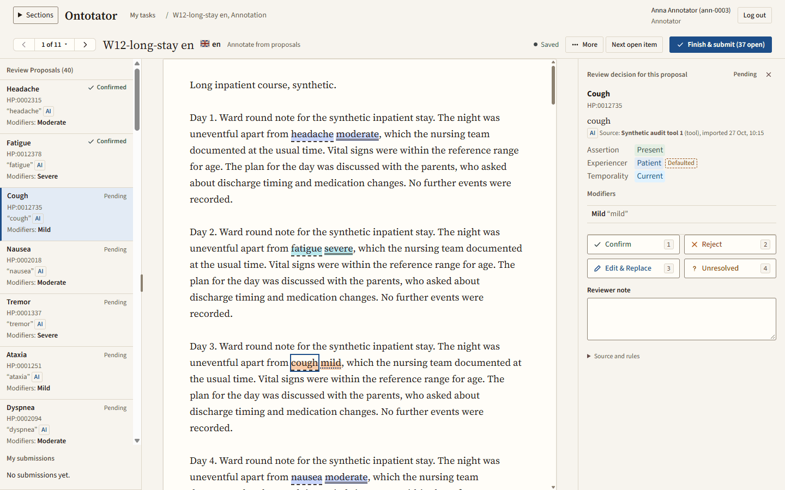
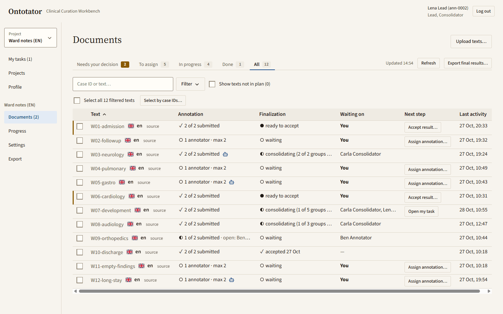

# Ontotator

Ontotator is a self-hosted web service for collaborative annotation of ontology terms, such as Human Phenotype Ontology (HPO) concepts, in texts.

[](https://github.com/halbritter-lab/ontotator/actions/workflows/ci.yml)
[](LICENSE)
[](pyproject.toml)



Several people mark text spans, link them to ontology concepts and review each other's work. Administrators load ontology releases and documents, set up projects and assign people to them. The server runs without internet access; operators supply the ontology releases.

Website with tutorial videos: <https://halbritter-lab.github.io/ontotator/> (source in [`site/`](site/)).

Ontotator is in early development. Interfaces, data formats and the database schema can still change. There are no tagged releases yet.

## How it works

`annotate → review → consolidate → export`

- **Annotate:** annotators mark findings in their assigned texts, either from scratch or by checking tool proposals, and submit their work independently.
- **Review:** the lead sees all submissions per text on the documents page and accepts a result directly when the submissions agree.
- **Consolidate:** when submissions differ, the lead starts a consolidation; a consolidator resolves the differences with the source of each finding visible.
- **Export:** the lead exports the final results and pseudonymised edit logs for later analysis.



## Roles

| Role | What they do |
| --- | --- |
| Admin | Manages users, ontology releases and projects; sees every project and its exports. |
| Lead | Imports documents, manages members and assignments, accepts results and exports a project. |
| Annotator | Annotates assigned texts, checks tool proposals and reviews translations. |
| Consolidator | Resolves differences between submissions in a consolidation round. |

Admin is a system-wide flag. The other roles are per project, and one person can hold several. The API stores the consolidator role as `adjudicator`; the CLI accepts both names.

## Features

- Span annotation with local, offline ontology search and optional Babelon translations of labels.
- Independent annotation by several people, with optional tool proposals to confirm, reject or edit.
- Consolidation with visible source provenance for every finding.
- Completion checks per annotation layer and detection of conflicting edits.
- Export of submissions and pseudonymised edit logs.
- Individual accounts with project roles, plus an administrator CLI for users, ontologies and projects.

## Quick start

The disposable development stack runs PostgreSQL, the schema migrations and the application in Docker. You need Docker with Compose v2.

The Docker build installs the `ontospan` Python dependency from GitHub. A GitHub token is optional. The development Compose file passes the file named by `GITHUB_TOKEN_FILE` as the `github_token` build secret; an empty file means an anonymous fetch.

```bash
export GITHUB_TOKEN_FILE=/absolute/path/to/github-token-or-empty-file
docker compose -f docker-compose.dev.yml up -d --build --wait
```

Open `http://127.0.0.1:8000` and sign in as `admin` with the password `development-only-password`.

All credentials in `docker-compose.dev.yml` and `docker/dev-passwords/` are public development fixtures. Never expose or deploy this stack. PostgreSQL listens on `127.0.0.1:55432`. Set `ONTOTATOR_DEV_PORT` and `ONTOTATOR_DEV_PG_PORT` before starting to use other loopback ports.

To add demo data, seed a fresh stack with synthetic users, an HPO fixture and a small project:

```bash
uv sync --dev --locked
uv run python scripts/seed_stack.py
```

It adds the accounts `smoke-admin` and `smoke-annotator`, both with the password `development-only-smoke-password`. The script fails on a database that is already seeded. Stop and remove the stack, including its volumes, with:

```bash
docker compose -f docker-compose.dev.yml down --volumes
```

## Run from source

Install Python 3.11 or later, [uv](https://docs.astral.sh/uv/) and Node.js 20 or later. `uv` installs `ontospan` from GitHub automatically.

```bash
uv sync --dev --locked
npm --prefix frontend ci
npm --prefix frontend run build
uv run ontotator --help
uv run ontotator serve --help
```

`ontotator serve` needs a migrated PostgreSQL database (`ontotator db upgrade`) and serves the web UI bundled in `src/ontotator/web` (as in the Docker image), falling back to a `frontend/dist` build in a source checkout; `--web-dir` overrides both.

## Documentation

- [User handbook](docs/handbook/README.md): how annotators, consolidators, leads and administrators work in the app.
- [Demo project](examples/demo-project/README.md): a fully synthetic project to set up in a real instance, step by step, with all files to upload.
- [Operations guide](docs/operations.md): installation, configuration, upgrades, backups and internet exposure.
- [Scientific workflow](docs/scientific-workflow.md): a small two-annotator pilot.
- [Translation review export](docs/translation-review-export.md): the export format of translation reviews.

## Configuration

The server reads `ONTOTATOR_*` environment variables. The main ones are:

| Variable | Purpose |
| --- | --- |
| `ONTOTATOR_ENV` | `development` or `production` |
| `ONTOTATOR_DATABASE_URL`, `ONTOTATOR_DATABASE_PASSWORD_FILE` | Application database connection |
| `ONTOTATOR_MIGRATION_DATABASE_URL`, `ONTOTATOR_MIGRATION_DATABASE_PASSWORD_FILE` | Schema owner connection for migrations |
| `ONTOTATOR_DATA_DIR` | Persistent directory for ontologies, translations, blobs and exports |
| `ONTOTATOR_PUBLIC_ORIGIN` | Exact public origin, for example `https://editor.example.org` |
| `ONTOTATOR_TRUSTED_PROXIES` | Address of the reverse proxy |
| `ONTOTATOR_ADMIN_PASSWORD_HASH_FILE` | Argon2id hash for the initial `admin` account |
| `ONTOTATOR_WORKERS` | Number of Uvicorn workers (1 to 6, default 2) |

Production settings start from [.env.docker.template](.env.docker.template). The [operations guide](docs/operations.md#configuration-and-secrets) explains every setting and how to create the secret files.

## Deployment

The repository ships a `Dockerfile` and a production Compose file, [docker-compose.yml](docker-compose.yml), for PostgreSQL, migrations and the application. The host, DNS, HTTPS certificates and the reverse proxy are up to you; the application publishes no host port. See the [operations guide](docs/operations.md) for building an image, first start, users and projects, upgrades, backups, reverse proxy settings and internet exposure.

Ontotator does not bundle ontology releases. Load OBO Graph JSON releases with the administrator CLI and follow the license and citation terms of each release, for example those of the [Human Phenotype Ontology](https://hpo.jax.org/license). The [scientific workflow](docs/scientific-workflow.md) describes a small two-annotator pilot.

## Security

Please report vulnerabilities privately through GitHub's private vulnerability reporting. Do not open a public issue. See [SECURITY.md](SECURITY.md).

## Development

Run the full local check from Git Bash, Linux or macOS. Docker must be running for the PostgreSQL and browser tests.

```bash
uv sync --dev --locked
npm --prefix frontend ci
npm --prefix frontend exec -- playwright install chromium
bash scripts/check.sh
```

The check covers Ruff linting and formatting, mypy, OpenAPI and TypeScript drift, wheel contents, backend tests, frontend unit tests and Playwright browser tests. `CHECK_CONTAINERS=1 bash scripts/check.sh` adds container checks and a browser smoke test on a disposable stack. See [local checks](docs/operations/local-checks.md) for single phases and worker settings.

Single tools:

```bash
uv run ruff check .
uv run ruff format --check .
uv run mypy src
uv run pytest
npm --prefix frontend run typecheck
npm --prefix frontend test
```

GitHub Actions runs the same full gate as `scripts/check.sh` on every push and pull request, split into parallel jobs.

## License

Ontotator is released under the [MIT License](LICENSE).

It includes adapted code from [hpo-span-annotator](https://github.com/JohannKaspar/hpo-span-annotator) (MIT) and icons from Lucide (ISC). Their license texts are in [LICENSES/](LICENSES/). [THIRD_PARTY_NOTICES.md](THIRD_PARTY_NOTICES.md) lists all bundled third-party code and runtime dependencies.
