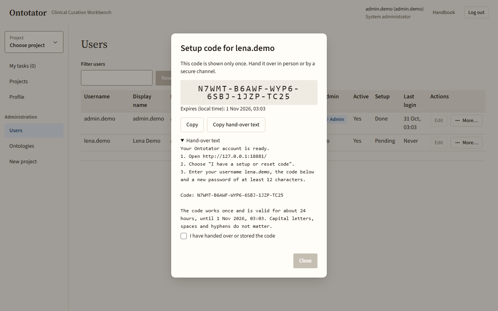
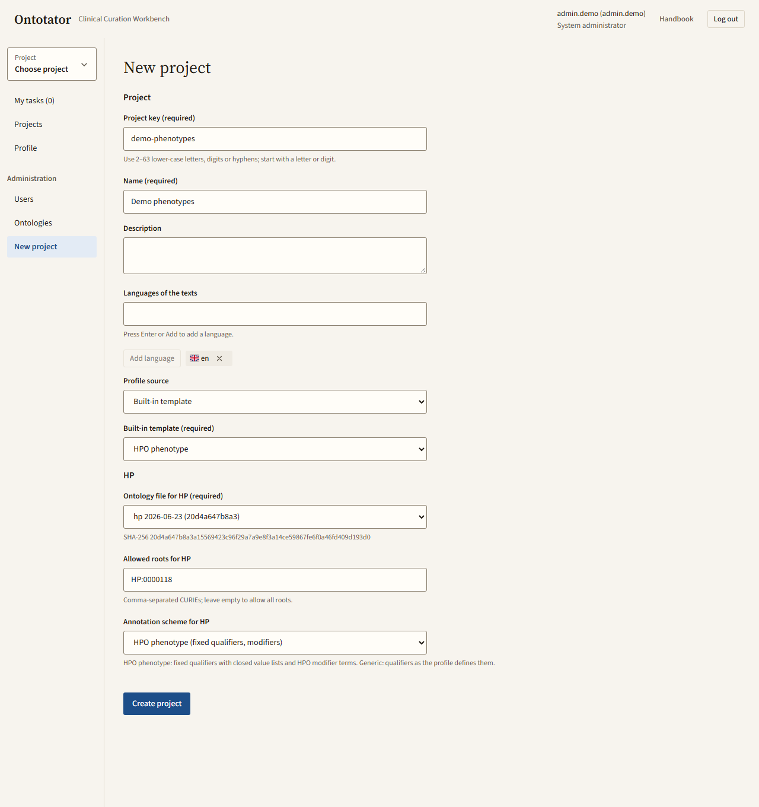

# Administration

This chapter is for system administrators. You manage user accounts, ontology releases and projects in the app. Back to the [handbook overview](README.md).

Server set-up, the command line, backups, upgrades and deployment are in the [server operations guide (for server operators)](../operations.md). A lost administrator password is also handled there: see [Lost admin password](../operations.md#lost-admin-password).

Ontotator sends no e-mail. New users and users who forgot their password get a one-time code from you, by hand.

## Set up a new project for a lead

The usual first day, in order:

1. [Upload the ontology release](#upload-ontology-releases-and-translation-files) the project needs.
2. [Create the project](#create-a-project).
3. [Create a user account](#create-a-user-account) for the lead, with the **Lead** role in the new project.
4. [Hand over the setup code](#hand-over-a-setup-or-reset-code) to the lead.

The lead then sets up the rest; see the [lead overview](lead.md).

Try it with the demo project: the [demo project guide](../../examples/demo-project/README.md) has an HPO release link, suggested users and all files to upload for a fully synthetic project.

## Reach the administration pages

What for: find the pages only system administrators see.

1. Log in. Your role line in the header reads **System administrator**.
2. In the sidebar, open the group **Administration**.
3. Click **Users**, **Ontologies** or **New project**.

Other users do not see this group. If they open such a page by its address, they get a short explanation instead.

## Find and review user accounts

What for: check who has an account, whether they finished setup and when they last logged in.

1. In the sidebar, open **Administration** › **Users**.
2. Type a username or display name into **Filter users**.
3. Read the table. **Setup** shows **Pending** until the person has set a password. **Last login** shows **Never** if they have not logged in yet. **Active** reads **Yes**, **No** or **Anonymised**. **Projects** shows how many projects the person belongs to; click it to see the projects and the person's roles in each.
4. Click a row to highlight it. Click it again to clear the highlight.
5. Click **Refresh users** to reload the list.

## Create a user account

What for: give a new person access to Ontotator.

1. On **Users**, click **New user…**.
2. Fill **Username** and **Display name**. **E-mail** and **Languages** are optional.
3. Tick **System administrator** only if the person should manage the whole server.
4. Optional: under **Add to projects (optional)**, tick a role per project: **Lead**, **Annotator** or **Consolidator**. With many projects, type into **Find project** to narrow the list.
5. Click **Create user**.
6. The setup-code dialog opens. [Hand over the code](#hand-over-a-setup-or-reset-code).

The username uses 3–64 lower-case letters, digits, dots, hyphens or underscores. If it is taken or invalid, the message appears at the field.

## Hand over a setup or reset code

What for: let a person set their own password. Codes are shown only once.

1. A dialog opens with the title **Setup code** or **Reset code** and the username. It shows the code and when it expires.
2. Click **Copy hand-over text**. This copies short instructions with the login address, the username and the code. Open **Hand-over text** to read it first. **Copy** copies only the code.
3. Give the text to the person in person or by a secure channel.
4. Tick **I have handed over or stored the code**.
5. Click **Close**.

You cannot close the dialog or leave the page until the box is ticked. Setup codes last 24 hours, reset codes 2 hours. The person then uses **I have a setup or reset code** on the login page, see [Getting started](getting-started.md#set-your-password-with-a-setup-or-reset-code).

## Issue a new setup or reset code

What for: a code expired, got lost, or someone forgot their password.

1. On **Users**, click **More…** in the person's row.
2. Choose **New setup code** (setup still pending) or **Reset code** (password already set).
3. Confirm with **New setup code** or **Reset code**. Any earlier unused code stops working. With a reset code, the current password keeps working until the new code is used.
4. [Hand over the code](#hand-over-a-setup-or-reset-code).

Deactivated accounts get no new code. Activate the account first.

## Edit a user's profile and administrator role

What for: correct a name, e-mail, qualification or languages, or grant or remove the administrator role.

1. On **Users**, click **Edit** in the row.
2. Change **Display name**, **E-mail**, **Qualification**, **Languages** or **System administrator**.
3. Click **Save changes**.
4. If you changed the administrator role, confirm with **Save changes** again. The person is logged out everywhere.

You cannot remove your own administrator role. The last active system administrator cannot lose the role either; add another one first.

## Deactivate or activate an account

What for: stop someone from logging in, without deleting their work.

1. On **Users**, click **More…** in the row.
2. Choose **Deactivate…**.
3. Confirm with **Deactivate**. The person is logged out everywhere.
4. To undo, open **More…** again and choose **Activate**.

You cannot deactivate your own account. In project member lists the person shows as **Inactive**.

## See a user's history

What for: check what was changed on an account and by whom.

1. On **Users**, click **More…** in the row and choose **History**. For anonymised accounts, click the **History** button in the row.
2. Read the table: **When**, **By**, **What**, **Whom**, **Project**, **Details**.
3. The dialog shows the newest 200 entries. For the whole trail, use the command `ontotator admin audit`, see [Server operations](../operations.md#users-ontologies-and-projects).

## Anonymise a deactivated account

What for: erase a person's personal data for good, while keeping their work.

Warning: anonymising cannot be undone.

Before you start: [deactivate the account](#deactivate-or-activate-an-account).

1. On **Users**, click **More…** in the row and choose **Anonymise…**.
2. Read what is erased. The pseudonym and all work stay, so results and exports remain complete.
3. Type the username into the confirmation field.
4. Click **Anonymise permanently**.

## Upload ontology releases and translation files

What for: make a new ontology release (for example a newer HPO) or a translation file available to projects.

1. In the sidebar, open **Administration** › **Ontologies**.
2. In **Ontology files**, choose one or more files: OBO Graph JSON ontologies (`.json`) or Babelon translation files (`.tsv`).
3. Click **Upload files**.
4. Read **Upload results**: **Added** or **Already present** per file.

Each file is stored on its own. If one file fails, earlier files may already be in the list below. Incomplete HPO releases are refused: a missing or obsolete main branch, or too many terms that do not reach the root. The message names the problem; upload a complete release instead.

## Check the ontology inventory and which projects use a file

What for: see which releases are on the server and which projects use them.

1. On **Ontologies**, look at **Uploaded files**.
2. The table lists file name, kind, release, language, checksum and upload time.
3. **Pinned by** lists the projects that use (*pin*) a file. Click a project key to open its settings on the **Ontology** tab. Unused files read **Not pinned**.
4. Click **Copy** next to a checksum to copy it.
5. Click **Refresh inventory** to reload the list.

To move a project to a newer release, upload it here, then follow [Move a started project to a newer release](lead-settings.md#move-a-started-project-to-a-newer-release).

## Create a project

What for: start a new project with its ontology and annotation scheme. Only system administrators can do this.

Before you start: [upload the ontology release](#upload-ontology-releases-and-translation-files) the project needs.

1. In the sidebar, open **Administration** › **New project**.
2. Fill **Project key** (2–63 lower-case letters, digits or hyphens) and **Name**. **Description** and **Languages of the texts** are optional.
3. Under **Profile source**, keep **Built-in template** and choose a template. Or choose **Upload profile JSON** and pick a task profile file.
4. For each ontology, choose the release in its ontology file field. Optionally limit the allowed branches and choose the annotation scheme. For HPO, both are filled in for you.
5. Click **Create project**.
6. The project's settings open on **People**. [Add the lead](lead-settings.md#add-a-member) and the other members.

The project key cannot be changed later. Everything else, such as name, workflow and members, is set in the [project settings](lead-settings.md).

## Open and manage any project

What for: as system administrator you can manage every project, also without a project role.

1. Click **Projects** in the sidebar, or **All projects** in the project switcher.
2. In the project's row, click **Open** to go to its documents, or **Settings** to change it.
3. Work as a lead would; see the [lead overview](lead.md).
