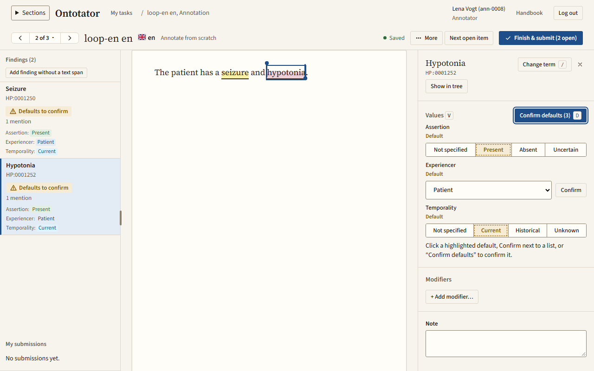
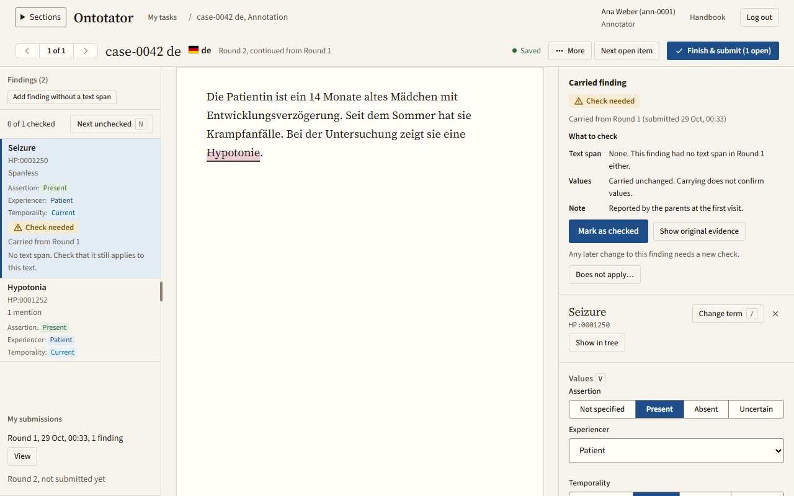
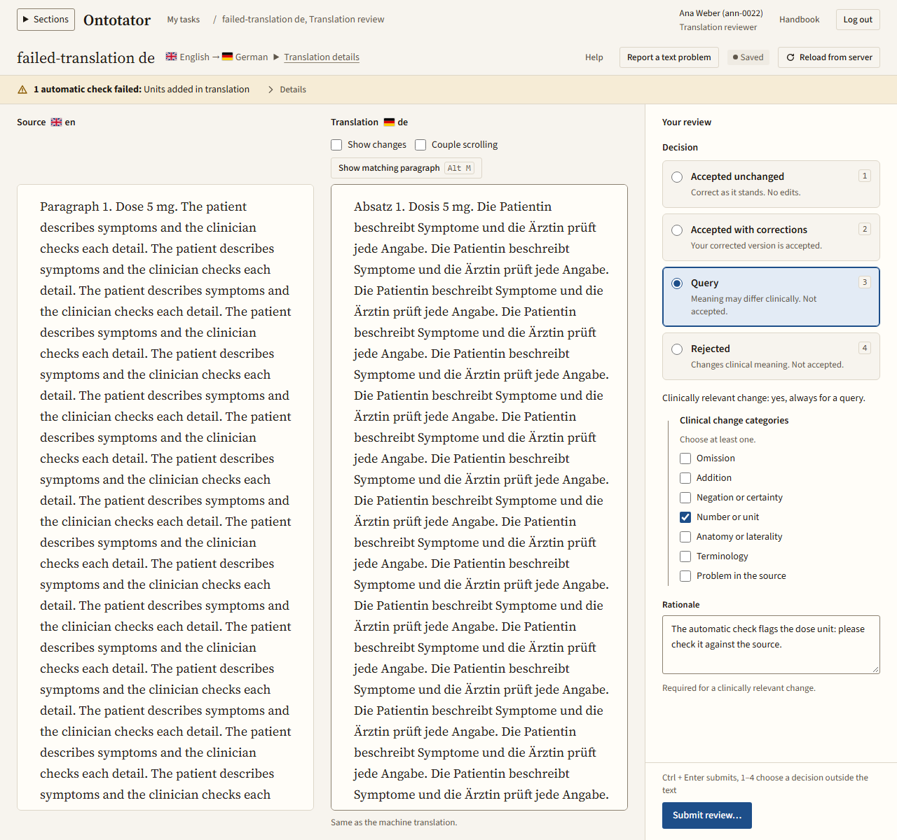

# Annotator reference

This chapter is for annotators and translation reviewers. It explains the editor, how to mark findings, check tool proposals and carried findings, submit a text and review a translation. Back to the [handbook overview](README.md).

New here? Start with [Your first task, start to finish](first-task.md). How to log in, find your tasks and open one is in [Getting started](getting-started.md). Words such as finding, mention, value field and modifier are explained in the [glossary](README.md#glossary).

## Contents

- Basics: [The editor screen](#the-editor-screen), [When is a task done?](#when-is-a-task-done)
- Findings: [Mark text and add a finding](#mark-text-and-add-a-finding), [Search a term](#search-a-term), [Browse the ontology tree](#browse-the-ontology-tree), [Set values and confirm defaults](#set-values-and-confirm-defaults), [Manage mentions](#manage-mentions-of-a-finding), [Add a finding without a text span](#add-a-finding-without-a-text-span), [Change term, note or delete a finding](#change-term-note-or-delete-a-finding), [Add modifiers](#add-modifiers-to-a-finding), [Turn a finding into a modifier](#turn-a-standalone-modifier-finding-into-a-modifier), [Work in several layers](#work-in-several-layers)
- Special tasks: [Review tool proposals](#review-tool-proposals), [Review carried findings](#review-carried-findings), [Re-create findings after a text correction](#re-create-findings-after-a-text-correction)
- Finishing: [Submit the text](#submit-the-text), [Confirm values and acknowledge warnings](#confirm-values-and-acknowledge-warnings-in-the-submit-dialog), [View your submissions](#view-your-submissions), [Start a new work round](#start-a-new-work-round)
- Problems: [Report a text problem](#report-a-text-problem), [Resume a paused task or withdraw a report](#resume-a-paused-task-or-withdraw-a-report)
- [Review a translation](#review-a-translation)
- [Keyboard shortcuts](#keyboard-shortcuts)

## The editor screen

The editor has three columns:

| Column | What is in it |
| --- | --- |
| Left: **Findings** | The list of your findings. In a task from proposals: **Review Proposals** and **Your own findings**. |
| Middle: the text | The text you annotate. Marked passages are highlighted. |
| Right: details | The selected finding: **Values**, **Modifiers**, **Note**, its mentions and the term search. With nothing selected, the **New finding** panel opens here when you mark text. |

To make the findings list wider or narrower, drag the divider between the findings list and the text (**Resize findings column**), or focus it and press `←` or `→`. On a narrow screen, the tabs **Findings**, **Document** and **Details** switch between the columns; **Back to text** returns to the text.

The toolbar shows the text name, its language and the mode:

| Mode | Meaning |
| --- | --- |
| **Annotate from scratch** | You see neither tool proposals nor other people's work. |
| **Annotate from proposals** | You see a tool's proposals, never other people's work. See [Review tool proposals](#review-tool-proposals). |
| **Review carried findings**, or the round name such as *Round 2, continued from Round 1* | Findings were carried over from earlier work. See [Review carried findings](#review-carried-findings). |
| **Check after text change** | The text was corrected. See [Re-create findings after a text correction](#re-create-findings-after-a-text-correction). |

Next to the mode, the save status tells you whether your work is stored: **Saved**, **Saving...** or **Unsaved changes**. Work is saved automatically; there is no save button. If it reads **Offline** or shows an error, click **Retry**.

The **More** menu holds **Work rounds**, **Report a text problem…**, the guidelines (for example *Guidelines v2*) and **Keyboard shortcuts (?)**.

If the text was changed elsewhere, a **Revision conflict** notice appears; click **Reload case**. A submitted task is read-only.

### Marks and badges

| You see | Meaning |
| --- | --- |
| Fill colour of a mark | The term. The same term always has the same colour; the colour says nothing about the state. |
| Solid underline | Your own finding. |
| Dashed underline | A tool proposal under review. |
| Dotted underline | A read-only reference finding. |
| Diagonal hatching | A finding with the value **Absent**. |
| Thicker underline | Overlapping findings. |
| Frame | The finding you point at or selected. |
| **AI** | Proposed by a tool. Point at the badge to see which tool. |
| **Pending** | A proposal you have not decided yet. Decided proposals show **Confirmed**, **Rejected**, **Replaced** or **Unresolved**. |
| **Defaults to confirm** | The finding still has prefilled values you have not confirmed. |
| **Check needed** | A carried finding you have not checked yet. |
| **Spanless** | A finding without a text passage. |

## When is a task done?

A task is done when you submit it. Before that:

- every finding the text states is marked, following the project guidelines;
- every value is chosen or confirmed (no **Default** left that you did not check);
- in a task from proposals, every proposal is decided;
- in a carried round, every carried finding is checked;
- you have read the whole text once more for findings you missed.

**Next open item** takes you to everything that still needs you. After you submit, the lead receives your work; see [What happens next](first-task.md#9-what-happens-next).

## Mark text and add a finding

What for: record a term that the text mentions.

1. Select the words in the text with the mouse. With the keyboard: click before the first word (or press Tab until the text has focus), hold Shift and move with the arrow keys.
2. The panel **New finding** shows the marked text. To adjust it, drag the edge handles at its start and end, or focus a handle and press `←` or `→`.
3. **Search term** is already filled with the marked words, and the hits are listed under **Terms**. Change the words, or type a code such as `HP:0001250`, if the right term is not among them.
4. Press Enter to add the top hit, or click a hit.
5. The finding is created with the project's prefilled values. [Confirm or change them](#set-values-and-confirm-defaults).

To drop a mark without adding a finding, click **Discard** or press Esc.

## Search a term

What for: find the right ontology term quickly.

1. Press `/` or click **Change term** to focus the search.
2. Type a name or a code. Hits appear in the list **Terms**.
3. Move with `↓` and `↑`; press Enter to take the active hit, or Esc to cancel.

Search options:

- To search only modifier terms (severity, onset, …), switch on **Modifiers only**, or type `mod:` before the word.
- The language of the text is searched too. To search names in other languages, click the language button next to the field (it lists the languages searched, for example *EN, DE*) and tick them under **Search languages**. English names are always searched.
- Hits tagged **Modifier** are modifier terms. Use one as a finding only if it names the finding itself; otherwise add it under **Modifiers**. Obsolete terms cannot be chosen.

The search compares the words you type with term names and synonyms, letter by letter; it does not understand what they mean. Terms whose name or synonym equals your words come first. Similar terms follow in a shuffled order, so the best one is not always on top. Read the hits before you choose one. If nothing matches, try another word or a synonym, type a code or switch search languages.

## Browse the ontology tree

What for: pick a broader or narrower term than the one you have.

1. Select a finding and click **Show in tree**. The **Ontology tree** opens at the current term.
2. Click a term in the tree. Its **Synonyms**, **Translated names** and other parents (**Also under**) are shown.
3. Click **Use this term** to give the selected finding this term.
4. Click **Close tree**.

## Set values and confirm defaults

What for: record the context of a finding: whether it is present, who has it and when.

1. Select the finding. The section **Values** lists each value field, such as the assertion (**Present**, **Absent**, **Uncertain**) or the experiencer (**Patient**, **Family member**, …). Press `v` to jump there with the keyboard.
2. Read the passage in context. "No seizures" is **Absent**; "his mother has seizures" is not the patient.
3. To change a value, choose another one. Value fields with few values are buttons; others are a dropdown.
4. Values the project prefills are tagged **Default**. They count as not confirmed until you confirm or change them. If all shown values are right, click **Confirm defaults** or press `d`. This confirms every default of this finding. On a button field you can also confirm one default by clicking its highlighted button.

Findings with open defaults show **Defaults to confirm** in the list.

## Manage mentions of a finding

What for: link a finding to every place in the text that supports it.

1. Select the finding.
2. Use the action you need:
   - **Add mention**, then mark the text: adds another place. Esc cancels.
   - **Add segment** on a mention, then mark the text: adds a second piece to the same mention, for words that are apart.
   - Drag a mention's edge handles, or focus an edge and press `←` or `→` (`Ctrl+←` / `Ctrl+→` moves by word): resizes it.
   - **Move to a new finding**: gives one mention its own finding with the same term and values. The original finding stays selected; the new one is added to the list. Select it there to change it.
   - **Remove**, then **Yes, remove**: detaches the mention.

You cannot remove the last mention when the project requires a text span. If the project allows findings without a span, enter a reason in the note first.

## Add a finding without a text span

What for: record a finding that the text implies but does not state in one passage.

Before you start: the project must allow findings without a text span. Otherwise the button is inactive.

1. In the **Findings** header, click **Add finding without a text span**.
2. In the panel **New finding without a text span**, fill in **Reason for no text span** (if the project requires a reason).
3. Search and choose the term. If you chose the term first, click **Add annotation**.
4. The finding is listed as **Spanless**.

Click **Cancel** to stop. The reason is kept as the finding's note.

## Change term, note or delete a finding

What for: correct a finding you made.

1. Select the finding.
2. Use the action you need:
   - **Change term**, then search a new one: changes the term and keeps the mentions.
   - **Note**: type a comment. It is saved with the finding and the lead can read it.
   - **Delete finding**, then **Yes, delete**: deletes the finding and all its mentions.

Warning: deleting a finding cannot be undone. Check that the right finding is selected first.

If a term has become obsolete, the panel says so. Change the term or delete the finding.

## Add modifiers to a finding

What for: add severity, onset, pattern and similar details to a finding.

1. Select the finding. In **Modifiers**, click **+ Add modifier…**, type into **Search modifier** and choose the modifier.
2. Optional: to link the modifier to the words that state it, click **Link a text span** and mark the text.

You can also start from the text:

1. Mark the words, for example "severe", and pick a modifier hit.
2. The panel asks which finding it belongs to. Click the finding in the list or in the text. The nearest ones are listed under **Nearest in this sentence:**.
3. If the modifier names the finding itself, choose the option to use it as the finding instead.

To change a modifier later, open its row menu: **Link a text span…**, **Remove text span** or **Remove modifier**. A removal can be undone with **Undo** or `Ctrl+Z`.

## Turn a standalone modifier finding into a modifier

What for: fix a finding that is really a modifier of another finding.

1. Select the finding. A warning says it is a modifier term.
2. Click **Turn into modifier…**.
3. Click the finding it belongs to. The list marks candidates with **Becomes a modifier of the finding you choose**.

## Work in several layers

What for: work in projects with more than one layer (for example two ontologies). With one layer this panel is not shown.

1. Open **Layers & Ontologies** in the findings list.
2. Use the visibility toggle next to a layer to show or hide it. Layers tagged **Reference** are read-only.
3. Click **Activate** on the layer you want to annotate. **Locked** layers cannot be edited.
4. Choose the **Annotation type** for new findings.

## Review tool proposals

What for: check a tool's proposals one by one and add what the tool missed. Your mode reads **Annotate from proposals**.

Tools make mistakes. Check every proposal as if you had marked it yourself: the marked text, the term and every value. Negations are a common error: a proposal for "Keine Krampfanfälle" (no seizures) with **Present** is wrong.

1. The list **Review Proposals** shows every proposal. Your additions are under **Your own findings**.
2. Select a proposal, or move with `j` and `k`. The text shows where it was found.
3. Check the marked text, the term and each value.
4. Decide:
   - **Confirm**: the passage, term and all values are right. Values tagged **Defaulted** were not set by the tool but prefilled; Confirm accepts them as shown, so check them too.
   - **Reject**: the proposal is wrong and nothing should replace it.
   - **Edit & Replace**: the proposal is nearly right. You get an editable copy that replaces it; correct the term, values or text span in the copy.
   - **Unresolved**: only if you really cannot decide; the other three decisions are the normal case. Write a **Reviewer note** saying why, then click **Save decision**. The proposal is submitted with your note and a reviewer flag. It does not block submitting; the lead (and a consolidator, if there is one) decides it.
5. After each decision, the next open proposal is selected. Press `k` right after a decision to go back to it.
6. When all proposals are decided, read the whole text again and add findings the tool missed: mark text that has no proposal, choose the term in **New finding** and set the values, as in [Mark text and add a finding](#mark-text-and-add-a-finding). Your additions appear under **Your own findings**, next to the proposals.

To undo a decision, click **Reset decision (open)** or press `0`.

**Unresolved** is a flag for the lead, not clinical uncertainty. For clinical uncertainty ("possible seizures"), use the value **Uncertain**.

## Review carried findings

What for: check findings that were carried over from an earlier round, for example after you continued from your submission, a lead reopened your work, or the text changed.

1. The toolbar names the round, for example *Round 2, continued from Round 1*, or reads **Review carried findings**. The progress line counts checked findings.
2. Click **Next unchecked** (or press `n`) to select the next finding marked **Check needed**.
3. Read **What to check**: the text span, the values or the note. For a finding without a text span, the note is its **Reason for no text span**; it stays with the finding. Carried values are not confirmed.
4. Optional: to see the finding as it was, click **Show original evidence**.
5. If it is right (after any edits), click **Mark as checked** or press `c`.
6. If it does not apply to this text, open **Does not apply…**, give a reason and click **Dismiss**.

If you change a finding after checking it, it needs a new check.

A row **Not on this text** means the finding could not be placed in this text. Select it and choose one: **Mark in text**, **Link to an existing finding**, or **Dismiss with reason…**. A finding re-created with **Mark in text** keeps the original's term, values and note.

## Re-create findings after a text correction

What for: move your findings to the corrected text after a lead changed it. The toolbar reads **Check after text change**.

1. The panel **Needs review after the text change** lists the findings to place again.
2. For each item, click **Re-create here** and mark the supporting text in the corrected version.
3. Check the term, then click **Save re-created finding**. You can choose a different term below.
4. Check the text span and the values of the saved finding, then click **Complete text-change review**. A later change to the finding needs this again.

If the finding no longer fits, click **Dismiss with reason**, fill in **Reason for dismissal** and click **Save dismissal**.

## Submit the text

What for: hand your finished work to the lead.

Before you start: submitting says you checked the whole text for further findings, not only the ones you marked. See [When is a task done?](#when-is-a-task-done).

1. Click **Next open item** to jump to things that still need attention.
2. Click **Finish & submit text**. While items are open, the button shows how many.
3. A dialog named after the text, for example *Submit CASE-1 en?*, lists what is still open: **Carried findings to check**, **Findings that need attention**, **Findings after text correction**, **Proposals not decided**. Click **Go to** to fix an item.
4. When nothing blocks, click **Submit text**. If only warnings are left, the button reads **Submit with** and the number of warnings; see [Confirm values and acknowledge warnings](#confirm-values-and-acknowledge-warnings-in-the-submit-dialog) first.
5. The next open task opens, or **My tasks** if none is left. To see what you sent, click **View result** in the message.

The task is now read-only. To change it later, [start a new work round](#start-a-new-work-round).

## Confirm values and acknowledge warnings in the submit dialog

What for: finish prefilled values and modifier warnings without leaving the dialog.

Check each value before you confirm it. **Confirm as shown** says "I checked this value and it is right"; it is not a way to make the warning go away. A value you leave unconfirmed is submitted as shown, but recorded as *defaulted*, not chosen. The lead and the export see this difference.

1. The group **Values not chosen yet** lists findings with prefilled values.
2. Click **Go to** to check a finding in the text and change a value. If the shown values are right, click **Confirm as shown** on the row, or, with more than one row, **Confirm all as shown**.
3. The group **Modifier warnings** lists, for example, a modifier used as a finding or two severities on one finding. Click **Go to** to fix one.
4. Click the submit button. Warnings you leave are submitted as they are.

If the project requires chosen values, unconfirmed values block submitting instead of warning.

## View your submissions

What for: look at what you submitted earlier.

1. Open the task. On a narrow screen, switch to **Details**.
2. Under **My submissions**, click **View** next to a round.
3. The dialog **Historical submission** shows the findings, values, notes and decisions of that submission.
4. Click **Close**.

## Start a new work round

What for: change your work after you submitted it, or start over. A submission itself never changes; a new round replaces it once you submit the round.

1. Open the task, then open **More** and choose **Work rounds**.
2. The table **Rounds** lists each round with its state and submission. **You are here** marks the current one; **Open** opens another.
3. Under **Start a new round**, choose one:
   - To continue from your work: choose the submission under **Continue from** and click **Continue from this submission**. Your findings are carried into the new round, and each must be checked again ([Review carried findings](#review-carried-findings)).
   - To start over: click **Start empty round**. The new round has no findings.
4. Click **Close**, make your changes and [submit the text](#submit-the-text) again.

What happens to your earlier work:

- The earlier round stays in the history and is marked *Replaced by Round 2* (or the next number). Starting a round does not change the final result.
- Your task shows **Open** in **My tasks** again, with **Continue**. It no longer counts as submitted, so you must submit the new round.
- If the lead had already accepted your earlier submission as the final result, the lead is asked to review that choice.

## Report a text problem

What for: tell the lead that the text cannot be annotated as it is, for example cut off or the wrong text. For questions about the rules, ask your lead directly instead.

Before you start: a report pauses your task. You cannot save or submit until the pause is released. Your saved work stays.

1. Open **More** and choose **Report a text problem…**. In a translation review or consolidation, use the button **Report a text problem** in the header.
2. Describe the problem under **What is the problem?**. Only you and project leads can read it.
3. Click **Report and pause my task**.

The menu item reads **Text problems** when there is something to see, for example your earlier reports. The dialog lists **Your reports** and offers **New report**.

## Resume a paused task or withdraw a report

What for: continue work after a report, or take a report back.

1. Open **More**, then **Text problems**. Your report card shows its state and your task's state.
2. Choose one:
   - To continue: click **Resume my task…**, fill in **Why can you continue?** and click **Resume my task**. The report stays open for the lead.
   - To take the report back: click **Withdraw report…**, fill in **Why are you withdrawing it?** and click **Withdraw report**. Your task is no longer paused by this report.

When the lead answers, the task shows a banner with **Open the answer**, and **My tasks** shows **Answer to your report**. If a project lead paused the task, only a project lead can release the pause.

## Review a translation

What for: check a machine or human translation before it is annotated. Your task is *Translation review*.

Before you start: your profile must contain your **Qualification** ([Edit your profile](getting-started.md#edit-your-profile)). A submitted review cannot be changed.

What to check: compare each paragraph with the source. Look for the problems the app lets you record:

| Category | Look for |
| --- | --- |
| **Omission** | Something in the source is missing in the translation. |
| **Addition** | The translation says something the source does not. |
| **Negation or certainty** | "no", "possible", "suspected" lost or changed. |
| **Number or unit** | Numbers, doses, units, dates. |
| **Anatomy or laterality** | Body parts, left and right. |
| **Terminology** | A clinical term translated wrongly or too loosely. |
| **Problem in the source** | The source itself is wrong or unreadable. |

Then decide:

| Decision | Use it when | What happens next |
| --- | --- | --- |
| **Accepted unchanged** | The translation is right as it stands. | It becomes available for annotation. |
| **Accepted with corrections** | You corrected it and it is now right. Editing chooses this for you. | Your corrected text is saved as a new text version, which is accepted for annotation. |
| **Query** | The meaning may differ clinically and you are not sure. | Not accepted. The lead reads your rationale and decides. |
| **Rejected** | The translation changes the clinical meaning. | Not accepted. The lead decides: a new review, a correction or discarding it. |

Steps:

1. Open the task. The **Source** is on the left, the **Translation** on the right.
2. Read the automatic checks band at the top. Click **Details** to see which checks failed and why.
3. Type your corrections directly in the translation column. Your edits are saved as you type, and the decision switches to **Accepted with corrections**. Use **Show changes** to see your edits and **Couple scrolling** to scroll both columns together. **Show matching paragraph** (`Alt+M`) jumps to the paired paragraph.
4. Optional: to compare with another text, click the button that starts with **Compare with**, for example *Compare with … de*. With several texts to compare, it opens a menu **Compare with…**.
5. Under **Your review**, choose a **Decision** (or press `1` to `4`).
6. Fill in what the decision needs:
   - **Query** and **Rejected** always count as a clinically relevant change: choose at least one category and write a **Rationale**. Put your question for the lead in the rationale.
   - **Accepted with corrections**: tick **Clinically relevant change** if your correction changes the clinical meaning; then a category and a **Rationale** are required.
   - **Accepted unchanged** after a failed automatic check: say in the **Rationale** why the flagged difference is correct.
7. Click **Submit review…** (or press `Ctrl+Enter`), read what will happen, then click **Submit review**.
8. A message confirms the review, with **View result**. Your next open task opens on its own, or **My tasks** if none is left.

If the source text was updated, **Source updates to review** appears. Open it, compare **Original source** and **Updated source**, and click **Submit review and resolve source update**.

## Keyboard shortcuts

What for: work without the mouse. Shortcuts are off while you type in a field or when a dialog is open. Letter keys work in lower and upper case alike. **Keyboard shortcuts (?)** in **More**, or `?`, lists the shortcuts of the current screen. Many buttons also show their key next to the label.

| Key | Action |
|---|---|
| `/` | Focus the term search |
| `↓` / `↑`, Enter | Move through term hits; add the active hit |
| `v` | Focus the values |
| `d` | Confirm all default values of the selected finding |
| Esc | Discard the marked text, clear the selection, cancel adding a mention |
| Shift+arrow keys | Select text with the keyboard (after clicking into the text) |
| `←` / `→`, `Ctrl+←` / `Ctrl+→` | Move the focused mention edge |
| `j` / `k` | Next open / previous proposal. Right after a decision, `k` goes back to that proposal. |
| `1` `2` `3` `4` | Confirm, Reject, Edit & Replace, Unresolved |
| `0` | Reset the decision to open |
| `n` / `Shift+N` | Next / previous unchecked carried finding |
| `c` | Mark carried finding as checked |
| `Ctrl+Z` (macOS: `Cmd+Z`) | Undo removing a modifier |
| `Alt+←` / `Alt+→` | Previous / next text |
| `Alt+P` | Switch project |

In a translation review: `1` to `4` choose a decision (outside the text), `Ctrl+Enter` submits (with a confirmation), `Alt+M` shows the matching paragraph.
