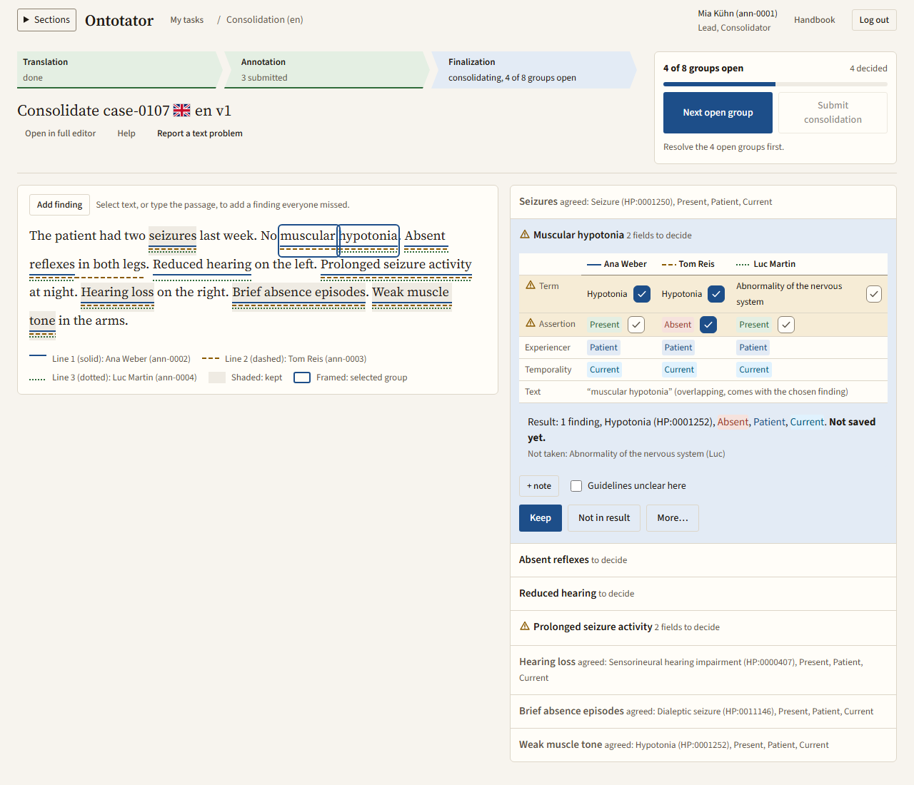
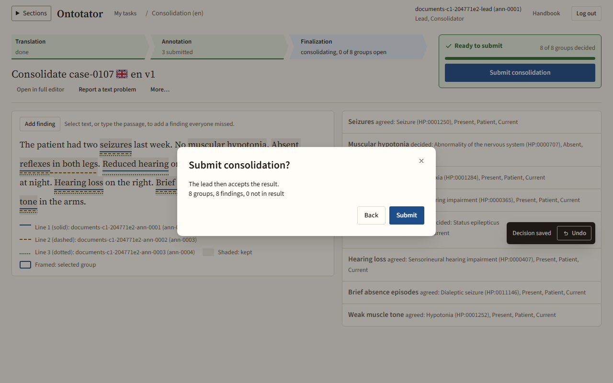

# Consolidator

This chapter is for consolidators. A consolidation merges two or more submissions on one text into one result: findings that everyone agrees on are taken over, and you decide the rest. Back to the [handbook overview](README.md).

How to open tasks is in [Getting started](getting-started.md). How a lead starts a consolidation and accepts the result is in [Lead: results, decisions and export](lead-results.md#start-a-consolidation). Reporting a text problem works as in the [annotator reference](annotator.md#report-a-text-problem).

## Typical consolidation, start to finish

1. Open **My tasks** and click **Start** in the row whose task is **Consolidation** ([Open a consolidation task](#open-a-consolidation-task)).
2. Open the project guidelines (the guidelines button in the header) and keep them at hand ([How to decide](#how-to-decide)).
3. Read the whole text once. The underlines show who marked what.
4. Click **Next open group**. For each open group, read the passage in context, choose the right value in each highlighted row with ✓ and click **Keep** ([Decide a group in the ✓ table](#decide-a-group-in-the--table)). Drop findings the text does not support with **Not in result**.
5. If the guidelines did not settle a group, write a **Note for the lead** and tick **Guidelines unclear here**.
6. Add any finding everyone missed ([Add a finding everyone missed](#add-a-finding-everyone-missed)).
7. When the progress card reads **Ready to submit**, click **Submit consolidation** and confirm ([Finish a consolidation](#finish-a-consolidation)).
8. The lead reads your result, your notes and flags, and accepts it as the final result.

## How to decide

Decide each group by the text and the project guidelines, as if you were annotating it yourself.

- Not by majority. Two people can make the same mistake. If two of three said **Present** for "No muscular hypotonia", the right value is still **Absent**.
- Not by seniority. Whose finding it was does not matter.
- Read the passage in context. Check negation ("no", "without"), who has the finding (patient or family member), and when (now or in the past).
- Prefer the term the text supports. Usually that is the most specific term the text states; follow the guidelines if they say otherwise.
- If none of the versions is right, use **More…** › **Other term…** or **Edit values…** ([Edit values or pick another term](#edit-values-or-pick-another-term)).
- If the guidelines do not settle it, decide as well as you can, write a **Note for the lead** and tick **Guidelines unclear here**. The lead sees both and can improve the guidelines.

Open the guidelines with the guidelines button in the header, for example *Guidelines v2* ([Read the project guidelines](getting-started.md#read-the-project-guidelines)).

## Groups and their states

Ontotator puts the findings that different people marked on overlapping passages into one *group*. You decide a group as a whole.

| State | Meaning |
| --- | --- |
| **agreed** | Everyone who marked it chose the same term and values. It is already in the result and counts as decided. Open it and click **Reopen** if it is wrong. |
| **to decide**, or *2 fields to decide* | Still open. The number counts the highlighted rows that need your choice. |
| **Conflict** mark | People chose different terms or values. |
| **to decide** without **Conflict** | Only the passage differs, or not everyone marked the finding. |
| **decided** | You decided it. |
| **not in result** | You left it out. |
| **attached** | A modifier term you attached to another finding. |

A new consolidation already shows agreed groups as decided, for example *4 of 8 groups open · 4 decided*.

## Open a consolidation task

What for: start or continue your consolidation work.

1. In **My tasks**, find the row whose task is **Consolidation**.
2. Click **Start**, **Continue** or **View**.
3. The consolidation screen opens. Its heading reads, for example, *Consolidate CASE-1 en v1*. The path above it shows how many groups are still open.

If the lead gave a reason when starting the consolidation, it shows above the groups, for example *Reason from the lead: Term and assertion differ*, and under the task in **My tasks**.

The header holds **Open in full editor**, **Report a text problem** and, if the project has guidelines, a button such as *Guidelines v2*. **More…** appears once you decided a group.

The screen is read-only after you submitted, when the task is no longer yours, when it is paused, or when a submission used here was withdrawn. A banner tells you which.

## Read the text and walk the groups

What for: see who marked what and work through the differences in order.

1. The **Clinical text** shows one underline per person. The legend below says which line style belongs to whom. Kept findings are shaded; the selected group is framed.
2. Beside it, the list **Groups** holds the groups in text order, each with its passage and [its state](#groups-and-their-states).
3. One group is open at a time. Click a group, or a marked passage in the text, to open it.
4. Press `j` for the next open group and `k` for the previous one, or click **Next open group** on the progress card.

On a smaller screen, use **Hide text** and **Show text** to make room. On a phone-sized screen, each group shows its own text snippet instead.

## Decide a group in the ✓ table

What for: decide a group by choosing, per row, the value that is right.

1. Open a group. The table has one column per person. A robot icon marks findings from a tool proposal.
2. The rows are **Term**, one row per value field (for example the assertion), **Text**, **Modifiers** (only if someone used modifiers) and **Note**. Rows where people disagree come first and are highlighted; *(all agree)* marks rows that need no choice. You can mix: take the term from one person and a value from another.
3. In each highlighted row, click the ✓ next to the value you want. Its button is named after the value, for example *Take Hypotonia … for Term*.
4. Read the result line below the table. It starts with "Result:" and lists what is still not chosen, for example *Term not chosen yet* or *text not chosen yet*. Once the term is chosen, **Not taken:** lists other people's terms that are not in the result.
5. Optional: click **+ note** to write a **Note for the lead**, and tick **Guidelines unclear here** if the guidelines did not settle the case.
6. Click **Keep**. The group reads **decided**, the message **Decision saved** appears with **Undo**, and the next open group opens. A note shows under the closed group in the list, so you and the lead see it without opening the group.

**Keep** stays inactive until every highlighted row has a choice. Value colours only help you scan; they carry no meaning beyond the value.

Special cases:

- Not everyone marked it. The card names who did, for example *Ana Weber, Luc Martin marked this. Tom Reis has nothing here.* The button reads **Keep the finding**, or *Keep Luc Martin's finding* for one person. Keep it only if the text supports it.
- Different passages. If people marked overlapping but different passages, the group is open without a highlighted row. The **Text** row shows each person's passage; the ✓ of the passage that goes into the result is pressed, and the result line names it, for example *text "Absent reflexes"*. Compare the underlines in the text. To use another person's passage, click its ✓; its note comes with it. Then click **Keep**. For a passage nobody marked, [work in the full editor](#work-in-the-full-editor).
- Modifiers. Each modifier has its own ✓, so you can combine modifiers that different people chose. Modifiers of one kind, such as two severities, exclude each other. If someone linked a modifier to a different finding, the card says so, for example *Ben Roth linked "Severe" (Severe) to Hypotonia.* Check which finding the text means.
- Same term twice. If the same term is already in the result from another group, the card warns you. **Keep** then adds a second finding with that term.

## Leave a finding out of the result

What for: drop a finding that the text does not support, that breaks the guidelines, or that duplicates another one.

1. Open the group.
2. Optional: write a **Note for the lead** if the reason is not obvious.
3. Click **Not in result**. The group reads **not in result**.

To take it back, click **Undo** in the message, or open the group later and click **Reopen**.

## Attach a modifier to a finding

What for: when someone used a modifier term (such as "Severe") as a finding of its own, turn it into a modifier of the right finding.

1. Open the group. The card says that a modifier term was used as a finding.
2. Click **Attach to a finding…** and choose the finding from the menu.
3. The group reads **attached**. The target group lists the modifier under **Attached modifier:**.

## Edit values or pick another term

What for: keep a finding with a value or term that nobody chose.

1. Open the group and click **More…**. It is offered when no row is in conflict or when the terms differ.
2. Choose one:
   - **Edit values…**: set each value and the modifiers, then click **Keep with these values**. This is offered only when no row is in conflict.
   - **Other term…**: search and pick a term. If there was no term conflict, it is saved at once; otherwise choose the remaining highlighted rows with ✓ and click **Keep**.

Click **Cancel** to stop without changes.

## Add a finding everyone missed

What for: add a finding that no submission has.

1. Select the passage in the text. Or click **Add finding**, type the passage into **Passage from the text** (choose the **Occurrence** if it appears more than once) and click **Continue**.
2. Search and pick the term.
3. A message confirms the new finding. It is listed under **Added by you** with its values, which start as the project's defaults (for example *Present, Patient, Current*). Its value fields open right away: change what the text says, for example **Assertion** to *Absent* for a negated finding, and click **Save values**. Click **Cancel** to keep the defaults.
4. To change the values later, click **Edit values…** next to the added finding.

If the passage is not found, type it exactly as written, or select it in the text.

## Change or undo a decision

What for: correct a decision you made.

1. Choose what fits:
   - Right after a decision: click **Undo** in the message, or press `Ctrl+Z` (macOS: `Cmd+Z`) while you are not typing in a field. This undoes the last decision only.
   - Later: open the decided group and click **Reopen**. Decide it again.
   - Only the note or the flag: use **Edit note** and **Save note**, or the **Guidelines unclear here** box. These save at once.
2. To start over: open **More…** in the header and choose **Reopen all decisions…**, then **Reopen all**. Groups where everyone agreed are taken over again; every other group opens without a choice. The message offers **Undo**.

If you changed a group in the full editor, reopening it drops that edit. You are asked to confirm.

## Finish a consolidation

What for: hand the merged result to the lead.

Before you start: after you submit, you cannot change the consolidation.

1. When no group is open, the progress card reads **Ready to submit**.
2. Click **Submit consolidation**.
3. The dialog **Submit consolidation?** says who accepts the result (*The lead then accepts the result.*; if you are the lead yourself: *Then accept the result in Documents.*) and shows how many groups and findings the result has, and how many are not in the result.
4. Click **Submit**.
5. If there are warnings (values filled in by default, a modifier used as a finding, two severities), the dialog now lists them under **Check before you submit**, and the button reads **Submit with** and the number of warnings. Click **Back** to fix them, or submit with warnings only if you checked that the values are right.
6. The screen confirms: *Consolidation submitted. The lead then accepts the result.* (If you are the lead yourself: *Consolidation submitted. Accept the result in Documents.*) Open your next task or click **Back to my tasks**.

While groups are open, **Submit consolidation** stays inactive and says how many groups are left.

What happens next: the lead reads the result with your notes and flags, and accepts it as the final result or chooses another result. If you notice a mistake after submitting, tell the lead: they can start a new consolidation, which can include yours.

## Work in the full editor

What for: change text spans or add findings that the comparison table cannot express.

1. Click **Open in full editor**.
2. The editor shows the mode **Consolidate** and the list **Selected submitted findings** with each finding's author. *Replaced by* on a submitted finding shows which result finding took its place; point at it for a short explanation, click it to jump to that finding. The editor works as described in the [annotator reference](annotator.md), except that it has no submit button.
3. Click **Back to consolidation** at the end of the toolbar to return. Next to it the editor says *Submit on the consolidation screen.*

Groups you changed here are tagged **edited in editor** on the consolidation screen. You submit the consolidation only there, with **Submit consolidation** (see [Finish a consolidation](#finish-a-consolidation)).

## Keyboard shortcuts

| Key | Action |
| --- | --- |
| `j` / `k` | Next / previous open group |
| `Ctrl+Z` (macOS: `Cmd+Z`) | Undo the last decision |
| `?` | Show all shortcuts of this screen |

## Read others' work in the text view

Consolidators can open the text view of a text they consolidate to read each person's findings side by side. See [Read a text and other people's work in the text view](lead-documents.md#read-a-text-and-other-peoples-work-in-the-text-view).
