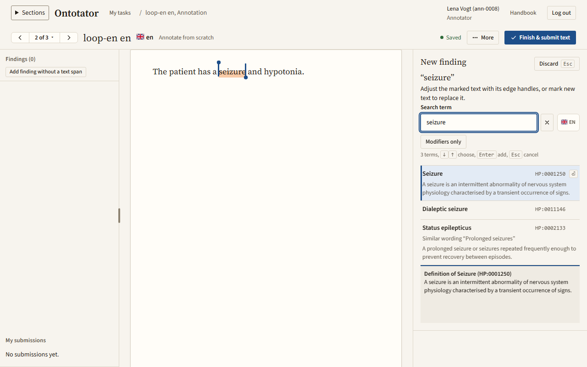
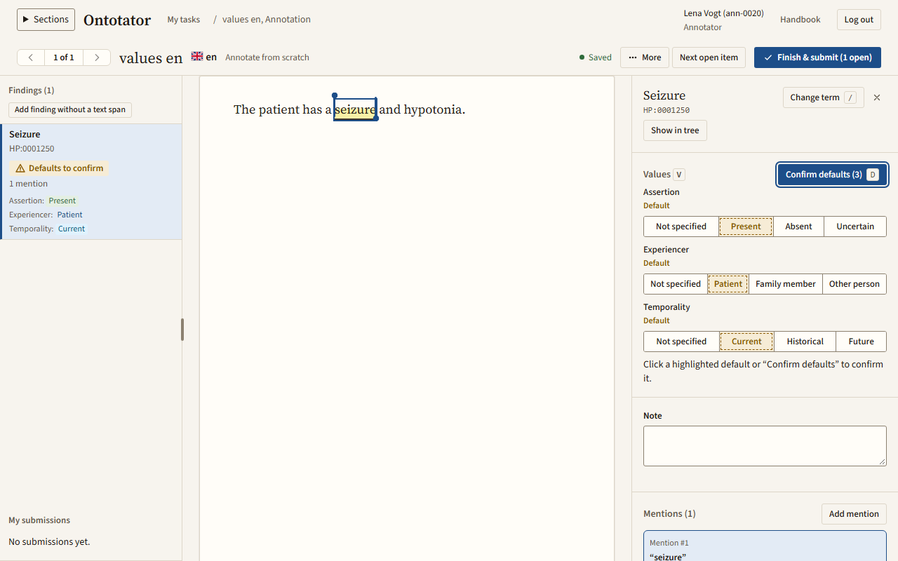
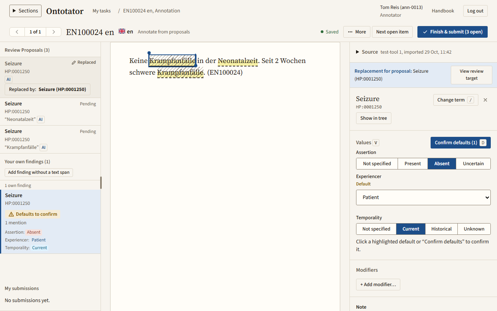
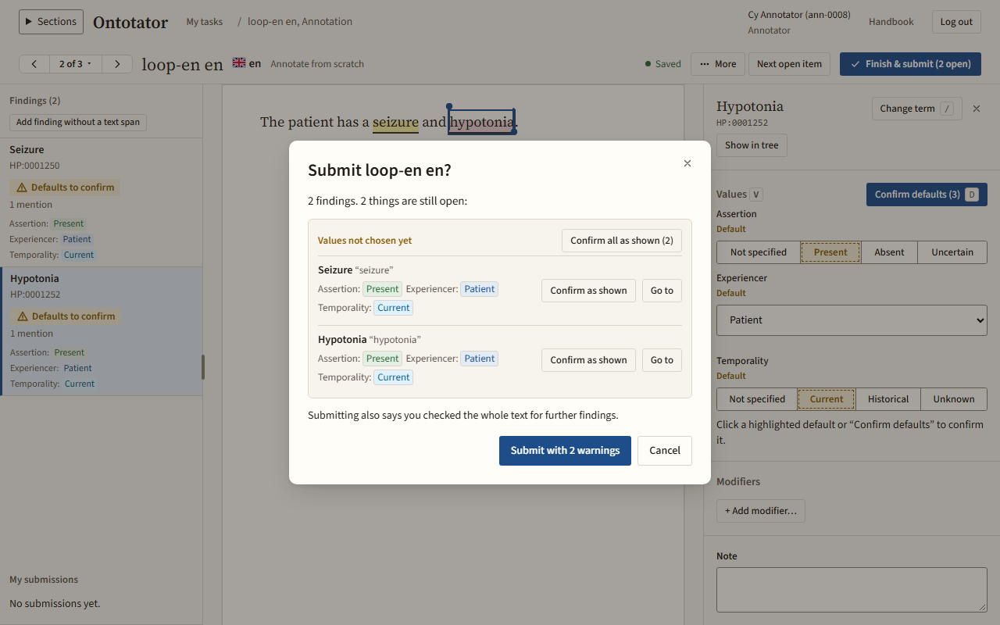

# Your first task, start to finish

This chapter takes you through one annotation task, from your first login to a submitted text. Do it once in this order; afterwards, look things up in the [annotator reference](annotator.md). Back to the [handbook overview](README.md).

Before you start: you need the address of your Ontotator server, your username and a setup code from your administrator, and a lead must have assigned a text to you.

## 1. Log in

1. Open the address of your Ontotator server.
2. The first time: click **I have a setup or reset code**, enter your **Username**, the code and a new password twice, then click **Set password and log in** ([details](getting-started.md#set-your-password-with-a-setup-or-reset-code)).
3. Later: enter your **Username** and **Password** and click **Log in**.

## 2. Find your task

After login you see **My tasks**, or **Projects** the first time.

1. Click **My tasks** in the sidebar.
2. On the tab **To do**, find a row whose **Task** is *Annotation, from scratch* or *Annotation, from proposals*.
3. Click **Start**. A task marked **Waiting for translation review** cannot be started yet; it opens by itself once the translation review is accepted.

The editor opens. If you have no task, you see **No texts are assigned to you yet.**; ask your lead.

## 3. Read the guidelines

The first time you open a task in a project with guidelines, a notice asks you to read them. Click the read button in the notice, for example *Read guidelines v2*. Later you find them under **More** in the toolbar.

The guidelines tell you what to mark and how: which findings count, how much text to mark, how to handle negations or family history. When in doubt, follow the guidelines; if they do not answer your question, ask your lead.

## 4. Get to know the screen

The editor has three columns: the list of **Findings** on the left, the text in the middle and the details of the selected finding on the right. The toolbar shows the mode, for example **Annotate from scratch**, and the save status. Everything is saved automatically; **Saved** means your work is stored. See [The editor screen](annotator.md#the-editor-screen).

## 5. Mark a finding

1. Read the text from the start. When it names a finding, for example "seizures", select the words with the mouse.
2. The panel **New finding** opens. **Search term** already holds the marked words, and the hits are listed under **Terms**.
3. Read the hits before you choose: the search matches words, not meaning, and only a term whose name or synonym equals your words is sure to be on top. If the top hit is the right term, press Enter. Otherwise, click another hit, or try another word or a synonym in **Search term**.

## 6. Choose the values

The new finding starts with the project's prefilled values, for example **Present** for the assertion and **Patient** for the experiencer. They are tagged **Default** and do not count as chosen yet.

1. Read the passage again in context. Does the text say the finding is there, absent ("no seizures") or uncertain? Is it the patient's or a family member's?
2. If a value is wrong, choose the right one under **Values**.
3. If all shown values are right, click **Confirm defaults** (or press `d`).

Repeat steps 5 and 6 for every finding in the text.

## 7. Check the tool proposals (tasks from proposals only)

In a task *Annotation, from proposals*, the column **Review Proposals** lists findings a tool suggested. Tools make mistakes, especially with negations: a tool may propose "Keine Krampfanfälle" (no seizures) as **Present**.

1. Select the first proposal. The text shows where it was found.
2. Check three things: the marked text, the term and every value.
3. Click **Confirm** if all three are right, **Reject** if the proposal is wrong, or **Edit & Replace** to correct it in a copy, then click **Done, back to the proposal**. Only if you really cannot decide, click **Unresolved** and write a **Reviewer note** saying why.
4. The next open proposal is selected. Go on until every proposal is decided.
5. Then read the whole text for findings the tool missed. Mark text that has no proposal and add the finding as in step 5. It appears under **Your own findings**, next to the proposals.

Details: [Review tool proposals](annotator.md#review-tool-proposals).

## 8. Submit

Before you start: submitting means you checked the whole text, not only the findings you marked.

1. Click **Next open item** until nothing is left. It takes you to every proposal, value or finding that still needs you.
2. Click **Finish & submit text**. (A consolidation is submitted on its own screen; see [Consolidator](consolidator.md).)
3. The dialog lists what is still open, with **Go to** for each item. Values you have not confirmed are under **Values not chosen yet**: confirm them only if you checked that they are right. A value you leave is submitted as shown but recorded as defaulted, not chosen; the lead and the export see this.
4. Click **Submit text**.

Details: [Submit the text](annotator.md#submit-the-text).

## 9. What happens next

- Your task shows **Submitted** in **My tasks**. It is read-only now; click **View** to look at it.
- The next open task opens on its own, or **My tasks** if none is left.
- The lead sees your submission next to the other annotators' work on the same text, and accepts one result or starts a consolidation. You do not see other people's work.
- Your task is done. You do not need to do anything else unless the lead reopens it (**Reopened** in **My tasks**) or you notice a mistake.

If you notice a mistake after submitting: open the task, choose **More** › **Work rounds** and click **Continue from this submission** ([Start a new work round](annotator.md#start-a-new-work-round)). Fix the finding, check the carried findings and submit again.

If something is wrong with the text itself (cut off, wrong patient, unreadable): **More** › **Report a text problem…** ([Report a text problem](annotator.md#report-a-text-problem)).

## If you were given a translation review

A *Translation review* task shows the source and the translation side by side. You correct the translation if needed and choose a decision. See [Review a translation](annotator.md#review-a-translation).
