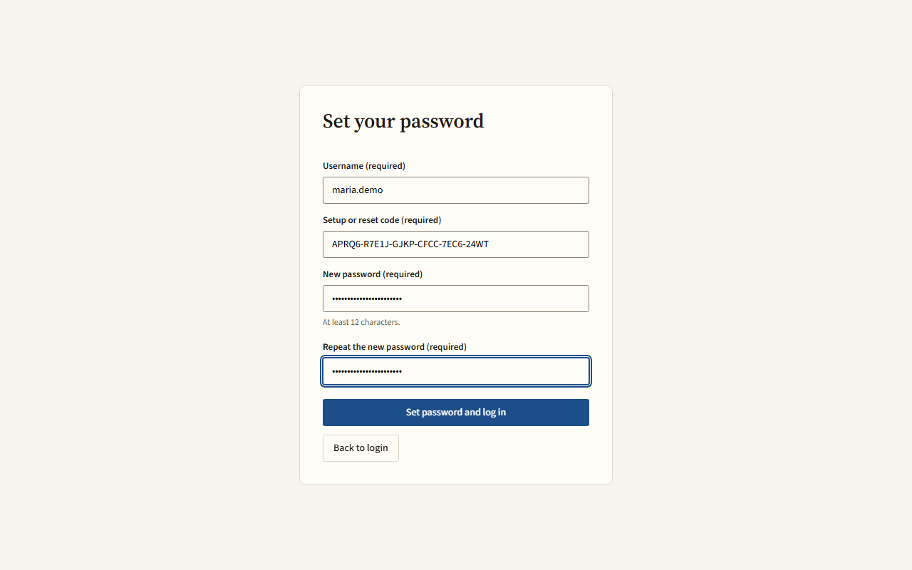
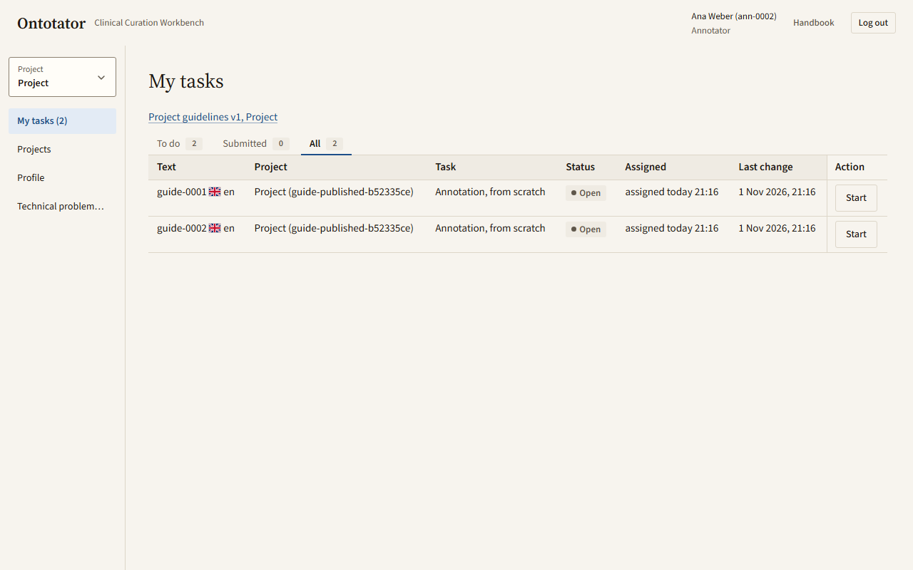

# Getting started

This chapter is for everyone. It shows how to log in, find your tasks and keep your profile up to date. Back to the [handbook overview](README.md).

## Before you start

- Your administrator gives you the address of your Ontotator server, your username and a one-time setup code.
- Use a current version of Chrome, Firefox, Edge or Safari.
- Everything you do is saved automatically. There is no **Save** button in tasks, and you can close the browser tab at any time and continue later.

## Set your password with a setup or reset code

What for: your first login, or a new password after an administrator reset it.

Before you start: you need a setup or reset code from your administrator. A code works once. Setup codes expire after 24 hours, reset codes after 2 hours.

1. Open the address of your Ontotator server in your browser. You see the login screen.
2. Click **I have a setup or reset code**. The form **Set your password** opens.
3. Enter your **Username**.
4. Enter the code in **Setup or reset code**.
5. Enter a password in **New password**: 12 to 256 characters, different from your username.
6. Enter it again in **Repeat the new password**.
7. Click **Set password and log in**.

Ontotator sets the password and logs you in at once. The first time, you land on **Projects** (see [Log in](#log-in) for where you land later). Only if that login fails afterwards, for example because the account is locked for a while, the login screen opens with **Your password is set. Log in with it now.**; the password is set, so [log in](#log-in) with it later. If you see **The two passwords differ.**, type both passwords again. To go back without a code, click **Back to login**.

## Log in

What for: start working.

1. Open the address of your Ontotator server in your browser. You see the heading **Log in to Ontotator**.
2. Enter your **Username** and **Password**.
3. Click **Log in**.

After logging in, Ontotator opens the project you used last on this browser:

- annotators and consolidators see **My tasks** for that project;
- leads see the project's **Documents** page.

The first time, or if that project is no longer yours, you see **Projects**. Click **My tasks** in the sidebar to see your work. On **Projects**, **Needs your decision** counts texts that wait for a lead's decision, and **Your open tasks** counts your tasks.

If your session ends while you work, a login box opens with **Your session has ended. Please log in again.** Log in there. Your unsaved input is kept.

## Log out

What for: end your session, for example on a shared computer.

1. Click **Log out** in the header.
2. If a dialog **Unsaved changes** opens, click **Save and log out**.
3. If a dialog **Unsaved profile changes** opens, click **Save and log out** to keep your changes, or **Discard and log out**.

## Find your way around

What for: know where things are.

The header is the same on every page:

- **Ontotator** on the left takes you to the start page.
- The breadcrumb shows where you are, for example **My tasks** or **Documents**.
- On the right are your display name, your pseudonym, your roles and **Log out**.
- **Handbook** in the header opens this handbook inside the app. On the Documents, consolidation and translation review screens, **Help** opens the handbook section about that screen; in the editor it is **More** > **Help for this screen**. Click a screenshot in the handbook to open it at full size in a new tab.
- Below the chapter list, the handbook shows the app's version and commit, for example `Ontotator 0.3.0 · commit cc65cea`. Quote it when you report a problem.

The sidebar lists **My tasks**, **Projects** and **Profile**. The number after **My tasks** counts your open tasks, the same tasks as the **To do** tab; it updates as soon as you submit a text. Clicking **My tasks** or **Projects** loads your projects and the count again, so a project you were just added to shows up without reloading the page. Leads also see their project's pages (**Documents**, **Progress**, **Settings**, **Export**). System administrators also see **Administration** with **Users**, **Ontologies** and **New project** (see [Administration](admin.md)). In the editor, the sidebar folds into **Sections**; click it to open it.

## Switch project

What for: work in another project.

1. Click the project switcher in the sidebar. It shows **Project** and the current project name. The shortcut is `Alt+P`.
2. Type part of the name in **Find project**.
3. Click the project, or choose it with the arrow keys and press Enter.

**All projects** opens the **Projects** page. There you see each project with **Your roles** and **Your open tasks**; click **Open** to go to a project.

## See your tasks

What for: find the texts you have to work on.

1. Click **My tasks** in the sidebar.
2. Choose a tab: **To do**, **Submitted** or **All**. The tab **Paused** appears only while one of your tasks is paused.
3. If you work in several projects, choose a project in **Filter my tasks by project**, or **All my tasks**.

Each row is one task. The **Task** column says what to do, for example **Annotation, from scratch**, **Annotation, from proposals**, **Consolidation** or **Translation review**. The **Status** column shows **Open**, **In progress**, **Submitted** or **Reopened**.

- **Reopened**: the lead reopened your submission. Click the badge to read why.
- A **Consolidation** task shows the lead's reason under the task, for example *Reason from the lead: Term and assertion differ*, if the lead gave one.
- **Paused**: the task waits for a decision on a problem report. **Answer to your report** means the lead has replied.

If the project has guidelines, a link such as *Project guidelines v2* appears above the table. Read them before you start: they say what to mark and how.

If you see **No texts are assigned to you yet.**, wait until your lead assigns texts to you.

## Open a task

What for: start or continue your work on a text.

1. In **My tasks**, find the row of the task.
2. Click the button in the **Action** column:
   - **Start** for a new task,
   - **Continue** for a task in progress or a reopened one,
   - **View** for a submitted task (read-only),
   - **View paused task** for a paused task (read-only).
3. The task opens. While it loads you see **Opening task…**.

To move to your next or previous task without going back, use **Previous text** and **Next text** in the toolbar (`Alt+←` and `Alt+→`), or pick one in **Select text**.

How to work inside the task: [Your first task, start to finish](first-task.md), the [annotator reference](annotator.md) and, for consolidations, the [consolidator chapter](consolidator.md).

If you see **Task not found or not yours**, the task was withdrawn or is assigned to someone else. Click **My tasks** to go back.

## Read the project guidelines

What for: check the annotation rules of the project.

1. Open a task.
2. Open **More** in the toolbar and choose the guidelines, for example *Guidelines v2*. *(new)* after it means the guidelines changed since you last read them. In a translation review or consolidation, the guidelines are a button in the header instead, with a **New** badge.
3. The guidelines open beside the text. Click **All versions** to see older versions, or **Close** to hide them.

The first time you open a task in a project with guidelines, a notice asks you to read them. Click the read button in the notice, for example *Read guidelines v2*. The notice also says where you find them later: under **More** › *Guidelines* in the editor, or the guidelines button in the header of a translation review or consolidation.

The guidelines are your project's rules: what counts as a finding, how much text to mark, how to handle negation or family history. The handbook explains the app, not these rules. If the project has no guidelines or they do not answer your question, ask your lead.

## Edit your profile

What for: keep your name, languages and qualification up to date.

1. Click **Profile** in the sidebar.
2. Change **Display name**, **E-mail**, **Languages you can read**, **Qualification** or **ORCID**.
3. To be named in exports, tick **Name me (display name and ORCID) as a contributor in exports**.
4. Click **Save**. You see **Saved.**

Your **Username** and **Pseudonym** cannot be changed. Exports show your pseudonym, not your name, unless you tick the box in step 3.

Fill in **Qualification** if you do translation reviews: you cannot submit a translation review without it.

## Set your search preferences

What for: search ontology terms in your own languages too.

1. Click **Profile** in the sidebar.
2. Go to **Search preferences**.
3. Tick **Search translated names** to search the translated names of terms.
4. Choose your **Preferred search languages**.
5. Tick **Automatically include the document language** to also search in the language of the text you work on.
6. Click **Save search preferences**. You see **Search preferences saved.**

## Change your password

What for: replace your password with a new one.

1. Click **Profile** in the sidebar.
2. Go to **Change password**.
3. Enter your **Current password**.
4. Enter a **New password** with 12 to 256 characters. It must differ from your username.
5. Enter it again in **Repeat new password**.
6. Click **Change password**. You see **Password changed. Other sessions were logged out.**

If you forgot your password, ask an administrator for a reset code and follow [Set your password with a setup or reset code](#set-your-password-with-a-setup-or-reset-code).
