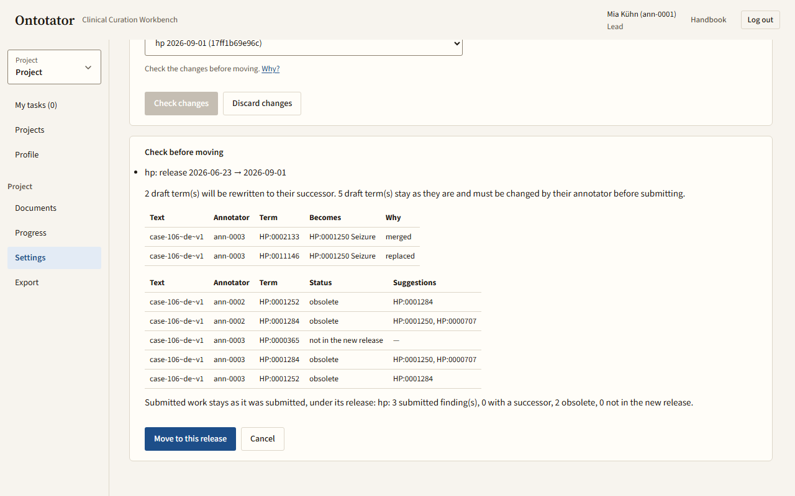
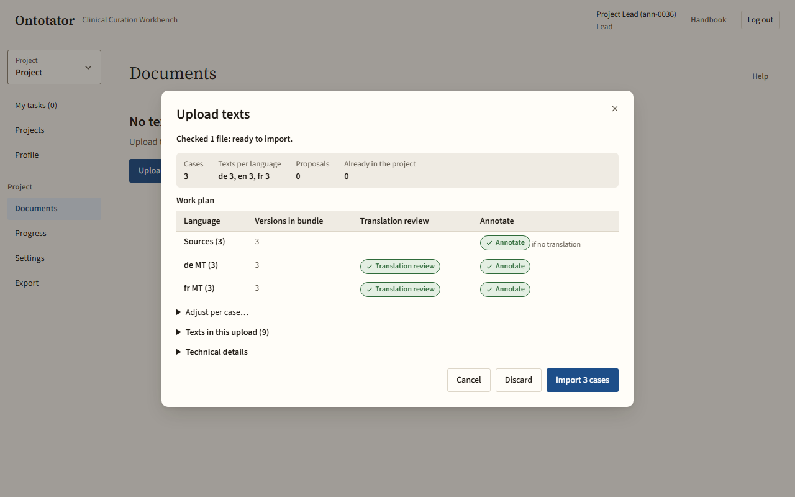
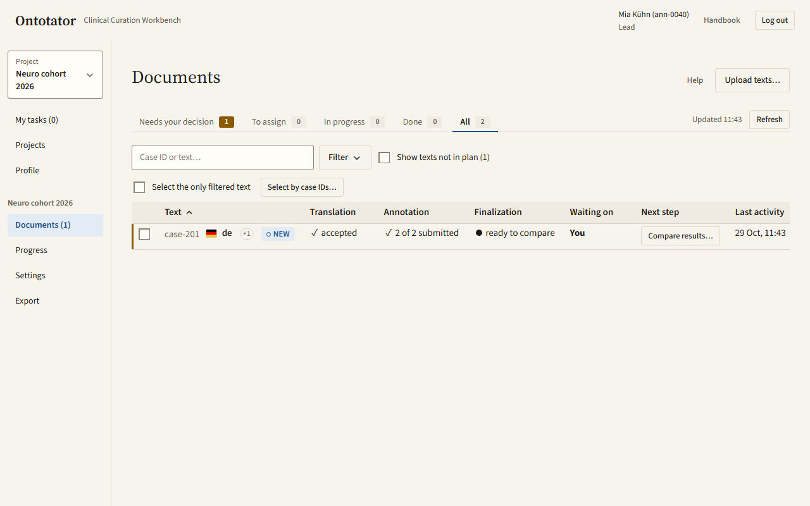
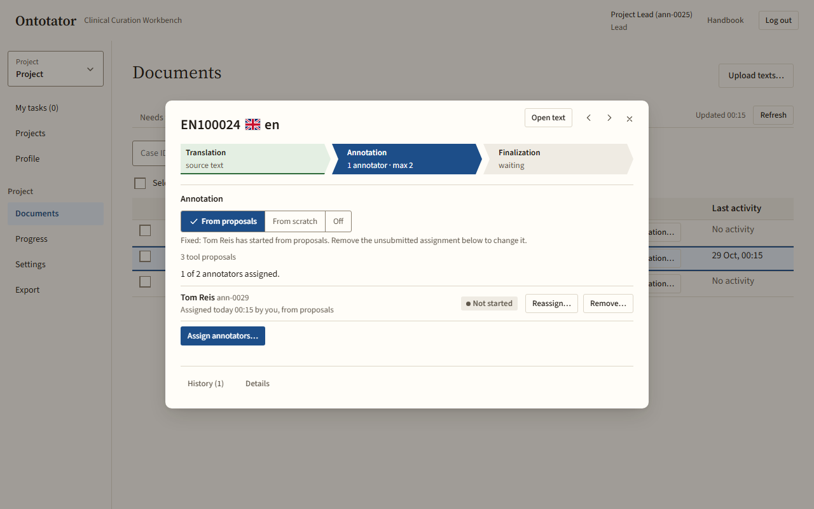
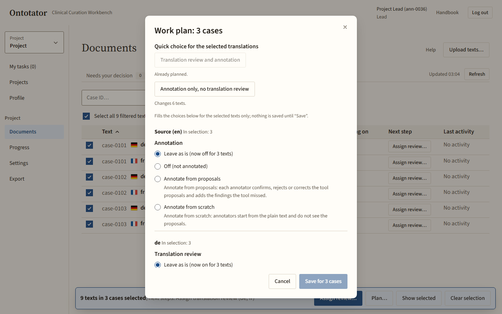
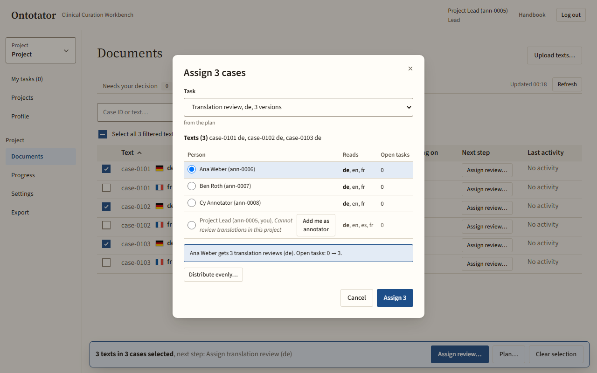
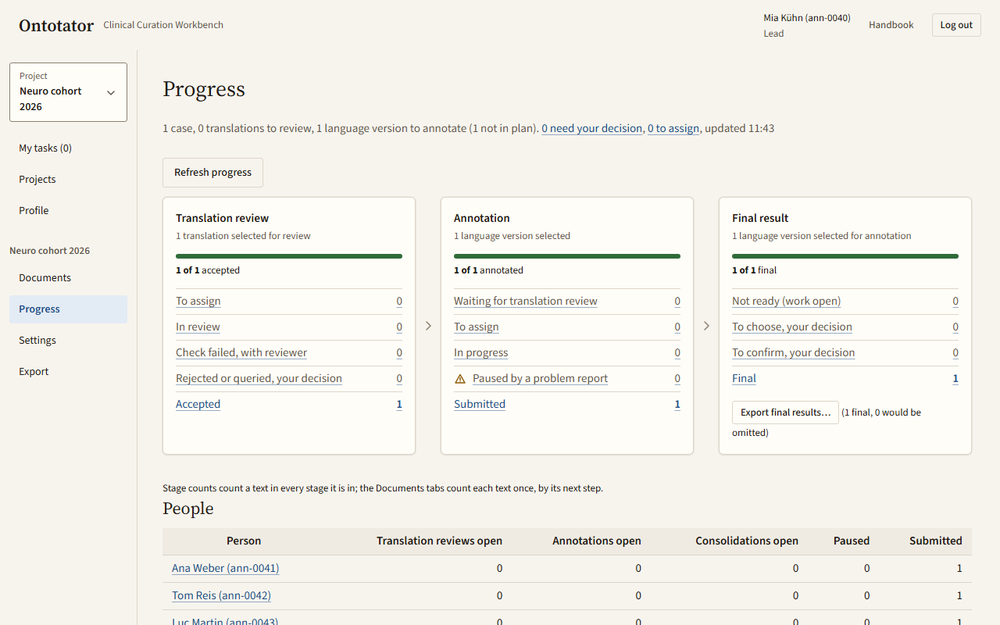
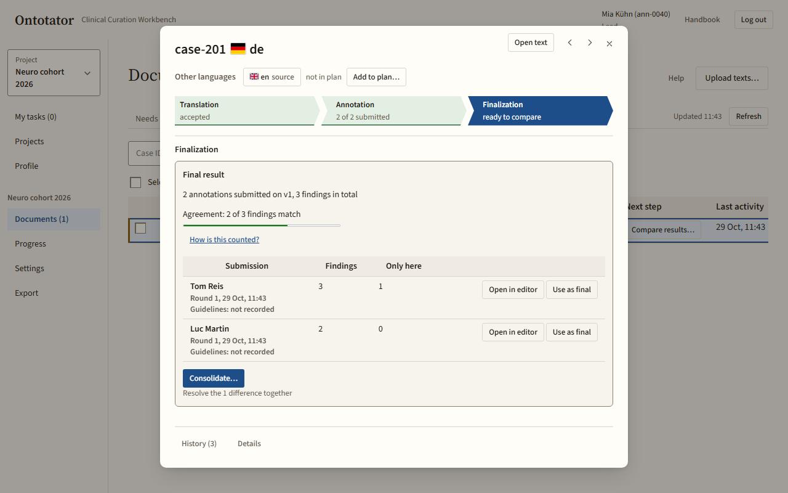
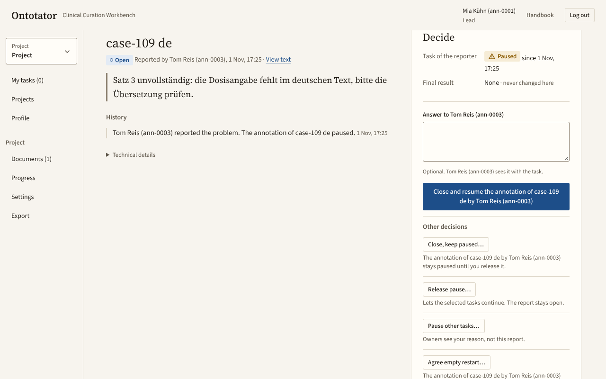
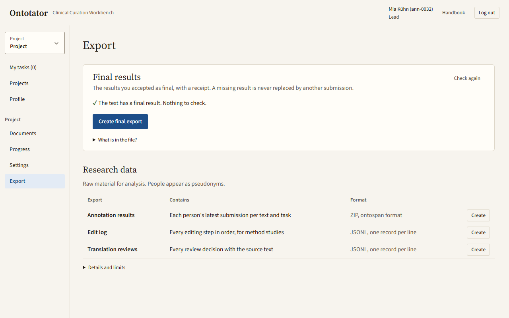

# Lead guide

This chapter is for project leads. A lead sets up the project, uploads texts, plans and assigns the work, accepts the results and exports them.

As a lead you see an extra group in the sidebar with the name of the current project: **Documents**, **Progress**, **Settings** and **Export**. System administrators see the same pages for every project (see [admin.md](admin.md)). How annotators and consolidators do their tasks is in [annotator.md](annotator.md) and [consolidator.md](consolidator.md).

## Typical project, start to finish

1. An administrator creates the project and makes you its lead ([admin.md](admin.md)).
2. Check the ontology, the languages and the rules: [Set up the project](#set-up-the-project).
3. Add the people who work with you: [Add a member](#add-a-member).
4. Publish the guidelines: [Publish guidelines](#publish-the-first-or-a-new-guideline-version).
5. Upload the texts and choose their work plan: [Upload texts](#upload-texts).
6. Assign translation reviews and annotations: [Assign work to the selected texts](#assign-work-to-the-selected-texts).
7. Follow the work and answer what needs you: [Watch progress](#watch-progress), [Decide on a problem report](#decide-on-a-problem-report).
8. Accept one result per text, or start a consolidation when annotators disagree: [Accept a result or compare results](#accept-a-result-or-compare-results).
9. Export the final results: [Export final results](#export-final-results).

## Set up the project

All project settings are under **Settings**. General, Annotation, Workflow and Ontology have a **Save changes** button at the bottom. People and Guidelines save each change at once.

### Open project settings

What for: reach all settings of the current project.

1. In the sidebar click **Settings**. You can also click **Settings** in the project's row on **Projects**.
2. Choose a tab: **General**, **Annotation**, **Workflow**, **Guidelines**, **People** or **Ontology**.
3. After a change click **Save changes**. The page then says, for example, *General saved.*
4. To undo your edits before saving, click **Discard changes**.

If you leave a tab with unsaved edits, a dialog asks you to **Save changes**, **Discard changes** or **Cancel**.

### Change the project name and description

What for: give the project a clear name and a short description on **Projects**.

1. Open **Settings**, tab **General**.
2. In the card **Name and description** edit **Name** and **Description**.
3. Click **Save changes**.

### Set the languages of the texts

What for: make sure every imported text is in a language you expect. An import refuses texts in other languages. Leave the list empty to allow any language.

1. Open **Settings**, tab **General**, card **Languages**.
2. Type a language code into **Languages of the texts**, for example `de`.
3. Press Enter or click **Add language**.
4. To remove a language, click the ✕ next to its code.
5. Click **Save changes**.

A typed code that you did not add blocks saving: **Add this language code before saving.**

### Choose the ontology version, branches and annotation scheme

What for: decide which ontology release annotators search in. You can change this until the first work is submitted.

1. Open **Settings**, tab **Ontology**.
2. In **Ontology version** choose the release for each ontology. Only releases an administrator uploaded on **Ontologies** are offered.
3. Optional: open **Advanced**.
   - Limit the terms to some branches: enter term codes separated by commas, for example `HP:0000118`. Empty means every term.
   - Choose the annotation scheme: **HPO phenotype (fixed qualifiers, modifiers)** or **Generic (free qualifiers)**.
4. Click **Save changes**. If the change would rewrite or flag draft terms, a check opens first, as in [Move a started project to a newer release](#move-a-started-project-to-a-newer-release).

### Replace the task profile

What for: change the layers, finding types and values annotators work with. Only possible before work starts.

1. Open **Settings**, tab **Ontology**, and open **Advanced: task profile**.
2. Check **Current profile layers**.
3. Choose a JSON file in **Profile file (JSON)**. The new layers appear under **Profile layers**.
4. Click **Save changes**. The page says *Task profile saved.*

### Move a started project to a newer release

What for: move to a newer ontology release after work was submitted. Drafts are updated; submitted work stays as it was submitted.

1. Open **Settings**, tab **Ontology**. The card **Ontology** shows the current release.
2. Under **Move to another release** choose the new release.
3. Click **Check changes**.
4. Read the panel **Check before moving**:
   - **Rewritten draft terms** lists terms that will be replaced by their successor.
   - **Draft terms to change by hand** lists obsolete terms. Their annotators must change them before submitting.
5. Click **Move to this release**, or **Cancel**. The page says **Ontology release changed.**

If drafts changed meanwhile, you see **Drafts or pins changed since the check. Check the changes again before moving.** Click **Check changes** again.

### Set the submission rules

What for: decide what annotators must do before they can submit.

1. Open **Settings**, tab **Annotation**, card **When submitting**.
2. In **Findings that point to no text passage** choose **Not allowed**, **Allowed with a reason** or **Allowed, reason optional**.
3. Tick **Annotators must confirm every value before submitting** if prefilled values may not be submitted unconfirmed.
4. Tick **A finding must be one continuous passage** if a finding may not have several text segments.
5. Click **Save changes**. The rules apply to every submission from now on.

### Set prefilled values for new findings

What for: new findings start with these values. They stay marked as not confirmed until the annotator confirms or changes them.

1. Open **Settings**, tab **Annotation**, card **Prefilled values**.
2. For each value field choose a value, or **No prefill**.
3. Click **Save changes**.

### Limit the values annotators can choose

What for: hide values the project does not use from the editor.

1. Open **Settings**, tab **Annotation**, and open **Values annotators can choose**.
2. Click a value to switch it off (hidden) or on (shown). The default value of a field cannot be hidden.
3. Click **Save changes**.

Existing findings keep their values. A finding with a hidden value must be changed before it is saved again.

### Choose the plan for new imports

What for: decide whether newly imported translations get a translation review and an annotation by default.

1. Open **Settings**, tab **Workflow**, card **New imports**.
2. Choose **Plan review and annotation for every translation** or **Plan nothing; I plan texts on Documents**.
3. Click **Save changes**.

You can still change the plan of single texts later on **Documents**.

### Choose how texts with tool proposals are annotated

What for: set the project default for texts that came with tool proposals.

1. Open **Settings**, tab **Workflow**, card **Texts with tool proposals**.
2. Choose **Annotators work from the proposals** (they confirm, reject, correct and add) or **Annotators start from scratch** (proposals are hidden).
3. Click **Save changes**.

A text's own plan can override this until work on it starts.

### Set annotators per text and the consolidation rules

What for: decide how many people annotate each text and who may consolidate.

1. Open **Settings**, tab **Workflow**, card **Annotation and consolidation**.
2. Set **Annotators per text** (1 to 5). It is an upper limit; fewer is fine.
3. Tick **Annotate only after the translation review is accepted** if translations must be reviewed before annotation.
4. Tick **Consolidator must not be one of the text's annotators** if annotators may not consolidate their own texts.
5. Click **Save changes**.

Lowering the number removes nobody; existing assignments stay.

### Add a member

What for: let a person work in this project. The person needs an account first (see [admin.md](admin.md)).

1. Open **Settings**, tab **People**.
2. Click **Add member…**.
3. In **Username** type at least three letters of the name, or the exact username or e-mail. Pick the person from the suggestions.
4. Tick one or more roles: **Lead**, **Annotator**, **Consolidator**.
5. Click **Add member**. The page confirms the new role.

Annotators also review translations. Consolidators merge the annotations of a text.

### Change a member's roles

What for: give or take away a role.

1. Open **Settings**, tab **People**. The table **Project members** shows one row per person.
2. Tick a role checkbox to give the role. It saves at once.
3. Untick a role checkbox to take it away, then confirm with **Remove role**. This logs the person out on all devices; they can log in again right away.

A project needs at least one lead: **Add another project lead before removing the last lead.**

### Remove a member

What for: take someone off the project.

1. Open **Settings**, tab **People**.
2. In the person's row click **Remove…**.
3. Confirm with **Remove from project**.
4. If the person still has open work, the dialog **Revoke affected assignments?** lists it. Click **Remove and revoke their open assignments**.

Submitted work stays in the history.

### Publish the first or a new guideline version

What for: give annotators and reviewers the rules they work by. They find the guidelines in every task.

1. Open **Settings**, tab **Guidelines**.
2. Without guidelines the form is already open (**No guidelines yet**). Otherwise click **Publish a new version**.
3. Choose a `.md` or `.txt` file (UTF-8, up to 256 KB) in **Guideline file (.md or .txt, up to 256 KB)**.
4. Check the preview below.
5. Optional: describe the change in **What changed? (optional)**.
6. Click the publish button, for example *Publish as v2*. Or click **Discard**.

Everyone sees a notice in their next task. Published versions cannot be edited, only withdrawn.

### See who has read the guidelines

What for: check which version is in force and who has not opened it yet.

1. Open **Settings**, tab **Guidelines**. The top card shows the version **In force**.
2. Read **Seen by**. Open **who not yet?** to see the names.
3. Click **Read** to read a version. Close it with the ✕.
4. Older versions are listed under **All versions**.

### Republish an earlier guideline version

What for: go back to an earlier text.

1. Open **Settings**, tab **Guidelines**.
2. In the row of the old version click **More…**, then the republish item, for example *Republish v1…*.
3. The form opens with the old text. Click the publish button, for example *Publish as v3*.

### Withdraw a guideline version

What for: remove a version that must no longer be read, for example because it contains a mistake.

1. Open **Settings**, tab **Guidelines**.
2. In the version's row click **More…**, then the withdraw item, for example *Withdraw v2…*.
3. Optional: enter **Reason (optional)**. Do not repeat confidential content.
4. Confirm, for example with *Withdraw v2*.

The text is deleted for good. The version number stays, and results made under it show it as withdrawn. No guideline is in force until you publish or republish one.

## Texts

### Upload texts

What for: bring texts into the project, with or without tool proposals.

1. Open **Documents** and click **Upload texts…**.
2. Choose the **Format**: **Ontospan bundle** (.zip or .json) or **Plain text** (.txt or .zip). For plain text also choose the **Upload language**.
3. Click **Choose files…** and select your files.
4. Click **Check**. Nothing is imported yet.
5. Read the preview: the number of cases, proposals and texts already in the project, and any **Notes**.
6. Check the **Work plan**: for each language, whether it gets a **Translation review** and an annotation. Click **Adjust per case…** for exceptions.
7. If translations are not marked as reviewed and you want them annotated without review, tick **These translations were reviewed outside Ontotator — accept them as they are** and enter a **Reason**.
8. Click the import button, for example *Import 20 cases*.

You can close the dialog during the import; the texts appear after the next page load. If the check finds problems, nothing can be imported. The dialog then names the problems per file; click **Discard** and try again.

### Open the Documents page

What for: see every text of the project and what it needs next.

1. In the sidebar click **Documents**. A number next to it counts the texts that need your decision.
2. Each row is one text (one language of a case). The columns show **Translation**, **Annotation**, **Finalization**, **Waiting on**, **Next step** and **Last activity**.

### Search texts

What for: find a text by its case ID or by words in the text.

1. Type into the search field **Case ID or text…**.
2. The list updates after a short pause or when you press Enter.
3. To clear it, click the ✕ in the field.

### Filter the list

What for: show only texts in a certain state, language or origin.

1. Click **Filter**.
2. Tick the options you need, for example under **Language**, **Translation review**, **Annotation** or **Final**. Each choice applies at once.
3. Under **Order** choose **Case ID**, **Import order** or **Last activity**.
4. Active filters show as chips above the table. Remove one with its ✕, or click **Clear all**.

Options without texts are hidden. Click the button below the options, for example *Show 4 empty filters*, to see them.

### Sort the table

What for: change the order of the rows.

1. Click the column header **Text** to sort by case ID, up or down.
2. Click **Last activity** to sort newest or oldest first.
3. The other headers sort only the rows on the current page.

### Read a row

What for: understand where a text stands.

1. The **Text** cell shows the case ID, the language, the version and a **NEW** badge for texts that are new since your last visit.
2. The stage cells show the state of the translation, the annotation and the final result, with the people involved in grey.
3. A robot icon means the text has tool proposals.
4. **Waiting on** shows who the text waits for. **You** in bold means it waits for you.
5. Rows that need your decision have a coloured left edge.

### Page through the list

What for: see more texts than fit on one page.

1. Below the table click **Next** or **Previous**.

### Open the text card

What for: see everything about one text and act on it.

1. Double-click a row. Or focus the text name and press Enter.
2. The card shows the path **Translation**, **Annotation**, **Finalization**. Click a part to see it.
3. Click **Open text** to read the text with all layers.
4. Use **Previous text** and **Next text** (keys K and J) to walk through the table.
5. Under **Other languages** switch to another language of the same case.
6. Close the card with ✕ or Escape.

### Read the history and details of a text

What for: see what happened to a text and its technical IDs.

1. In the text card footer click **History** or **Details**.
2. **History** lists all activity, newest first, with reviewers' reasons.
3. **Details** shows the **Plan**, the **Problem reports** and the **Technical details**.
4. Click **Back** to return to the path.

### Use Documents on a narrow screen

What for: work on a phone or a small window.

1. Below 700 px each case is a card with its texts.
2. Click a stage status to see the latest activity and the actions for that stage.
3. Click **Details** to open the full text card.

### Review the translation versions of a text

What for: see each version of a translation, its reviews and its origin.

1. Open the text card and click **Translation**.
2. The list shows each version with its origin and status. Older ones are under **Older versions**.
3. Click **View text** to read a version, or **Translation reviews** to see every review decision.
4. Click **Compare with source** to compare the translation with the source text.

### Request a translation correction

What for: have a translation corrected by a reviewer.

1. Open the text card and click **Translation**.
2. At the version click **Request correction…**.
3. Choose the **Translation reviewer** and enter the **Reason for another review**.
4. Click **Assign correction review**, then **Close**.

The corrected text becomes a new version.

### Resolve a rejected or queried translation

What for: decide what happens after a reviewer rejected or queried a translation. The row's next step is **Resolve rejected translation** or **Resolve queried translation**.

1. In the row click **Resolve…**. The options open below the row with the reviewer's reason.
2. Choose one:
   - **Assign a new review…** to have someone review it again.
   - **Correct the translation…** to correct it yourself. Then click **Open translation review**. Your corrected text counts as accepted.
   - The discard item, for example *Discard the de translation…*, to drop it. Enter a **Reason** and click **Discard**. Nothing is deleted; the versions are marked as discarded.
3. Or click **Cancel**.

### Accept a translation that was not reviewed

What for: annotate a translation that was reviewed outside Ontotator. The row's next step is **Translation not accepted**.

1. In the row click **Assign review or accept…**.
2. Either click **Turn translation review on**, then assign a review.
3. Or tick **This translation was reviewed outside Ontotator — accept it as it is**, enter a **Reason** and click **Accept and annotate**.

The acceptance is recorded with your name, the reason and the time.

To have an accepted translation reviewed after all, click **Assign a new review…** in the **Translation** part of the text card.

### Handle a text change for open annotation work

What for: decide what happens when a text gets a new version while someone is still annotating the old one. The row's next step is **Handle text change**.

1. In the row click **Handle text change…**.
2. Choose one:
   - Move to the new version: the annotator continues on the corrected text; their draft findings are carried and marked for checking.
   - Let the annotator finish on the old version: the result is carried to the new version for them to check.
   - **Withdraw**: the draft stays with them, and the new version needs a new annotation.
3. Click **Apply**.

If the task is paused by a problem report, decide the report first.

### Carry submitted work to a new text version

What for: reuse submitted findings after the text was corrected. The row's next step reads, for example, *Carry to v2…*.

1. In the row click the carry button, for example *Carry to v2…*.
2. Choose who continues: the author, **Someone else…** (then pick the **Annotator**), or annotate the new version from scratch.
3. Click **Assign**.

The carried findings must be checked by the annotator before submitting.

## Work plans and distribution

The work plan says, for each text, whether it gets a translation review and whether and how it is annotated. Texts that are planned show up in the main list; the others are hidden.

### Add a text to the plan

What for: start work on a text that is not planned yet.

1. On **Documents**, tab **All**, tick **Show texts not in plan**. Unplanned texts appear muted.
2. In the text's row click **Add to plan…**.
3. Choose **Translation review** **On** or **Off**.
4. Choose the annotation: **Off (not annotated)**, **Annotate from proposals** or **Annotate from scratch**.
5. Click **Save**. The message has an **Undo** button.

### Select texts

What for: plan or assign many texts at once.

1. Click a row to select it. Shift+click selects a range; Ctrl+click (Cmd+click on Mac) adds single rows.
2. To select every filtered text, tick the checkbox in the table header.
3. The selection bar at the bottom shows how many texts are selected and their next step.
4. Click **Clear selection** to start over.

### Select texts by pasting case IDs

What for: select texts from a list you have elsewhere, for example a spreadsheet.

1. Click **Select by case IDs…**.
2. Paste the IDs into **Paste case IDs**, one per line or separated by commas.
3. Check how many were found. Click **Copy unknown IDs** to copy the ones that do not exist.
4. To keep the current selection, tick **Add to the current selection instead**.
5. Click the select button, for example *Select 20*.

### Plan several texts at once

What for: set the work plan for a selection.

1. Select the texts, then click **Plan…** in the selection bar.
2. Optional: under **Quick choice for the selected translations** pick **Translation review and annotation** or **Annotation only, no translation review**.
3. Or set it per language: **Translation review** and **Annotation**. **Leave as is** keeps the current plan.
4. Read what will change.
5. Click the save button, for example *Save for 20 cases*.
6. If work already exists, the dialog lists what happens to it. Tick **I understand** (or **I understand — withdraw the open tasks**) and save again.

**Undo** in the message restores the plan, not withdrawn tasks.

### Change the annotation mode of one text

What for: switch one text between from proposals, from scratch and not annotated.

1. Open the text card and click **Annotation**.
2. In **Annotation plan** choose **From proposals**, **From scratch** or **Off**. It saves at once.

Once someone started or submitted work in one mode, the mode is fixed.

### Assign work to the selected texts

What for: give translation reviews or annotations to people.

1. Select the texts, then click the assign button in the selection bar, for example **Assign annotation…**.
2. Check the **Task**, for example a translation review in one language.
3. Under **Members** pick the reviewer, or tick everyone who should annotate. Each ticked person gets every selected text.
4. Read the **Summary**.
5. Click the assign button, for example *Assign 20*.

If someone does not read a language the task needs, the dialog asks again; click **Assign anyway** or **Back**.

### Assign work for one text

What for: assign a single review or annotation.

1. In the row click **Assign review…** or **Assign annotation…**. In the text card use **Assign review…** or **Assign annotators…**.
2. Tick the people. To annotate yourself without the Annotator role, click **Add me as annotator**.
3. Click the assign button, for example *Assign 2 people*.

To change the limit of annotators per text from here, click the (i) next to the limit and then **Change for all texts**.

### Distribute work evenly

What for: spread a batch of texts evenly across people.

1. In the assign dialog click **Distribute evenly…**.
2. Set **People per document** and click **Propose**.
3. Check the proposal. Change a person in any cell, or click **Propose again**.
4. Click **Confirm**, then **Close**.

### Remove, reassign or reopen an assignment

What for: change who works on a text, or let someone change a submitted annotation.

1. Open the text card and click **Annotation** (or **Translation** for reviews).
2. In the person's row click:
   - **Reassign…**: choose the **New assignee** and click **Reassign**.
   - **Reopen…**: optional **Reason (optional)**, then **Reopen assignment**.
   - **Remove…**: confirm with **Remove** or **Confirm removal**.

Removing unsubmitted work deletes the draft for good. Submitted work stays in the history. Consolidations cannot be reassigned.

## Following progress

### Watch progress

What for: see the whole project at a glance.

1. In the sidebar click **Progress**.
2. The first line counts cases, reviews and annotations. Click **need your decision** or **to assign** to jump to those texts.
3. The cards **Translation review**, **Annotation** and **Final result** count the texts per state. Each count opens **Documents** with the same texts.
4. The **People** table shows each person's open and submitted work. Click a name to see their texts.
5. Click **Refresh progress** to update.

### Use the Documents tabs

What for: work through texts by what they need.

1. On **Documents** choose a tab: **Needs your decision**, **To assign**, **In progress**, **Done** or **All**.
2. Click **Refresh** to update the counts.

A tab keeps your filters and search.

### Do a text's next step

What for: act on a text directly from its row.

1. In the **Next step** column click the row's button, for example **Assign annotation…**, **Accept result…** or **Decide on report…**.
2. The matching dialog, card or page opens. The tasks in this chapter describe each one.

If you have an open task on the text yourself, the row shows **Open my task** instead.

## Accepting results and consolidation

Each text version gets one final result: one submission or one consolidation that you accept. Only final results go into the final export.

### Accept a result or compare results

What for: choose the final result of a text.

1. On **Documents**, tab **Needs your decision**, click **Accept result…** or **Compare results…** in the row. The card opens at **Final result**.
2. With one submission or a submitted consolidation, check it and click **Accept result**.
3. If all annotations agree, the card says so. Click **Accept result**.
4. If they differ, the card shows how many findings match. Open a submission with **Open in editor** and click **Use as final** in its row. Or start a consolidation (next task).
5. After saving, the card moves on to the next text that needs a decision.

If the project rule says the consolidator may not be an annotator, you cannot accept your own result; another lead must do it.

### Accept early while other annotations are open

What for: accept a result before everyone has submitted.

1. Open the text card at **Finalization**. It lists the annotations still open.
2. Optional: remove open work with **Remove assignment…**.
3. Choose the result as in [Accept a result or compare results](#accept-a-result-or-compare-results).

Open work stays assigned unless you remove it.

### Start a consolidation

What for: let one person resolve the differences between submissions into one result.

1. In the text card's final result block click **Consolidate…**.
2. Check the submissions under **Submissions to merge**.
3. Choose the **Consolidator**. You can choose yourself.
4. Optional: enter **Consolidation reason (optional)**.
5. Click **Start consolidation**. If you chose yourself, click **Open consolidation** in the message to begin.

The consolidator's work is described in [consolidator.md](consolidator.md). While it runs, the card shows the consolidator and how many groups are still open.

### Accept a consolidation

What for: make a submitted consolidation the final result.

1. Click **Accept result…** in the row.
2. Optional: click **Open consolidation** to read it. It opens read-only. Click **Back to documents** to return.
3. Click **Accept result**.

### Review changes to a final result

What for: confirm a final result after something changed, for example a newer submission or a corrected text. The row's next step is **Confirm final result**.

1. In the row click **Review changes…**. The card lists what changed.
2. If the text changed, click **Show changes** to see the changed passages.
3. Choose one:
   - Keep the final on the old version, for example *Keep final on v1*.
   - **Use the newer result**.
   - Carry it to the new version, for example *Carry to v2…* (see [Carry submitted work to a new text version](#carry-submitted-work-to-a-new-text-version)).

### Change a final result

What for: pick another result after you already chose one.

1. Open the text card at **Finalization**.
2. Click **Change final…**.
3. Click **Use as final** in the row of the result you want.

## Problem reports

Annotators and reviewers can report a problem with a text. This pauses their task until you decide.

### Decide on a problem report

What for: answer a report and let the work go on.

1. On **Documents** click **Decide on report…** in the row. Or click **Open report** in the text card.
2. Read the report: who reported it, the reason and the history.
3. In the common case, write an optional answer and click the close-and-resume button, for example *Close and resume Task 12*.
4. For other cases open **Other decisions**:
   - **Close report…** or **Close, keep paused…**: close it with an outcome for the reporter.
   - **Release pause…**: let paused tasks continue.
   - **Pause other tasks…**: pause other tasks on the same text or project.
   - **Agree empty restart…**: restart the task with an empty round, after agreeing with the reporter.
   - **Reopen report…**: open a closed report again.
5. Confirm in the form that opens.
6. Click **Back to Documents**, or go to the next decision.

A final result is never changed here. If a task is still paused after the report was closed, the row shows **Resume task…**; click it and release the pause.

## Export

### Export final results

What for: download the accepted final results.

1. In the sidebar click **Export**. Or click **Export final results…** on **Documents** or **Progress**.
2. The card **Final results** checks every text. It lists texts that need your decision and texts left out because they have no final result.
3. If you want to export now anyway, tick the box to leave out the other texts.
4. Click **Create final export**.
5. When it is ready, click **Download (ZIP)**.

Click **Check again** after you accepted more results. **What is in the file?** explains the contents.

### Export research data

What for: download raw material for analysis. People appear as pseudonyms.

1. On **Export**, go to **Research data**.
2. Choose a row: **Annotation results**, **Edit log** or **Translation reviews**.
3. Click **Create**, then **Download** when it is ready.

How to analyse these files is described in [scientific-workflow.md](../scientific-workflow.md).
