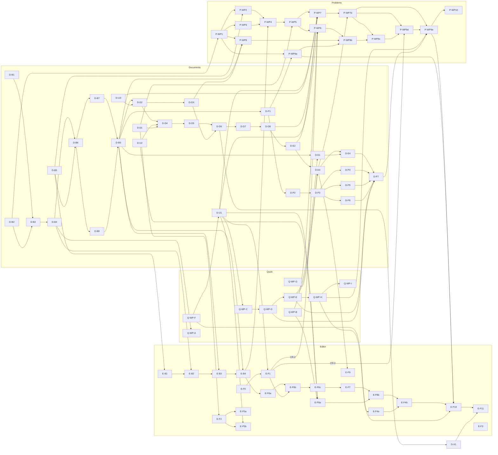

# Phase 0 UX Plans: Execution Overview

**Purpose.** One schedule for the four implementation plans of 2026-10-19 that share one worktree, one machine (16 GB) and several files. It assigns every work package (WP) to a wave and a lane, states the global rules once, and describes how an orchestrating session dispatches, verifies and reviews a WP. The plans stay the source of truth for WP content; this file only orders them.

Worktree: `C:/Users/jan-p/Development/ontocurator/.worktrees/phase0-implementation` (branch `feat/phase0-acceptance-plan`).

## The four plans

| Prefix used here | Plan | Spec | WPs |
|---|---|---|---|
| **D-** Documents | [2026-10-19-documents-lead-table.md](2026-10-19-documents-lead-table.md) | [design](../specs/2026-10-19-documents-lead-table-design.md) | 32: B1–B9, U1–U3, D1, D2, D4–D8, DX, E1–E4, P1–P7, X1 (no D3) |
| **Q-** Quick fixes | [2026-10-19-quick-fixes-and-export.md](2026-10-19-quick-fixes-and-export.md) | [design](../specs/2026-10-19-quick-fixes-and-export-design.md) | 9: WP-A … WP-I |
| **E-** Editor | [2026-10-19-editor-carried-review.md](2026-10-19-editor-carried-review.md) | [design](../specs/2026-10-19-editor-carried-review-design.md) | 21: B1–B4, F0, F1, F2, F3, F4a, F4b, F5a, F5b, F6a, F6b, F6c, F7, F8a, F8b, F9, F10, F11 |
| **P-** Problem reports | [2026-10-19-problem-reports.md](2026-10-19-problem-reports.md) | [design](../specs/2026-10-19-problem-reports-design.md) | 15: WP1–WP8, WP7b, WP9a–WP9e, WP10 |

Total: 77 WPs. Note that `B1`–`B4` exist in both Documents and Editor; always write the prefix (`D-B4`, `E-B4`).

Shared primitives are owned by Documents (U1 `Button` busy state, `InlineConfirm`, shortcuts, `useMediaQuery`, base CSS; U2 `DataTable`; U3 router and replace navigation; D1 `submissionLabels.ts`/`Time.tsx`; B5 `submission_labels.py`) and by Editor F1 (`Dialog` header close, fixed footer, narrow `md` sheet). Siblings consume them and never fork them.

## Global rules (apply to every WP of every plan)

1. **Commit in sensible steps, never push** unless the user says so (decision 2026-10-19). Step 0 before wave 1: commit the pre-existing uncommitted implementation changes of this worktree as one baseline commit ("feat: phase 0 acceptance remediation baseline"), after a quick check that the existing test suites pass (report failures to the user instead of committing broken state). After that, the orchestrator commits each WP (or a small group of WPs of the same wave) once its review/fix loop is done, using the WP's commit-point text and staging only that WP's owned files (`git add <owned files>`, never `git add -A`). Subagents never commit themselves. No AI attribution lines anywhere (no Co-Authored-By, no "Generated with").
2. **Preserve uncommitted work.** The worktree holds many uncommitted changes. Never `git reset`, `git checkout -- <file>`, `git stash`, `git clean`, and never overwrite a file you do not own. Edit on top of the working tree.
3. **Shell.** All plan commands are written for the Bash tool (Git Bash), run from the worktree root (`cd /c/Users/jan-p/Development/ontocurator/.worktrees/phase0-implementation && …`). `rg` is not installed in Git Bash; use `grep -rnE`.
4. **Exclusive file ownership.** A file is written by exactly one WP at a time across all plans. A WP writes only its "Owns" list; if it needs anything else, it stops and reports. Separate hunks in one file never justify running two owners in parallel. Test files count.
5. **At most two test-heavy agents at once across all plans.** Heavy = backend pytest against PostgreSQL, a full Vitest run, Playwright, or a full gate. Single Vitest files, typecheck and generator scripts are light.
6. **Vitest always with** `--maxWorkers=4 --minWorkers=1` (`CHECK_VITEST_WORKERS=4` for `scripts/check.sh --only frontend`).
7. **Playwright: one run at a time on the machine**, whatever the port (`test:e2e` rebuilds the shared `frontend/dist`). Each plan keeps its own `HPO_E2E_PORT`: Documents 18765 (default), problem reports 18781, quick fixes 18791, editor 18793. If a build fails because another agent is mid-edit, rerun after that agent finishes; do not fix its files.
8. **One contracts writer at a time.** `contracts/openapi.json`, `frontend/src/api/generated.ts`, `frontend/src/api/client.ts` are never hand-edited; order D-B9 → E-B4 → P-WP4 → P-WP8, and never while any backend WP is mid-edit on API models. `contracts/admin-error-codes.json`: D-B4 → E-B2.
9. **Migrations:** D-B2 creates `0014`, P-WP1 creates `0015` (`down_revision = "0014"`). Any later migration is `0016+`. Never renumber.
10. **Prerequisite checks.** A WP whose plan gives a `grep`/`test` check for a sibling prerequisite runs it first and stops if it fails; it never re-implements the missing piece.
11. **Obsolescence.** When a later WP replaces a component, it also owns and removes or updates the tests that asserted the old UI (listed in that later WP). An earlier WP whose target is already replaced skips the part and reports "obsolete (replaced by <plan> <WP>)".
12. English for all files and UI copy; icons only from `ui/icons.tsx`.

## Shared-file chains (order across plans)

| File(s) | Writers in order |
|---|---|
| `frontend/src/styles/components.css` | Q-WP-F → D-U1 → Q-WP-C → E-F1 (incl. CR-2 sheet) → Q-WP-D → Q-WP-E |
| `frontend/src/App.tsx` | D-U3 → D-D6 → D-E2 → D-E3 → P-WP7b |
| `frontend/src/tasks/ProblemReportDetail.tsx`, `frontend/tests/problemReportRoute.test.tsx` | D-E2 → P-WP7 → P-WP7b (test only) |
| `src/ontocurator/application/final_results.py` | D-B3 → D-B4 → Q-WP-A (`freeze()` only) |
| `src/ontocurator/api/app.py` | D-B4 → D-B9 → E-B2 → E-B3 |
| contracts / `generated.ts` / `client.ts` | D-B9 → E-B4 → P-WP4 → P-WP8 |
| Documents row backend files, `documents/ExpandedRow.tsx` | D-B6/B7/B9, D-DX → P-WP8 (not while D-E4 runs) |
| `frontend/src/styles/screens/editor.css` | Q-WP-F → E-F4a → E-F4b |
| `frontend/tests/quickFixStyles.test.ts` | Q-WP-F → E-F4b (Q8 assertions) |
| `frontend/tests/dialogFooters.test.tsx` | Q-WP-B → E-F1 (query scoping) → E-F8a (round dialogs) → P-WP6 (problem dialog), never two at once |
| `frontend/src/admin/FinalExportPanel.tsx` | Q-WP-E → D-E1 |
| `frontend/tests/finalSelection.test.tsx`, `variants/FinalResultSelector.tsx` | Q-WP-E, Q-WP-G → D-E3 |
| `CaseScreen.tsx` | E-F0 → E-F6b → E-F6c → E-F7 → E-F8b → E-F4b |
| `variants/CaseViewer.tsx`, `caseViewer.test.tsx` | D-E3 → E-F9 |
| `tests/browser_server.py` | D-P1 → P-WP9a → E-F10 (one line each) |
| existing `frontend/browser/*.spec.ts` | Q-WP-D, Q-WP-E (specific lines) → D-P7 → P-WP9e → E-F10 |
| `frontend/browser/quick-fixes.spec.ts` | Q-WP-H → P-WP9e (Q1 B2 lines) → E-F10 (Q1 B1, Q8) |
| `DESIGN.md` | D-X1 → E-F11 |

## Global dependency graph

Intra-plan edges are in each plan's own graph; the wave table below lists every WP's prerequisites. This graph shows the cross-plan edges and the critical path (Documents backend → Documents page → report page → browser).



## Wave schedule

A wave is a set of WPs that may run at the same time: disjoint owned files, at most two heavy WPs, at most one Playwright run. A wave's WPs start when their prerequisites are done; the next wave starts when the WPs it depends on are done (an orchestrator may start a WP early if all its prerequisites and file locks are free, without breaking the limits).

Lanes: **H** = heavy (takes one of the two machine-wide slots; **PW** = Playwright, alone among Playwright runs). **L** = light (single Vitest files, typecheck). **L+** = light, but its one full Vitest run at the end needs a free heavy slot (wait for it). Run at most three light agents at once; queue the rest within the wave.

| Wave | Heavy lane (≤2) | Light lane | Prerequisites and notes |
|---|---|---|---|
| 1 | D-B1, D-B2 | Q-WP-F, Q-WP-B, Q-WP-G, D-B5, D-D1, D-U2 (L+), D-U3 (L+), E-F3 | No prerequisites. Q-WP-F takes `components.css` before D-U1. Q-WP-B and Q-WP-G run before their replacements (E-F8a, P-WP6, D-E3). |
| 2 | D-B3, E-B1 | D-U1 (L+, includes CR-1 `conflictMessage`), E-F2, E-F4a | D-B3: D-B1, D-B2. E-B1: D-B5. D-U1 after Q-WP-F (`components.css`); its assertion-only test edits must not meet another owner, so this wave holds only new-file light WPs. E-F2: D-D1. E-F4a: Q-WP-F (`editor.css`). |
| 3 | D-B4, E-F0 | Q-WP-C, E-F5a, E-F5b | D-B4: D-B3. E-F0: none (full Vitest). Q-WP-C: D-U1. E-F5a: E-F2. E-F5b: E-F2, D-U1, D-D1. |
| 4 | D-B6, E-F1 (includes CR-2 sheet) | — | D-B6: D-B3, D-B5. E-F1: E-F0, D-U1; only `components.css` writer in the wave; scopes `dialogFooters.test.tsx` queries written by Q-WP-B. |
| 5 | D-B7, D-B8 | Q-WP-D | D-B7, D-B8: D-B6. Q-WP-D: D-U1, Q-WP-C (`components.css` after E-F1). |
| 6 | D-B9, P-WP1 | Q-WP-E | D-B9: D-B1, D-B4, D-B7, D-B8 (first contracts writer). P-WP1: D-B2 (migration 0015). Q-WP-E: D-U1, Q-WP-D; before D-E1, D-E3. |
| 7 | E-B2, P-WP2 | D-D2, D-E1 | E-B2: E-B1, D-B4 (`app.py`, error codes after D-B9). P-WP2: P-WP1, D-B5. D-D2: D-B9, D-U3. D-E1: D-B9, D-U3, Q-WP-E. |
| 8 | E-B3, P-WP3 | D-D4, D-DX | E-B3: E-B2, D-B9. P-WP3: P-WP1. D-D4: D-D2, D-U2, D-D1. D-DX: D-D2, D-U2, D-U3, D-D1. |
| 9 | D-P1, Q-WP-A | D-D5, E-B4 | D-P1: D-B9 (`browser_server.py`). Q-WP-A: D-B4 (`final_results.py` after D-B3/B4). D-D5: D-D4. E-B4: E-B1–B3 (contracts slot 2). |
| 10 | D-P2, P-WP9a | P-WP4, D-D6, E-F6a | D-P2: D-P1. P-WP9a: P-WP1 (`browser_server.py` after D-P1). P-WP4: P-WP2, P-WP3, D-B9 (contracts slot 3). D-D6: D-D2, D-D5, D-DX, D-U1, D-U3 (`App.tsx`). E-F6a: E-F2, E-B4. |
| 11 | D-P3, P-WP8 | P-WP5, D-D7, D-X1, E-F8a | D-P3: D-P2. P-WP8: P-WP1, P-WP4, D-B9, D-DX (contracts slot 4; D-E4 not running). P-WP5: P-WP4, D-D1. D-D7: D-D6. D-X1: D-U1, D-U2, D-D6. E-F8a: E-B4, E-F1, E-F2, D-U1, D-U2, D-D1, Q-WP-B. |
| 12 | Q-WP-H (PW) | D-D8 (L+) | Q-WP-H: Q-WP-B, Q-WP-D, Q-WP-E, Q-WP-F. Runs here so its Step 0 checks see a stable tree (E-F8a landed: `Q1 (B1)` skipped; E-F6b and P-WP6 not started: `Q8` and `Q1 (B2)` written). D-D8: D-D7. |
| 13 | E-F6b, D-P4 (PW) | D-E2, P-WP6 | E-F6b: E-F0, E-F1, E-F5a, E-F6a. D-P4: D-P3, D-D8. D-E2: D-D8 (`App.tsx`, `ProblemReportDetail.tsx`). P-WP6: P-WP5, D-U1, E-F1 + CR-2, Q-WP-B (`dialogFooters.test.tsx` after E-F8a). |
| 14 | E-F6c, D-P5 (PW) | D-E3, P-WP7 | E-F6c: E-F6b, E-F5b. D-P5: D-P3, D-E2. D-E3: D-E2, D-DX, D-B1, Q-WP-E, Q-WP-G. P-WP7: P-WP5, D-B9, D-U1 + CR-1, D-U3, D-D1, D-D8, D-E2. |
| 15 | E-F7, D-P6 (PW) | P-WP7b, E-F9 | E-F7: E-F6c, E-F1. D-P6: D-P3, D-E3. P-WP7b: P-WP7, D-E3 (`App.tsx`). E-F9: E-F5b, E-B4, D-E3. |
| 16 | E-F8b, P-WP9b (PW) | D-E4 (L+) | E-F8b: E-F7, E-F8a, E-F5b, E-B4, E-F1. P-WP9b: P-WP6, P-WP7, P-WP8, P-WP9a. D-E4: D-E1, D-E3 (P-WP8 done). |
| 17 | D-P7 (PW, full gate) | — | D-P7: D-E4, D-P4, D-P5, D-P6, Q-WP-D, Q-WP-E. Runs alone: it ends with the complete `scripts/check.sh`. |
| 18 | P-WP9c (PW) | E-F4b | P-WP9c: P-WP7b, P-WP8, P-WP9a. E-F4b: E-F4a, E-F8b, E-F6b, E-F8a, Q-WP-F. |
| 19 | P-WP9d (PW) | — | P-WP9d: P-WP6, P-WP7b, P-WP9a, E-F1 + CR-2. |
| 20 | P-WP9e (PW) | — | P-WP9e: P-WP6, P-WP7b, D-P7, Q-WP-E, Q-WP-H. |
| 21 | E-F10 (PW, alone) | — | E-F10: all editor WPs before it, D-P1, P-WP9a, Q-WP-H, D-P7, P-WP9e. |
| 22 | Q-WP-I, E-F11, P-WP10 (gates, alone) | — | E-F11: E-F10, D-X1. P-WP10: all problem-report WPs. Q-WP-I: all quick-fix WPs. First run the edit steps (E-F11 Step 1 `DESIGN.md`, P-WP10 deletion of `ReportHistory.tsx`) in parallel, then **one** gate agent runs the full gate once (`static`, `frontend`, `backend`, `browser`) plus each WP's extra checks (Q-WP-I greps, P-WP10 grep, E-F11 Step 3 release check) and reports the result for all three. |

Per plan: Documents W1–W17, quick fixes W1–W12 and W22, editor W1–W22, problem reports W6–W22. If the user wants a plan finished early (for example quick fixes for a release), its gate can run as soon as its last WP is done; the combined gate in W22 then reruns only what changed.

Count check: wave 1 has 10 WPs, 2 has 5, 3 has 5, 4 has 2, 5 has 3, 6 has 3, 7 has 4, 8 has 4, 9 has 4, 10 has 5, 11 has 6, 12 has 2, 13 has 4, 14 has 4, 15 has 4, 16 has 3, 17 has 1, 18 has 2, 19 has 1, 20 has 1, 21 has 1, 22 has 3: 77 in total (Documents 32, quick fixes 9, editor 21, problem reports 15), each exactly once.

## Recommended start

Wave 1: **Q-WP-F** (small CSS fixes; must take `components.css` before D-U1), **D-B1** and **D-B2** (heavy lane; the Documents backend is the critical path), and the light primitives **D-U2, D-U3, D-D1, D-B5**, plus **E-F3** (independent), **Q-WP-B**, **Q-WP-G**. D-U1 follows in wave 2 because it shares `components.css` with Q-WP-F. If fewer agents are wanted, start with D-B1, D-B2, Q-WP-F, D-U3, D-D1, D-B5 and add the rest when a light slot frees.

## Dispatching a WP to a subagent

The orchestrating session (main session or a coordinator agent) dispatches one WP per subagent. The prompt contains:

1. The worktree path and the instruction to read **only**: the WP section of its plan (for Documents the WP block in "WP blocks" plus the Task sections it names), the spec sections the WP lists, the code locations it lists, and the "Ground rules" section of its plan.
2. This file's "Global rules" (copy them or link this file) and the WP's wave row (prerequisites, which sibling WPs run at the same time and which files they own).
3. The prerequisite checks to run first (the `grep`/`test` commands in the WP or in its plan's prerequisite table) and "stop and report if one fails".
4. Its lane: heavy or light; for L+ "run the full Vitest suite only when the orchestrator confirms a free heavy slot".
5. The required hand-back: changed files (must be a subset of "Owns"), commands run with exit status and summary, the WP's done checklist ticked item by item, skipped parts with "obsolete (replaced by …)", deviations from the plan, and the commit point text. Subagents do not commit; the orchestrator commits after review.

Model and effort: implementation agents at the plan's default; the fix agent after a review at effort **medium**.

### Verification and review

1. **Done check (orchestrator).** Compare the reported files with "Owns" (`git status --short` must show only expected new paths besides the pre-existing changes), rerun the WP's light verification commands if the report is unclear, and confirm each done-checklist item.
2. **One review.** For WPs of size M or L, and for every WP that touches a shared file, run one Codex review, read-only:

   ```bash
   cd /c/Users/jan-p/Development/ontocurator/.worktrees/phase0-implementation && codex exec -m gpt-6.1-sol -c model_reasoning_effort=medium -s read-only "Review the uncommitted changes of <plan> WP <id> against docs/superpowers/plans/<plan>.md (section <id>) and the spec sections it lists. Files: <owned files>. Report P0-P3 findings with file:line; check the done checklist and the cross-plan constraints."
   ```

   Small WPs (size S, single owned area) may skip the external review if their checks are green.
3. **One fix agent** (effort medium) applies verified findings within the same owned files, reruns the WP's verification, and reports. No second review round unless a P0/P1 remains.
4. Commit the WP (owned files only, commit-point text as message), mark it done in the orchestration notes (wave, WP, result, commit SHA), then release its files for the next owner.

## User checkpoints

- **Check-code explanation texts** (editor F3 writes `docs/superpowers/reviews/2026-10-19-translation-check-explanations-review.md`): the user confirms each text before release. E-F11 lists unconfirmed codes; this does not block implementation.
- **Optional pauses between waves.** Natural review points: after wave 6 (Documents backend and contracts done, quick fixes C/D/E/F/B/G done), after wave 12 (Documents page complete, quick-fix browser check), after wave 17 (Documents complete with its full gate), and after wave 22 (all plans gated).
- **Commits.** Baseline commit before wave 1, then one commit per reviewed WP (or small same-wave group). No push until the user asks.

## Open items needing user input

Each has a default implemented behind one function or one line; the user only needs to decide if the default is wrong.

- Documents open questions 1–9 (plan section "Open questions"): `accepted_corrected` parent cause (default no), old text-correction acknowledgements (default left unchanged, so each asks once more), root order without creation time, `compare=` deep link, `action=resume`, lead = `can_manage`, NEWER vs acknowledged REVISED, "Changed: {reason}" wording, Resolved badge via `sessionStorage`.
- Problem reports open questions 1, 2 and 4: what counts as "a lead has acted" for withdrawal, lead `resume` of a task the report does not pause (default accepted unchanged), "Withdrawn" badge tone and summary text. (Open question 3 is resolved by CR-2 in E-F1.)
- Editor defaults 1–5 (section "Taken in this plan"): client-side "Mark in text" link, no key for "Next open item", extra `source_submission_recorded_at`, origin label on another text version, undo of a plain dismissal only clears the resolution.
- Quick fixes decisions 1–6 (section "Decisions taken in this plan"): `submitted_at` column, BOM in `index.csv`, frozen project name, provenance rows without variant, the aria-disabled download button while a job runs, the four My tasks counts.

## Reconciliation changes made on 2026-10-19

- Problem-reports CR-1 (`InlineConfirm` `conflictMessage`) folded into Documents U1 (Task 3.3, U1 block, primitives table).
- Problem-reports CR-2 (full-height `md` dialog sheet below 700 px) assigned to Editor F1 (plan F1 section, ownership rows) and noted in the editor spec §8.
- Problem-reports CR-3 reflected in quick-fixes WP-B Step 0, the shared-file rows and the WP-H handover.
- Editor prerequisite check for U1 changed from `grep "aria-busy"` (matches today's Button) to `grep 'aria-disabled={loading'`.
- Ownership aligned: Q8 rule and test removal belongs to Editor F4b (not F6/F8a); the B1 block of `dialogFooters.test.tsx` is updated by Editor F8a, the B2 case replaced by problem-reports WP6, never at the same time; Editor F10 also owns the `Q1 (B1)` test in `quick-fixes.spec.ts` and runs after problem-reports WP9e and Documents P7.
- Obsolete tests assigned to the replacing WP: Documents D6 (old `DocumentsPage` cases in `documentAssignments`, `variantAdmin`, `variantApp` tests), problem-reports WP7 (three `ProblemReportDetail` cases in `problemReports.test.tsx`; WP6 leaves them).
- Documents "Files shared" table names the sibling WPs in each chain; nonexistent `D3` removed from sibling ID lists; `rg` commands replaced by `grep -rnE`.
