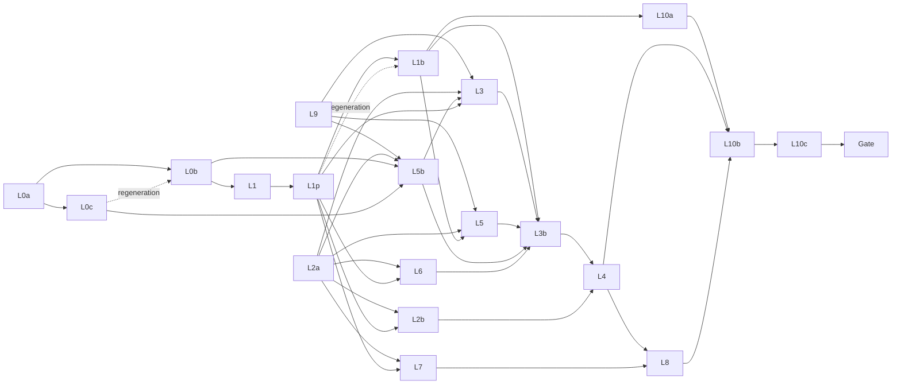

# Lead Workflow Implementation Plan

> **For agentic workers:** REQUIRED SUB-SKILL: Use superpowers:subagent-driven-development (recommended) or superpowers:executing-plans to implement this plan task-by-task. Steps use checkbox (`- [ ]`) syntax for tracking.

**Goal:** Give the project lead a work plan per text and language version (Review / Annotate), case-level bulk selection, one server-derived next step per row, bulk assignment (one person or split evenly), a pipeline view on Progress, and the smaller landing/identity/export changes, as specified in [2026-10-20-lead-workflow-design.md](../specs/2026-10-20-lead-workflow-design.md).

**Architecture:** Migration `0016_work_plans` adds plan rows, case revisions, translation acceptances, discards and two project settings. A pure module `domain/work_plans.py` holds defaults, validity, tri-state merge and consequences; `application/work_plans.py` saves plans under the project lock and is exposed by `api/work_plan_routes.py`. The Documents read model gains a pure next-step derivation (`domain/next_steps.py`) that feeds rows, bar segments, filters, the selection summary and Progress. Bulk assignment reuses `AssignmentService._assign_locked` inside one transaction. The frontend gets three primitives (`PlanChip`, `TriStateButton`, `Toast`) and grouped-table case selection, then rebuilds Documents (6 columns, chips, selection bar), the assign dialog, the plan dialog, the upload "Work plan" step, Progress, landing and Export.

**Tech Stack:** Python 3.12, FastAPI, SQLAlchemy 2, Alembic, PostgreSQL (pytest via Docker testcontainers or `ONTOCURATOR_TEST_PG_URL`); React 18, TypeScript, Vitest + Testing Library, Playwright + axe-core; `openapi-typescript` for `generated.ts`.

**Binding inputs:** the spec above; mockups in `.superpowers/mockups/lead-workflow-20261020/approved/` (`work-plan-flow.html`, `work-plan-by-language.html`, `work-plan-shift-select.html`, `work-plan-step3.html`, `work-plan-step4-assign.html`; binding for layout and copy of the work-plan flow); `PRODUCT.md`; `DESIGN.md`. Where a mockup and the spec differ, the spec wins.

---

## Global rules (every WP; a subagent reads only this section and its WP block)

Worktree: `C:/Users/jan-p/Development/ontocurator/.worktrees/phase0-implementation` (Git Bash: `/c/Users/jan-p/Development/ontocurator/.worktrees/phase0-implementation`), branch `feat/lead-workflow`. Every command runs from the worktree root: `cd /c/Users/jan-p/Development/ontocurator/.worktrees/phase0-implementation && …`.

1. **Subagents never commit, push, `git reset`, `git checkout -- <file>`, `git stash` or `git clean`.** Edit on top of the working tree. The orchestrator commits each WP after its done check (and review, where flagged) with the WP's commit message, staging only the WP's owned files (`git add <files>`, never `git add -A`). No AI attribution lines anywhere (no `Co-Authored-By`, no "Generated with").
2. **Exclusive file ownership.** A WP writes only the files in its **Owns** list (test files included). If it needs another file, it stops and reports. Two WPs never own the same file at the same time; shared files follow the chains in "Shared-file chains".
3. **Prerequisite checks first.** Run the WP's prerequisite commands; if one fails, stop and report. Never re-implement a missing prerequisite.
4. **Shell.** Git Bash. `rg` is not installed; use `grep -rnE`.
5. **Machine limits (16 GB).** At most **two heavy** agents at once. Heavy = backend pytest that touches PostgreSQL, a full Vitest run, Playwright, a `scripts/check.sh` stage. Light = pure-Python pytest files without a database (`tests/test_*_domain.py`, `tests/test_batch_layout.py`), single Vitest files, `npm --prefix frontend run typecheck`, ruff/mypy, generator scripts. At most three light agents at once. Lane **L+** = light, but its one full Vitest run at the end waits until the orchestrator confirms a free heavy slot.
6. **Vitest always** with `--maxWorkers=4 --minWorkers=1`: single file `npm --prefix frontend test -- --maxWorkers=4 --minWorkers=1 tests/<path>`; full suite `npm --prefix frontend test -- --maxWorkers=4 --minWorkers=1`.
7. **Playwright: one run at a time on the machine**, always with `HPO_E2E_PORT=18765` for this plan: `HPO_E2E_PORT=18765 npm --prefix frontend run test:e2e -- <spec>` (it rebuilds `frontend/dist`). If the build fails because another agent is mid-edit, rerun after it finishes; never fix its files. The same holds for the static gate during parallel work: `scripts/check.sh --only static` checks the whole tree (ruff, format, mypy, contract drift), so it may fail on a sibling WP's in-progress files or on a pending regeneration. A WP fixes only failures in its own Owns, reports the others with file names, and the orchestrator reruns the static gate after the sibling WP is done.
8. **Backend tests.** Need Docker running or `ONTOCURATOR_TEST_PG_URL`. Run single files: `uv run pytest tests/<file>.py -q`. Static: `uv run ruff check . && uv run ruff format --check . && uv run mypy src`. The full backend suite (~25 min) runs only where a WP block says so and in the final gate.
9. **Contracts.** `contracts/openapi.json`, `frontend/src/api/generated.ts` and `contracts/admin-error-codes.json` are never hand-edited. Regenerate with `uv run python scripts/export_openapi.py && npm --prefix frontend run api:generate` and `uv run python scripts/export_admin_error_codes.py`; drift checks `uv run python scripts/export_openapi.py --check`, `npm --prefix frontend run api:check`, `uv run python scripts/export_admin_error_codes.py --check` (all three are part of `scripts/check.sh --only static`). One contracts writer at a time, in the order L0b → L1 → L1p → L1b, never while another backend WP is mid-edit on API models. Before a WP's regeneration step, backend WPs verify with ruff/mypy and their pytest files (OpenAPI drift is expected until then).
10. **API changes are additive.** New response fields get defaults (`= None`, `= 0`, `Field(default_factory=…)`) so the generated TypeScript fields stay optional and existing frontend code and fixtures keep compiling. Old fields stay until a frontend WP stops using them; no WP removes a response field.
11. **Migration:** this plan creates `0016_work_plans` (`down_revision = "0015"`). Never renumber; a later migration is `0017+`.
12. **English** for all files and UI copy; icons only from `frontend/src/ui/icons.tsx` (no Unicode glyph icons: "✓"/"✕" in the spec copy are rendered as `IconCheck`/`IconClose` plus text). Status never by colour alone. Native `disabled` is not used for unavailable actions: `aria-disabled` + `aria-describedby` reason (existing `Button` behaviour).
13. **TDD.** Write the listed failing tests first, run them red, implement, run green. Keep the WP's report short.
14. **Hand-back** (final message): changed/created/deleted files (subset of Owns), commands with exit status and one-line result, done checklist item by item, skipped parts and deviations, open risks, the commit message.

## Spec WP mapping

The spec's rough WPs are split where one agent session would be too large; IDs keep the spec prefix.

| Spec WP | Plan WPs |
|---|---|
| L0 | **L0a** schema, migration, store, pure domain · **L0b** plan service, endpoints, eligibility, export scope, `PLAN_RESTORED`, contracts · **L0c** import: package acceptance, upload preview work plan, commit overrides |
| L1 | **L1** next step, bar segments, filters, sort, filtered case IDs · **L1p** PersonRef, workload, `TaskSummary.case_id`, progress stages |
| L1b | **L1b** batch assign preview/commit, selection summary |
| L2 | **L2a** `app/identity.ts` helpers · **L2b** apply them to shared views |
| L3, L3b, L4, L5, L5b, L6, L7, L8, L9 | same IDs |
| L10 | **L10a** browser fixture builders · **L10b** new `lead-workflow.spec.ts` · **L10c** update existing browser specs |

Deviations from the spec's API list (all inside the spec's intent): the filtered case-ID list moves from L0 to L1 (it needs the new filters); the selection summary is `POST …/document-rows/selection-summary` (a body holds up to 2000 case IDs; a query string does not); bulk Undo uses one extra endpoint `PUT …/work-plans/rows` (exact flags and `restored_revision` per row, `undo: true`, D22); the settings hint "{k} rows have more annotators than the new target" uses `GET …/work-plans/annotation-target-preview`; batch assignment is all-or-nothing (spec "Contract"), and "partial refusals" are returned as the 409 details listing each refused case.

## Work packages

| WP | Content | Size | Lane | Depends on | Review |
|---|---|---|---|---|---|
| L0a | Migration 0016, ORM tables, `work_plan_store`, `domain/work_plans.py` | L | H | — | yes (backend-critical) |
| L0b | `application/work_plans.py`, routes, eligibility `NOT_IN_WORK_PLAN`, export/preflight scope, `PLAN_RESTORED`, settings, error codes, contracts | L | H | L0a, L0c (regeneration only) | yes (backend-critical) |
| L0c | Package `translation.review`, upload preview work plan, commit plan overrides and acceptances | M | H | L0a | yes (backend-critical) |
| L1 | `domain/next_steps.py`, facts, bar segments, filters, sort, `GET document-rows/case-ids`, contracts | L | H | L0b | yes (backend-critical) |
| L1p | PersonRef on read models, members `open_tasks` and display-name rule, `TaskSummary.case_id`, progress `lede`/`stages`/`workload`, contracts | M | H | L1 | yes (backend-critical) |
| L1b | `domain/batch_layout.py`, batch preview/commit, selection summary, contracts | M | H | L1, L1p (regeneration only) | yes (backend-critical) |
| L9 | `ui/PlanChip`, `ui/TriStateButton`, `ui/Toast`, DataTable `groupSelection`, `ui/shortcuts.ts` typing guard, CSS, empty screen CSS files, DESIGN.md | S | L+ | — | — |
| L2a | `app/identity.ts` (`personLabel`, `textLabel`) | S | L | — | — |
| L2b | Apply identity/text labels to shared views | M | L+ | L1p, L2a | — |
| L5b | `documents/PlanDialog.tsx`, upload "Work plan" step, Settings › Workflow | M | L+ | L0b, L0c, L9, L2a | — |
| L3 | Documents table: 6 columns, chips with Undo/confirm, collapsed not-in-plan, row actions incl. Resolve and "Assign review or accept…", bar segments, filters, router, cards | L | L+ | L1, L1p, L9, L2a, L5b (`planUndo.ts`) | yes (L) |
| L5 | `admin/AssignWorkDialog.tsx` (row and many cases, One person / Split evenly) | M | L+ | L1b, L9, L2a | — |
| L6 | Landing, "My tasks (n)", shell identity, My tasks text label | S | L+ | L1p, L2a | — |
| L7 | Progress lede, stage cards, People | M | L | L1p, L2a | — |
| L3b | Selection model, header select-all, range/keyboard, selection bar with quick actions, Select by case IDs, Documents wiring of both dialogs | M | L+ | L3, L5, L5b, L6, L1b | — |
| L4 | Expanded row: stage blocks, Submissions when needed, More, acceptance/discard labels | M | L+ | L3b, L2b | — |
| L8 | Report page Decide focus and links; Export preflight on open, plan scope | S | L+ | L3, L4, L7, L2b | — |
| L10a | `tests/browser_lead_workflow_scenarios.py` builders and route | M | H | L1b | — |
| L10b | `frontend/browser/lead-workflow.spec.ts` (D15 scenario and all flows) | M | PW | L10a, L3b, L4, L5, L5b, L6, L7, L8 | — |
| L10c | Update existing browser specs; full browser suite | M | PW | L10b | — (plan review at the gate) |

Review: one review per flagged WP by the `superpowers:code-reviewer` agent (or `agy` with gemini-3.8-flash), read-only, then one fix agent at effort medium. After the final gate, one review of the whole plan's diff. No Codex.

## Shared-file chains (one writer at a time, in this order)

| File(s) | Writers in order |
|---|---|
| `contracts/openapi.json`, `frontend/src/api/generated.ts`, `frontend/src/api/client.ts` | L0b (also covers L0c's upload models) → L1 → L1p → L1b |
| `src/ontocurator/domain/admin_error_codes.py`, `contracts/admin-error-codes.json`, `frontend/src/admin/errors.ts`, `src/ontocurator/api/app.py` | L0b → L1b |
| `src/ontocurator/storage/tables.py` | L0a only |
| `src/ontocurator/domain/document_rows.py` | L0b (`ACKNOWLEDGEABLE` += `PLAN_RESTORED`; `missing_final_counts(per_text=…)`) → L1 |
| `src/ontocurator/assignments/service.py` | L0b (`check_assignable(check_plan=…)`, reassign bypass, D25 `review_accepted_translation`) → L1p (`TaskSummary.case_id`) |
| `src/ontocurator/api/assignment_routes.py` | L0b only (create request field `review_accepted_translation`) |
| `src/ontocurator/application/document_rows.py`, `application/document_row_page.py`, `api/document_row_routes.py`, `tests/document_rows_support.py` | L1 → L1p |
| `src/ontocurator/application/document_row_submissions.py`, `application/document_row_reports.py` | L1p only |
| `frontend/tests/documents/fixtures.ts` | L1 → L1p → L3 → L4 |
| `frontend/tests/projectFixtures.ts` | L0b → L5b |
| `tests/t1_fixtures.py`, `tests/browser_documents_scenarios.py` (fixture-only `plan_all` calls) | L0b only |
| `frontend/src/ui/index.ts`, `frontend/src/ui/DataTable.tsx`, `frontend/src/ui/shortcuts.ts`, `frontend/tests/ui/shortcuts.test.tsx`, `frontend/src/styles/components.css`, `frontend/src/styles/index.css`, `DESIGN.md` | L9 only |
| `frontend/src/documents/planUndo.ts` | L5b only (L3 and L3b import it) |
| `frontend/src/app/router.ts`, `frontend/tests/router.test.ts` | L3 only |
| `frontend/src/admin/DocumentsPage.tsx`, `frontend/tests/documentsPage.test.tsx`, `frontend/tests/documents/finalConfirm.test.tsx` | L3 → L3b → L4 |
| `frontend/src/styles/screens/documents-table.css`, `frontend/src/documents/DocumentsTable.tsx`, `frontend/src/documents/DocumentCards.tsx`, `frontend/tests/documents/documentsTable.test.tsx` | L3 → L3b |
| `frontend/src/documents/TextVersions.tsx`, `frontend/src/documents/SubmissionsTable.tsx`, `frontend/tests/documents/expandedRow.test.tsx`, `frontend/tests/documents/submissionsTable.test.tsx` | L2b → L4 |
| `frontend/tests/variantAdmin.test.tsx`, `variantApp.test.tsx`, `variantAdminApp.test.tsx` (assertion-only edits for the WP's own behaviour) | L6 → L3b → L4 → L8 |
| `frontend/tests/progressExportApp.test.tsx` | L7 → L8 |
| `frontend/tests/problems/leadReportPage.test.tsx`, `frontend/src/problems/*` | L2b → L8 |
| `tests/browser_server.py` | L10a (one registration line) |
| existing `frontend/browser/*.spec.ts` | L10c only |

## Dependency graph



## Wave schedule

A wave's WPs may run at the same time (disjoint owned files, ≤ 2 heavy, ≤ 3 light, ≤ 1 Playwright). A WP starts as soon as its prerequisites are done and its files are free; the orchestrator may start a WP early without breaking the limits.

| Wave | Heavy lane (≤ 2) | Light lane (≤ 3) | Notes |
|---|---|---|---|
| 1 | L0a | L9 (L+), L2a | No prerequisites. |
| 2 | L0b, L0c | — | L0c finishes its API models first; L0b's Task "Contracts" runs after L0c reports done. |
| 3 | L1 | L5b (L+) | L5b: L0b, L0c, L9, L2a. L1 is the second contracts writer. |
| 4 | L1p, L1b | — | L1p regenerates contracts first; L1b starts at once and checks for L1p's contracts only in its Step 6 (regeneration). |
| 5 | L10a | L3 (L+), L5 (L+), L2b (L+) | L3: L1, L1p, L9, L2a, L5b. L5: L1b, L9, L2a. L2b: L1p, L2a. L10a: L1b. |
| 6 | — | L6 (L+), L7 | L6 before L3b (test-file chain). L3 (size L) may still run from wave 5. |
| 7 | — | L3b (L+) | L3b: L3, L5, L5b, L6, L1b. |
| 8 | — | L4 (L+) | L4: L3b, L2b. |
| 9 | — | L8 (L+) | L8: L3, L4, L7, L2b. |
| 10 | L10b (PW) | — | All UI WPs done. |
| 11 | L10c (PW) | — | Runs alone. |
| 12 | Final gate (alone) | — | See "Final gate". |

Count: 20 WPs (L0a, L0b, L0c, L1, L1p, L1b, L2a, L2b, L3, L3b, L4, L5, L5b, L6, L7, L8, L9, L10a, L10b, L10c), each exactly once.

## Dispatching a WP to a subagent

The orchestrator sends one WP per subagent with: the worktree path; the instruction to read **only** "Global rules", "Shared contracts" (the parts the WP block names) and the WP block, plus the spec sections, mockups and code locations the block lists; the WP's wave row (which sibling WPs run at the same time and which files they own); the lane (H, L, L+, PW; for L+ "run the full Vitest suite only when I confirm a free heavy slot"); the hand-back format of rule 14. Implementation agents run at the default effort; a fix agent after a review at effort medium.

**Done check (orchestrator):** compare the reported files with Owns (`git status --short`), rerun the WP's light verification if unclear, tick the done checklist. Then review (flagged WPs only), one fix agent if needed, commit with the WP's message, release the files.

---

## Shared contracts

These names are fixed for all WPs. A WP that produces one implements it exactly; a WP that consumes one relies on it.

### Backend: work plan (L0a/L0b/L0c)

```python
# src/ontocurator/domain/work_plans.py (L0a, pure)
ImportPlanSetting = Literal["nothing", "review_and_annotate_translations"]
TriState = Literal["keep", "on", "off"]
Preset = Literal["review_and_annotate_translations", "annotate_only"]


@dataclass(frozen=True)
class RowKey:
    case_id: str
    language: str


@dataclass(frozen=True)
class PlanFlags:
    review: bool
    annotate: bool


@dataclass(frozen=True)
class LanguageVersion:
    """One Documents row as the plan sees it."""

    case_id: str
    language: str
    is_source: bool  # the row holds the case's native root(s)
    accepted: bool  # every root's newest version is `accepted` (False for sources)
    marked_in_package: bool  # newest version carries a `package` acceptance
    discarded: bool = False  # every root of the row is discarded
    review_blocked: bool = False  # a root's newest version is rejected/queried or has an open translation review (not acceptable externally)


@dataclass(frozen=True)
class LanguageChange:
    review: TriState = "keep"
    annotate: TriState = "keep"


@dataclass(frozen=True)
class OpenTask:
    assignment_id: int
    case_id: str
    language: str
    task: str  # "translation_review" | "annotate" | "review"
    user_id: int


@dataclass(frozen=True)
class OpenReport:
    report_id: str
    case_id: str
    language: str
    assignment_id: int | None
    held: bool  # an active task hold belongs to the report


@dataclass(frozen=True)
class Consequences:
    withdrawn: tuple[OpenTask, ...]
    finals_leaving: tuple[RowKey, ...]
    restored: tuple[RowKey, ...]
    open_reports: tuple[
        OpenReport, ...
    ] = ()  # open reports on rows whose flag turns off; they stay open

    @property
    def any(self) -> bool: ...


@dataclass(frozen=True)
class Invalid:
    key: RowKey
    reason: Literal["source_review", "annotate_not_accepted", "not_acceptable"]


def import_defaults(
    setting: ImportPlanSetting, rows: Sequence[LanguageVersion]
) -> dict[RowKey, PlanFlags]: ...
def validate(
    changes: Mapping[RowKey, PlanFlags],
    rows: Mapping[RowKey, LanguageVersion],
    *,
    rule_on: bool,
    accepting: frozenset[RowKey] = frozenset(),
) -> list[Invalid]: ...
def merge(
    current: Mapping[RowKey, PlanFlags],
    rows: Mapping[RowKey, LanguageVersion],
    case_ids: Sequence[str],
    languages: Mapping[str, LanguageChange],
) -> dict[RowKey, PlanFlags]: ...  # key "source" targets each case's source row(s)
def preset_changes(
    preset: Preset, rows: Iterable[LanguageVersion]
) -> dict[str, LanguageChange]: ...
def consequences(
    old: Mapping[RowKey, PlanFlags],
    new: Mapping[RowKey, PlanFlags],
    open_tasks: Sequence[OpenTask],
    finals: frozenset[RowKey],
    reports: Sequence[OpenReport] = (),
) -> Consequences: ...
def mixed_counts(
    current: Mapping[RowKey, PlanFlags], keys: Iterable[RowKey]
) -> dict[str, int]: ...  # {"review_on", "review_off", "annotate_on", "annotate_off"}
```

Tables (L0a, `src/ontocurator/storage/plan_tables.py`, imported at the end of `storage/tables.py` like `final_tables`): `work_plans(id, project_id, case_id, revision CHECK (revision >= 1), updated_at; unique(project_id, case_id))`, `work_plan_rows(id, project_id, case_id, language, review, annotate, restored_revision NULL, updated_by NULL FK → users, updated_at, created_at; unique(project_id, case_id, language))`, `translation_acceptances(id, project_id, document_id, source CHECK IN ('package','lead','override'), reason NULL CHECK (source = 'package' OR reason IS NOT NULL), accepted_by NULL FK → users, accepted_at, upload_id NULL FK → uploads, metadata jsonb '{}'; FK (project_id, document_id) → documents)`, `discarded_variants(id, project_id, document_id, reason, discarded_by FK → users, discarded_at; unique(project_id, document_id); FK → documents)`. `translation_acceptances` and `discarded_variants` are append-only (added to `APPEND_ONLY_TABLES`). `projects.annotations_per_text` (int, server default 1, CHECK 1–5), `projects.import_plan` (text, server default `'review_and_annotate_translations'`, CHECK in the two values).

Store (L0a, `src/ontocurator/storage/work_plan_store.py`, conn-scoped, no transactions of its own):

```python
def language_versions(
    conn, project_id: int, case_ids: Sequence[str] | None = None
) -> dict[RowKey, LanguageVersion]: ...
def plan_rows(
    conn, project_id: int, case_ids: Sequence[str] | None = None
) -> dict[RowKey, PlanFlags]: ...  # stored rows only
def effective_plan(
    conn, project_id: int, case_ids: Sequence[str] | None = None
) -> dict[
    RowKey, PlanFlags
]: ...  # stored rows, plus import_defaults(project.import_plan) for language versions without a stored row
def revisions(
    conn, project_id: int, case_ids: Sequence[str]
) -> dict[str, int]: ...  # a case without a work_plans row has revision 1
def restored(conn, project_id: int) -> dict[RowKey, int]: ...  # row → restored_revision
def write_rows(
    conn,
    project_id: int,
    rows: Mapping[RowKey, PlanFlags],
    *,
    actor_id: int | None,
    restored: Mapping[RowKey, int | None] = {},
) -> dict[
    str, int
]: ...  # upsert; each touched case stores current revision + 1 (missing row = 1, so the first write stores 2); a key in `restored` sets restored_revision exactly (None clears); other rows clear it when annotate turns off; returns new revisions
def ensure_rows(
    conn, project_id: int, defaults: Mapping[RowKey, PlanFlags]
) -> int: ...  # insert only missing rows (work_plans row inserted at revision 1 when missing), return count
def open_tasks(
    conn, project_id: int, keys: Iterable[RowKey], *, lock: bool = False
) -> list[
    OpenTask
]: ...  # non-revoked, not submitted; lock=True adds .with_for_update(key_share=True) like projects.assignments.unsupported_assignments
def open_reports(
    conn, project_id: int, keys: Iterable[RowKey]
) -> list[
    OpenReport
]: ...  # problem_report_state.state == 'open' on a document of the row; held = an active task_hold_state for it
def final_keys(conn, project_id: int) -> frozenset[RowKey]: ...
def add_acceptance(
    conn,
    project_id: int,
    document_id: str,
    *,
    source: str,
    reason: str | None,
    accepted_by: int | None,
    upload_id: int | None = None,
    metadata: Mapping[str, Any] = {},
) -> None: ...
def acceptances(
    conn, project_id: int
) -> dict[str, dict[str, Any]]: ...  # newest acceptance per document_id
def discarded(conn, project_id: int) -> dict[str, dict[str, Any]]: ...
```

Error codes (L0b adds to `ADMIN_ERROR_CODES`, `errors.ts` messages and the `app.py` status map): `WORK_PLAN_CONFIRMATION_REQUIRED` (409), `WORK_PLAN_CHANGED` (409), `WORK_PLAN_INVALID` (422), `NOT_IN_WORK_PLAN` (409), `CASE_IDS_TOO_MANY` (422), `VARIANT_ALREADY_DISCARDED` (409). L1b adds `ASSIGNMENT_BATCH_STALE` (409) and `ASSIGNMENT_BATCH_REFUSED` (409).

API models (L0b, `src/ontocurator/api/work_plan_routes.py`; `PersonRefView` in `src/ontocurator/api/person_views.py`, loader `person_refs` in `src/ontocurator/application/people.py`):

```python
class PersonRefView(BaseModel):  # display_name only for lead callers; None otherwise
    pseudonym: str
    display_name: str | None = None
    is_me: bool = False


class PlanFlagsView(BaseModel):
    review: bool
    annotate: bool
    review_applicable: bool
    discarded: bool = False


class RowRefView(BaseModel):
    case_id: str
    language: str


class WithdrawnTaskView(BaseModel):
    assignment_id: int
    case_id: str
    language: str
    task: Task
    person: PersonRefView


class OpenReportView(BaseModel):
    report_id: str
    case_id: str
    language: str
    assignment_id: int | None = None
    held: bool = False


class ConsequencesView(BaseModel):
    withdrawn: list[WithdrawnTaskView]
    finals_leaving: list[RowRefView]
    restored: list[RowRefView]
    open_reports: list[OpenReportView] = []


class UndoRowView(BaseModel):
    case_id: str
    language: str
    review: bool
    annotate: bool
    restored_revision: int | None = None


class UndoView(BaseModel):
    rows: list[UndoRowView]
    revisions: dict[str, int]


class AcceptExternalReview(BaseModel):
    reason: str = Field(min_length=1, max_length=2000)


# PATCH /api/v1/projects/{key}/work-plans/{case_id:path}/{language}
class PlanRowPatch(BaseModel):
    review: bool | None = None
    annotate: bool | None = None
    expected_revision: int
    confirm: bool = False
    accept_external_review: AcceptExternalReview | None = None


class PlanRowResult(BaseModel):
    case_id: str
    language: str
    flags: PlanFlagsView
    revision: int
    undo: UndoView
    withdrawn: list[WithdrawnTaskView]
    accepted_document_ids: list[str]


# POST /work-plans/bulk/preview, PUT /work-plans/bulk
class LanguageChangeView(BaseModel):
    review: TriState = "keep"
    annotate: TriState = "keep"


class BulkAcceptance(BaseModel):
    languages: list[str] = Field(min_length=1)
    reason: str = Field(min_length=1, max_length=2000)


class BulkPlanRequest(BaseModel):
    case_ids: list[str] = Field(min_length=1, max_length=2000)
    languages: dict[str, LanguageChangeView] = Field(
        default_factory=dict
    )  # "source" = each case's source row(s)
    preset: Preset | None = None
    accept_external_review: BulkAcceptance | None = None
    expected_revisions: dict[str, int] | None = None
    confirm: bool = False


class MixedCountView(BaseModel):
    on: int
    off: int


class LanguagePreviewView(BaseModel):
    key: str  # "source" or a language code
    source_languages: list[str]  # for key "source": e.g. ["en", "fr"] with counts below
    cases_in_selection: int
    review: MixedCountView | None  # None for "source"
    annotate: MixedCountView
    will_change: int  # rows whose flags change
    not_accepted: int  # translations not accepted (rule on, Annotate on, Review off)
    not_acceptable: int = 0  # of these: rejected/queried or with an open review (external acceptance refused)
    in_review: int = 0  # subset of not_acceptable with an open translation review
    marked_in_package: int


class BulkPreview(BaseModel):
    cases: int
    languages: list[LanguagePreviewView]
    changes: int
    to_assign: dict[str, int]
    consequences: ConsequencesView
    invalid: list[RowRefView]
    revisions: dict[str, int]
    rule_on: bool


class BulkResult(BaseModel):
    changed_rows: int
    revisions: dict[str, int]
    undo: UndoView
    withdrawn: list[WithdrawnTaskView]


# PUT /work-plans/rows (bulk Undo; exact flags and restored_revision per row)
class PlanRowsSet(BaseModel):
    rows: list[UndoRowView] = Field(min_length=1, max_length=20000)
    expected_revisions: dict[str, int]
    undo: bool = False
    confirm: bool = False


# undo=True (D22): restored_revision written exactly, no PLAN_RESTORED, finals/restored never need confirm; confirm needed only when tasks assigned after the change would be withdrawn


# GET /work-plans/annotation-target-preview?annotations_per_text=n
class AnnotationTargetPreview(BaseModel):
    rows_over_target: int


# POST /case-ids/lookup
class CaseIdLookup(BaseModel):
    ids: list[str] = Field(max_length=5000)


class CaseIdLookupResult(BaseModel):
    found: list[str]
    unknown: list[str]


# POST /variants/{document_id:path}/discard
class DiscardRequest(BaseModel):
    reason: str = Field(min_length=1, max_length=2000)
    confirm: bool = False
```

409 `WORK_PLAN_CONFIRMATION_REQUIRED` details = `ConsequencesView` JSON. 422 `WORK_PLAN_INVALID` details = `{"reason": "source_review" | "annotate_not_accepted" | "not_acceptable", "rows": [{"case_id", "language", "not_accepted": int, "not_acceptable": int, "marked_in_package": int}]}`. 409 `WORK_PLAN_CHANGED` details = `{"cases": [{"case_id", "revision"}]}`. Project settings: `ProjectSettingsChange` gains `annotations_per_text: int | None = Field(None, ge=1, le=5)` and `import_plan: ImportPlanSetting | None = None` (`None` keeps the stored value; the settings change is a full replace, so this keeps the existing settings page from resetting them in the window between L0b and L5b); `ProjectSettings` returns both as concrete values (`int`, `ImportPlanSetting`). The create-assignment request (`api/assignment_routes.py`) gains `review_accepted_translation: bool = False` (D25). Final preflight (`FinalPreflight`) gains `not_in_plan: list[RowRefView] = []` (rows with a final result and Annotate off; informational, never acknowledged).

Upload (L0c): `ImportPlan.work_plan: UploadWorkPlan | None = None` with `UploadWorkPlan = {setting, languages: [{key ("source" | code), source_languages, versions, review: bool | None, annotate: bool, source_rule: "always" | "if_no_translation" | None, marked_in_package, not_accepted}], cases: [{case_id, language, review: bool | None, annotate, new_row: bool}], existing_rows_kept: int}`. `CommitUpload` gains `plan_languages: dict[str, PlanChoice] = {}`, `plan_cases: list[CasePlanChoice] = []`, `accept_external_review: BulkAcceptance | None = None` (`PlanChoice = {review: bool | None, annotate: bool}`, `CasePlanChoice = {case_id, language, review: bool | None, annotate: bool}`).

### Backend: next step and identity (L1/L1p)

```python
# src/ontocurator/domain/next_steps.py (L1, pure)
StepCode = Literal[
    "decide_report",
    "resume_task",
    "confirm_final",
    "resolve_rejected",
    "resolve_queried",
    "translation_not_accepted",
    "choose_final",
    "assign_translation_review",
    "translation_review_in_progress",
    "assign_annotation",
    "annotation_in_progress",
    "annotation_review_in_progress",
    "waiting_for_translation_review",
    "done",
    "translation_accepted",
]
StepKind = Literal["decision", "assign", "in_progress", "done"]
Stage = Literal["translation_review", "annotation", "final", "done"]
Segment = Literal["decision", "assign", "progress"]
RowAction = Literal[
    "decide_report",
    "resume_task",
    "review_changes",
    "resolve",
    "accept_or_review",
    "choose_final",
    "assign_translation_review",
    "assign_annotation",
]


@dataclass(frozen=True)
class StepFacts:
    review: bool
    annotate: bool
    is_source: bool
    rule_on: bool
    per_text: int
    open_report_id: str | None
    orphan_pause_assignment_id: int | None
    unacknowledged_final_cause: bool  # incl. PLAN_RESTORED
    newest_decisions: tuple[
        str | None, ...
    ]  # latest review decision per root's newest version (realistic: "rejected"/"query" only with status "reviewed")
    translation_statuses: tuple[
        str | None, ...
    ]  # newest version status per root (Version.not_newer corrections skipped, as bulk_target)
    open_translation_reviews: int
    annotation_assignments: (
        int  # non-revoked annotate assignments, minimum over the row's target versions
    )
    open_annotations: int
    open_annotation_reviews: int
    missing_final: (
        bool  # missing_final_counts(..., per_text=per_text), restricted to Annotate on
    )
    has_final: bool
    check_failed: bool  # a newest version is automatic_check_failed


@dataclass(frozen=True)
class Step:
    code: StepCode
    kind: StepKind
    stage: Stage
    action: RowAction | None
    badges: tuple[Literal["your_decision", "check_failed", "paused"], ...]
    assigned: int | None = None
    target: int | None = None


def in_plan(
    facts: StepFacts,
) -> bool: ...  # review or annotate; the only source of "in plan" (never `not steps`)
def derive_steps(
    facts: StepFacts,
) -> list[
    Step
]: ...  # all matching rules in precedence order; [] when not in_plan; never [] when in_plan
def segment_of(
    step: Step,
) -> (
    Segment | None
): ...  # decision: rules 1-5 and 4a, assign: 6 and 8, progress: 7, 9, 10
```

API (L1, `api/document_row_routes.py`): `DocumentRowView` gains `next_step: NextStepView | None = None`, `steps: list[NextStepView] = []`, `plan_row: PlanFlagsView | None = None`, `in_plan: bool = True`; `DocumentGroupView` gains `plan_revision: int = 1`, `not_in_plan_languages: list[str] = []`; `DecisionBarView` gains `in_plan: int = 0`, `needs_decision: int = 0`, `to_assign: int = 0`, `in_progress: int = 0`, `decision_categories: dict[str, int] = {}`. `NextStepView = {code, kind, stage, action, badges, assigned, target, owner: StepOwnerView, detail: StepDetailView | None, report_id, assignment_id, document_id}`; `StepOwnerView = {kind: "you" | "person" | "people" | "none", person: PersonRefView | None, count: int}`; `StepDetailView = {kind: "version" | "source_ready" | "annotations_submitted" | "round" | "report" | "final" | "review_only" | "waiting", version, origin, translation_status, submitted, total, round_ordinal, excerpt, reporter: PersonRefView | None, task_paused: bool}`. Query parameters added: `segment` (`decision|assign|progress`, exclusive with `decision`), `step` (StepCode), `stage`, `owner` (`me` or a pseudonym), `plan` (`review|annotate|review_and_annotate|not_in_plan`), `final` adds `none`, `sort` (`case|import|activity`, default `case`). `GET /api/v1/projects/{key}/document-rows/case-ids` (same filters) → `{case_ids: list[str], total: int, truncated: bool}` (max 2000, list order). `application/document_row_page.py` also exports `sorted_case_ids(facts, case_ids, sort) -> list[str]` (Documents order of any case-ID set; L1b uses it) and `cases_not_shown(facts, case_ids, query) -> int` (selected cases with no row matching the filters).

L1p: `PersonRefView` fields added next to the existing label strings (`WorkItemView.person`, `FinalSelectionSummary.author`, `RowSubmissionView.author`, `RowRoundView.author`, `OpenTranslationReviewView.reviewer`, `ReportIssueView.reporter`, `RowProblemReport.reporter`, all `= None`). `Member.open_tasks: OpenTasksView = {translation_review: 0, annotate: 0, review: 0}`; for non-lead callers `Member.display_name` and `Member.username` of other people are `""` (pseudonym only; own record complete). `TaskSummary.case_id: str | None = None`. `ProjectProgress` gains `lede: ProgressLedeView | None`, `stages: ProgressStagesView | None`, `workload: list[ProgressWorkloadView] = []` (shapes in the L1p block).

### Backend: batch assignment (L1b)

```python
# src/ontocurator/domain/batch_layout.py (pure)
def layout(
    case_ids: Sequence[str],
    people: Sequence[str],
    *,
    mode: Literal["one", "split"],
    remaining: Mapping[str, int],
    already: Mapping[str, frozenset[str]],
) -> tuple[dict[str, list[str]], list[str]]: ...


# remaining = per case: target minus non-revoked assignments (translation review: always 1); a case with 0 is skipped
# returns (case → usernames, skipped cases with reason already_assigned)


# POST /api/v1/projects/{key}/assignments/batch/preview
class DocumentRowFilters(
    BaseModel
):  # the Documents filters, same names and values as the L1 query parameters
    language: str | None = None
    case: str | None = None
    segment: Segment | None = None
    step: StepCode | None = None
    stage: Stage | None = None
    owner: str | None = None
    plan: str | None = None
    final: str | None = None
    origin: str | None = None
    translation_status: str | None = None
    status: str | None = None


class BatchAssignRequest(BaseModel):
    task: Literal["translation_review", "annotate", "review"]
    language: str
    case_ids: list[str] = Field(
        min_length=1, max_length=2000
    )  # the selection; the server orders it by `sort` + `filters`
    sort: Literal["case", "import", "activity"] = "case"
    filters: DocumentRowFilters = Field(default_factory=DocumentRowFilters)
    mode: Literal["one", "split"]
    usernames: list[str] = Field(default_factory=list, max_length=50)
    review_accepted_translation: bool = (
        False  # D25: translation review of an externally accepted version
    )


class BatchSkipView(BaseModel):
    case_id: str
    language: str
    reason: Literal[
        "waiting_for_review",
        "not_in_plan",
        "already_assigned",
        "step_differs",
        "discarded",
    ]


class BatchTargetView(BaseModel):
    case_id: str
    language: str
    document_id: str
    version: int
    remaining: int
    usernames: list[str]


class BatchPersonView(BaseModel):
    username: str
    person: PersonRefView
    reads: list[str]
    open_before: int
    open_after: int
    gets: int
    first_case: str | None
    last_case: str | None
    language_mismatch: bool
    unavailable: Literal["does_not_read", "role_missing", "inactive"] | None
    already_assigned: int


class BatchPreview(BaseModel):
    task: str
    language: str
    versions: int
    targets: list[BatchTargetView]
    skipped: list[BatchSkipView]
    people: list[BatchPersonView]
    per_text: int
    digest: str


# POST /api/v1/projects/{key}/assignments/batch
class BatchAssignBody(BatchAssignRequest):
    expected_preview_digest: str
    confirm_language: bool = False


class BatchAssignResult(BaseModel):
    created: list[AssignmentView]


# 409 ASSIGNMENT_BATCH_REFUSED details: {"refused": [{case_id, language, document_id, username, code}]}; 409 ASSIGNMENT_BATCH_STALE
# POST /api/v1/projects/{key}/document-rows/selection-summary
class SelectionSummaryRequest(BaseModel):
    case_ids: list[str] = Field(min_length=1, max_length=2000)
    filters: DocumentRowFilters = Field(default_factory=DocumentRowFilters)


class AssignableStepView(BaseModel):
    task: str
    language: str
    versions: int
    cases: int


class SelectionSummary(BaseModel):
    cases: int
    steps: list[AssignableStepView]
    skipped: dict[str, int]
    common: AssignableStepView | None
    not_shown: int = 0


# a row counts for a task when ANY of its steps (not only the first) is that assign step; preview and summary use the same match
```

### Frontend (L9, L2a, L5, L5b, L3b)

```ts
// frontend/src/ui/PlanChip.tsx (L9)
export interface PlanChipProps { kind: "review" | "annotate"; pressed: boolean; name: string; busy?: boolean; size?: "table" | "card"; onToggle: () => void }
// frontend/src/ui/TriStateButton.tsx (L9)
export type TriState = "keep" | "on" | "off";
export interface TriStateButtonProps { value: TriState; mixed?: string /* title, e.g. "12 on, 8 off"; shows "mixed" instead of "keep" */; label: string /* "Review, fr" */; describedBy?: string; disabled?: boolean; onChange: (next: TriState) => void }
export const nextTriState: (value: TriState) => TriState; // keep → on → off → keep
// frontend/src/ui/Toast.tsx (L9)
export interface ToastMessage { id: number; message: string; actionLabel?: string; onAction?: () => void; note?: string }
export function useToast(): { toast: ToastMessage | null; show: (t: Omit<ToastMessage, "id">) => void; dismiss: () => void };
export function Toast(props: { toast: ToastMessage | null; onDismiss: () => void; durationMs?: number /* 10000 */ }): JSX.Element;
// frontend/src/ui/DataTable.tsx (L9) — additive
export type GroupSelectMode = "toggle" | "range" | "toggle-keep-anchor" | "select";
export interface GroupSelection { selected: (groupKey: string) => boolean; onSelect: (groupKey: string, mode: GroupSelectMode) => void; checkboxLabel: (groupKey: string) => string }
// DataTableProps gains: groupSelection?: GroupSelection
// frontend/src/app/identity.ts (L2a)
export interface PersonRef { pseudonym: string; display_name?: string | null; is_me?: boolean }
export function personLabel(person: PersonRef | null | undefined, options?: { fallback?: string }): string; // "Ana Weber (ann-0004)", "Ana Weber (ann-0002, you)", "ann-0004"
export function textLabel(text: { case_id: string; language: string; version?: number | null }, options?: { withVersion?: boolean }): string; // "case-0101 · de", "case-0101 · de v2"
// frontend/src/admin/AssignWorkDialog.tsx (L5)
export type AssignWorkTask = "translation_review" | "annotate" | "review";
export type AssignWorkDialogProps =
  | { mode: "row"; projectKey: string; row: DocumentRowView; task: AssignWorkTask; newReviewOfAccepted?: boolean /* D25 */; onClose: () => void; onAssigned: (message: string) => void }
  | { mode: "cases"; projectKey: string; caseIds: readonly string[]; sort: "case" | "import" | "activity"; filters: DocumentRowFilters /* server orders caseIds by these */; onClose: () => void; onAssigned: (message: string, skipped: readonly string[]) => void };
// frontend/src/documents/PlanDialog.tsx (L5b)
export interface PlanDialogProps { projectKey: string; caseIds: readonly string[]; initial?: Record<string, { review?: TriState; annotate?: TriState }> /* preset or acceptance entry */; onClose: () => void; onSaved: (result: BulkResult, summary: string) => void }
// frontend/src/documents/planUndo.ts (L5b; used by L3 chips and L3b bulk saves)
export type PlanUndoOutcome = { kind: "done"; revisions: Record<string, number> } | { kind: "needs_confirm"; consequences: ConsequencesView } | { kind: "changed"; cases: { case_id: string; revision: number }[] };
export function runPlanUndo(projectKey: string, undo: UndoView, options?: { confirm?: boolean }): Promise<PlanUndoOutcome>; // PUT …/work-plans/rows with undo: true
// frontend/src/documents/useCaseSelection.ts (L3b)
export const MAX_SELECTION = 2000;
export interface CaseSelection { ids: ReadonlySet<string>; anchor: string | null; select: (caseId: string, mode: GroupSelectMode, order: readonly string[]) => void; replace: (ids: Iterable<string>) => { truncated: boolean }; add: (ids: Iterable<string>) => { truncated: boolean }; clear: () => void } // never holds more than MAX_SELECTION
```

Router (L3 adds; others consume): `ProjectDocumentsQuery` gains `segment`, `step`, `stage`, `owner`, `plan`, `sort`; the problem-report route gains `section?: "decide"` (`#/projects/{key}/problem-reports/{id}?section=decide`).

---

## WP blocks

### L0a: Schema, migration 0016, store, pure work-plan domain

- **Goal:** persistent work plans and the pure rules every later WP uses.
- **Spec:** "Work plan" (Concept, Project default for imports, Editing after work started, Migration of existing projects), "Backend and API" › "Work plan, selection, acceptance" (Data model, Domain).
- **Shared contracts:** "Backend: work plan" (domain, tables, store).
- **Owns:** `src/ontocurator/storage/migrations/versions/0016_work_plans.py` (create), `src/ontocurator/storage/plan_tables.py` (create), `src/ontocurator/storage/tables.py` (two `ProjectRow` columns, `APPEND_ONLY_TABLES` += 2 names, one import line at the end), `src/ontocurator/storage/work_plan_store.py` (create), `src/ontocurator/domain/work_plans.py` (create), `tests/test_work_plans_domain.py`, `tests/test_work_plan_migration.py`, `tests/test_work_plan_store.py` (create).
- **Size / lane / review:** L / heavy / yes (backend-critical).
- **Code to read:** `storage/final_tables.py` (mapping style), `storage/migrations/versions/0013_problem_reports.py` (grants: `GRANT SELECT, INSERT` for append-only, `SELECT, INSERT, UPDATE` otherwise) and `0015_problem_report_lifecycle.py` (header), `storage/tables.py:78-122` (`ProjectRow`), `:158-206` (`DocumentRow`), `tests/test_problem_report_migration.py` (migration test pattern with `unmigrated_database_url`), `tests/test_schema.py` (mapped tables must equal the migration), `domain/variants.py` (`resolve_translation_lineage`, `TRANSLATION_ORIGINS`), `domain/document_rows.py:79-175` (`Version`, `build_chains`).
- **Prerequisites:** `ls src/ontocurator/storage/migrations/versions/ | grep -c '^0016'` prints `0`; `test ! -e src/ontocurator/domain/work_plans.py`.

- [ ] **Step 1: Failing domain tests** (`tests/test_work_plans_domain.py`, pure, light):

```python
"""Pure work-plan rules (spec "Work plan"); no database."""

from ontocurator.domain.work_plans import (
    LanguageChange,
    LanguageVersion,
    OpenReport,
    OpenTask,
    PlanFlags,
    RowKey,
    consequences,
    import_defaults,
    merge,
    mixed_counts,
    preset_changes,
    validate,
)

ON_ON, OFF_ON = PlanFlags(True, True), PlanFlags(False, True)
ON_OFF, OFF_OFF = PlanFlags(True, False), PlanFlags(False, False)


def lv(case, lang, *, source=False, accepted=False, marked=False, blocked=False):
    return LanguageVersion(case, lang, source, accepted, marked, review_blocked=blocked)


def test_nothing_planned_puts_every_row_out_of_plan():
    rows = [lv("c1", "en", source=True), lv("c1", "de")]
    assert set(import_defaults("nothing", rows).values()) == {OFF_OFF}


def test_review_and_annotate_all_translations_default():
    rows = [
        lv("c1", "en", source=True),
        lv("c1", "de"),
        lv("c1", "fr", accepted=True, marked=True),
        lv("c2", "en", source=True),
    ]
    got = import_defaults("review_and_annotate_translations", rows)
    assert got[RowKey("c1", "en")] == OFF_OFF  # source with translations
    assert got[RowKey("c1", "de")] == ON_ON
    assert got[RowKey("c1", "fr")] == OFF_ON  # marked as reviewed in the package
    assert got[RowKey("c2", "en")] == OFF_ON  # source without translation


def test_validate_refuses_source_review_and_unaccepted_annotation_with_rule_on():
    en, de = RowKey("c1", "en"), RowKey("c1", "de")
    rows = {en: lv("c1", "en", source=True), de: lv("c1", "de")}
    bad = validate({en: ON_ON, de: OFF_ON}, rows, rule_on=True)
    assert [(i.key.language, i.reason) for i in bad] == [
        ("en", "source_review"),
        ("de", "annotate_not_accepted"),
    ]
    assert validate({de: OFF_ON}, rows, rule_on=False) == []
    assert validate({de: ON_ON}, rows, rule_on=True) == []
    assert validate({de: OFF_ON}, rows, rule_on=True, accepting=frozenset({de})) == []


def test_validate_refuses_external_acceptance_of_rejected_queried_or_in_review():
    de = RowKey("c1", "de")
    rows = {de: lv("c1", "de", blocked=True)}
    bad = validate({de: OFF_ON}, rows, rule_on=True, accepting=frozenset({de}))
    assert [i.reason for i in bad] == ["not_acceptable"]


def test_merge_is_tri_state_and_source_key_targets_each_case_source():
    keys = [("c1", "en"), ("c1", "de"), ("c2", "en"), ("c2", "fr")]
    rows = {RowKey(c, lang): lv(c, lang, source=(lang == "en")) for c, lang in keys}
    current = {RowKey("c1", "de"): ON_OFF, RowKey("c2", "fr"): OFF_OFF}
    got = merge(
        current,
        rows,
        ["c1", "c2"],
        {"de": LanguageChange(annotate="on"), "source": LanguageChange(annotate="off")},
    )
    assert got[RowKey("c1", "de")] == ON_ON  # review kept, annotate set
    assert RowKey("c2", "de") not in got  # no de row in c2: never created
    assert got[RowKey("c1", "en")] == OFF_OFF
    assert got[RowKey("c2", "en")] == OFF_OFF
    assert RowKey("c2", "fr") not in got  # language not in the change set


def test_presets_expand_over_translation_rows():
    rows = [lv("c1", "en", source=True), lv("c1", "de"), lv("c1", "fr")]
    assert preset_changes("review_and_annotate_translations", rows) == {
        "de": LanguageChange("on", "on"),
        "fr": LanguageChange("on", "on"),
    }
    assert preset_changes("annotate_only", rows) == {
        "de": LanguageChange("keep", "on"),
        "fr": LanguageChange("keep", "on"),
    }


def test_consequences_cover_the_editing_table():
    key = RowKey("c1", "fr")
    tasks = [
        OpenTask(1, "c1", "fr", "translation_review", 7),
        OpenTask(2, "c1", "fr", "annotate", 8),
        OpenTask(3, "c1", "fr", "review", 9),
    ]
    review_off = consequences({key: ON_ON}, {key: OFF_ON}, tasks, frozenset())
    assert [t.assignment_id for t in review_off.withdrawn] == [1]
    annotate_off = consequences({key: ON_ON}, {key: ON_OFF}, tasks, frozenset({key}))
    assert [t.assignment_id for t in annotate_off.withdrawn] == [2, 3]
    assert annotate_off.finals_leaving == (key,)
    restored = consequences({key: ON_OFF}, {key: ON_ON}, [], frozenset({key}))
    assert restored.restored == (key,) and restored.any
    assert not consequences({key: OFF_OFF}, {key: ON_ON}, [], frozenset()).any


def test_consequences_list_open_reports_of_rows_turned_off():
    key = RowKey("c1", "fr")
    report = OpenReport("r1", "c1", "fr", 2, True)
    got = consequences({key: ON_ON}, {key: ON_OFF}, [], frozenset(), [report])
    assert got.open_reports == (report,) and got.any
    assert (
        consequences(
            {key: OFF_ON}, {key: ON_ON}, [], frozenset(), [report]
        ).open_reports
        == ()
    )


def test_mixed_counts():
    cur = {RowKey("a", "de"): ON_ON, RowKey("b", "de"): OFF_OFF}
    assert mixed_counts(cur, cur.keys()) == {
        "review_on": 1,
        "review_off": 1,
        "annotate_on": 1,
        "annotate_off": 1,
    }
```

- [ ] **Step 2:** `uv run pytest tests/test_work_plans_domain.py -q` → FAIL (module missing).
- [ ] **Step 3: Implement `domain/work_plans.py`** with the signatures in "Shared contracts". Rules: `import_defaults` — under `review_and_annotate_translations` a translation row is `PlanFlags(False, True)` when `marked_in_package`, else `PlanFlags(True, True)`; a source row is `PlanFlags(False, True)` only when its case has no translation row, else off/off; under `nothing` every row is off/off. `validate` returns entries in input order: `source_review` when a source row has `review`; `not_acceptable` when the key is in `accepting` and the row is `review_blocked`; `annotate_not_accepted` when `rule_on`, translation row, `annotate`, not `review`, not `accepted`, key not in `accepting`. `merge` returns only rows of the selected cases whose language (or `"source"` for source rows) is in `languages`; `keep` preserves the current flag (missing current = off/off); a source row ignores `review`. `consequences`: withdraw `translation_review` tasks when review goes on → off; `annotate` and `review` tasks when annotate goes on → off; `finals_leaving` when annotate on → off and the key has a final; `restored` when annotate off → on and the key has a final; `open_reports` = the given reports on rows where review or annotate goes on → off. Tuples sorted by `(case_id, language, assignment_id)` (reports by `(case_id, language, report_id)`).
- [ ] **Step 4:** Step 2 again → PASS.
- [ ] **Step 5: Tables and migration.** `plan_tables.py` maps the four tables of "Shared contracts" (`Identity()` keys; `ForeignKey(f"{SCHEMA}.projects.id")`; `ForeignKeyConstraint(["project_id", "document_id"], [f"{SCHEMA}.documents.project_id", f"{SCHEMA}.documents.document_id"])`; check constraints named `source`, `reason_required` and `revision` (`revision >= 1` on `work_plans`); foreign keys `updated_by`, `accepted_by`, `discarded_by` → `f"{SCHEMA}.users.id"`, `upload_id` → `f"{SCHEMA}.uploads.id"`). `ProjectRow` gains `annotations_per_text: Mapped[int] = mapped_column(server_default=text("1"))` with `CheckConstraint("annotations_per_text BETWEEN 1 AND 5", name="annotations_per_text")` and `import_plan: Mapped[str] = mapped_column(server_default=text("'review_and_annotate_translations'"))` with `CheckConstraint("import_plan IN ('nothing', 'review_and_annotate_translations')", name="import_plan")`. `0016_work_plans.py` (`revision = "0016"`, `down_revision = "0015"`; `downgrade()` raises `NotImplementedError("Migrations are forward-only")` like 0013 and 0015) creates the tables, grants like 0013, adds the project columns, then migrates data in SQL, each flag separately (spec D23: a flag not forced on by existing work takes the import default):
  1. language rows = distinct `(project_id, case_id, language)` of `documents`; a source row has a document with `origin = 'native'`. `review_work` = a translation_review assignment on a document of the row OR a translation_reviews record for one; `annotation_work` = an annotate/review assignment on a document of the row OR a submission for one OR a final_selections row for (project_id, case_id, language). The default ("Review and annotate all translations") is translation on/on; source annotate on only when the case has no non-source row.
  2. `review = NOT source AND (review_work OR (NOT annotation_work AND default review))` — off for rows with other work but no review work.
  3. `annotate = annotation_work OR default annotate` — so review-only rows get Annotate on.
  4. one `work_plans` row per `(project_id, case_id)`, `revision = 1`.
  5. `override` acceptances from `audit_events` with `action = 'variant.status_override'` (document = `target_id`, `reason = details->>'reason'`, `accepted_by = actor_user_id`, `accepted_at = at`, `upload_id` NULL), newest per document, only while the document is still `accepted`.
  6. one `audit_events` row per project with the columns `record_audit` writes (`auth/audit.py`): `at = now()`, `actor_user_id = NULL`, `actor_label = 'migration'`, `action = 'work_plan.migrate'`, `target_type = 'project'`, `target_id = project_key`, `project_id`, details `{"rows", "review", "annotate", "not_in_plan"}`.
- [ ] **Step 6: Migration tests** (`tests/test_work_plan_migration.py`, heavy; seed at 0015 like `test_problem_report_migration.py`, then `upgrade`): `test_rows_with_work_keep_their_work_in_plan`, `test_rows_without_work_get_the_default`, `test_review_only_rows_get_annotate_from_the_default` (D23), `test_rows_with_annotation_work_only_keep_review_off`, `test_no_row_with_work_is_out_of_plan`, `test_override_audit_becomes_acceptance_record`, `test_project_settings_defaults_and_checks` (1 and the default plan; 0, 6 and an unknown plan refused), `test_acceptances_and_discards_are_append_only` (app role cannot UPDATE/DELETE), `test_migration_is_audited_per_project` (asserts `actor_user_id IS NULL`, `actor_label`, `at`), `test_downgrade_is_not_supported`.
- [ ] **Step 7: Store** (`work_plan_store.py`). `language_versions` derives `is_source`, `accepted` (every root's newest version `accepted`, via `domain.document_rows.build_chains`), `marked_in_package` (newest version has a `package` acceptance), `discarded` (every root discarded) and `review_blocked` (a root's newest version is `reviewed` with latest decision `rejected`/`query`, or has an open translation review). Newest version per root skips `Version.not_newer` corrections, as `bulk_target` does. `revisions` returns 1 for a case without a `work_plans` row. `write_rows` upserts (`ON CONFLICT (project_id, case_id, language) DO UPDATE`), sets `updated_by`/`updated_at`, sets `restored_revision` exactly for keys in `restored` (None clears) and clears it on other rows when annotate turns off, stores **current revision + 1** once per touched case (missing row = 1, so the first write inserts 2) and returns the new revisions. `open_tasks(lock=True)` locks with `.with_for_update(key_share=True)` as `projects.assignments.unsupported_assignments` does. `open_reports` reads `problem_report_state.state = 'open'` for reports on documents of the rows and `task_hold_state.active` for `held`.
  `effective_plan` is the only way later WPs read flags: a language version without a stored row (documents inserted outside an import, e.g. by older test fixtures) behaves as the project default computes it.
- [ ] **Step 8: Store tests** (`tests/test_work_plan_store.py`, heavy; documents via `Repository.add_documents_and_proposals` as in `tests/test_variants_storage.py`): `test_language_versions_detect_source_accepted_and_parallel_roots` (two MT roots into `fr`: accepted only when both newest are), `test_revisions_default_to_1_and_write_rows_stores_current_plus_one` (missing → 1; first write → 2; second → 3; two rows of one case in one call bump once), `test_write_rows_sets_and_clears_restored_revision_exactly`, `test_ensure_rows_inserts_only_missing`, `test_open_reports_lists_open_reports_and_active_holds`, `test_language_versions_flag_review_blocked`, `test_effective_plan_falls_back_to_project_default`, `test_open_tasks_excludes_revoked_and_submitted`, `test_acceptance_requires_reason_except_package`.
- [ ] **Step 9: Verify:** `uv run pytest tests/test_work_plans_domain.py tests/test_work_plan_migration.py tests/test_work_plan_store.py tests/test_schema.py -q`; `uv run ruff check . && uv run ruff format --check . && uv run mypy src`.
- **Done:** domain tests pass without a database; `test_schema.py` passes (mapped tables equal the migration; append-only parametrisation includes both new tables); the five migration bullets of the spec are covered; no other module changed.
- **Commit:** `feat(work-plans): add work plan schema, migration 0016 and pure plan rules`

### L0b: Plan service, endpoints, eligibility, export scope, PLAN_RESTORED, settings, contracts

- **Goal:** every plan write path of the spec, its effects on assignment, export and final causes, and the regenerated contracts.
- **Spec:** "Work plan" (Concept, Selection bar, Inline plan chips, Plan dialog, Annotate without review, Editing after work started, Discarding a language version), "Concepts › Stage", "Screens › Export" (plan scope), "Settings › Workflow", "Backend and API" (L0 list), "Testing" (Contract).
- **Shared contracts:** "Backend: work plan" (all).
- **Owns:** `src/ontocurator/application/work_plans.py`, `src/ontocurator/application/people.py`, `src/ontocurator/api/person_views.py`, `src/ontocurator/api/work_plan_routes.py` (create all four), `src/ontocurator/api/app.py` (router include, status map), `src/ontocurator/assignments/eligibility.py`, `src/ontocurator/assignments/service.py` (`check_assignable(check_plan=…)`, `reassign`, the create path for `review_accepted_translation`), `src/ontocurator/api/assignment_routes.py` (create request field only), `src/ontocurator/assignments/proposals.py` (`snapshot_on` only), `src/ontocurator/projects/service.py` (settings fields), `src/ontocurator/application/final_causes.py`, `src/ontocurator/application/final_results.py`, `src/ontocurator/application/workflow_warnings.py`, `src/ontocurator/api/final_result_routes.py` (`FinalPreflight.not_in_plan`), `src/ontocurator/domain/document_rows.py` (`ACKNOWLEDGEABLE` and `missing_final_counts(per_text=1)` only), `src/ontocurator/domain/admin_error_codes.py`, `contracts/admin-error-codes.json`, `frontend/src/admin/errors.ts`, `contracts/openapi.json`, `frontend/src/api/generated.ts`, `frontend/src/api/client.ts`, `frontend/tests/workPlanClient.test.ts` (create), `frontend/tests/projectFixtures.ts` (only if typecheck needs it), `tests/test_work_plans_service.py`, `tests/test_work_plans_api.py`, `tests/test_work_plan_effects.py`, `tests/work_plan_support.py` (create all four); fixture-only `plan_all` calls in `tests/t1_fixtures.py`, `tests/browser_documents_scenarios.py` and any other fixture module the full backend run shows failing with `NOT_IN_WORK_PLAN` or the new export scope, never a file L0c owns. The hand-back lists every swept file by exact path; the orchestrator stages exactly that list.
- **Size / lane / review:** L / heavy / yes (backend-critical).
- **Code to read:** `assignments/eligibility.py`, `assignments/service.py:293-350`, `assignments/proposals.py:229-320`, `assignments/confirmations.py:63-150` (lock order: shared `members`, exclusive `project`), `projects/assignments.py:36-66` (`revoke_assignments`), `projects/service.py:53-120`, `application/final_causes.py:47-60, 122-368`, `application/final_results.py:59-260`, `application/workflow_warnings.py`, `api/final_result_routes.py`, `api/app.py:389-430`, `auth/audit.py:42`, `api/document_row_routes.py:247-260` (`_service` pattern), `frontend/src/api/client.ts:255-310`.
- **Prerequisites:** `grep -n "def import_defaults" src/ontocurator/domain/work_plans.py`; `grep -n "def write_rows" src/ontocurator/storage/work_plan_store.py`; `grep -n 'revision = "0016"' src/ontocurator/storage/migrations/versions/0016_work_plans.py`.
- **Coordination:** L0c runs at the same time (import files). Steps 8 (fixture sweep) and 9 (contracts) start only after L0c reports done. All reads of flags use `work_plan_store.effective_plan`.

- [ ] **Step 1: Failing service tests** (`tests/test_work_plans_service.py`, heavy). Fixture: project via `t1_fixtures.create_project`; lead; reviewers `ana` ("Ana Weber") and `ben` ("Ben Roth"); one annotator; cases `c1`, `c2` with `en` source and `de`, `fr` MT versions; plan rows via one `work_plan_store.write_rows` call (so each case is at revision 2: implicit 1, stored current + 1).
  - `test_patch_without_consequences_saves_and_returns_undo` — review off → on: `revision == 3`, `undo.rows == [{"case_id": "c1", "language": "de", "review": False, "annotate": False, "restored_revision": None}]`, `undo.revisions == {"c1": 3}`.
  - `test_patch_with_open_review_requires_confirmation` — open translation review for `ana`; review off without `confirm` raises `WORK_PLAN_CONFIRMATION_REQUIRED` whose details name `ana` with `display_name == "Ana Weber"`; with `confirm=True` the assignment is revoked, the translation status and submitted reviews are unchanged.
  - `test_annotate_off_keeps_drafts_and_final_but_leaves_export` — consequences list the final; after confirm the final selection still exists and the preflight lists the row in `not_in_plan`.
  - `test_annotate_on_with_earlier_final_sets_plan_restored` — consequence `restored`; then `derive_final_state` yields `PLAN_RESTORED:c1:de:{revision}`; keeping the final with that cause id acknowledges it.
  - `test_invalid_annotate_without_accepted_translation` — rule on, review off, annotate on → `WORK_PLAN_INVALID` (`reason == "annotate_not_accepted"`); with `accept_external_review={"reason": "checked externally"}` the newest version becomes `accepted`, a `lead` acceptance with reason and actor exists, audit `translation.accept_external_review` exists, and the plan saves.
  - `test_source_row_never_gets_review` — `WORK_PLAN_INVALID` with `reason == "source_review"`.
  - `test_stale_revision_is_refused` — `WORK_PLAN_CHANGED` carrying the current revision.
  - `test_bulk_preview_counts_mixed_and_will_change` — `c1` de review on, `c2` de review off; preview for `{"de": {"review": "keep", "annotate": "on"}}` (rule off): `review == {"on": 1, "off": 1}`, `will_change == 2`, `to_assign == {"annotate": 2}`, no consequences.
  - `test_bulk_save_is_all_or_nothing` — one stale case in `expected_revisions` → `WORK_PLAN_CHANGED` listing it; no row changed.
  - `test_bulk_preset_annotate_only_with_rule_on_reports_invalid` — preview `invalid` lists not-accepted rows; save without acceptance → `WORK_PLAN_INVALID`; with `{"languages": ["fr"], "reason": "…"}` it saves and records one acceptance per newest version.
  - `test_rows_set_restores_exact_flags_for_undo` — `set_rows` with the bulk `undo` restores flags; revoked tasks stay revoked.
  - `test_undo_restores_exact_state_without_plan_restored` (D22) — annotate on → off on a row with a final (confirmed), then `set_rows(undo=True)` with the returned undo: annotate on, `restored_revision` as before (None), no `PLAN_RESTORED` from `derive_final_state`, no confirmation asked; likewise annotate off → on with `PLAN_RESTORED` then Undo clears it exactly.
  - `test_undo_after_intervening_assignment_needs_confirmation` (D22) — review off → on, then `ana` gets a translation review, then Undo without `confirm` → `WORK_PLAN_CONFIRMATION_REQUIRED` naming `ana`; with `confirm=True` the review is revoked; a stale revision → `WORK_PLAN_CHANGED`.
  - `test_external_acceptance_refused_for_rejected_queried_or_in_review` — rejected, queried and in-review versions → `WORK_PLAN_INVALID` with `reason == "not_acceptable"`; the bulk preview counts them in `not_acceptable` (in-review also in `in_review`).
  - `test_consequences_list_open_reports_and_keep_them_listed` — an open report with an active hold on a `fr` annotation; annotate off preview lists it in `open_reports` (`held=True`); after confirm the report is still open and listed by `GET /api/v1/projects/{key}/problem-reports`.
  - `test_new_review_of_externally_accepted_translation` (D25) — a `lead` (and an `override`) acceptance: `AssignmentService` create with `review_accepted_translation=True` assigns a translation review of the accepted version, turns Review on for the row (audit `work_plan.update`), and is refused for a `package` acceptance or without the flag (existing accepted-translation refusal).
  - `test_annotation_target_preview_counts_rows_over_target` — two annotators on one row; `annotations_per_text=1` → `rows_over_target == 1`.
  - `test_settings_change_without_new_fields_keeps_stored_values` — `annotations_per_text=2` saved, then a change without both fields keeps 2 and the import plan.
  - `test_case_id_lookup_normalises_and_reports_unknown` — `[" c1\n", "c1", "ｃ２", "x9"]` → `found == ["c1", "c2"]`, `unknown == ["x9"]`; 5001 ids → `CASE_IDS_TOO_MANY`.
  - `test_discard_sets_flags_off_and_never_deletes` — reason required; flags off/off; `discarded_variants` rows for every version of the root; `documents` rows unchanged; second discard → `VARIANT_ALREADY_DISCARDED`; open tasks need `confirm`.
  - `test_discard_one_of_two_roots_keeps_the_row_flags` — two `fr` roots; discarding one keeps review/annotate on, withdraws only that root's open tasks; discarding the second turns both flags off.
  - `test_every_change_is_audited` — audit `work_plan.update` with old flags, new flags, withdrawn assignment ids.
- [ ] **Step 2:** `uv run pytest tests/test_work_plans_service.py -q` → FAIL.
- [ ] **Step 3: Implement `application/work_plans.py`.** `WorkPlanService(db, actor, access)` with `patch_row(key, case_id, language, change)`, `bulk_preview(key, request)`, `bulk_save(key, request)`, `set_rows(key, request)`, `lookup_case_ids(key, ids)`, `discard(key, document_id, reason, confirm)`. Writes take the shared `members` lock and the exclusive `project` lock (as `confirmations.py`), then `require_project_management(..., Action.MANAGE_ASSIGNMENTS)`; acceptances also need `Action.OVERRIDE_TRANSLATION_STATUS`. Order: load rows → check revisions → target flags (`merge`/`preset_changes`/exact rows) → `validate` (with `accepting`) → `open_tasks(lock=True)` and `open_reports` → `consequences` → `WORK_PLAN_CONFIRMATION_REQUIRED` unless `confirm` (only when `consequences.any`) → acceptances (newest version of each root `accepted`, `add_acceptance(source="lead")`, audit; refused as `not_acceptable` for `review_blocked` rows) → `revoke_assignments(..., reason="work_plan")` (`projects/assignments.py`) → `write_rows(..., restored=…)` → audit `work_plan.update` per case. Undo payloads carry each row's previous `restored_revision`. `set_rows(undo=True)` (D22) writes flags and `restored_revision` exactly, ignores `restored`/`finals_leaving` and open reports for confirmation, and requires `confirm` only when it would withdraw open tasks (those were assigned after the change). Discard: marks every version of the document's root; flags turn off (with consequences) only when no undiscarded root of the row remains, else only that root's open tasks are withdrawn. `annotation_target_preview(key, n)` counts rows whose non-revoked annotation assignments on a target version exceed `n`. Preview reads under the shared lock and never writes. Case IDs: `unicodedata.normalize("NFKC", raw).strip()`, empty dropped, duplicates dropped keeping first order, matched exactly against `documents.case_id`. `application/people.py`: `person_refs(conn, user_ids, *, viewer_id: int, viewer_is_lead: bool) -> dict[int, PersonRefView]` (display name only for lead viewers or the viewer's own record).
- [ ] **Step 4:** Step 2 again → PASS.
- [ ] **Step 5: Effects tests** (`tests/test_work_plan_effects.py`, heavy): `test_assignment_refused_when_not_in_plan` (annotate on an annotate-off row, translation review on a review-off row, any task on a discarded version → `NOT_IN_WORK_PLAN`), `test_reopen_reassign_and_exact_retry_bypass_plan` (an existing assignment on a row turned off can still be reopened, reassigned and retried), `test_missing_final_respects_annotations_per_text` (`missing_final_counts(..., per_text=2)` is False with 1 of 2 submitted; no `MISSING_FINAL_SELECTION` warning), `test_distribution_snapshot_skips_rows_out_of_plan`, `test_translation_not_accepted_rule_unchanged` (a lead acceptance satisfies it), `test_preflight_and_export_only_cover_annotate_rows` (source row annotate off with a final: not exported, no `MISSING_FINAL_SELECTION`, listed in `not_in_plan`; export content equals preflight scope), `test_project_settings_round_trip` (`annotations_per_text` 1–5 saved, 6 refused, `import_plan` saved).
- [ ] **Step 6: Implement effects.** `eligibility.check_work_plan(conn, project_id, variant, task)` raises `NOT_IN_WORK_PLAN` (review flag for `translation_review`; annotate flag for `annotate`/`review`; a discarded document always); call it in `AssignmentService.check_assignable` after `check_variant_assignable` when its new keyword `check_plan: bool = True` is set; `reassign` passes `check_plan=False` (like reopen and the exact-retry early return, which never reach it); call it in `proposals.snapshot_on` (document becomes unassignable with code `NOT_IN_WORK_PLAN`). D25: the create path accepts `review_accepted_translation`; only for task `translation_review` on a newest version with a `lead`/`override` acceptance it passes `allow_accepted_translation_review=True` (as `application/translation_workflow.py` does) and, if the row's Review is off, writes Review on through `write_rows` with audit `work_plan.update` in the same transaction. `domain/document_rows.missing_final_counts` gains `per_text: int = 1` (also requires at least `per_text` submissions). `workflow_warnings.py`: `MISSING_FINAL_SELECTION` only for rows with annotate on, with `per_text = annotations_per_text`. `final_results`: freeze/export only rows with annotate on; `preflight` adds `not_in_plan`. `final_causes.derive_final_state`: emit `PLAN_RESTORED` with `cause_id = f"PLAN_RESTORED:{case}:{language}:{restored_revision}"` (same dict shape as other acknowledgeable causes) for rows with a final and a `restored_revision`; acknowledgeable in `final_results`; `domain/document_rows.ACKNOWLEDGEABLE` += `"PLAN_RESTORED"`. `projects/service`: settings fields per "Shared contracts" (`None` keeps the stored value). Error codes and status map per "Shared contracts".
- [ ] **Step 7: Routes and HTTP tests.** `api/work_plan_routes.py` (prefix `/api/v1/projects/{key}`, included in `app.py` next to `document_row_router`): `PATCH /work-plans/{case_id:path}/{language}`, `POST /work-plans/bulk/preview`, `PUT /work-plans/bulk`, `PUT /work-plans/rows`, `GET /work-plans/annotation-target-preview` (declared before the `{case_id:path}` route), `POST /case-ids/lookup`, `POST /variants/{document_id:path}/discard`. `tests/test_work_plans_api.py` (heavy, `case_env` from `tests/test_case_api.py`): `test_routes_are_lead_only`, `test_patch_409_body_carries_consequences`, `test_patch_422_body_carries_acceptance_offer`, `test_bulk_preview_then_put_round_trip`, `test_rows_put_restores_undo` (incl. `undo: true` 409 body naming the newly assigned person), `test_lookup_and_discard_routes`, `test_case_id_path_encoding` (case id with `/`, `#`, `é`).
- [ ] **Step 8: Fixture sweep (heavy, once, ~25 min; ask the orchestrator for the slot).** Create `tests/work_plan_support.py`:

```python
"""Test helper: every language version in the plan (review on translations)."""

from typing import Any

from ontocurator.domain.work_plans import PlanFlags
from ontocurator.storage import work_plan_store as store
from ontocurator.storage.repository import Repository


def plan_all(db: Any, key: str) -> None:
    with db.transaction() as conn:
        pid = Repository._project_id(conn, key)
        assert pid is not None
        rows = store.language_versions(conn, pid)
        flags = {k: PlanFlags(not v.is_source, True) for k, v in rows.items()}
        store.write_rows(conn, pid, flags, actor_id=None)
```

  Run `uv run pytest -q --durations=20`. For each failure caused by `NOT_IN_WORK_PLAN` or the export scope, add a `plan_all(...)` call after the fixture's text import, never inside `t1_fixtures.run_import` itself (start with callers of `tests/t1_fixtures.py` helpers, `tests/test_case_api.py::case_env`, `tests/browser_documents_scenarios.py::import_texts`). Never weaken an assertion; the hand-back lists every touched file by exact path (no globs). Rerun the failing files until green.
- [ ] **Step 9: Contracts (after L0c reports done).** `uv run python scripts/export_openapi.py && npm --prefix frontend run api:generate && uv run python scripts/export_admin_error_codes.py`. `client.ts`: export types `PersonRefView`, `PlanFlagsView`, `ConsequencesView`, `WithdrawnTaskView`, `PlanRowResult`, `BulkPlanRequest`, `BulkPreview`, `BulkResult`, `PlanRowsSet`, `UndoView`, `OpenReportView`, `CaseIdLookupResult`, `UploadWorkPlan`; methods `patchWorkPlan(key, caseId, language, body)`, `previewWorkPlans(key, body)`, `saveWorkPlans(key, body)`, `setWorkPlanRows(key, body)` (body incl. `undo`), `annotationTargetPreview(key, annotationsPerText)`, `lookupCaseIds(key, ids)`, `discardVariant(key, documentId, body)`; the existing create-assignment method passes `review_accepted_translation` when given; `commitUpload(key, id, planSha256, overrides?, plan?: { plan_languages?, plan_cases?, accept_external_review? })` keeps its old body when `plan` is absent. `errors.ts`: `WORK_PLAN_CHANGED: "This plan changed. Reloaded the current plan."`, `WORK_PLAN_CONFIRMATION_REQUIRED: "This change affects existing work. Confirm to continue."`, `WORK_PLAN_INVALID: "Annotation needs an accepted translation."`, `NOT_IN_WORK_PLAN: "This language version is not planned for this task."`, `CASE_IDS_TOO_MANY: "Paste at most 5000 case IDs."`, `VARIANT_ALREADY_DISCARDED: "This translation was already discarded."`. `frontend/tests/workPlanClient.test.ts` (mock style of `tests/apiClient.test.ts`): `it("encodes key, case id and language in the plan path")`, `it("posts bulk preview and save bodies unchanged")`, `it("keeps the old commit body without a plan")`.
- [ ] **Step 10: Verify:** `uv run pytest tests/test_work_plans_service.py tests/test_work_plans_api.py tests/test_work_plan_effects.py tests/test_final_causes.py tests/test_final_results.py tests/test_final_export.py tests/test_admin_error_codes.py -q`; `bash scripts/check.sh --only static`; `npm --prefix frontend test -- --maxWorkers=4 --minWorkers=1 tests/workPlanClient.test.ts tests/errors.test.ts`.
- **Done:** no plan change withdraws work without `confirm`; bulk saves all-or-nothing; stale revisions refused; undo restores flags and `restored_revision` exactly (D22); external acceptance refused for rejected/queried/in-review versions; open reports listed and kept; D25 new review works; reassign bypasses the plan check; discard never deletes and keeps a row with another root; export and preflight equal on plan scope; `PLAN_RESTORED` acknowledgeable; full backend suite green after the sweep; static gate green.
- **Commit:** `feat(work-plans): plan endpoints, eligibility, plan-scoped export and PLAN_RESTORED`

### L0c: Import: package acceptance, upload preview work plan, commit overrides

- **Goal:** imports create plan rows from the project default, accept package-reviewed translations, and let the lead change the plan and accept external reviews in the upload preview.
- **Spec:** "Work plan › Project default for imports", "Planning at import (upload preview)", "Annotate without review: acceptance record (D20)" (From the package), "Backend and API › Import".
- **Shared contracts:** "Backend: work plan" (Upload part, domain, store).
- **Owns:** `src/ontocurator/exchange/variant_plan.py`, `src/ontocurator/exchange/plan.py` (`ImportPlan.work_plan`), `src/ontocurator/exchange/uploads.py`, `src/ontocurator/api/upload_routes.py`, `tests/test_import_work_plan.py` (create); expectation-only edits in `tests/test_variant_import.py`, `tests/test_variant_import_plan.py`, `tests/test_upload_preview_job_api.py` where they assert the exact preview shape or plan hash.
- **Size / lane / review:** M / heavy / yes (backend-critical).
- **Code to read:** `exchange/variant_plan.py`, `exchange/plan.py:60-130, 240-340`, `exchange/uploads.py:140-460, 497-600, 680-723`, `exchange/variant_overrides.py`, `api/upload_routes.py`, `tests/test_variant_import.py:36-100` (helpers `staged`, `units`, `preview`, `commit`, `override`), `tests/t1_fixtures.py:156-220`.
- **Prerequisites:** as L0b's first three checks; plus `grep -n "def ensure_rows" src/ontocurator/storage/work_plan_store.py`.
- **Coordination:** L0b runs at the same time and owns error codes, `app.py` and contracts. Raise `DomainError("WORK_PLAN_INVALID", …)` (L0b registers it). Tell the orchestrator "L0c API models final" once `plan.py` and `upload_routes.py` models no longer change; never regenerate contracts.

- [ ] **Step 1: Failing tests** (`tests/test_import_work_plan.py`, heavy, helpers from `tests/test_variant_import.py`):
  - `test_translation_marked_reviewed_in_package_is_imported_accepted` — translation `{"provider": "pipeline", "review": {"status": "reviewed", "reviewer": "R. Roe", "reviewed_at": "2026-10-01T10:00:00Z"}}` → `accepted`, one `package` acceptance with that metadata and `upload_id`; `{"review": {"status": "pending"}}` or no `review` → not accepted.
  - `test_preview_returns_default_plan_by_language` — `review_and_annotate_translations`, 2 cases × (`en`, `de`, `fr`): source entry `review is None`, `annotate True`, `source_rule == "if_no_translation"`; `de`/`fr` review and annotate on; under `nothing` everything off.
  - `test_commit_applies_language_and_case_overrides` — `plan_languages={"fr": {"review": False, "annotate": False}}`, `plan_cases=[{"case_id": "c2", "language": "fr", "review": True, "annotate": False}]`.
  - `test_existing_rows_keep_their_plan` — a second upload with a new `es` translation for `c1`: only `(c1, es)` has `new_row`; `existing_rows_kept` counts the rest; their flags are unchanged after commit.
  - `test_commit_refuses_annotate_without_accepted_translation_when_rule_on` — `plan_languages={"de": {"review": False, "annotate": True}}` → `pytest.raises(DomainError)` with `.code == "WORK_PLAN_INVALID"` (service level; the HTTP status is L0b's status map); with `accept_external_review={"languages": ["de"], "reason": "external QA"}` by a lead → commit succeeds and `lead` acceptances with `upload_id` exist.
  - `test_plan_hash_covers_project_import_setting` — changing `import_plan` between preview and commit → `UPLOAD_STALE`.
  - `test_imports_without_preview_create_default_rows` — the `t1_fixtures.run_import` path creates plan rows with the project default.
  - `test_fully_discarded_row_counts_as_new_row` — `(c1, de)` with every version in `discarded_variants`; a new `de` root in the next upload → that row has `new_row: True` and gets the default at commit; a row with one discarded and one valid root keeps its plan.
  - `test_import_override_writes_override_acceptance_with_upload` — an accept-without-review override at commit writes a `translation_acceptances` row `source = "override"` with reason, `accepted_by` and `upload_id` (besides the existing `variant.status_override` audit).
- [ ] **Step 2:** `uv run pytest tests/test_import_work_plan.py -q` → FAIL.
- [ ] **Step 3: Implement.** `variant_plan.py`: `(unit.translation or {}).get("review", {}).get("status") == "reviewed"` → planned status `accepted`, `status_reason = "Marked as reviewed in the package"`, `failed_checks` kept; `PlannedVariant.marked_in_package: bool = False`. `plan.py`: `ImportPlan.work_plan: UploadWorkPlan | None = None`. `uploads.prepare_plan`: context hash adds `"import_plan": row.import_plan`; `work_plan` from `import_defaults` over the planned language versions (new rows only; existing rows counted; a stored row whose every version is discarded counts as new and is overwritten with the default at commit). `UploadService.commit` validates `plan_languages`/`plan_cases`/`accept_external_review` (`validate` with `rule_on` and `accepting`; acceptance needs `Action.OVERRIDE_TRANSLATION_STATUS`, like status overrides) and stores them in the job payload; `apply_plan` writes rows with `work_plan_store.ensure_rows` (defaults → language override → case override), inserts `package` acceptances for marked versions, `lead` acceptances (setting `accepted`) and, in `variant_overrides`' apply path in `uploads.py`, `override` acceptances with `upload_id` for accept-without-review overrides, inside the import transaction. Imports without a preview (CLI, fixtures) call `ensure_rows` with plain defaults. `CommitUpload` gains the three fields.
- [ ] **Step 4:** Step 2 again → PASS; then `uv run pytest tests/test_variant_import.py tests/test_variant_import_plan.py tests/test_upload_preview_job_api.py tests/test_uploads_api.py tests/test_upload_apply.py tests/test_text_upload.py -q`.
- [ ] **Step 5: Verify:** Step 4's commands; `uv run ruff check . && uv run ruff format --check . && uv run mypy src`.
- **Done:** package-marked translations imported accepted with a `package` acceptance; overrides write `override` acceptances with `upload_id`; fully discarded rows count as new; preview shows defaults per language and per case; overrides and acceptances applied at commit; existing rows untouched; imports without a preview create default rows; contracts not regenerated here.
- **Commit:** `feat(import): plan imported texts and accept package-reviewed translations`

### L1: Next step, bar segments, filters, sort, filtered case IDs

- **Goal:** one server-side next-step derivation per row that feeds the row, the bar, the filters and the header checkbox.
- **Spec:** "Concepts › Stage", "Next step" (rules table, precedence, secondary line, owner), "Bar (D21)", "Screens › Documents" (filters, sort, not-in-plan rows), "Backend and API › Next step, identity, counts" (bar and query parts), "Selection on Documents" (header checkbox list), "Testing" (Unit: next-step rules, bar segments; Contract: Documents bar equals per-row step kinds).
- **Shared contracts:** "Backend: next step and identity" (domain, L1 API), "Backend: work plan" (store: `effective_plan`, `acceptances`, `discarded`).
- **Owns:** `src/ontocurator/domain/next_steps.py` (create), `src/ontocurator/domain/document_rows.py` (bar helpers), `src/ontocurator/application/document_rows.py`, `src/ontocurator/application/document_row_page.py`, `src/ontocurator/api/document_row_routes.py`, `tests/document_rows_support.py`, `tests/test_next_steps_domain.py` (create), `tests/test_document_rows_next_step.py` (create), expectation-only edits in `tests/test_document_rows_page.py`, `tests/test_document_rows_api.py`, `tests/test_document_rows_domain.py`, `tests/test_document_rows_facts.py`, `tests/test_document_rows_submissions.py`, `tests/test_document_rows_problem_reports.py` (missing-final now only on Annotate rows; bar fields added), `contracts/openapi.json`, `frontend/src/api/generated.ts`, `frontend/src/api/client.ts`, `frontend/tests/documents/client.test.ts`, `frontend/tests/documents/fixtures.ts` (defaults for new fields only).
- **Size / lane / review:** L / heavy / yes (backend-critical).
- **Code to read:** `domain/document_rows.py` (whole), `application/document_rows.py:53-145, 467-518`, `application/document_row_page.py` (whole), `api/document_row_routes.py` (whole), `tests/document_rows_support.py`, `tests/test_document_rows_page.py` (fixture style).
- **Prerequisites:** `grep -n "def effective_plan" src/ontocurator/storage/work_plan_store.py`; `grep -n "PLAN_RESTORED" src/ontocurator/domain/document_rows.py`; `grep -n "patchWorkPlan" frontend/src/api/client.ts` (L0b contracts done).

- [ ] **Step 1: Failing domain tests** (`tests/test_next_steps_domain.py`, pure, light):

```python
"""Next-step rules 1-11 and precedence (spec "Next step")."""

import pytest

from ontocurator.domain.next_steps import StepFacts, derive_steps, in_plan, segment_of


def facts(**kw):
    base = dict(
        review=False,
        annotate=False,
        is_source=False,
        rule_on=True,
        per_text=1,
        open_report_id=None,
        orphan_pause_assignment_id=None,
        unacknowledged_final_cause=False,
        newest_decisions=(None,),
        translation_statuses=("ready_for_review",),
        open_translation_reviews=0,
        annotation_assignments=0,
        open_annotations=0,
        open_annotation_reviews=0,
        missing_final=False,
        has_final=False,
        check_failed=False,
    )
    base.update(kw)
    return StepFacts(**base)


def codes(**kw):
    return [s.code for s in derive_steps(facts(**kw))]


def test_not_in_plan_has_no_step_and_in_plan_is_its_own_fact():
    assert not in_plan(facts()) and derive_steps(facts()) == []
    for kw in (
        dict(review=True),
        dict(annotate=True),
        dict(review=True, annotate=True),
    ):
        assert in_plan(facts(**kw)) and derive_steps(
            facts(**kw)
        )  # never [] while in plan


@pytest.mark.parametrize(
    "kw, first",
    [
        (dict(annotate=True, open_report_id="r1"), "decide_report"),
        (dict(annotate=True, orphan_pause_assignment_id=4), "resume_task"),
        (
            dict(annotate=True, has_final=True, unacknowledged_final_cause=True),
            "confirm_final",
        ),
        (
            dict(
                review=True,
                translation_statuses=("reviewed",),
                newest_decisions=("rejected",),
            ),
            "resolve_rejected",
        ),
        (
            dict(
                review=True,
                translation_statuses=("reviewed",),
                newest_decisions=("query",),
            ),
            "resolve_queried",
        ),
        (
            dict(annotate=True),
            "translation_not_accepted",
        ),  # rule 4a: rule on, review off, ready_for_review
        (
            dict(
                annotate=True,
                translation_statuses=("accepted",),
                annotation_assignments=1,
                missing_final=True,
            ),
            "choose_final",
        ),
        (dict(review=True), "assign_translation_review"),
        (
            dict(review=True, open_translation_reviews=1),
            "translation_review_in_progress",
        ),
        (dict(annotate=True, translation_statuses=("accepted",)), "assign_annotation"),
        (
            dict(
                annotate=True,
                translation_statuses=("accepted",),
                annotation_assignments=1,
                open_annotations=1,
            ),
            "annotation_in_progress",
        ),
        (
            dict(
                annotate=True,
                translation_statuses=("accepted",),
                annotation_assignments=1,
                open_annotation_reviews=1,
            ),
            "annotation_review_in_progress",
        ),
        (
            dict(review=True, annotate=True, open_translation_reviews=1),
            "translation_review_in_progress",
        ),
        (dict(review=True, translation_statuses=("accepted",)), "translation_accepted"),
        (
            dict(
                annotate=True,
                translation_statuses=("accepted",),
                annotation_assignments=1,
                has_final=True,
            ),
            "done",
        ),
    ],
)
def test_first_matching_rule_wins(kw, first):
    assert codes(**kw)[0] == first


def test_waiting_for_review_is_in_progress_and_counted_with_open_review_steps():
    steps = derive_steps(facts(review=True, annotate=True, open_translation_reviews=1))
    assert [s.code for s in steps] == [
        "translation_review_in_progress",
        "waiting_for_translation_review",
    ]
    assert {segment_of(s) for s in steps} == {"progress"}


def test_failed_check_without_reviewer_is_to_assign_with_badge():
    [step, *_] = derive_steps(
        facts(
            review=True,
            translation_statuses=("automatic_check_failed",),
            check_failed=True,
        )
    )
    assert step.code == "assign_translation_review" and "check_failed" in step.badges
    assert segment_of(step) == "assign"


def test_failed_check_with_open_review_is_never_a_decision():
    [step, *_] = derive_steps(
        facts(review=True, check_failed=True, open_translation_reviews=1)
    )
    assert segment_of(step) == "progress"


def test_rule_off_lets_annotation_start_before_acceptance():
    assert codes(review=True, annotate=True, rule_on=False)[:2] == [
        "assign_translation_review",
        "assign_annotation",
    ]


def test_annotate_without_review_on_unaccepted_translation_is_a_decision():
    f = facts(annotate=True)  # D24: rule on, review off, not accepted
    [step, *_] = derive_steps(f)
    assert in_plan(f) and (step.code, step.action) == (
        "translation_not_accepted",
        "accept_or_review",
    )
    assert segment_of(step) == "decision"
    assert codes(annotate=True, rule_on=False)[0] == "assign_annotation"
    assert (
        codes(annotate=True, open_translation_reviews=1)[0]
        == "translation_review_in_progress"
    )


def test_choose_final_waits_for_annotations_per_text():
    kw = dict(
        annotate=True,
        is_source=True,
        translation_statuses=(None,),
        per_text=2,
        annotation_assignments=1,
    )
    assert (
        codes(**kw, missing_final=True)[0] == "assign_annotation"
    )  # 1 of 2 submitted is not final-ready
    assert (
        codes(**{**kw, "annotation_assignments": 2}, missing_final=True)[0]
        == "choose_final"
    )


def test_two_annotations_per_text_counts_assigned():
    [step, *_] = derive_steps(
        facts(
            annotate=True,
            is_source=True,
            translation_statuses=(None,),
            per_text=2,
            annotation_assignments=1,
            open_annotations=1,
        )
    )
    assert (step.code, step.assigned, step.target) == ("assign_annotation", 1, 2)


def test_parallel_roots_use_each_newest_version():
    assert (
        codes(
            review=True,
            translation_statuses=("accepted", "ready_for_review"),
            newest_decisions=(None, None),
        )[0]
        == "assign_translation_review"
    )


def test_review_only_row_done_on_acceptance():
    [step] = derive_steps(facts(review=True, translation_statuses=("accepted",)))
    assert (step.code, step.kind, step.stage) == (
        "translation_accepted",
        "done",
        "done",
    )
```

- [ ] **Step 2:** `uv run pytest tests/test_next_steps_domain.py -q` → FAIL.
- [ ] **Step 3: Implement `domain/next_steps.py`** exactly as the spec's rules table (rules 1–11 with 4a, first match first; `derive_steps` returns every matching rule in order, `done`/`translation_accepted` only when nothing else matches; `[]` only when `not in_plan(facts)`; an in-plan fact set that matches nothing is a bug: raise `AssertionError`). Kinds: rules 1–5 and 4a `decision` (badge `your_decision`; rule 2 also `paused`), 6 and 8 `assign`, 7, 9, 10 `in_progress`, 11 `done`. Rule 4a (`translation_not_accepted`, action `accept_or_review`): annotate, not review, `rule_on`, a root's newest status not `accepted`, no open translation review. Rule 5 needs `missing_final` **and** `annotation_assignments >= per_text`. Stage per spec "Stage". Rule 8 sets `assigned`/`target` when `per_text > 1`. Rule 6 needs a translation status in `translated`, `automatic_check_failed`, `ready_for_review` (incl. correction `ready_for_review`) and no non-revoked review. `segment_of` maps kinds `decision`, `assign`, `in_progress` to `decision`, `assign`, `progress`; `done` → `None`. Precedence ties ("+1 more step"): the row's `steps[1:]`.
- [ ] **Step 4:** Step 2 again → PASS.
- [ ] **Step 5: Failing integration tests** (`tests/test_document_rows_next_step.py`, heavy; `service()`/`rows_of()` from `tests/document_rows_support.py`, plan via `work_plan_store.write_rows`):
  - `test_rows_carry_next_step_plan_row_and_group_revision` — `next_step.code`, `plan_row == {"review": True, "annotate": True, "review_applicable": True, "discarded": False}`, group `plan_revision`.
  - `test_not_in_plan_rows_are_listed_on_the_group` — `in_plan is False`, `next_step is None`, `group.not_in_plan_languages == ["en", "es"]`.
  - `test_annotate_only_row_with_unaccepted_translation_stays_in_plan` (D24) — rows written directly with annotate on, review off, rule on, translation `ready_for_review`: `in_plan is True`, `next_step.code == "translation_not_accepted"`, counted in `bar.needs_decision`, not in `not_in_plan_languages`.
  - `test_missing_final_respects_annotations_per_text` — `annotations_per_text = 2`, one annotation submitted: `next_step.code == "assign_annotation"`, no missing-final issue.
  - `test_bar_segments_equal_row_step_kinds` — for a mixed project: `bar.needs_decision == #rows with segment decision`, same for `to_assign`, `in_progress`; `bar.in_plan == #rows in plan`; rows out of plan not counted.
  - `test_translation_category_excludes_chains_with_open_review` — failed check with open review counts in `in_progress`, not in `needs_decision`.
  - `test_missing_final_only_for_annotate_rows` — source row annotate off with submissions: no missing-final; `final=none` filter returns annotate rows without a final.
  - `test_filters_segment_step_stage_owner_plan` — each filter narrows rows as specified; `segment` with `decision` → 422; `owner=me` returns rows whose step owner is the caller; `owner=<pseudonym>` rows owned by that person.
  - `test_sort_case_import_activity` — `sort=import` orders cases by the earliest document `position`, `activity` by last activity desc; `sorted_case_ids` returns the same order for an arbitrary case-ID set, `cases_not_shown` counts selected cases without a matching row.
  - `test_case_ids_endpoint_returns_filtered_ids_in_order_and_truncates` — 3 cases match → `{case_ids: [...], total: 3, truncated: False}`; with `MAX_CASE_IDS` monkeypatched to 2 → `truncated: True`.
  - `test_detail_and_owner` — owner `you` for lead-owned steps, `person` with pseudonym for an open review, `people` with count 2 for two annotators; `detail.kind` per row type (`version`, `source_ready`, `annotations_submitted`, `review_only`).
- [ ] **Step 6: Implement.** `application/document_rows.py`: `RowFacts` gains `plan: dict[RowKey, PlanFlags]` (`effective_plan`), `revisions`, `acceptances`, `discarded`, `annotations_per_text`, `rule_on`; per-row facts use the newest version of each root that is not `Version.not_newer` (targets); `annotation_assignments` is the minimum of non-revoked annotate assignments over the targets; `missing_final` from `missing_final_counts(..., per_text=annotations_per_text)`; `in_plan` from `next_steps.in_plan(...)`, never from an empty step list; `RowQuery` gains `segment`, `step`, `stage`, `owner`, `plan`, `sort` (`final` accepts `"none"`); `segment` and `decision` mutually exclusive. `document_row_page.py`: build `StepFacts` per row, attach `next_step` (first), `steps`, `plan_row`, `in_plan`, `owner`, `detail`; missing-final rule only for annotate rows; bar fields; groups gain `plan_revision` and `not_in_plan_languages`; filters and sort; `case_ids(facts, query) -> (ids, total, truncated)` with `MAX_CASE_IDS = 2000`; `sorted_case_ids(facts, case_ids, sort)` and `cases_not_shown(facts, case_ids, query)` (shared with L1b). `document_row_routes.py`: response fields per "Shared contracts" (all with defaults), query parameters, `GET /document-rows/case-ids` declared **before** the `{case_id:path}` route.
- [ ] **Step 7:** Steps 2 and 5 → PASS; then `uv run pytest tests/test_document_rows_page.py tests/test_document_rows_api.py tests/test_document_rows_domain.py tests/test_document_rows_facts.py tests/test_document_rows_submissions.py tests/test_document_rows_problem_reports.py -q` (expectation-only edits where the spec changed semantics; list each).
- [ ] **Step 8: Contracts.** Regenerate (`uv run python scripts/export_openapi.py && npm --prefix frontend run api:generate`). `client.ts`: `DocumentRowsQuery` gains `segment`, `step`, `stage`, `owner`, `plan`, `sort`, `final?: "missing" | "none"`; types `NextStepView`, `StepOwnerView`, `StepDetailView`; method `listDocumentCaseIds(key, query): Promise<{ case_ids: string[]; total: number; truncated: boolean }>`. `frontend/tests/documents/fixtures.ts`: `row()` defaults `next_step: null, steps: [], plan_row: { review: false, annotate: true, review_applicable: false, discarded: false }, in_plan: true`; `group()` default `plan_revision: 1, not_in_plan_languages: []`; `bar()` defaults for the new counts. `frontend/tests/documents/client.test.ts`: `it("serialises segment, plan, sort and owner filters")`, `it("requests filtered case ids")`.
- [ ] **Step 9: Verify:** the pytest commands above; `bash scripts/check.sh --only static`; `npm --prefix frontend test -- --maxWorkers=4 --minWorkers=1 tests/documents/client.test.ts`; `npm --prefix frontend run typecheck`.
- **Done:** every rule and its precedence tested (incl. 4a and per-text final readiness); `in_plan` never inferred from steps; bar equals per-row segments; filters, sort and case IDs work; additive contract; static gate green.
- **Commit:** `feat(documents): server-derived next step, bar segments and plan filters`

### L1p: PersonRef, workload, TaskSummary.case_id, progress stages

- **Goal:** lead-only display names in one person format, open-task workload per member, the case ID on My tasks, and Progress counts from the same derivation as Documents.
- **Spec:** "Identity (D1)", "Text label", "Screens › Progress (D9)", "Backend and API › Next step, identity, counts" (PersonRef, `Member.open_tasks`, `TaskSummary.case_id`, progress `stages`), "Testing" (Contract: Documents and Progress counts equal).
- **Shared contracts:** "Backend: next step and identity" (L1p part), `PersonRefView` and `person_refs` (L0b).
- **Owns:** `src/ontocurator/application/document_rows.py`, `src/ontocurator/application/document_row_page.py`, `src/ontocurator/application/document_row_submissions.py`, `src/ontocurator/application/document_row_reports.py`, `src/ontocurator/api/document_row_routes.py`, `src/ontocurator/api/project_routes.py`, `src/ontocurator/assignments/service.py` (`TaskSummary`, `my_tasks`), `src/ontocurator/application/progress.py` (create), `tests/document_rows_support.py`, `tests/test_person_refs.py`, `tests/test_progress_stages.py` (create), expectation-only edits in `tests/test_progress_export_api.py`, `tests/test_assignments.py` (TaskSummary shape), `contracts/openapi.json`, `frontend/src/api/generated.ts`, `frontend/src/api/client.ts`, `frontend/tests/documents/fixtures.ts` (defaults only), `frontend/tests/progressExportClient.test.ts`.
- **Size / lane / review:** M / heavy / yes (backend-critical).
- **Code to read:** `api/project_routes.py:55-190, 317-360`, `assignments/service.py:95-112, 603-674`, `application/document_row_page.py` (author/reporter labels), `application/document_row_submissions.py`, `application/document_row_reports.py`, `application/people.py`, `api/person_views.py`.
- **Prerequisites:** `grep -n "def derive_steps" src/ontocurator/domain/next_steps.py`; `grep -n "listDocumentCaseIds" frontend/src/api/client.ts` (L1 contracts done).

- [ ] **Step 1: Failing tests.** `tests/test_person_refs.py` (heavy): `test_lead_sees_display_names_of_others` (work item, final summary, submission, round, open review, report reporter carry `{"pseudonym": "ann-0004", "display_name": "Ana Weber", "is_me": False}`), `test_lead_own_items_are_marked_is_me`, `test_members_hide_other_display_names_from_non_leads` (annotator calling `GET /members` sees `display_name == ""` and `username == ""` for others, only their pseudonyms; own record intact; a lead still sees all usernames and names), `test_members_carry_open_tasks` (`{"translation_review": 1, "annotate": 2, "review": 0}`; submitted and revoked not counted), `test_my_tasks_carry_case_id`. `tests/test_progress_stages.py` (heavy): `test_progress_lede_counts` (`cases`, `translations_to_review`, `versions_to_annotate`, `not_in_plan`, `needs_decision`, `to_assign`), `test_stage_cards_count_rows_per_state` (Translation review: `to_assign`, `in_review`, `check_failed`, `check_failed_with_reviewer`, `rejected_or_queried`, `accepted`; Annotation: `waiting_for_review`, `to_assign`, `in_progress`, `paused`, `submitted`; Final: `not_ready`, `to_choose`, `to_confirm`, `final`, `would_be_omitted`), `test_progress_counts_equal_documents_bar` (`needs_decision`/`to_assign` equal `bar.needs_decision`/`bar.to_assign` of `GET document-rows`), `test_workload_people_sorted_by_open_work` (person refs; columns translation reviews open, annotations open, reviews open, paused, submitted).
- [ ] **Step 2:** `uv run pytest tests/test_person_refs.py tests/test_progress_stages.py -q` → FAIL.
- [ ] **Step 3: Implement.** Person refs through `application/people.person_refs` with `viewer_is_lead = True` in the lead-only Documents service; add `person`, `author`, `reviewer`, `reporter` fields (defaults `None`) beside the existing labels. `members()`: lead check via `require_project_management` semantics (`Action.MANAGE_ASSIGNMENTS` allowed → lead); for others blank other people's display names and usernames (all frontend `listMembers` callers are lead screens: `assignmentUI.tsx`, `DocumentsPage.tsx`, `MembersSection.tsx`, `ConsolidationLauncher.tsx`, `TranslationCorrectionAction.tsx`); `open_tasks` from non-revoked, unsubmitted assignments grouped by task. `TaskSummary.case_id` selected from `DocumentRow.case_id`. `application/progress.py`: `progress_view(conn, key, actor, access)` loads `RowFacts` once (L1 loader) and counts stages and workload from `derive_steps`; `ProjectProgress` gains `lede`, `stages`, `workload` (shapes: `ProgressLedeView{cases, translations_to_review, versions_to_annotate, not_in_plan, needs_decision, to_assign}`, `ProgressStagesView{translation_review: {scope, done, total, counts: dict[str, int]}, annotation: {...}, final: {...}}`, `ProgressWorkloadView{person: PersonRefView, username, translation_reviews_open, annotations_open, reviews_open, paused, submitted}`); old fields stay.
- [ ] **Step 4:** Step 2 → PASS; `uv run pytest tests/test_progress_export_api.py tests/test_assignments.py tests/test_document_rows_api.py tests/test_document_rows_page.py tests/test_document_rows_submissions.py -q`.
- [ ] **Step 5: Contracts.** Regenerate; `client.ts` exports `ProgressLedeView`, `ProgressStagesView`, `ProgressWorkloadView`, `OpenTasksView`; fixtures defaults (`person: null` etc.). `frontend/tests/progressExportClient.test.ts`: `it("reads progress stages and workload")`.
- [ ] **Step 6: Verify:** Step 4 commands; `bash scripts/check.sh --only static`; `npm --prefix frontend test -- --maxWorkers=4 --minWorkers=1 tests/progressExportClient.test.ts tests/documents/client.test.ts`.
- **Done:** display names of others only for leads; exports untouched (still pseudonymous); `open_tasks` correct; Progress counts equal the Documents bar; additive contract.
- **Commit:** `feat(identity): person refs for leads, member workload and progress stages`

### L1b: Bulk assignment preview and commit, selection summary

- **Goal:** assign a planned batch to one person or split it evenly in contiguous blocks, all-or-nothing, and tell the selection bar which step is common.
- **Spec:** "Assign dialog › From the selection bar, many cases (D21)", "Bar (D21)" (waiting for review), "Backend and API › Bulk assignment (WP L1b)", "Testing" (batch assign layout, contract all-or-nothing).
- **Shared contracts:** "Backend: batch assignment".
- **Owns:** `src/ontocurator/domain/batch_layout.py` (create), `src/ontocurator/assignments/batch.py` (create), `src/ontocurator/api/assignment_batch_routes.py` (create), `src/ontocurator/api/app.py` (router include, two status codes), `src/ontocurator/domain/admin_error_codes.py`, `contracts/admin-error-codes.json`, `frontend/src/admin/errors.ts`, `tests/test_batch_layout.py`, `tests/test_assignment_batch.py` (create), `contracts/openapi.json`, `frontend/src/api/generated.ts`, `frontend/src/api/client.ts`, `frontend/tests/assignmentBatchClient.test.ts` (create).
- **Size / lane / review:** M / heavy / yes (backend-critical).
- **Code to read:** `assignments/confirmations.py` (lock order, `begin_nested` per row), `assignments/service.py:403-460` (`_assign_locked`), `api/assignment_routes.py:45-75, 273-310` (`AssignmentView`, `_views`), `application/document_rows.py` (`load_facts`), `domain/next_steps.py`.
- **Prerequisites:** `grep -n "def derive_steps" src/ontocurator/domain/next_steps.py`; `grep -n "def sorted_case_ids" src/ontocurator/application/document_row_page.py`. (L1p runs at the same time; its contracts are checked in Step 6, not here.)

- [ ] **Step 1: Failing layout tests** (`tests/test_batch_layout.py`, pure, light):

```python
from ontocurator.domain.batch_layout import layout

CASES = [f"case-{n:04d}" for n in range(101, 121)]


def ones(cases, n=1):
    return dict.fromkeys(cases, n)


def test_one_person_gets_every_case():
    got, skipped = layout(CASES, ["ana"], mode="one", remaining=ones(CASES), already={})
    assert set(map(tuple, got.values())) == {("ana",)} and skipped == []


def test_split_evenly_is_contiguous_in_list_order():
    got, _ = layout(
        CASES, ["ana", "ben"], mode="split", remaining=ones(CASES), already={}
    )
    assert [got[c] for c in CASES[:10]] == [["ana"]] * 10
    assert [got[c] for c in CASES[10:]] == [["ben"]] * 10


def test_remainder_goes_to_the_first_people():
    got, _ = layout(
        CASES[:7],
        ["ana", "ben", "cy"],
        mode="split",
        remaining=ones(CASES[:7]),
        already={},
    )
    assert [got[c][0] for c in CASES[:7]] == ["ana"] * 3 + ["ben"] * 2 + ["cy"] * 2


def test_rotation_gives_n_distinct_people_per_text():
    got, _ = layout(
        CASES[:6],
        ["ana", "ben", "cy"],
        mode="split",
        remaining=ones(CASES[:6], 2),
        already={},
    )
    assert all(len(set(p)) == 2 for p in got.values())
    assert got[CASES[0]] == ["ana", "ben"] and got[CASES[5]] == ["cy", "ana"]


def test_remaining_per_case_fills_only_open_slots():
    # CASES[0] already has 1 of 2 annotators (ana); CASES[1] has none
    got, _ = layout(
        CASES[:2],
        ["ana", "ben", "cy"],
        mode="split",
        remaining={CASES[0]: 1, CASES[1]: 2},
        already={CASES[0]: frozenset({"ana"})},
    )
    assert len(got[CASES[0]]) == 1 and "ana" not in got[CASES[0]]
    assert len(set(got[CASES[1]])) == 2


def test_already_assigned_person_is_skipped_in_split_and_case_skipped_in_one():
    already = {CASES[0]: frozenset({"ana"})}
    split, _ = layout(
        CASES[:2],
        ["ana", "ben"],
        mode="split",
        remaining=ones(CASES[:2]),
        already=already,
    )
    assert split[CASES[0]] == ["ben"]
    one, skipped = layout(
        CASES[:2], ["ana"], mode="one", remaining=ones(CASES[:2]), already=already
    )
    assert CASES[0] not in one and skipped == [CASES[0]]


def test_too_few_people_for_per_text_raises():
    import pytest

    with pytest.raises(ValueError, match="at least 2"):
        layout(
            CASES[:2], ["ana"], mode="split", remaining=ones(CASES[:2], 2), already={}
        )
```

- [ ] **Step 2:** `uv run pytest tests/test_batch_layout.py -q` → FAIL; implement `domain/batch_layout.py` (cases with `remaining == 0` are skipped as `already_assigned`; blocks: `q, r = divmod(m, k)`, the first `r` people get `q + 1`; slot `j < remaining[case]` of a case in block `i` gets `people[(i + j) % k]`; `ValueError("Choose at least n …")` when `max(remaining) > k` in split mode; an already-assigned person is replaced by the next person in rotation not yet on the case; in `one` mode such a case is skipped); rerun → PASS.
- [ ] **Step 3: Failing service tests** (`tests/test_assignment_batch.py`, heavy; 20 `de` cases planned review+annotate, rule on, reviewers `ana`, `ben` reading `de`+`en`, annotator `cy` reading only `en`):
  - `test_preview_targets_newest_version_per_root_and_skips_with_reasons` — skips `waiting_for_review` (annotation batch where the review is still open), `not_in_plan`, `already_assigned`, `step_differs`, `discarded`.
  - `test_preview_people_sorted_reads_then_open_tasks_then_name_with_reasons` — `cy` listed last with `unavailable == "does_not_read"`; a member without the role has `role_missing`.
  - `test_preview_split_reports_blocks_and_open_totals` — `gets`, `first_case`, `last_case`, `open_before`/`open_after`.
  - `test_commit_creates_all_in_one_transaction` — 20 assignments created; audit per assignment as `createAssignments`.
  - `test_commit_is_all_or_nothing_on_refusal` — one target revoked meanwhile (e.g. plan off) → 409 `ASSIGNMENT_BATCH_REFUSED` listing it; nothing created.
  - `test_commit_refuses_stale_digest` → `ASSIGNMENT_BATCH_STALE`.
  - `test_language_mismatch_needs_confirm_language` — `cy` for a `de` review → refusal with `LANGUAGE_CONFIRMATION_REQUIRED` in the refused list; with `confirm_language=True` created and audited as `assignment.language_override`.
  - `test_selection_summary_lists_assignable_steps_and_common_step` — 14 accepted, 6 in review: steps `[annotate de: 14]`, `skipped == {"waiting_for_review": 6}`, `common` = that step.
  - `test_task_matches_any_step_not_only_the_first` — a row whose first step is `decide_report` and second `assign_annotation` is a target of an annotation batch and counted in the summary.
  - `test_preview_orders_case_ids_by_documents_sort` — case IDs sent in a scrambled order with `sort="import"` come back as targets in Documents order; the split blocks follow that order.
  - `test_selection_summary_counts_cases_not_shown_with_filters` — `filters={"plan": "review"}` with 3 of 20 selected cases having no Review row → `not_shown == 3`.
  - `test_remaining_per_case_with_one_of_two_assigned` — `annotations_per_text = 2`, one case already has `cy`: its target `remaining == 1`, it gets one more person.
  - `test_review_accepted_translation_targets_externally_accepted_rows_only` (D25) — with `review_accepted_translation=True` and task `translation_review`, rows whose newest version has a `lead`/`override` acceptance are targets (Review turned on at commit); `package`-accepted rows are skipped as `step_differs`.
  - `test_routes_are_lead_only`.
- [ ] **Step 4: Implement** `assignments/batch.py` (`BatchAssignmentService(db, actor, access)` with `preview(key, request)`, `commit(key, body)`, `selection_summary(key, case_ids)`): load facts once (L1 loader), order `case_ids` with `sorted_case_ids(facts, case_ids, request.sort)` (L1), derive each case's row for `language`, keep rows where **any** step is `assign_translation_review` (task `translation_review`) or `assign_annotation` (task `annotate`); task `review` targets rows with submitted annotation and no open review; D25 targets per the test above; targets = newest version per root (not `not_newer`); `remaining` per target = `per_text` minus non-revoked annotate assignments (translation review and review: 1); the selection summary uses the same match and `cases_not_shown(facts, case_ids, filters)` for `not_shown`; digest = sha256 of the canonical JSON of targets, skipped and layout. `commit`: same locks as `confirmations.py`, recompute preview, compare digest, then `_assign_locked` per target inside `conn.begin_nested()`; collect refusals; if any → raise `ASSIGNMENT_BATCH_REFUSED` (transaction rolls back). Routes in `api/assignment_batch_routes.py`: `POST /assignments/batch/preview`, `POST /assignments/batch`, `POST /document-rows/selection-summary` (prefix `/api/v1/projects/{key}`).
- [ ] **Step 5:** Steps 2–3 tests → PASS.
- [ ] **Step 6: Contracts (after L1p's).** First check `grep -n "ProgressWorkloadView" frontend/src/api/client.ts` (L1p contracts done); if missing, wait and report. Regenerate OpenAPI, `generated.ts`, admin error codes; `client.ts`: types per "Shared contracts" and methods `previewAssignmentBatch(key, body)`, `commitAssignmentBatch(key, body)`, `selectionSummary(key, caseIds)`; `errors.ts`: `ASSIGNMENT_BATCH_STALE: "The cases or people changed. Check the new preview."`, `ASSIGNMENT_BATCH_REFUSED: "Some assignments could not be made. Nothing was assigned."`. `frontend/tests/assignmentBatchClient.test.ts`: `it("posts batch preview, commit and selection summary to the project paths")`.
- [ ] **Step 7: Verify:** `uv run pytest tests/test_batch_layout.py tests/test_assignment_batch.py tests/test_assignments.py tests/test_admin_error_codes.py -q`; `bash scripts/check.sh --only static`; `npm --prefix frontend test -- --maxWorkers=4 --minWorkers=1 tests/assignmentBatchClient.test.ts tests/errors.test.ts`.
- **Done:** layout rules (contiguous, remainder, rotation, remaining per case, skips) tested; any-step match; server-side Documents order; commit all-or-nothing with the same refusals as `createAssignments`; selection summary; static gate green.
- **Commit:** `feat(assignments): batch assignment preview and commit, selection summary`

### L9: PlanChip, TriStateButton, Toast, grouped-table case selection, DESIGN.md

- **Goal:** the shared primitives of the spec's "Design system changes".
- **Spec:** "Design system changes", "Accessibility" (chips, toast, tri-state, targets, forced colours, reduced motion), "Inline plan chips (D18)" (visual states).
- **Shared contracts:** "Frontend" (L9 part).
- **Owns:** `frontend/src/ui/PlanChip.tsx`, `frontend/src/ui/TriStateButton.tsx`, `frontend/src/ui/Toast.tsx` (create), `frontend/src/ui/DataTable.tsx` (additive `groupSelection`), `frontend/src/ui/shortcuts.ts` (`isTypingTarget` only), `frontend/tests/ui/shortcuts.test.tsx` (append), `frontend/src/ui/index.ts`, `frontend/src/styles/components.css`, `frontend/src/styles/index.css` (four `@import` lines), new empty `frontend/src/styles/screens/work-plan.css`, `assign.css`, `progress.css`, `selection.css` (ownership passes to L5b, L5, L7, L3b), `frontend/tests/ui/planChip.test.tsx`, `triStateButton.test.tsx`, `toast.test.tsx` (create), `frontend/tests/ui/dataTable.test.tsx` (append), `frontend/tests/ui/styles.test.ts` (append), `DESIGN.md`.
- **Size / lane / review:** S / L+ / —.
- **Code to read:** `frontend/src/ui/Button.tsx`, `ui/InlineConfirm.tsx`, `ui/shortcuts.ts` (`useShortcut`, `isTypingTarget`), `ui/DataTable.tsx`, `ui/icons.tsx` (`IconCheck`, `IconClose`, `IconUndo`), `styles/components.css:782-820` (segments, forced colours), `styles/tokens.css` (`success-light`, `success`, `border-strong`), `DESIGN.md` "Components", "Grouped expandable table", "Forced colours and motion", "Shortcuts"; mockup `approved/work-plan-flow.html` (chips), `approved/work-plan-step3.html` (tri-state cells, toast).
- **Prerequisites:** `test ! -e frontend/src/ui/Toast.tsx`.

- [ ] **Step 1: Failing tests.**

```tsx
// frontend/tests/ui/planChip.test.tsx
import { cleanup, fireEvent, render, screen } from "@testing-library/react";
import { afterEach, expect, it, vi } from "vitest";
import { PlanChip } from "../../src/ui/PlanChip";
afterEach(cleanup);
it("is a toggle button named with its row and shows the check icon only when pressed", () => {
  const onToggle = vi.fn();
  const { rerender } = render(<PlanChip kind="review" pressed={false} name="Review, case-0101 · fr" onToggle={onToggle} />);
  const chip = screen.getByRole("button", { name: "Review, case-0101 · fr" });
  expect(chip.getAttribute("aria-pressed")).toBe("false");
  expect(chip.querySelector("svg")).toBeNull();
  fireEvent.click(chip); expect(onToggle).toHaveBeenCalledTimes(1);
  rerender(<PlanChip kind="review" pressed name="Review, case-0101 · fr" onToggle={onToggle} />);
  expect(chip.getAttribute("aria-pressed")).toBe("true");
  expect(chip.querySelector("svg")).not.toBeNull();
  expect(chip.textContent).toContain("Review");
});
it("keeps focus while busy, ignores clicks and renders no status region of its own", () => {
  const onToggle = vi.fn();
  render(<PlanChip kind="annotate" pressed name="Annotate, case-0101 · de" busy onToggle={onToggle} />);
  const chip = screen.getByRole("button", { name: /Annotate, case-0101 · de/ });
  expect(chip.getAttribute("aria-disabled")).toBe("true");
  expect(chip.hasAttribute("disabled")).toBe(false);
  expect(screen.queryByRole("status")).toBeNull(); // "Saving…" goes to the page's shared polite region (L3)
  fireEvent.click(chip); expect(onToggle).not.toHaveBeenCalled();
});
```

```tsx
// frontend/tests/ui/triStateButton.test.tsx
import { cleanup, fireEvent, render, screen } from "@testing-library/react";
import { afterEach, expect, it, vi } from "vitest";
import { nextTriState, TriStateButton } from "../../src/ui/TriStateButton";
afterEach(cleanup);
it("cycles keep, on, off, keep", () => {
  expect([nextTriState("keep"), nextTriState("on"), nextTriState("off")]).toEqual(["on", "off", "keep"]);
});
it("names the cell with its state and shows mixed instead of keep", () => {
  const onChange = vi.fn();
  render(<TriStateButton value="keep" mixed="12 on, 8 off" label="Review, fr" onChange={onChange} />);
  const cell = screen.getByRole("button", { name: "Review, fr, mixed" });
  expect(cell.getAttribute("title")).toBe("12 on, 8 off");
  expect(cell.textContent).toContain("mixed");
  fireEvent.click(cell); expect(onChange).toHaveBeenCalledWith("on");
  expect(cell.getAttribute("aria-describedby")).toContain("tristate-hint");
  expect(document.getElementById(cell.getAttribute("aria-describedby")!.split(" ")[0])?.textContent).toBe("Click to change: keep, on, off.");
});
```

```tsx
// frontend/tests/ui/toast.test.tsx
import { act, cleanup, fireEvent, render, screen } from "@testing-library/react";
import { afterEach, beforeEach, expect, it, vi } from "vitest";
import { Toast, useToast } from "../../src/ui/Toast";
beforeEach(() => vi.useFakeTimers());
afterEach(() => { cleanup(); vi.useRealTimers(); });
function Host({ onUndo }: { onUndo: () => void }) {
  const { toast, show, dismiss } = useToast();
  return <><button onClick={() => show({ message: "fr of case-0101: Review off", actionLabel: "Undo", onAction: onUndo })}>first</button>
    <button onClick={() => show({ message: "Plan saved for 20 cases" })}>second</button><input aria-label="field" />
    <input type="checkbox" aria-label="Select case-0101 (3 languages)" />
    <Toast toast={toast} onDismiss={dismiss} /></>;
}
it("shows one polite toast at a time without taking focus and replaces the old one", () => {
  render(<Host onUndo={() => undefined} />);
  fireEvent.click(screen.getByText("first"));
  const region = screen.getByRole("status");
  expect(region.getAttribute("aria-live")).toBe("polite");
  expect(document.activeElement?.textContent).toBe("first");
  fireEvent.click(screen.getByText("second"));
  expect(region.textContent).toContain("Plan saved for 20 cases");
  expect(region.textContent).not.toContain("Review off");
});
it("disappears after 10 s, pauses while hovered, and runs its action on Ctrl+Z outside text fields", () => {
  const onUndo = vi.fn();
  render(<Host onUndo={onUndo} />);
  fireEvent.click(screen.getByText("first"));
  fireEvent.mouseEnter(screen.getByRole("status").firstElementChild!);
  act(() => { vi.advanceTimersByTime(15_000); });
  expect(screen.getByRole("button", { name: "Undo" })).not.toBeNull();
  fireEvent.mouseLeave(screen.getByRole("status").firstElementChild!);
  screen.getByLabelText("field").focus();
  fireEvent.keyDown(screen.getByLabelText("field"), { key: "z", ctrlKey: true });
  expect(onUndo).not.toHaveBeenCalled();
  (document.activeElement as HTMLElement).blur();
  fireEvent.keyDown(document.body, { key: "z", ctrlKey: true });
  expect(onUndo).toHaveBeenCalledTimes(1);
  act(() => { vi.advanceTimersByTime(10_000); });
  expect(screen.queryByRole("button", { name: "Undo" })).toBeNull();
});
it("runs its action on Meta+Z and while a case checkbox has focus", () => {
  const onUndo = vi.fn();
  render(<Host onUndo={onUndo} />);
  fireEvent.click(screen.getByText("first"));
  const box = screen.getByRole("checkbox", { name: "Select case-0101 (3 languages)" });
  box.focus();
  fireEvent.keyDown(box, { key: "z", ctrlKey: true });
  expect(onUndo).toHaveBeenCalledTimes(1);
  fireEvent.click(screen.getByText("first"));
  fireEvent.keyDown(document.body, { key: "z", metaKey: true });
  expect(onUndo).toHaveBeenCalledTimes(2);
});
```

  Append to `frontend/tests/ui/dataTable.test.tsx`: `it("group_selection_renders_a_named_checkbox_in_each_group_header")` (label from `checkboxLabel`, checked from `selected`), `it("group_selection_reports_toggle_range_and_keep_anchor_modes")` (plain click → `"toggle"`, Shift-click → `"range"`, Ctrl-click and Meta-click → `"toggle-keep-anchor"`), `it("shift_arrow_moves_focus_to_the_next_group_checkbox_and_selects_it")` (Shift+ArrowDown on group 1's checkbox focuses group 2's and calls `onSelect("g2", "select")`; Shift+ArrowUp the reverse; no wrap at the ends). Append to `frontend/tests/ui/shortcuts.test.tsx`: `it("does not treat checkboxes and radios as typing targets")` (`isTypingTarget` false for `input[type=checkbox]` and `input[type=radio]`, still true for text inputs, textarea, select and contenteditable; a screen shortcut fires from a focused checkbox). Append to `styles.test.ts`: chips have `min-height: 24px`, `.ui-plan-chip[aria-pressed="true"]` uses `--color-success-light`, a `forced-colors` rule gives pressed chips a `CanvasText` border, the toast has no animation under `prefers-reduced-motion: reduce`.
- [ ] **Step 2:** run the four files → FAIL.
- [ ] **Step 3: Implement.** `PlanChip`: `<button type="button" className="ui-plan-chip" aria-pressed aria-label={name} aria-disabled={busy || undefined} data-busy={busy || undefined}>{pressed && <IconCheck />}<span>{kind === "review" ? "Review" : "Annotate"}</span></button>`; no live region inside the chip (the page announces "Saving…" in its one shared polite region); click ignored while busy; sizes via `data-size`. `shortcuts.ts`: `isTypingTarget` returns false for `input` elements of type `checkbox` and `radio` (other inputs, textarea, select and editable content stay typing targets); run the existing shortcut tests to confirm no screen relied on the old behaviour. `TriStateButton`: text "keep" / "mixed" / "on" (with `IconCheck`) / "off" (with `IconClose`); `aria-label={`${label}, ${shown}`}`; `aria-describedby` = a shared hidden hint `<span id="tristate-hint" hidden>` rendered once per component instance via `useId` (`tristate-hint-…`) plus `describedBy`. `Toast`: region `<div role="status" aria-live="polite" className="ui-toast-region">` always rendered; content `<div className="ui-toast">` with message, optional note, optional action `Button` (`IconUndo`), close `IconButton`; timer 10 s paused on `mouseenter`/`focusin`, resumed on leave; `useShortcut("Ctrl+z", …)` and `useShortcut("Meta+z", …)` (`{ scope: "screen", description: "Undo the last plan change", group: "Selection", enabled: !!toast?.onAction }`; typing targets are skipped, checkboxes and radios are not). `DataTable`: with `groupSelection`, the group header `<th>` starts with `<input type="checkbox" className="data-table-group-select" aria-label={checkboxLabel(key)} checked={selected(key)} …>`; `onClick` reads `shiftKey`/`ctrlKey`/`metaKey`; `onKeyDown` handles Shift+ArrowDown/Up (focus the next/previous group checkbox in DOM order, `preventDefault`). CSS in `components.css`: `.ui-plan-chip` (outline `--color-border-strong`, muted text; pressed: `--color-success-light` fill, `--color-success` border; min-height 24 px), `.ui-tristate`, `.ui-toast-region` (fixed bottom, one toast), `.data-table-group-select`, forced-colours and reduced-motion rules. Create the four empty screen CSS files and import them in `styles/index.css`. Export the three components from `ui/index.ts`.
- [ ] **Step 4: DESIGN.md.** Under "Components": "Plan chip", "Tri-state cell", "Toast" (rule: toasts only for reversible saved changes with Undo; errors stay inline; one at a time; 10 s; never takes focus; Ctrl+Z / Meta+Z, also from a focused checkbox); under "Grouped expandable table": case selection (`groupSelection`, Shift/Ctrl, Shift+↓/↑); under "Shortcuts": group "Selection".
- [ ] **Step 5: Verify:** the test files with `npm --prefix frontend test -- --maxWorkers=4 --minWorkers=1 tests/ui/planChip.test.tsx tests/ui/triStateButton.test.tsx tests/ui/toast.test.tsx tests/ui/dataTable.test.tsx tests/ui/styles.test.ts tests/ui/shortcuts.test.tsx tests/ui/shortcutHelp.test.tsx`; `npm --prefix frontend run typecheck`; at the end (heavy slot) the full Vitest suite.
- **Done:** contracts of "Shared contracts › Frontend" (L9) hold; existing DataTable tests unchanged and green; DESIGN.md documents the four additions.
- **Commit:** `feat(ui): plan chip, tri-state cell, undo toast and grouped-table case selection`

### L2a: Identity and text label helpers

- **Goal:** one formatter for people and one for texts.
- **Spec:** "Identity (D1)", "Text label".
- **Owns:** `frontend/src/app/identity.ts`, `frontend/tests/identity.test.ts` (create).
- **Size / lane / review:** S / L / —.
- **Prerequisites:** `test ! -e frontend/src/app/identity.ts`.

- [ ] **Step 1: Failing test**

```ts
import { expect, it } from "vitest";
import { personLabel, textLabel } from "../src/app/identity";
it("formats people for leads and others", () => {
  expect(personLabel({ pseudonym: "ann-0004", display_name: "Ana Weber" })).toBe("Ana Weber (ann-0004)");
  expect(personLabel({ pseudonym: "ann-0002", display_name: "Project Lead", is_me: true })).toBe("Project Lead (ann-0002, you)");
  expect(personLabel({ pseudonym: "ann-0004", display_name: null })).toBe("ann-0004");
  expect(personLabel({ pseudonym: "ann-0004", display_name: "" })).toBe("ann-0004");
  expect(personLabel(null)).toBe("—");
  expect(personLabel(undefined, { fallback: "Former member" })).toBe("Former member");
});
it("formats texts as case · language with an optional version", () => {
  expect(textLabel({ case_id: "case-0101", language: "de" })).toBe("case-0101 · de");
  expect(textLabel({ case_id: "case-0101", language: "de", version: 2 }, { withVersion: true })).toBe("case-0101 · de v2");
  expect(textLabel({ case_id: "case-0101", language: "de", version: 1 })).toBe("case-0101 · de");
});
```

- [ ] **Step 2:** run → FAIL; implement (structural `PersonRef` of "Shared contracts"); run → PASS; `npm --prefix frontend run typecheck`.
- **Done:** helpers exported; no other file changed.
- **Commit:** `feat(app): shared person and text labels`

### L2b: Apply identity and text labels to shared views

- **Goal:** "Display name (ann-0004)" for leads and "{case} · {language}" in the views no other WP rebuilds.
- **Spec:** "Identity (D1)", "Text label".
- **Owns:** `frontend/src/documents/SubmissionsTable.tsx`, `frontend/src/documents/SelectionNotice.tsx`, `frontend/src/documents/TextVersions.tsx`, `frontend/src/variants/SubmissionHistory.tsx`, `frontend/src/variants/ConsolidationLauncher.tsx`, `frontend/src/variants/TranslationCorrectionAction.tsx`, `frontend/src/problems/labels.ts`, `frontend/src/problems/LeadConfirms.tsx`, `frontend/src/problems/LeadStatePanel.tsx`, `frontend/src/app/submissionLabels.ts`, `frontend/src/translation/ReviewParts.tsx`; tests `frontend/tests/documents/submissionsTable.test.tsx`, `frontend/tests/submissionHistory.test.tsx`, `frontend/tests/submissionLabels.test.ts`, `frontend/tests/problems/*.test.tsx` except `leadReportPage.test.tsx` (L8), `frontend/tests/documents/expandedRow.test.tsx` (TextVersions expectations only).
- **Size / lane / review:** M / L+ / —.
- **Code to read:** each owned file's current label code (`grep -nE "pseudonym|author_label|reporter_label|reviewer_label|display_name" <file>`), `frontend/src/api/client.ts` (`PersonRefView` fields from L1p).
- **Prerequisites:** `grep -n "export function personLabel" frontend/src/app/identity.ts`; `grep -n "ProgressWorkloadView" frontend/src/api/client.ts`.

- [ ] **Step 1: Failing tests** (append to the owned test files): `it("shows the author as display name and pseudonym for leads")` in `submissionsTable.test.tsx` (row with `author: { pseudonym: "ann-0004", display_name: "Ana Weber" }` renders "Ana Weber (ann-0004)"; without `author` falls back to `author_label`), `it("labels history entries with the text label")` in `submissionHistory.test.tsx` ("case-0101 · de v2" where versions differ), and in `tests/problems/` one test per changed component asserting the reporter as `personLabel` output.
- [ ] **Step 2:** run the files → FAIL; implement: render `personLabel(ref ?? { pseudonym: label })` everywhere a person appears; texts via `textLabel`; usernames are never shown; run → PASS.
- [ ] **Step 3: Verify:** owned test files with the Vitest flags; `npm --prefix frontend run typecheck`; at the end the full Vitest suite (heavy slot).
- **Done:** no username outside Settings › Members and Technical details in the owned views; annotator-facing views still show pseudonyms only (server sends `display_name: null`).
- **Commit:** `feat(identity): display names for leads and text labels in shared views`

### L5b: Plan dialog, upload "Work plan" step, Settings › Workflow

- **Goal:** plan many cases in one dialog, plan at import, and set the project defaults.
- **Spec:** "Plan dialog for several cases (D19)", "Annotate without review (D20)", "Planning at import (upload preview)", "Settings › Workflow", "States" (Plan chips / dialog column), "Copy" (Plan dialog, Acceptance, Upload step), "Accessibility" (tri-state cells). Mockups: `approved/work-plan-step3.html`, `approved/work-plan-by-language.html` (steps 1 and 3), `approved/work-plan-flow.html` (1).
- **Shared contracts:** "Frontend" (`PlanDialogProps`, `TriStateButton`, `Toast`), work-plan API types in `client.ts`.
- **Owns:** `frontend/src/documents/PlanDialog.tsx`, `frontend/src/documents/planSummary.ts`, `frontend/src/documents/planUndo.ts` (create), `frontend/tests/documents/planUndo.test.ts` (create), `frontend/src/admin/UploadWorkPlan.tsx` (create), `frontend/src/admin/UploadPanel.tsx`, `frontend/src/admin/UploadPreview.tsx`, `frontend/src/admin/ProjectSettingsPage.tsx`, `frontend/src/admin/projectFields.tsx`, `frontend/src/styles/screens/work-plan.css`, `frontend/tests/projectFixtures.ts`, `frontend/tests/documents/planDialog.test.tsx`, `frontend/tests/documents/planSummary.test.ts`, `frontend/tests/uploadWorkPlan.test.tsx` (create), `frontend/tests/uploadPanel.test.tsx`, `frontend/tests/projectSettings.test.tsx`.
- **Size / lane / review:** M / L+ / —.
- **Code to read:** `admin/UploadPanel.tsx`, `admin/UploadPreview.tsx`, `admin/ProjectSettingsPage.tsx`, `admin/projectFields.tsx`, `ui/Dialog.tsx`, `ui/InlineConfirm.tsx`, `ui/Textarea.tsx`, `frontend/src/api/client.ts` (`previewWorkPlans`, `saveWorkPlans`, `commitUpload`, `UploadWorkPlan`).
- **Prerequisites:** `grep -n "previewWorkPlans" frontend/src/api/client.ts`; `grep -n "export function TriStateButton" frontend/src/ui/TriStateButton.tsx`; `grep -n "export function Toast" frontend/src/ui/Toast.tsx`.

- [ ] **Step 1: Failing tests.** `planSummary.test.ts` (pure): `it("describes review then annotate with the rule on")` → `"de in 20 cases → review, then annotate after the review is accepted. Nothing else changes. 20 translation reviews and 20 annotations become 'to assign'."`; `it("describes parallel work with the rule off")` → `"… review and annotate in parallel."`; `it("returns Nothing to change yet. while every cell is keep")`. `planDialog.test.tsx` (mock `api.previewWorkPlans`/`saveWorkPlans`):
  - `it("lists languages in the selection with counts and source rows without review")` — rows "Source (en) · 20", "de · MT · 20", "fr · 18 of 20"; the source row has "–" under Review.
  - `it("cycles cells and shows mixed with its title")` — a mixed language shows "mixed" with title "12 on, 8 off".
  - `it("keeps Save unavailable with a reason while everything is keep")` — `Save for 20 cases` has `aria-disabled="true"` and the description "Nothing to change yet.".
  - `it("previews and shows the Will change summary as a live region")`.
  - `it("switches to the in-dialog confirmation when work is affected")` — preview with consequences: table read-only, warning names "Ana Weber (ann-0004)", checkbox "I understand — withdraw the open tasks" required; "Back" returns; save sends `confirm: true`.
  - `it("requires the external-review acceptance with a reason when annotate is on without review")` — "fr: 12 of 30 translations are not marked as reviewed in the package. Annotation needs an accepted translation." with the checkbox and "Reason (required)"; save sends `accept_external_review: { languages: ["fr"], reason }`; offer absent when `rule_on` is false.
  - `it("reports the saved result with an undo payload and keeps the selection")` — `onSaved` receives the `BulkResult` and `"Plan saved for 20 cases · de: review + annotate"`.
  - `it("shows the current values instead of keep for a single case and toggles on and off")` — with one case the cells show "✓ on"/"✕ off" (as icon + text) and a click toggles between them; no "keep" state is reachable.
  - `it("renders the confirmation table as read-only text")` — in the confirmation step the table cells are text ("✓ on", "keep"), `queryAllByRole("button")` inside the table is empty.
  - `it("lists open problem reports in the confirmation")` — "1 open problem report (case-0108 · fr, task paused) stays open under Problem reports."; with only finals or reports affected the checkbox reads "I understand".
  - `it("blocks the external-review acceptance for rejected, queried or in-review translations")` — preview `not_acceptable: 3, in_review: 1` → "2 rejected or queried: resolve them first." and "1 in review: wait for the review or withdraw it first."; Save stays `aria-disabled` for that language until Review is turned on.
  - `it("passes the undo payload with restored_revision to onSaved")`.
  `planUndo.test.ts` (mock `api.setWorkPlanRows`): `it("sends undo: true with restored_revision per row")`, `it("returns needs_confirm with the consequences on 409 WORK_PLAN_CONFIRMATION_REQUIRED and resends with confirm")`, `it("returns changed on WORK_PLAN_CHANGED")`.
  `uploadWorkPlan.test.tsx`: `it("shows the work plan by language with chips prefilled from the project default")`, `it("changes a whole language row with one chip click")`, `it("offers per-case exceptions under Adjust per case…")`, `it("names the import button by count and blocks it with aria-disabled until the acceptance is resolved")` ("Import 50 cases"), `it("lists new language versions of existing cases with the default and keeps existing rows")` ("keeps its plan"). `uploadPanel.test.tsx`: `it("commits the chosen plan with the upload")` (calls `commitUpload` with `plan_languages`/`plan_cases`). `projectSettings.test.tsx`: `it("edits Plan for imported texts and Annotations per text under Workflow")` (radio "Nothing planned" / "Review and annotate all translations", hint "Applies to texts imported from now on."; number 1–5 with "How many people annotate each text independently."), `it("shows how many rows exceed a lowered target")` (mock `annotationTargetPreview` → 4: "4 rows have more annotators than the new target. Nobody is removed."; 0 → only "Nobody is removed."), `it("always sends import_plan and annotations_per_text on save")` (the saved body contains both fields with the current values, also when the user changed neither).
- [ ] **Step 2:** run the files → FAIL.
- [ ] **Step 3: Implement.** `PlanDialog`: `Dialog size="md"` "Work plan · {n} cases"; table "Language · In selection · Review · Annotate" with `TriStateButton` cells (`aria-describedby` to the summary); preview on every change (debounced 250 ms, stale responses discarded); "Will change:" summary from `planSummary.ts` in a polite live region; footer Cancel · primary "Save for {n} cases" (`aria-disabled` with reason); confirmation step inside the same dialog per spec; acceptance block per language (rule on only); errors above the footer with choices kept; `WORK_PLAN_CHANGED` reloads the preview with the message. `UploadWorkPlan` renders the chips table of the spec (uses `PlanChip`) and returns the overrides; `UploadPreview` gains the "Work plan" section before "Import"; `UploadPanel` passes overrides to `commitUpload`. Settings › Workflow fields in `ProjectSettingsPage`/`projectFields`; the save body always carries `import_plan` and `annotations_per_text` (until this WP lands, the old page omits them and the server keeps the stored values; L0b made both optional for exactly this window); the lowered-target hint calls `annotationTargetPreview` (debounced). `planUndo.ts` per "Shared contracts" (`setWorkPlanRows` with `undo: true`; maps 409 `WORK_PLAN_CONFIRMATION_REQUIRED` → `needs_confirm`, `WORK_PLAN_CHANGED` → `changed`). With one case selected, `PlanDialog` uses the current values and toggles on ↔ off (sends `on`/`off`, never `keep`). The confirmation step renders the table as text. Styles in `work-plan.css`; below 700 px the dialog is a full-height sheet (existing `Dialog` behaviour) and keeps three columns.
- [ ] **Step 4: Verify:** owned test files with the Vitest flags; `npm --prefix frontend run typecheck`; at the end the full Vitest suite (heavy slot).
- **Done:** copy as in the spec's "Copy" table; Save never natively disabled; acceptance only while the rule is on and never for rejected/queried/in-review translations; Undo payload (with `restored_revision`) passed to the caller; `planUndo.ts` ready for L3/L3b; settings send both new fields.
- **Commit:** `feat(work-plans): plan dialog, upload work plan step and workflow settings`

### L3: Documents table: six columns, plan chips, row actions, bar segments, filters, cards

- **Goal:** the lead reads each row's plan, next step and owner at a glance and acts from the row.
- **Spec:** "Screens › Documents" (layout items 1–3 and 6, row actions, after success), "Inline plan chips (D18)", "Discarding a language version (D5 c)", "Bar (D21)", "States" (Documents column), "Narrow (Documents)", "Copy" (Chips and plan, Bar, Steps, Row actions, Resolve options, Badges), "Accessibility", "Changes to approved decisions" 2, 5, 7, 8. Mockups `approved/work-plan-flow.html` (2), earlier `documents.html` (non-binding).
- **Shared contracts:** "Frontend" (`PlanChip`, `Toast`, `personLabel`, `textLabel`), router additions, L1 API (`NextStepView`, `plan_row`, bar fields), work-plan client (`patchWorkPlan`, `discardVariant`).
- **Owns:** `frontend/src/admin/DocumentsPage.tsx`, `frontend/src/documents/DocumentsTable.tsx`, `frontend/src/documents/RowCells.tsx`, `frontend/src/documents/DocumentCards.tsx`, `frontend/src/documents/DecisionBar.tsx`, `frontend/src/documents/labels.ts`, `frontend/src/documents/useDocumentRows.ts`, `frontend/src/documents/PlanChips.tsx`, `frontend/src/documents/nextStepLabels.ts`, `frontend/src/documents/ResolveTranslation.tsx` (create the last three), `frontend/src/app/router.ts`, `frontend/src/styles/screens/documents-table.css`, `frontend/src/styles/screens/documents-cards.css`, tests `frontend/tests/router.test.ts`, `frontend/tests/documentsPage.test.tsx`, `frontend/tests/documents/finalConfirm.test.tsx` (DocumentsPage expectations only), `frontend/tests/documents/documentsTable.test.tsx`, `decisionBar.test.tsx`, `documentCards.test.tsx`, `labels.test.ts`, `useDocumentRows.test.tsx`, `fixtures.ts` (helpers for steps), and create `frontend/tests/documents/planChips.test.tsx`, `nextStepLabels.test.ts`, `resolveTranslation.test.tsx`.
- **Size / lane / review:** L / L+ / yes (L).
- **Code to read:** `admin/DocumentsPage.tsx` (whole), `documents/*.tsx` listed above, `app/router.ts:1-60, 95-170`, `tests/documents/fixtures.ts`, `variants/TranslationCorrectionAction.tsx` (Correct the translation flow), `ui/InlineConfirm.tsx`.
- **Prerequisites:** `grep -n "NextStepView" frontend/src/api/client.ts`; `grep -n "ProgressWorkloadView" frontend/src/api/client.ts`; `grep -n "export function PlanChip" frontend/src/ui/PlanChip.tsx`; `grep -n "export function personLabel" frontend/src/app/identity.ts`; `grep -n "export function runPlanUndo" frontend/src/documents/planUndo.ts`.
- **Boundary:** selection (case checkbox, selection bar, Select by case IDs) is L3b; the expanded row content is L4. Row actions that open the assign dialog call a prop `onAssign(row, task, options?: { newReviewOfAccepted?: boolean })`; in this WP `DocumentsPage` keeps opening the existing `admin/AssignDialog.tsx` with the row's `open.document_id` (L3b switches to `AssignWorkDialog`). Remove the old per-row/version bulk checkboxes and `SelectionNotice` usage from the table (L3b brings case selection).

- [ ] **Step 1: Failing tests.**
  - `nextStepLabels.test.ts`: `it("labels every step code")` (all 15 codes incl. `translation_not_accepted` → spec copy; action `accept_or_review` → "Assign review or accept…"), `it("labels the secondary line per detail kind")` ("v1 machine translation · ready for review", "Source text · ready to annotate", "2 of 2 annotations submitted", "Round 1 · in progress", report excerpt cut at 60 characters with reporter and "task paused", "Final: Annotation · Round 1 · Annotator (ann-0004)", "Review only · not annotated"), `it("labels the owner")` ("You", "Ana Weber (ann-0004)", "2 annotators", "—").
  - `planChips.test.tsx` (mock `api.patchWorkPlan`): `it("toggles and saves with one click and shows the undo toast")` ("fr of case-0101: Review off · Undo"), `it("undo restores the previous flags with the returned revision")` (via `runPlanUndo`, `undo: true`), `it("undo after an intervening assignment shows the message and the normal confirmation")` ("Since your change, work was assigned: 1 open translation review (Ana Weber, ann-0004) would be withdrawn.", checkbox, "Undo anyway" resends with `confirm: true`), `it("serialises two quick toggles on one case and sends the revision of the first response")` (second `patchWorkPlan` call waits for the first and uses its `revision`; no `WORK_PLAN_CHANGED`), `it("announces Saving… in the page's shared polite region")`, `it("opens an inline confirmation with consequences instead of saving")` (409 details → lines and checkbox "I understand — withdraw the open tasks", primary "Save" sends `confirm: true`), `it("offers the external-review acceptance for an invalid combination")` (422 → "This translation was reviewed outside Ontocurator — accept it as it is", reason required, primary "Accept and annotate"), `it("keeps focus while saving and shows an inline error with Retry")`, `it("reloads after a stale revision with the message")` ("This plan changed. Reloaded the current plan."), `it("shows only Annotate on the source row")`.
  - `documentsTable.test.tsx` (rewrite cases that asserted the 7-column layout): `it("renders six columns in order")` (Text · language, Plan, Next step, Owner, Action, Last activity), `it("renders the case header with source plus translations and a decision badge")` ("case-0101 · en source + 2 translations", "1 decision"), `it("collapses not-in-plan rows into one line with show")` ("en, fr, es not in plan · show" expands rows with chips), `it("expands groups with a decision initially and collapses the others above 50 cases")`, `it("names the row action with step and text")` ("Assign translation review…, case-0101 · de"), `it("shows badges Your decision, Check failed, Paused and +1 more step")`.
  - `decisionBar.test.tsx`: `it("shows All, Needs your decision, To assign, In progress")`, `it("links segments to the segment filter and marks the current one")`, `it("moves No final result to More filters")`.
  - `documentCards.test.tsx`: `it("renders one article per language row with chips, next step, owner and a full-width action")`.
  - `resolveTranslation.test.tsx`: `it("offers exactly three options")` ("Assign a new review…", "Correct the translation…", "Discard the de translation…"), `it("discards with a required reason and shows consequences")`, `it("Assign review or accept… offers Turn Review on or the external-review acceptance")` (D24: "Turn Review on" calls `patchWorkPlan` with `review: true`; the acceptance needs a reason and sends `accept_external_review`).
  - `router.test.ts`: round trips for `segment`, `step`, `stage`, `owner`, `plan`, `sort`, `final=none`, and `projectProblemReport` with `section=decide`.
  - `documentsPage.test.tsx`: `it("filters by Next step, Plan, Language and Case ID; More filters holds Final result, Origin, Translation status, Status, Sort")`, `it("Choose final… expands the row and opens Use as final for one eligible submission")`, `it("Review changes… expands the row and opens Keep")`, `it("Decide on report… navigates to the report with section=decide")`, `it("Resume task… navigates with action=resume")`, `it("after success the row updates in place and announces Next: case · language under a segment filter")`, `it("shows the empty states per segment")` ("Nothing to assign", "Nothing in progress", "Every language version is in the plan.").
- [ ] **Step 2:** run the files → FAIL.
- [ ] **Step 3: Implement** per the spec sections above. `PlanChips` (row and card) uses `PlanChip`, `InlineConfirm` below the row for consequences/acceptance, and the page's `useToast`; saves are queued per case and each uses the latest `PlanRowResult.revision` kept locally per case; "Saving…" goes to the page's shared polite live region; Undo uses `runPlanUndo` (D22) and shows the conflict `InlineConfirm` on `needs_confirm`; on success it calls `onChanged(row)` so `useDocumentRows` refetches. Initial group expansion per the spec (groups with a decision step expanded; others collapsed above 50 matching cases; not-in-plan rows always in the collapsed line). Rule 4a's action renders inside `ResolveTranslation` (mode `not_accepted`). `DocumentsPage` renders `<Toast>` right after the table (DOM order). Filters write route query fields; `useDocumentRows` passes them to `listDocumentRows`. Narrow ≤ 700 px: cards per `DocumentCards`.
- [ ] **Step 4: Verify:** owned test files with the Vitest flags; `npm --prefix frontend run typecheck`; at the end the full Vitest suite (heavy slot); failures in `variantAdmin*.test.tsx`/`variantApp.test.tsx`/`documentAssignments*.test.tsx` are expected and belong to L3b — list them.
- **Done:** 6 columns; chips save in 1 click with Undo; confirmations and acceptance inline; collapsed not-in-plan rows; bar segments; all row actions; narrow cards at 320 px reflow; no username in visible copy.
- **Commit:** `feat(documents): six-column table with plan chips, next step, owner and row actions`

### L5: Assign dialog for a row and for many cases

- **Goal:** assign a planned batch in 3 clicks (one person) or 5 (split between two), and a single row in 3.
- **Spec:** "Screens › Assign dialog" (from a row, from the selection bar), "States" (Assign dialog column), "Copy" (Assign many), "Accessibility" (Assign many), D10, D21. Mockups `approved/work-plan-step4-assign.html`, earlier `assign-dialog.html`.
- **Shared contracts:** `AssignWorkDialogProps`; L1b client (`previewAssignmentBatch`, `commitAssignmentBatch`); `personLabel`, `textLabel`.
- **Owns:** `frontend/src/admin/AssignWorkDialog.tsx`, `frontend/src/admin/assignSummary.ts` (create), `frontend/src/admin/assignmentUI.tsx`, `frontend/src/admin/DistributionDialog.tsx`, `frontend/src/admin/AssignmentActions.tsx`, `frontend/src/admin/MembersSection.tsx` (identity format only), `frontend/src/styles/screens/assign.css`, `frontend/tests/assignWorkDialog.test.tsx`, `frontend/tests/assignSummary.test.ts` (create), `frontend/tests/distributionDialog.test.tsx`, `frontend/tests/assignmentActions.test.tsx`, `frontend/tests/members.test.tsx`.
- **Size / lane / review:** M / L+ / —.
- **Note:** the old `admin/AssignDialog.tsx` still imports `assignmentUI.tsx` until L3b deletes it; keep every existing export of `assignmentUI.tsx` working.
- **Code to read:** `admin/AssignDialog.tsx`, `admin/assignmentUI.tsx`, `admin/DistributionDialog.tsx`, `admin/AssignmentActions.tsx`, `ui/Dialog.tsx`, `styles/components.css` (`.segment`).
- **Prerequisites:** `grep -n "previewAssignmentBatch" frontend/src/api/client.ts`; `grep -n "export function Toast" frontend/src/ui/Toast.tsx`; `grep -n "export function personLabel" frontend/src/app/identity.ts`.

- [ ] **Step 1: Failing tests.** `assignSummary.test.ts`: `it("summarises one person")` → "Ana Weber gets 20 translation reviews (de). Her open tasks: 3 → 23." (pronoun-free fallback "Open tasks: 3 → 23." when no display name), `it("summarises split blocks in list order")` → "Cases in list order: case-0101…0110 → Ana, case-0111…0120 → Ben.", `it("states skipped cases")` → "6 still in translation review: waiting for review, they join the next batch", "4 not in plan for de", `it("asks for enough people for n annotations")` → "Choose at least 2 annotators for 2 annotations per text.". `assignWorkDialog.test.tsx` (mock the batch client):
  - `it("preselects the task from the plan and lets several steps be chosen")` ("Translation review · de · 20 versions" with "from the plan"; select listing "Annotation · fr · 12 versions").
  - `it("sorts members by reads, then open tasks, then name; nobody preselected")`.
  - `it("shows ineligible members muted with the reason and aria-disabled")` ("does not read de", "Not an annotator in this project"; "Already annotating 3 of these cases" still selectable).
  - `it("One person: radio per member and live summary")` — 3 activations: open, person, "Assign 20".
  - `it("Split evenly: checkboxes with Gets and contiguous blocks")` — 5 activations.
  - `it("keeps Assign unavailable with a reason until a choice exists")`.
  - `it("asks Assign anyway in the dialog for a language mismatch")`.
  - `it("closes and reports the result for one person and split")` — "20 translation reviews assigned to Ana Weber" / "… split between Ana Weber (10) and Ben Roth (10)"; `onAssigned` receives skipped case IDs.
  - `it("keeps the dialog open listing refused cases by text and person")` (409 `ASSIGNMENT_BATCH_REFUSED`).
  - `it("reloads the preview after ASSIGNMENT_BATCH_STALE")`.
  - `it("row mode shows context, Currently and Change task")` — "case-0101 · de", "1 of 2 annotators assigned", task as text with "Change task".
  - `it("offers Random distribution… as a quiet link")`.
  - `it("arrow keys in the member radios skip aria-disabled members")` — ArrowDown from the first member moves past a "does not read de" member (when it is `aria-disabled`) to the next available one; Home/End likewise.
  - `it("sends the Documents sort and filters with the selected case IDs")` — preview body has `sort` and `filters` from props.
  - `it("shows remaining assignments for versions already partly assigned")` — target with `remaining: 1` under 2 annotations per text: "1 of 2 assigned" and the person gets 1.
  - `it("row mode can assign a new review of an accepted translation")` (D25) — `newReviewOfAccepted` sends `review_accepted_translation: true` with task `translation_review`.
- [ ] **Step 2:** run → FAIL.
- [ ] **Step 3: Implement** `AssignWorkDialog` (`Dialog size="md"`, full-height sheet below 700 px): "Distribute" as a radio group with `.segment` styling; members table "Person · Reads · Open tasks" (+ "Gets"); radios/checkboxes in the first cell with labels including name and reason; the radios are one roving group whose arrow-key order skips `aria-disabled` members; summary as polite live region; requests carry `sort` and `filters` from props; preview on every choice (stale responses discarded); commit with `expected_preview_digest`. Row mode builds a one-case request for the row's case and language. `DistributionDialog`, `AssignmentActions`, `MembersSection` and `assignmentUI` member selects use `personLabel` and open-task counts.
- [ ] **Step 4: Verify:** owned test files with the Vitest flags; typecheck; full Vitest suite at the end (heavy slot).
- **Done:** click counts 3 / 5 / 3 met in tests; nobody preselected; reasons visible; all-or-nothing errors listed; old `AssignDialog.tsx` untouched (L3b removes it).
- **Commit:** `feat(assignments): assign dialog for a row and for many cases with split evenly`

### L6: Landing, "My tasks (n)", shell identity, My tasks text label

- **Goal:** the lead lands where the work is; everyone sees the shared labels.
- **Spec:** "Screens › Landing (D7)", "My tasks", "Identity (D1)" (shell header).
- **Owns:** `frontend/src/App.tsx`, `frontend/src/app/Shell.tsx`, `frontend/src/app/lastProject.ts` (create), `frontend/src/ui/AppShell.tsx`, `frontend/src/tasks/MyTasks.tsx`, tests `frontend/tests/landing.test.tsx` (create), `frontend/tests/shell.test.tsx`, `frontend/tests/ui/appShell.test.tsx`, `frontend/tests/myTasks.test.tsx`, `frontend/tests/labels.test.ts`, `frontend/tests/navigationReplace.test.tsx`, `frontend/tests/translationTaskApp.test.tsx`, and assertion-only landing edits in App-level tests that expect a lead to land on My tasks (`grep -lE "My tasks|name: \"tasks\"" frontend/tests/*.test.tsx`; includes `variantApp.test.tsx`, `variantAdminApp.test.tsx`, `variantAdmin.test.tsx` — chain L6 → L3b → L4 → L8).
- **Size / lane / review:** S / L+ / —.
- **Code to read:** `App.tsx`, `app/Shell.tsx`, `ui/AppShell.tsx`, `tasks/MyTasks.tsx`, `app/router.ts` (read only).
- **Prerequisites:** `grep -n "ProgressWorkloadView" frontend/src/api/client.ts` (L1p done, so `TaskSummary.case_id` exists); `grep -n "export function textLabel" frontend/src/app/identity.ts`.

- [ ] **Step 1: Failing tests** (`landing.test.tsx`): `it("sends a lead from #/ to Documents of the last opened project with replace")` (`localStorage["ontocurator.lastProject.v1:lead"] = "p2"`; history length unchanged), `it("skips a remembered project the user no longer leads")`, `it("falls back to the first led project")`, `it("keeps users who lead nothing on My tasks")`, `it("lands on Documents even with own open tasks")`. `shell.test.tsx`: `it("shows My tasks (n) counting unsubmitted tasks, refreshed on focus")`, `it("shows Display name (pseudonym) with the role as a second line")`. `myTasks.test.tsx`: `it("labels tasks by text label and drops the Language column")` ("case-0101 · de"), `it("offers Go to Documents to a lead with no tasks")`.
- [ ] **Step 2:** run → FAIL; implement (remember the project on every project route; `listMyTasks` once per session and on window focus); run → PASS.
- [ ] **Step 3: Verify:** owned test files; typecheck; full Vitest suite at the end (heavy slot).
- **Done:** landing per D7; "My tasks (n)"; header identity; text label in My tasks.
- **Commit:** `feat(app): lead lands on Documents, My tasks count and shared labels`

### L7: Progress stage cards and People

- **Goal:** the pipeline and the people's workload at a glance, linking into filtered Documents.
- **Spec:** "Screens › Progress (D9)", "States" (Progress column), "Changes to approved decisions" 3. Mockup `progress.html` (non-binding).
- **Owns:** `frontend/src/admin/ProgressPage.tsx`, `frontend/src/admin/progressLabels.ts` (create), `frontend/src/styles/screens/progress.css`, `frontend/tests/progressPage.test.tsx`, `frontend/tests/progressLabels.test.ts` (create), `frontend/tests/progressExportApp.test.tsx` (Progress expectations only; chain L7 → L8).
- **Size / lane / review:** M / L / —.
- **Code to read:** `admin/ProgressPage.tsx`, `api/client.ts` (`ProgressLedeView`, `ProgressStagesView`, `ProgressWorkloadView`), `app/router.ts` (route builder for Documents filters; read only).
- **Prerequisites:** `grep -n "ProgressStagesView" frontend/src/api/client.ts`; `grep -n "export function personLabel" frontend/src/app/identity.ts`.

- [ ] **Step 1: Failing tests.** `progressLabels.test.ts`: `it("builds the lede")` → "50 cases · 50 translations to review · 50 language versions to annotate (100 not in plan)."; `it("builds done sentences")` → "2 of 7 accepted". `progressPage.test.tsx`: `it("renders three stage cards as an ordered list with decorative arrows")`, `it("links every count to filtered Documents")` (e.g. "To assign" under Translation review → `#/projects/p/documents?step=assign_translation_review`; "Final" card footer "Export final results…"), `it("mutes zero counts")`, `it("renders People sorted by open work in the identity format, linked by owner")`, `it("shows skeleton cards while loading and Error with Retry")`, `it("no longer renders Totals or the documents table")`.
- [ ] **Step 2:** run → FAIL; implement; run → PASS.
- [ ] **Step 3: Verify:** owned test files; typecheck.
- **Done:** stage cards and People per spec; links use the L3 route fields; old Totals/Documents sections removed from the page.
- **Commit:** `feat(progress): stage cards and people workload`

### L3b: Case selection, selection bar, Select by case IDs, dialog wiring

- **Goal:** select 20–50 cases in a few clicks or by pasted IDs and plan or assign them from one bar.
- **Spec:** "Selection on Documents (D17)", "Selection bar", "Screens › Documents" (items 4–5), "Assign dialog" (entry from the bar; result clears the selection; "Select the 6 skipped cases"), "Plan dialog" (after save the selection stays), "States" (Select by case IDs column), "Accessibility" (case checkbox, keyboard, `?` help group "Selection", selection bar region), "Narrow" (bottom-sticky bar). Mockups `approved/work-plan-shift-select.html`, `approved/work-plan-by-language.html` (step 2), `approved/work-plan-flow.html` (3).
- **Shared contracts:** `GroupSelection` (L9), `CaseSelection`, `AssignWorkDialogProps`, `PlanDialogProps`; clients `listDocumentCaseIds`, `lookupCaseIds`, `selectionSummary`, `saveWorkPlans`.
- **Owns:** `frontend/src/documents/useCaseSelection.ts`, `frontend/src/documents/SelectionBar.tsx`, `frontend/src/documents/SelectByIdsDialog.tsx`, `frontend/src/documents/caseIds.ts` (create all four), `frontend/src/admin/DocumentsPage.tsx`, `frontend/src/documents/DocumentsTable.tsx`, `frontend/src/documents/DocumentCards.tsx`, `frontend/src/styles/screens/documents-table.css`, `frontend/src/styles/screens/selection.css`, delete `frontend/src/admin/AssignDialog.tsx` and `frontend/tests/assignDialog.test.tsx` when no import remains, tests `frontend/tests/documents/useCaseSelection.test.tsx`, `selectionBar.test.tsx`, `selectByIdsDialog.test.tsx`, `caseIds.test.ts` (create), `frontend/tests/documentsPage.test.tsx`, `frontend/tests/documents/finalConfirm.test.tsx`, `frontend/tests/documents/documentsTable.test.tsx`, `frontend/tests/documentAssignments.test.tsx`, `frontend/tests/documentAssignmentsApp.test.tsx`, `frontend/tests/variantAdmin.test.tsx`, `variantApp.test.tsx`, `variantAdminApp.test.tsx` (assertions for the new selection and assign flow).
- **Size / lane / review:** M / L+ / —.
- **Code to read:** `admin/DocumentsPage.tsx` (after L3), `documents/DocumentsTable.tsx`, `ui/DataTable.tsx` (`groupSelection`), `admin/AssignWorkDialog.tsx`, `documents/PlanDialog.tsx`, `ui/shortcuts.ts` (`useShortcutHint`).
- **Prerequisites:** `grep -n "export function AssignWorkDialog" frontend/src/admin/AssignWorkDialog.tsx`; `grep -n "export function PlanDialog" frontend/src/documents/PlanDialog.tsx`; `grep -n "PlanChips" frontend/src/admin/DocumentsPage.tsx`; `grep -n "selectionSummary" frontend/src/api/client.ts`; `grep -n "lastProject" frontend/src/App.tsx`.

- [ ] **Step 1: Failing tests.**
  - `caseIds.test.ts`: `it("splits on newline, comma, semicolon, space and tab, trims, applies NFKC and drops duplicates")`.
  - `useCaseSelection.test.tsx`: `it("toggle adds and removes one case and sets the anchor")`, `it("range selects from the anchor to the case in list order within the page")`, `it("toggle-keep-anchor keeps the range anchor")`, `it("select adds without toggling")`, `it("survives page and filter changes")`, `it("replace and add for pasted lists")`, `it("never holds more than 2000 cases and reports truncation")`.
  - `selectionBar.test.tsx`: `it("shows count, common next step, hidden count and Clear selection")` ("20 cases selected", "next step: Assign translation review (de)", "3 not shown with these filters" from `selectionSummary`'s `not_shown`; the request carries the current filters), `it("bulk Undo after an intervening assignment shows the message and the normal confirmation")` (`runPlanUndo` → `needs_confirm`: "Since your change, work was assigned: …", "Undo anyway"), `it("has Assign… as the page's only primary button")`, `it("Review + annotate translations saves at once without a dialog when nothing is affected")` (calls `saveWorkPlans` with `preset`, then Undo toast "Plan saved for 20 cases · …"), `it("Annotate only opens the plan dialog with the acceptance section when translations are not accepted and the rule is on")`, `it("opens the plan dialog for Plan… and keeps the selection after save")`, `it("is a labelled region Selection and bottom-sticky below 700 px")`.
  - `selectByIdsDialog.test.tsx`: `it("looks up pasted ids live and shows found and unknown")` ("20 found · 0 unknown"; unknown list first 20 with "and k more"; "Copy unknown IDs"), `it("replaces the selection by default and can add instead")` ("This replaces the current selection of 5 cases.", "Add to the current selection instead"), `it("caps at 2000 with Select the first 2000")` (2500 found → primary "Select the first 2000", note "Selection is limited to 2000 cases."; adding beyond 2000 likewise), `it("keeps Select unavailable with a reason when nothing is found")`.
  - `documentsPage.test.tsx`: `it("case checkbox is named with the case and its language count")` ("Select case-0101 (3 languages)"), `it("Shift-click selects a range and announces the count")` ("20 cases selected" in the live region), `it("Shift+ArrowDown moves and selects; Space toggles; listed in ? help under Selection")`, `it("Ctrl+Z and Meta+Z undo the last plan change while a case checkbox has focus")`, `it("header checkbox selects all filtered cases across pages")` ("Select all 50 filtered cases"; more than 2000 → "Select the first 2000"), `it("Assign… opens the many-cases dialog with the current sort and filters and clears the selection after success")`, `it("offers Select the 6 skipped cases in the toast")`, `it("row Assign actions open the row dialog")`.
- [ ] **Step 2:** run → FAIL.
- [ ] **Step 3: Implement** the hook (cap `MAX_SELECTION = 2000`), bar (selection summary with the current filters; bulk Undo through `runPlanUndo`), dialog and wiring per spec (the cases-mode assign dialog gets the route's `sort` and filters; the row-mode handler passes `options.newReviewOfAccepted` through to `AssignWorkDialog`); register Shift+↓/↑ and Space help rows with `useShortcutHint` (group "Selection"); remove `SelectionNotice` usage if still present; delete the old `AssignDialog.tsx` and its test when unused (`grep -rn "AssignDialog\b" frontend/src frontend/tests`).
- [ ] **Step 4: Verify:** owned test files; typecheck; full Vitest suite at the end (heavy slot) — must be green except files owned by L4/L8 that the report lists with the reason.
- **Done:** D15 planning clicks reachable (Select by case IDs… → Select n → Plan… → Review → Annotate → Save = 6); assign 3 / 5 clicks from the bar; selection survives paging and filters; keyboard-only selection works.
- **Commit:** `feat(documents): case selection, selection bar and select by case IDs`

### L4: Expanded row: stage blocks, submissions, More, acceptance and discard labels

- **Goal:** the expanded row explains the row's pipeline and history without repeating the table.
- **Spec:** "Screens › Documents › Expanded row", "Annotate without review: acceptance record" (labels in Text versions and Technical details), "Discarding a language version" (labels), "Changes to approved decisions" 6, "Copy" (Badges "Not in plan", "Discarded").
- **Owns:** `frontend/src/documents/ExpandedRow.tsx`, `frontend/src/documents/StageBlocks.tsx` (create), `frontend/src/documents/TextVersions.tsx`, `frontend/src/documents/SubmissionsTable.tsx`, `frontend/src/documents/useRowSubmissions.ts`, `frontend/src/admin/DocumentsPage.tsx` (props passed to `ExpandedRow` only), `frontend/src/styles/screens/documents-expanded.css`, tests `frontend/tests/documents/expandedRow.test.tsx`, `expandedRowReports.test.tsx`, `stageBlocks.test.tsx` (create), `submissionsTable.test.tsx`, `fixtures.ts`, `frontend/tests/documentsPage.test.tsx`, `frontend/tests/documents/finalConfirm.test.tsx` (expanded-row expectations only), `frontend/tests/variantAdmin.test.tsx`, `variantApp.test.tsx`, `variantAdminApp.test.tsx` (expanded-row assertions only).
- **Size / lane / review:** M / L+ / —.
- **Prerequisites:** `grep -n "useCaseSelection" frontend/src/admin/DocumentsPage.tsx`; `grep -n "personLabel" frontend/src/documents/TextVersions.tsx`.

- [ ] **Step 1: Failing tests.** `stageBlocks.test.tsx`: `it("renders blocks only for planned stages")` (Translation review, Annotation "0 of 2 assigned", Final result; review-only row: one block plus "Not annotated in this plan"), `it("marks the current stage with an accent top edge and a status badge")`, `it("lists people, times and links per block")` ("Text versions (n)", "Translation reviews", "Assignment actions", "Assign annotation review…"), `it("lists report and source-change lines under Issues")`. `expandedRow.test.tsx`: `it("shows Submissions only when there is one or a final")` (no empty table header), `it("More holds Start consolidation…, Text versions, Problem reports, Technical details with IDs and plan revision")`, `it("labels acceptances and discarded versions in Text versions")` ("Accepted: reviewed outside Ontocurator · Project lead (ann-0002) · 20 Oct, 11:40 · {reason}", "Accepted: marked as reviewed in the package · R. Roe, 1 Oct", "Discarded"), `it("offers Assign a new review… for lead and override acceptances only")` (D25: the Translation review block shows the link for `lead`/`override`, not for `package`; it calls `onAssign(row, "translation_review", { newReviewOfAccepted: true })`), `it("keeps open problem reports listed under More for rows not in plan")`.
- [ ] **Step 2:** run → FAIL; implement; run → PASS.
- [ ] **Step 3: Verify:** owned test files; typecheck; full Vitest suite at the end (heavy slot).
- **Done:** no repeated "v1 · Native", "None", "No activity"; no empty Submissions header; acceptance and discard visible.
- **Commit:** `feat(documents): expanded row with stage blocks and acceptance history`

### L8: Problem report focus and links; Export preflight on open

- **Goal:** decisions from the row land on the Decide section; Export checks immediately and only covers planned rows.
- **Spec:** "Screens › Problem report page (small change)", "Screens › Export (D8)", "Changes to approved decisions" 4, 7.
- **Owns:** `frontend/src/tasks/ProblemReportDetail.tsx`, `frontend/src/problems/*` (as needed), `frontend/src/admin/ExportPage.tsx`, `frontend/src/admin/FinalExportPanel.tsx`, tests `frontend/tests/problemReportRoute.test.tsx`, `frontend/tests/problems/leadReportPage.test.tsx`, `frontend/tests/exportPage.test.tsx`, `frontend/tests/finalSelection.test.tsx`, `frontend/tests/progressExportApp.test.tsx`, `frontend/tests/variantAdmin.test.tsx`, `variantApp.test.tsx`, `variantAdminApp.test.tsx` (export/report assertions only).
- **Size / lane / review:** S / L+ / —.
- **Prerequisites:** `grep -n '"decide"' frontend/src/app/router.ts`; `grep -n "not_in_plan" frontend/src/api/generated.ts`; `grep -n "StageBlocks" frontend/src/documents/ExpandedRow.tsx`.

- [ ] **Step 1: Failing tests.** `problemReportRoute.test.tsx`: `it("opens at Decide with its heading focused when section=decide")`, `it("after a decision offers Back to Documents and Next decision under a segment filter")` (links only, "Next decision: case-0102 · de"). `exportPage.test.tsx`: `it("runs the preflight on open")` ("Checking final results…"), `it("Check again reruns it and final-selection changes rerun it while visible")`, `it("lists Not in plan, not exported as information")`, `it("Create final export is primary; Download stays an explicit click")` (3 activations without warnings, 4 with the warnings acknowledgement).
- [ ] **Step 2:** run → FAIL; implement; run → PASS.
- [ ] **Step 3: Verify:** owned test files; typecheck; full Vitest suite at the end (heavy slot) — the whole frontend suite must be green now.
- **Done:** report focus and links; preflight on open; plan-scoped lists; full Vitest green.
- **Commit:** `feat(export): preflight on open with plan scope; report decide focus`

### L10a: Browser fixture builders for the lead workflow

- **Goal:** fresh projects for every browser flow, built through the real services and returned with their identities.
- **Spec:** "Testing › Browser (Playwright)", D15.
- **Owns:** `tests/browser_lead_workflow_scenarios.py` (create), `tests/test_browser_lead_workflow_fixture.py` (create), `tests/browser_server.py` (one import and one registration line after `register_carry_forward_scenario_route(app)`), `frontend/browser/leadWorkflowHelpers.ts` (create).
- **Size / lane / review:** M / heavy / —.
- **Code to read:** `tests/browser_documents_scenarios.py` (route, `new_project`, `import_texts`, `Scenario`), `tests/test_browser_documents_fixture.py`, `tests/browser_server.py:440-500, 1265-1300`, `tests/t1_fixtures.py` (`unit`, `bundle`, `single`), `frontend/browser/documentsHelpers.ts`.
- **Prerequisites:** `grep -n "class BatchAssignmentService" src/ontocurator/assignments/batch.py`; `grep -n "class WorkPlanService" src/ontocurator/application/work_plans.py`.

Route `POST /__test_lead_workflow__?scenario=<name>` returns `{project, users: {lead, ana, ben, annotator, ...}, display_names, bundle_path?, case_ids: {de?: [...], fr?: [...]}, rows: [{case_id, language}]}`. Project keys `lead-{scenario}-{uuid8}`; display names "Project Lead", "Ana Weber", "Ben Roth" (reviewers reading `en`, `de`, `fr`), "Cy Annotator" (annotator reading `en`, `de`, `fr`). Bundles are written to a temp directory and returned as an absolute path for `page.setInputFiles`; projects for upload scenarios start empty.

| Scenario | Data | Used by |
|---|---|---|
| `D15` | setting `nothing`, rule on; bundle of 50 cases `case-0101…0150`, each `en` source + `de`, `fr`, `es` MT (not marked); `case_ids.de` = 20 IDs, `case_ids.fr` = the other 30 | D15 import, paste, plan, assign (one person / split) |
| `DEFAULT_IMPORT` | setting `review_and_annotate_translations`; bundle of 3 cases | 0-extra-click import |
| `ANNOTATION_BATCH` | 20 `de` cases planned review+annotate, reviews by `ana`; 14 accepted, 6 still in review | "To assign" annotation batch (5 clicks), "waiting for review" |
| `FR_OFF` | 10 cases with `fr` review on, 2 open reviews (`ana`, `ben`), one `fr` final on `case-0108` | turning fr off: confirmation names persons; tasks withdrawn; final leaves export |
| `ACCEPTANCE` | rule on; `fr` translations: 18 marked as reviewed in the package (accepted), 12 not | annotate without review: package-marked and lead-accepted |
| `ROWS` | 30 cases, mixed plans, one open report, one rejected translation | chip + Undo, keyboard range selection, row actions, 390/320 px, forced colours |

- [ ] **Step 1: Failing test** (`tests/test_browser_lead_workflow_fixture.py`, heavy, modelled on `tests/test_browser_documents_fixture.py`): one test per scenario asserting the returned identities, the bundle path exists (upload scenarios), and `GET /api/v1/projects/{project}/document-rows` as the lead shows the expected bar counts (e.g. `ANNOTATION_BATCH`: `to_assign == 14`, 6 rows `waiting_for_translation_review` in `steps`).
- [ ] **Step 2:** `uv run pytest tests/test_browser_lead_workflow_fixture.py -q` → FAIL; implement the builders with real services (`run_fixture_import` or the upload service, `WorkPlanService`, `AssignmentService`/`BatchAssignmentService`, translation review service, `FinalResultService`); one import call per scenario; run → PASS.
- [ ] **Step 3:** `frontend/browser/leadWorkflowHelpers.ts`: `leadScenario(page, name)` (POST helper, 120 s timeout) and `pasteCaseIds(page, ids)`; do not edit `browser/helpers.ts`.
- [ ] **Step 4: Verify:** Step 2's pytest; `uv run ruff check . && uv run ruff format --check .`; `npm --prefix frontend run typecheck`.
- **Done:** six scenarios build in under 30 s each; route registered with one line; helpers typed.
- **Commit:** `test(browser): lead workflow fixture scenarios`

### L10b: Browser verification of the lead workflow

- **Goal:** prove the D15 scenario and every new flow with click counts, keyboard-only selection, narrow reflow and forced colours.
- **Spec:** "Goals and targets" (click counts), "Testing › Browser (Playwright)", "Accessibility", "States" (Narrow).
- **Owns:** `frontend/browser/lead-workflow.spec.ts`, `frontend/browser/lead-workflow-a11y.spec.ts` (create).
- **Size / lane / review:** M / PW / —.
- **Code to read:** `frontend/browser/documents-a11y.spec.ts` (axe and forced-colours patterns), `frontend/browser/documents-decisions.spec.ts` (login helpers), `frontend/browser/leadWorkflowHelpers.ts`.
- **Prerequisites:** `grep -n "__test_lead_workflow__" tests/browser_server.py tests/browser_lead_workflow_scenarios.py`; `grep -n "StageBlocks" frontend/src/documents/ExpandedRow.tsx`; `grep -n '"decide"' frontend/src/app/router.ts`.

Count activations with a small helper `const clicks = counter(page)` that wraps `click`/`press` used for activations (not typing or pasting) and assert the totals of "Goals and targets".

- [ ] **Step 1: Write tests** (`lead-workflow.spec.ts`):
  - One serial test `D15: import, plan de, assign de, plan fr, split fr` with a running click total asserted after each stage:
    1. import 50 cases with Nothing planned (1; total 1) — upload `bundle_path`, preview shows "Work plan" with all off, "Import 50 cases";
    2. plan the 20 de cases from pasted IDs (6 + paste; total 7) — Select by case IDs…, paste `case_ids.de`, "Select 20", Plan…, de Review → on, de Annotate → on, "Save for 20 cases"; toast "Plan saved for 20 cases · de: review + annotate · Undo"; selection stays;
    3. assign the 20 de reviews to one person from the kept selection (3; total 10) — Assign…, Ana Weber, "Assign 20"; rows "Translation review in progress · Ana Weber (ann-…)"; selection cleared;
    4. plan the 30 fr cases the same way (6 + paste; total 16);
    5. split the 30 fr reviews between two (5; total 21) — Assign…, Split evenly, Ana, Ben, "Assign 30"; summary "Cases in list order: …".
  - `ANNOTATION_BATCH: later annotation batch via To assign (5 clicks) while 6 wait for review`.
  - `DEFAULT_IMPORT: import with 0 extra clicks`.
  - `ROWS: one chip click with Undo` — "fr of case-0101: Review off · Undo"; Undo restores; Ctrl+Z works while the toast is visible, also with a case checkbox focused.
  - `FR_OFF: turning fr off names persons and withdraws tasks` — confirmation lists "Ana Weber (ann-…) · Ben Roth (ann-…)" and the final; checkbox required; after save the tasks are gone and Export lists "Not in plan, not exported".
  - `ACCEPTANCE: annotate without review` — Plan dialog shows "fr: 12 of 30 translations are not marked as reviewed in the package…", "18 already marked as reviewed in the package metadata need nothing."; save after checkbox + reason; Text versions shows "Accepted: reviewed outside Ontocurator · …".
  - `ROWS: row actions within three clicks` — Choose final (2/3), Review changes (3), Decide on report (3, lands on Decide with focus), Resolve… (3; three options).
  - `annotator sees only pseudonyms` — log in as the annotator: My tasks and the task screen show no display names of others.
  - `lead lands on Documents of the last project` (D7).
- [ ] **Step 2: Write tests** (`lead-workflow-a11y.spec.ts`): `keyboard-only range selection` (Tab to a case checkbox, Space, Shift+ArrowDown ×4 → "5 cases selected"; `?` help lists group "Selection"), `axe has no violations on Documents with selection bar, plan dialog, assign dialog, Progress`, `390 px cards and bottom-sticky selection bar`, `320 px reflow without horizontal scrolling`, `forced colours keep pressed chips and the current stage visible`, `targets are at least 24 × 24 px (chips, checkboxes) and card actions at least 32 px high`, `reduced motion shows the toast without animation`.
- [ ] **Step 3: Run** `HPO_E2E_PORT=18765 npm --prefix frontend run test:e2e -- lead-workflow.spec.ts lead-workflow-a11y.spec.ts` → PASS (fix only owned spec files; report product bugs to the orchestrator with the failing step and screenshot path under `build/lead-workflow/evidence/`).
- **Done:** every click target of "Goals and targets" asserted; a11y spec green; screenshots only under `build/lead-workflow/evidence/`.
- **Commit:** `test(browser): lead workflow scenarios with click counts and accessibility`

### L10c: Update existing browser specs and run the full browser suite

- **Goal:** the existing Playwright suite matches the new Documents, assign, Progress, landing and Export behaviour.
- **Spec:** "Changes to approved decisions" (all rows).
- **Owns:** existing `frontend/browser/*.spec.ts` that fail because of this plan's UI changes (expected: `documents-table.spec.ts`, `documents-decisions.spec.ts`, `documents-a11y.spec.ts`, `final-workflow.spec.ts`, `variant-admin.spec.ts`, `variants.spec.ts`, `translations.spec.ts`, `workflow.spec.ts`, `admin.spec.ts`, `problem-reports-lead.spec.ts`, `quick-fixes.spec.ts`, `design.spec.ts`), `frontend/browser/documentsHelpers.ts`, `frontend/browser/helpers.ts` (landing-related login helper only).
- **Size / lane / review:** M / PW / — (covered by the plan review after the gate).
- **Prerequisites:** L10b done (`test -e frontend/browser/lead-workflow.spec.ts`).

- [ ] **Step 1:** `HPO_E2E_PORT=18765 npm --prefix frontend run test:e2e` (full suite, alone on the machine). Collect failures.
- [ ] **Step 2:** For each failure decide: (a) the spec asserts replaced UI (7 columns, old bar categories, per-version checkboxes, old assign dialog, My tasks landing, Prepare final export, Progress totals) → update the assertion to the new UI named in this plan's spec sections; (b) product bug → stop and report with the failing step. Never delete a scenario's intent; replace selectors and copy.
- [ ] **Step 3:** rerun the changed spec files one by one, then the full suite once → PASS.
- **Done:** full browser suite green on port 18765; list of changed specs with one line each.
- **Commit:** `test(browser): align existing browser specs with the lead workflow`

## Final gate (wave 12, alone on the machine, sequential)

Run from the worktree root, one stage after the other; stop at the first failure and send it to one fix agent (effort medium), then rerun that stage.

```bash
cd /c/Users/jan-p/Development/ontocurator/.worktrees/phase0-implementation
bash scripts/check.sh --only static
bash scripts/check.sh --only backend
HPO_E2E_PORT=18765 bash scripts/check.sh --only browser
CHECK_VITEST_WORKERS=4 bash scripts/check.sh --only frontend
```

Expected last line of each: `Selected stage checks passed (partial gate: <stage>).` Then:

- [ ] `git status --short` shows only files of this plan's WPs (all committed by the orchestrator WP by WP).
- [ ] Plan review: one `superpowers:code-reviewer` agent (or `agy` gemini-3.8-flash) over `git diff main...feat/lead-workflow` against the spec; one fix agent for verified findings; rerun the affected stages.
- [ ] Manual smoke (optional, user): log in as a lead with the D15 fixture, walk import → plan → assign → To assign → Progress → Export.

## Self-review against the spec

| Spec section | WP(s) |
|---|---|
| Decisions D1 (identity) | L1p, L2a, L2b, L6, L10b |
| D2, D11, D12 (plan per language version; source has only Annotate; translations from import) | L0a, L0b, L0c, L3 |
| D3 (Annotations per text) | L0a, L0b, L1, L1b, L5, L5b |
| D4 (failed check without reviewer under To assign) | L1, L3 |
| D5 (Resolve options, discard) | L0b, L3, L4 |
| D6 (optional annotation review) | L1 (rule 9), L4 (Assign annotation review…), L1b (task `review`) |
| D7 (landing, My tasks (n)) | L6 |
| D8 (export preflight on open) | L0b (scope), L8 |
| D9 (Progress stage cards) | L1p, L7 |
| D10 (nobody preselected) | L5 |
| D13 (finals leaving the plan, PLAN_RESTORED) | L0b, L1, L3 |
| D14 (6 columns, stage blocks, plan-scoped missing final and "final k of m") | L1, L3, L4, L0b |
| D15 (reference scenario) | L10a, L10b |
| D16 (project default for imports, upload preview) | L0a, L0c, L5b |
| D17 (case selection, Select by case IDs) | L9, L0b (lookup), L1 (filtered IDs), L3b |
| D18 (inline chips with Undo) | L9, L3 |
| D19 (plan dialog) | L0b, L5b |
| D20 (annotate without review, acceptance records) | L0a, L0b, L0c, L3, L4, L5b |
| D21 (assign many, bar segments) | L1, L1b, L5, L3, L3b |
| D22 (Undo restores the exact state, conflict → confirm) | L0a (`write_rows` restored), L0b (`set_rows(undo=True)`), L5b (`planUndo.ts`), L3, L3b |
| D23 (migration: per-flag default) | L0a |
| D24 (Annotate on, Review off, not accepted → decision) | L1 (rule 4a, `in_plan`), L3 (`ResolveTranslation` mode `not_accepted`) |
| D25 (new review of an externally accepted translation) | L0b (create path), L1b (batch flag), L5 (row mode), L4 (link) |
| Work plan › Migration of existing projects | L0a |
| Editing after work started (consequences, revisions, audit) | L0a, L0b, L3, L5b |
| Concepts › Stage, Next step, Bar, Identity, Text label | L1, L1p, L2a, L2b |
| Screens › Documents (layout, row actions, expanded row) | L3, L3b, L4 |
| Screens › Assign dialog | L1b, L5, L3b |
| Screens › Problem report page, Progress, My tasks, Export, Settings › Workflow | L8, L7, L6, L8, L5b |
| States, Copy, Accessibility | L9, L3, L3b, L5, L5b, L7, L10b |
| Design system changes | L9 |
| Backend and API (all endpoints) | L0b, L0c, L1, L1p, L1b |
| Testing (unit, contract, component, browser) | every WP; browser L10a–L10c |
| Out of scope (manual translation task, drag selection, saved selections) | not implemented |
