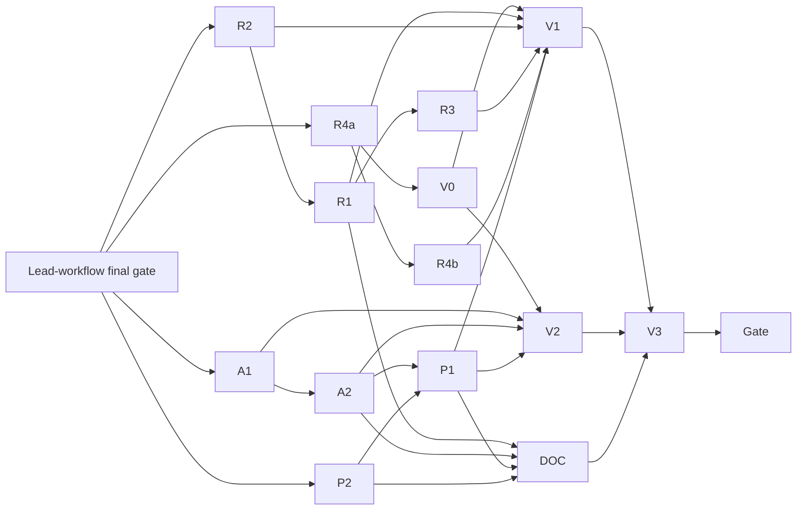

# Review and Annotation Flow Implementation Plan

> **For agentic workers:** REQUIRED SUB-SKILL: Use superpowers:subagent-driven-development (recommended) or superpowers:executing-plans to implement this plan task-by-task. Steps use checkbox (`- [ ]`) syntax for tracking.

**Goal:** Let the translation reviewer read both texts in the first viewport, decide without contradictory guidance and continue to the next task in one step; let the annotator add a finding in three actions (mark, Enter, Enter/D) with a prefilled term search combobox and a values block with "Confirm defaults (n)"; and polish the editor copy, styles, navigation and Settings, as specified in [2026-10-20-review-and-annotation-flow-design.md](../specs/2026-10-20-review-and-annotation-flow-design.md).

**Architecture:** Frontend-first. The translation review gets a pure decision module (`translation/decisionOrigin.ts`: implied clinical change, automatic "Accepted with corrections" and its revert), a one-line check band with a Details disclosure, a pinned rail at ≥1100 px and a pinned bottom bar below, and a "Next task" step fed by `listMyTasks()` and a pure `nextOpenTask()`. The only backend change is a read-only `TaskSummary.failed_check_count` derived at query time. The editor gets pure term-search helpers (`editor/termSearch.ts`), an ARIA 1.2 combobox in `SearchPanel`, a caret helper (`editor/textFocus.ts`), a coalescing hook for axis changes and a Values block whose "Confirm defaults (n)" sends one `set_axes`. Settings sections get their own addresses through the router.

**Tech Stack:** Python 3.12, FastAPI, SQLAlchemy 2 (pytest via Docker testcontainers or `ONTOCURATOR_TEST_PG_URL`); React 18, TypeScript, Vitest + Testing Library, Playwright + axe-core; `openapi-typescript` for `generated.ts`.

**Binding inputs:** the spec above; mockups `.superpowers/mockups/review-annotation-20261020/` (`01-translation-review.html`, `02-annotation-term-loop.html`, `03-editor-header-polish.html`; where a mockup and the spec differ, the spec wins); critique screenshots `build/phase0-ux/evidence/critique-20261020/`; `PRODUCT.md`; `DESIGN.md`.

**Runs after the lead workflow.** The plan [2026-10-20-lead-workflow.md](2026-10-20-lead-workflow.md) is still executing in the same worktree. No WP of this plan starts before that plan's "Final gate" has passed and its plan-review fixes are committed (see "Overlap with the lead-workflow plan").

---

## Global rules (every WP; a subagent reads only this section and its WP block)

Worktree: `C:/Users/jan-p/Development/ontocurator/.worktrees/phase0-implementation` (Git Bash: `/c/Users/jan-p/Development/ontocurator/.worktrees/phase0-implementation`), branch `feat/lead-workflow`. Every command runs from the worktree root: `cd /c/Users/jan-p/Development/ontocurator/.worktrees/phase0-implementation && …`.

1. **Subagents never commit, push, `git reset`, `git checkout -- <file>`, `git stash` or `git clean`.** Edit on top of the working tree. The orchestrator commits each WP after its done check (and review, where flagged) with the WP's commit message, staging only the WP's owned files (`git add <files>`, never `git add -A`). No AI attribution lines anywhere (no `Co-Authored-By`, no "Generated with").
2. **Exclusive file ownership.** A WP writes only the files in its **Owns** list (test files included). If it needs another file, it stops and reports. Two WPs never own the same file at the same time; shared files follow "Shared-file chains".
3. **Prerequisite checks first.** Run the WP's prerequisite commands; if one fails, stop and report. Never re-implement a missing prerequisite. Every WP of wave 1 also checks the lead-workflow gate: `git log --oneline main..HEAD | grep -q "test(browser): align existing browser specs with the lead workflow"` and the orchestrator's confirmation that the lead final gate and its plan-review fixes are committed; `git status --short` must be empty when wave 1 starts.
4. **Shell.** Git Bash. `rg` is not installed; use `grep -rnE`. `frontend/src/editor/TextPane.tsx` contains a literal NUL character (line 110, `prev.join("\0")` written as a raw byte): use `grep -a`, edit it only with the Edit tool on other lines, never rewrite it with Write.
5. **Machine limits (16 GB).** At most **two heavy** agents at once. Heavy = backend pytest that touches PostgreSQL, a full Vitest run, Playwright, a `scripts/check.sh` stage. Light = single Vitest files, `npm --prefix frontend run typecheck`, ruff/mypy, generator scripts. At most three light agents at once. Lane **L+** = light, but its one full Vitest run at the end waits until the orchestrator confirms a free heavy slot.
6. **Vitest always** with `--maxWorkers=4 --minWorkers=1`: single file `npm --prefix frontend test -- --maxWorkers=4 --minWorkers=1 tests/<path>`; full suite `npm --prefix frontend test -- --maxWorkers=4 --minWorkers=1`.
7. **Playwright: one run at a time on the machine**, always with `HPO_E2E_PORT=18793` for this plan: `HPO_E2E_PORT=18793 npm --prefix frontend run test:e2e -- <spec>` (it rebuilds `frontend/dist`). If the build fails because another agent is mid-edit, rerun after it finishes; never fix its files. The static gate `scripts/check.sh --only static` checks the whole tree, so it may fail on a sibling WP's in-progress files; a WP fixes only failures in its own Owns, reports the others with file names, and the orchestrator reruns it later.
8. **Backend tests.** Need Docker running or `ONTOCURATOR_TEST_PG_URL`. Run single files: `uv run pytest tests/<file>.py -q`. Static: `uv run ruff check . && uv run ruff format --check . && uv run mypy src`. The full backend suite (~25 min) runs only in the final gate.
9. **Contracts.** `contracts/openapi.json` and `frontend/src/api/generated.ts` are never hand-edited. Regenerate with `uv run python scripts/export_openapi.py && npm --prefix frontend run api:generate`; drift checks `uv run python scripts/export_openapi.py --check` and `npm --prefix frontend run api:check`. The only contracts writer of this plan is R4a. The response change is additive (`failed_check_count: int | None = None`), so existing frontend code and fixtures keep compiling. No migration.
10. **Straight-swap rule.** When copy or styles change, keep classes, IDs, `data-*` attributes and test hooks (`.candidate-card`, `#search-input`, `data-axis-field`, `data-testid="annotator-identity"`, `data-repair=…`) unless the WP block names the replacement. Tests that assert replaced copy are updated in the WP that changes the copy (they are listed in its Owns).
11. **English** for all files and UI copy; icons only from `frontend/src/ui/icons.tsx` (no "✓", "↳", "+" glyph icons). Status never by colour alone. Unavailable actions use `aria-disabled` + `aria-describedby` reason (existing `Button`). Every programmatic focus uses `focus({ preventScroll: true })` unless the WP block says otherwise. Shortcuts only through `useShortcut` / `useShortcutHint` in `ui/shortcuts.ts` (read-only for this plan: checkboxes and radios are already not typing targets; single-character bindings already ignore Shift).
12. **TDD.** Write the listed failing tests first, run them red, implement, run green. Keep the WP's report short.
13. **Hand-back** (final message): changed/created/deleted files (subset of Owns), commands with exit status and one-line result, done checklist item by item, skipped parts and deviations, open risks, the commit message.

## Spec WP mapping

| Spec WP | Plan WPs |
|---|---|
| R1 translation review layout | **R1** |
| R2 decision form | **R2** |
| R3 Next task | **R3** |
| R4 failed-check flag | **R4a** backend field and contracts · **R4b** My tasks line |
| A1 term search combobox | **A1** |
| A2 values and keys | **A2** |
| P1 polish | **P1** |
| P2 Settings sections | **P2** |
| (DESIGN.md parts of R1, A2, P1, P2) | **DOC** (one writer for `DESIGN.md`) |
| Browser checks of R1/A-series and acceptance | **V0** fixture builders · **V1** review flow spec · **V2** annotation loop spec · **V3** existing specs + full browser suite |

Deviations (all inside the spec's intent): the "Defaulted axes" badge lives in `editor/FindingRow.tsx` and `app/CaseScreen.tsx`, not in `editor/openItems.ts` (A2 owns those two); the guidance sentence (`checkDeviationGuidance`) is part of R1 because it lives in the check details that R1 rebuilds; DESIGN.md is written by one WP (DOC) instead of three; the 701–1024 px focus rule is implemented in A1 (focus helper), the ≤700 px "Choose term" bar in A2; with one recorded check the calm band reads "1 automatic check passed." instead of "All 1 automatic checks passed."; prefill uses the **active** search languages (B.2), which equal all loaded languages unless the annotator deselected one (resolved question 5).

## Work packages

| WP | Content | Size | Lane | Depends on | Review |
|---|---|---|---|---|---|
| R2 | `decisionOrigin.ts`, rationale for every decision, fact line for Query/Rejected, auto-select/revert, decision copy, keys 1–4 | M | L+ | lead gate | — |
| R1 | Review bar, check band + Details, column heads, pinned rail ≥1100, side-by-side 700–1099, pinned bottom bar, hidden unavailable coupling, check copy | L | L+ | R2 | yes (L) |
| R3 | `nextOpenTask()`, "Next task" after submit | S | L+ | R1 | — |
| R4a | `TaskSummary.failed_check_count`, contracts | S | H | lead gate | yes (backend) |
| R4b | My tasks failed-check line | S | L | R4a | — |
| A1 | `termSearch.ts`, `textFocus.ts`, SearchPanel combobox, prefill and focus, pending pane copy, Esc, SearchPanel styles | M | L+ | lead gate | — |
| A2 | Values block, Confirm defaults (one mutation), focus loop, `/` `V` `D`, coalesced changes, ≤700 px bar, badge text | M | L+ | A1 | — |
| P2 | Settings section addresses, nav links, leave guard | M | L+ | lead gate | — |
| P1 | Empty inspector, AnnotationPanel styles → CSS, one way back, task breadcrumb, type hierarchy, jargon | M | L+ | A2, P2 | — |
| DOC | DESIGN.md: check band, review layout, finding keys, Values block, editor hierarchy, settings sections | S | L | R1, A2, P1, P2 | — |
| V0 | `tests/browser_review_flow_scenarios.py` (`REVIEW_FLOW`, `ANNOTATION_LOOP`), route, helpers | M | H | R4a | — |
| V1 | `frontend/browser/review-flow.spec.ts` | M | PW | V0, R1, R2, R3, R4b, P1 | — |
| V2 | `frontend/browser/annotation-loop.spec.ts` | M | PW | V0, A1, A2, P1 | — |
| V3 | Existing browser specs, full browser suite | M | PW | V1, V2, DOC | — (plan review at the gate) |

Review: R1 (size L) and R4a (backend) get one review each by the `superpowers:code-reviewer` agent (or `agy` with gemini-3.8-flash), read-only, then one fix agent at effort medium. The spec also named A2 as critical; it is M, so it is covered by the plan review after the final gate (the plan review must read A2's diff first). No Codex.

## Overlap with the lead-workflow plan

Both plans run in the same worktree on `feat/lead-workflow`. These files were written by lead-workflow WPs and are written again here; every WP of this plan starts only after the lead-workflow **Final gate** (its wave 12) has passed and its plan-review fixes are committed. The lead WPs still open when this plan was written (L4, L8, L10b, L10c, gate) must not be running when wave 1 starts.

| File(s) | Lead-workflow writer | This plan |
|---|---|---|
| `frontend/src/App.tsx` | L6 | P2 → P1 |
| `frontend/src/app/router.ts`, `frontend/tests/router.test.ts` | L3 | P2 |
| `frontend/src/admin/ProjectSettingsPage.tsx`, `frontend/tests/projectSettings.test.tsx` (Settings › Workflow from L5b) | L5b | P2 |
| `frontend/src/tasks/MyTasks.tsx`, `frontend/tests/myTasks.test.tsx` | L6 | R4b |
| `frontend/src/ui/shortcuts.ts`, `frontend/tests/ui/shortcuts.test.tsx` | L9 | read only (no change needed) |
| `DESIGN.md` | L9 | DOC |
| `frontend/src/translation/ReviewParts.tsx` | L2b | R1 |
| `frontend/src/ui/AppShell.tsx`, `frontend/tests/ui/appShell.test.tsx`, `frontend/tests/labels.test.ts`, `frontend/tests/translationTaskApp.test.tsx`, `frontend/src/app/labels.ts` | L6 | P1 |
| `frontend/src/styles/index.css`, `frontend/src/styles/components.css` | L9 | P2 (one `@import`), R4b (one rule) |
| `src/ontocurator/assignments/service.py` | L0b → L1p | R4a |
| `contracts/openapi.json`, `frontend/src/api/generated.ts` | L0b → L1 → L1p → L1b | R4a |
| `tests/browser_server.py` | L10a | V0 (one import, one registration line) |
| existing `frontend/browser/*.spec.ts` | L10c | V3 |
| `frontend/tests/variantAdmin.test.tsx`, `variantAdminApp.test.tsx`, `adminApp.test.tsx` | L6 → L3b → L4 → L8 | P2 (assertion-only, settings links) |

## Shared-file chains (one writer at a time, in this order)

| File(s) | Writers in order |
|---|---|
| `frontend/src/translation/TranslationReviewScreen.tsx`, `frontend/tests/translationReview.test.tsx`, `frontend/src/translation/labels.ts`, `frontend/tests/translationLabels.test.ts` | R2 → R1 → R3 |
| `frontend/src/translation/ReviewForm.tsx`, `frontend/tests/reviewForm.test.tsx`, `frontend/src/translation/translation.css` | R2 → R1 |
| `frontend/src/translation/ReviewParts.tsx`, `frontend/tests/translationChecks.test.tsx` | R1 only |
| `frontend/src/translation/decisionOrigin.ts`, `frontend/src/translation/reviewRules.ts`, `frontend/tests/decisionOrigin.test.ts`, `frontend/tests/reviewRules.test.ts` | R2 only |
| `frontend/src/app/caseOrder.ts`, `frontend/tests/taskOrder.test.ts` | R3 only |
| `src/ontocurator/assignments/service.py`, `src/ontocurator/application/translation_reviews.py`, `contracts/openapi.json`, `frontend/src/api/generated.ts` | R4a only |
| `frontend/src/tasks/MyTasks.tsx`, `frontend/tests/myTasks.test.tsx`, `frontend/src/styles/components.css` | R4b only |
| `frontend/src/app/CaseScreen.tsx`, `frontend/src/editor/AnnotationPanel.tsx`, `frontend/src/styles/screens/editor.css`, `frontend/tests/caseScreen.test.tsx`, `frontend/tests/review-findings.test.tsx`, `frontend/tests/workflow-regressions.test.tsx` | A1 → A2 → P1 |
| `frontend/src/editor/SearchPanel.tsx`, `frontend/src/editor/termSearch.ts`, `frontend/src/editor/textFocus.ts`, `frontend/tests/searchPanel.test.tsx`, `frontend/tests/termSearch.test.ts`, `frontend/tests/textFocus.test.ts`, `frontend/tests/assignmentEditor.test.tsx`, `frontend/tests/caseTree.test.tsx` | A1 only (A2 imports `textFocus.ts`) |
| `frontend/src/editor/FindingRow.tsx`, `frontend/src/editor/useCoalescedAxisChange.ts`, `frontend/tests/coalescedAxisChange.test.tsx`, `frontend/tests/valuesBlock.test.tsx`, `frontend/tests/dynamicAxes.test.tsx`, `frontend/tests/projectRulesAxes.test.tsx`, `frontend/tests/submitDialog.test.tsx` | A2 only |
| `frontend/src/editor/TextPane.tsx`, `frontend/src/app/CaseNavigation.tsx`, `frontend/tests/caseNavigation.test.tsx`, `frontend/src/ui/AppShell.tsx`, `frontend/tests/ui/appShell.test.tsx`, `frontend/src/app/labels.ts`, `frontend/tests/labels.test.ts`, `frontend/tests/translationTaskApp.test.tsx`, `frontend/tests/carried/carriedInspector.test.tsx`, `frontend/tests/carried/carriedList.test.tsx`, `frontend/tests/reanchorIntegration.test.tsx`, `frontend/tests/caseResize.test.tsx`, `frontend/tests/annotationPanelStyles.test.ts` | P1 only |
| `frontend/src/App.tsx` | P2 → P1 |
| `frontend/src/app/router.ts`, `frontend/tests/router.test.ts`, `frontend/src/admin/ProjectSettingsPage.tsx`, `frontend/tests/projectSettings.test.tsx`, `frontend/src/styles/screens/settings.css`, `frontend/src/styles/index.css`, `frontend/tests/adminApp.test.tsx`, `frontend/tests/variantAdmin.test.tsx`, `frontend/tests/variantAdminApp.test.tsx`, `frontend/tests/ontologiesPage.test.tsx` | P2 only |
| `DESIGN.md` | DOC only |
| `tests/browser_server.py`, `tests/browser_review_flow_scenarios.py`, `tests/test_browser_review_flow_fixture.py`, `frontend/browser/reviewFlowHelpers.ts` | V0 only |
| `frontend/browser/review-flow.spec.ts` | V1 only |
| `frontend/browser/annotation-loop.spec.ts` | V2 only |
| existing `frontend/browser/*.spec.ts`, `frontend/browser/helpers.ts` | V3 only |

## Dependency graph



## Wave schedule

A wave's WPs may run at the same time (disjoint owned files, ≤ 2 heavy, ≤ 3 light, ≤ 1 Playwright). A WP starts as soon as its prerequisites are done and its files are free.

| Wave | Heavy lane (≤ 2) | Light lane (≤ 3) | Notes |
|---|---|---|---|
| 0 | — | — | Lead-workflow plan: L4, L8, L10b, L10c, Final gate and its plan-review fixes committed. `git status --short` empty. |
| 1 | R4a | R2 (L+), A1 (L+), P2 (L+) | No prerequisites inside this plan. R4a is the only contracts writer. |
| 2 | V0 | R1 (L+), A2 (L+), R4b | R1 after R2; A2 after A1; R4b and V0 after R4a. |
| 3 | — | R3 (L+), P1 (L+) | R3 after R1 (size L); P1 after A2 and P2. |
| 4 | V1 (PW) | DOC | V1 after R1, R2, R3, R4b, P1, V0. DOC after R1, A2, P1, P2. |
| 5 | V2 (PW) | — | After A1, A2, P1, V0; one Playwright run at a time. |
| 6 | V3 (PW) | — | Runs alone. |
| 7 | Final gate (alone) | — | See "Final gate". |

Count: 14 WPs (R1, R2, R3, R4a, R4b, A1, A2, P1, P2, DOC, V0, V1, V2, V3), each exactly once.

## Dispatching a WP to a subagent

The orchestrator sends one WP per subagent with: the worktree path; the instruction to read **only** "Global rules", "Shared contracts" (the parts the WP block names) and the WP block, plus the spec sections, mockups and code locations the block lists; the WP's wave row (which sibling WPs run at the same time and which files they own); the lane (H, L, L+, PW; for L+ "run the full Vitest suite only when I confirm a free heavy slot"); the hand-back format of rule 13. Implementation agents run at the default effort; a fix agent after a review at effort medium.

**Done check (orchestrator):** compare the reported files with Owns (`git status --short`), rerun the WP's light verification if unclear, tick the done checklist. Then review (flagged WPs only), one fix agent if needed, commit with the WP's message, release the files.

---

## Shared contracts

These names are fixed for all WPs. A WP that produces one implements it exactly; a WP that consumes one relies on it.

### Translation review (R2, R1, R3)

```ts
// frontend/src/translation/reviewRules.ts (R2: export the existing private helper, add one)
export function canonicalText(text: string): string;            // unchanged body: BOM, CRLF/CR → LF, NFC
export function textDiffers(machineText: string, text: string): boolean; // canonicalText(text) !== canonicalText(machineText)

// frontend/src/translation/decisionOrigin.ts (R2, create; pure, no React)
import type { ReviewDecisionCode } from "./reviewRules";
export type RawForm = Readonly<Record<string, unknown>>;
export type DecisionOrigin = { kind: "user" } | { kind: "auto"; previous: "accepted_unchanged" | undefined };
export type AutoNote =
  | { kind: "selected"; from: "accepted_unchanged" | undefined }
  | { kind: "reverted"; to: "accepted_unchanged" | undefined };
export interface DecisionState { origin: DecisionOrigin; note: AutoNote | null }
export const USER_ORIGIN: DecisionState; // { origin: { kind: "user" }, note: null } — also the state after load/reload
/** Query/Rejected: clinical_change true; Accepted with corrections: keeps clinical_change and categories;
 *  Accepted unchanged: clinical_change false, categories []. Rationale and unknown raw keys are always kept. */
export function chooseDecision(raw: RawForm, decision: ReviewDecisionCode): Record<string, unknown>;
/** Spec A.4 table. Returns the same `state` object when nothing changes (so the live note is announced once). */
export function reactToTextEdit(state: DecisionState, raw: RawForm, machineText: string, nextText: string):
  { state: DecisionState; form: Record<string, unknown> };
export function autoNoteText(note: AutoNote | null): string | null;
// "Selected because you edited the translation. You can choose another decision."
// "Changed from Accepted unchanged because you edited the translation."
// "Your edits are undone, so the decision is back to Accepted unchanged."
// "Your edits are undone, so the decision is back to not chosen."
```

`ReviewForm` props after R2 (R1 and R3 consume):

```ts
export interface ReviewFormProps {
  value: Partial<ReviewFormValue>;
  issues: readonly IssueCode[];
  onChange: (next: Partial<ReviewFormValue>) => void;
  /** Radio choice; default: onChange(chooseDecision(value, decision)). The screen uses it to set origin "user". */
  onChooseDecision?: (decision: ReviewDecisionCode) => void;
  /** Failed automatic checks of the reviewed run; selects the rationale hint for Accepted unchanged. */
  failedCheckCount?: number;
  /** Text of the auto-selection note (autoNoteText), rendered as role="status" under "Accepted with corrections". */
  autoNote?: string | null;
  readOnly?: boolean;
}
// The Decision legend carries data-decision-legend and tabIndex={-1} (R1's "Change ↓" focuses it).
```

`labels.ts` additions: R2 — `decisionDescriptions` (new short copy), `clinicalChangeFacts: Record<"query" | "rejected", string>`, `rationaleHint(decision, clinical, failedCheckCount): string`, `decisionKeyHint = "Ctrl + Enter submits · 1–4 choose a decision outside the text"`. R1 — `shortCheckLabel(code)`, `checkBandText(failedCodes: readonly string[]): string`, `calmCheckText(count: number): string`, `allChecksLine(passed: number, failed: number): string`, `checkDeviationGuidance(code: string): string` (replaces the constant), `checkNoLocation` (merged sentence).

```ts
// frontend/src/app/caseOrder.ts (R3)
/** Unsubmitted tasks of the same project in My tasks (server) order, without the current one (spec A.5). */
export function nextOpenTask(tasks: readonly TaskSummary[], currentAssignmentId: number, projectKey: string):
  { next: TaskSummary | null; remaining: number };
```

### Backend (R4a)

```python
# src/ontocurator/assignments/service.py
@dataclass(frozen=True)
class TaskSummary:
    ...
    case_id: str | None = None
    # Spec A.7: failed automatic checks of the reviewed variant's translation run
    # (the list ReviewWorkspace.failed_checks shows); None for other tasks.
    failed_check_count: int | None = None

# src/ontocurator/application/translation_reviews.py (module level, used by open() and my_tasks())
def failed_translation_checks(translation: dict[str, Any] | None) -> list[TranslationCheck]: ...
```

Generated TS: `TaskSummary.failed_check_count?: number | null`.

### Editor (A1, A2, P1)

```ts
// frontend/src/editor/termSearch.ts (A1, create; pure)
export const PREFILL_MAX = 80;
/** Covered text of all segments joined with a space, whitespace collapsed, trimmed, cut at 80 codepoints on a word boundary. */
export function prefillQuery(text: string, segments: readonly { start: number; end: number }[]): string;
/** English documents always; others only when the document language (base subtag) is an active search language. */
export function canPrefill(documentLanguage: string, activeLanguages: readonly string[] | undefined): boolean;
/** Spec B.6 match line; null for label matches or when the match equals the label. */
export function matchLine(candidate: Pick<SearchCandidate, "label" | "matched_term" | "match_kind" | "match_language">): string | null;
/** Index of the first hit that can be added (not obsolete, canAssign), or -1. */
export function firstUsableIndex(candidates: readonly SearchCandidate[], canAssign: boolean): number;
export const NO_PREFILL_HINT = "Names are searched in English. Type an English name or a code.";

// frontend/src/editor/textFocus.ts (A1, create)
/** Focus `.text-container` inside root without scrolling and place a collapsed caret at a codepoint offset of the
 *  document text (counted over the text nodes of `.run` elements). Returns false when the container is missing. */
export function focusTextAt(root: ParentNode | null, documentText: string, codepoint: number): boolean;
```

`SearchPanel` props after A1 (A2 and P1 consume):

```ts
export interface SearchPanelProps {
  canAssign?: boolean; searchManager: SearchManager; annotationId: string; workspaceKey: WorkspaceKey;
  layerId?: string; currentTermId?: string | null;
  onSelectCandidate: (candidate: SearchCandidate, searchId?: string) => void;
  debounceMs?: number; languages?: SearchLanguageControl;
  /** Prefilled query: shown selected and searched at once on mount (no debounce). */
  initialQuery?: string;
  /** Focus the field on mount (preventScroll; scrollIntoView({ block: "nearest" }) only if it is outside the viewport). */
  autoFocus?: boolean;
  /** Esc in the field. */
  onEscape?: () => void;
  /** Help line under the empty field; default "Name or code, for example HP:0001250". */
  emptyHint?: string;
}
// Field label "Search term", input id "search-input", role="combobox"; listbox ul role="listbox" aria-label="Terms";
// hits li.candidate-card role="option" with stable ids `${listboxId}-${index}-${term_id}`.
```

```ts
// frontend/src/editor/useCoalescedAxisChange.ts (A2, create)
export function useCoalescedAxisChange(
  base: Readonly<Record<string, string | null>>,
  send: (values: Record<string, string | null>) => void,
  delayMs?: number, // default 300
): {
  values: Record<string, string | null>;          // base merged with the pending local choice (what the radios show)
  change: (axisId: string, value: string | null) => void; // a change of another axis flushes the pending one first
  flush: () => void;                               // send the pending change now (Confirm defaults, unmount, other finding)
};
```

`AnnotationPanel` props after A2: `onConfirmAxis` is removed; added `onConfirmDefaults?: (axisIds: string[]) => void`, `valuesError?: string | null`, `searchRequest?: number` (each increment opens "Change term" and focuses the search). The Values section is `<section data-values-section aria-labelledby=…>` with `h3` "Values"; the button is `data-confirm-defaults` "Confirm defaults (n)". `CaseScreen.handleUpdateAxes(values, confirmedAxisIds?: string[])` (was a single id).

### App, router (P1, P2)

```ts
// frontend/src/app/router.ts (P2)
export type SettingsSection = "general" | "guideline" | "rules" | "workflow" | "defaults" | "profile" | "members";
export const SETTINGS_SECTIONS: readonly SettingsSection[];
// Route: { name: "projectSettings"; key: string; section?: SettingsSection }
// "#/projects/k/settings" → no section (General); "#/projects/k/settings/rules" → section "rules"; unknown section → notFound.
// routeHref: no section or "general" → "#/projects/k/settings"; else "#/projects/k/settings/{section}".

// frontend/src/app/labels.ts (P1)
export function taskCrumbLabel(task: Pick<TaskSummary, "external_id" | "document_id" | "task" | "language">): string;
// "failed-translation · Translation review (de)"

// frontend/src/ui/AppShell.tsx (P1)
export interface Crumb { label: string; onClick?: () => void; href?: string; title?: string }
```

---

## WP blocks

### R2: Decision form: rationale always, implied clinical change, auto-select, keys 1–4

- **Goal:** the form never contradicts its guidance; Query/Rejected never ask for a checkbox the rules require anyway; an edit selects "Accepted with corrections" visibly and reversibly; decisions by key.
- **Spec:** A.1 items 4–6 and 9, A.4 (whole), A.8 rows "Decision hints", "Fact line", "Rationale hint", "Auto note", A.9 rows 1–4, A.10 rows 2–4, "Deviations" 5, resolved questions 1 and 3.
- **Shared contracts:** "Translation review" (`reviewRules.ts`, `decisionOrigin.ts`, `ReviewFormProps`, R2 part of `labels.ts`).
- **Owns:** `frontend/src/translation/decisionOrigin.ts` (create), `frontend/src/translation/reviewRules.ts`, `frontend/src/translation/ReviewForm.tsx`, `frontend/src/translation/labels.ts` (R2 part), `frontend/src/translation/TranslationReviewScreen.tsx` (decision wiring and keys only), `frontend/src/translation/translation.css` (fact line, Kbd, note, key hint), tests `frontend/tests/decisionOrigin.test.ts` (create), `frontend/tests/reviewForm.test.tsx`, `frontend/tests/reviewRules.test.ts`, `frontend/tests/translationReview.test.tsx`, `frontend/tests/translationLabels.test.ts`.
- **Size / lane / review:** M / L+ / —.
- **Code to read:** `translation/ReviewForm.tsx` (whole), `translation/reviewRules.ts`, `translation/labels.ts:1-60`, `translation/TranslationReviewScreen.tsx:28-47` (raw/visual/typed form), `:177-180` (`edit`), `:224` (Ctrl+Enter), `:321-328` (form wiring), `:341-350` (footer), `ui/Kbd.tsx`, `ui/shortcuts.ts` (`useShortcut` options), `src/ontocurator/domain/translation_review.py` (rules; read only), mockup `01-translation-review.html` (rail).
- **Prerequisites:** `test ! -e frontend/src/translation/decisionOrigin.ts`; `grep -n "function canonicalText" frontend/src/translation/reviewRules.ts`.

- [ ] **Step 1: Failing pure tests** (`frontend/tests/decisionOrigin.test.ts`):

```ts
import { describe, expect, it } from "vitest";
import { autoNoteText, chooseDecision, reactToTextEdit, USER_ORIGIN } from "../src/translation/decisionOrigin";

const MACHINE = "Dosis 5 mg.";
describe("chooseDecision", () => {
  it("implies a clinical change for query and rejected and keeps categories and rationale", () => {
    expect(chooseDecision({ rationale: "r" }, "query")).toEqual({ rationale: "r", decision: "query", clinical_change: true });
    expect(chooseDecision({ decision: "query", clinical_change: true, categories: ["value"], rationale: "r" }, "rejected"))
      .toEqual({ decision: "rejected", clinical_change: true, categories: ["value"], rationale: "r" });
  });
  it("keeps clinical change and categories when switching to accepted with corrections", () => {
    expect(chooseDecision({ decision: "query", clinical_change: true, categories: ["value"], rationale: "r" }, "accepted_corrected"))
      .toEqual({ decision: "accepted_corrected", clinical_change: true, categories: ["value"], rationale: "r" });
  });
  it("clears clinical change and categories for accepted unchanged but keeps the rationale", () => {
    expect(chooseDecision({ decision: "rejected", clinical_change: true, categories: ["value"], rationale: "r" }, "accepted_unchanged"))
      .toEqual({ decision: "accepted_unchanged", clinical_change: false, categories: [], rationale: "r" });
  });
  it("keeps unknown raw keys untouched", () => {
    expect(chooseDecision({ extra: 1 }, "query")).toEqual({ extra: 1, decision: "query", clinical_change: true });
  });
});
describe("reactToTextEdit (spec A.4)", () => {
  it("selects accepted with corrections on the first difference when nothing is chosen", () => {
    const { state, form } = reactToTextEdit(USER_ORIGIN, {}, MACHINE, "Dosis 5 mg täglich.");
    expect(form).toEqual({ decision: "accepted_corrected" });
    expect(state).toEqual({ origin: { kind: "auto", previous: undefined }, note: { kind: "selected", from: undefined } });
    expect(autoNoteText(state.note)).toBe("Selected because you edited the translation. You can choose another decision.");
  });
  it("changes a user's accepted unchanged and names it", () => {
    const { state, form } = reactToTextEdit(USER_ORIGIN, { decision: "accepted_unchanged", clinical_change: false }, MACHINE, "x");
    expect(form).toEqual({ decision: "accepted_corrected", clinical_change: false });
    expect(autoNoteText(state.note)).toBe("Changed from Accepted unchanged because you edited the translation.");
  });
  it.each(["query", "rejected", "accepted_corrected"] as const)("leaves %s alone", (decision) => {
    const raw = { decision, clinical_change: decision !== "accepted_corrected" };
    const result = reactToTextEdit(USER_ORIGIN, raw, MACHINE, "x");
    expect(result.form).toEqual(raw); expect(result.state).toBe(USER_ORIGIN);
  });
  it("reverts an automatic selection when the text equals the machine text again", () => {
    const first = reactToTextEdit(USER_ORIGIN, {}, MACHINE, "x");
    const back = reactToTextEdit(first.state, first.form, MACHINE, MACHINE);
    expect(back.form).toEqual({}); // the decision key is removed
    expect(back.state).toEqual({ origin: { kind: "user" }, note: { kind: "reverted", to: undefined } });
    expect(autoNoteText(back.state.note)).toBe("Your edits are undone, so the decision is back to not chosen.");
    const fromUnchanged = reactToTextEdit(USER_ORIGIN, { decision: "accepted_unchanged", clinical_change: false }, MACHINE, "x");
    const undone = reactToTextEdit(fromUnchanged.state, fromUnchanged.form, MACHINE, MACHINE);
    expect(undone.form).toEqual({ decision: "accepted_unchanged", clinical_change: false, categories: [] });
    expect(autoNoteText(undone.state.note)).toBe("Your edits are undone, so the decision is back to Accepted unchanged.");
  });
  it("keeps a user's accepted with corrections when the edit is undone", () => {
    const raw = { decision: "accepted_corrected", clinical_change: false };
    expect(reactToTextEdit(USER_ORIGIN, raw, MACHINE, MACHINE)).toEqual({ state: USER_ORIGIN, form: raw });
  });
  it("returns the same state object for further edits while auto, so the note is announced once", () => {
    const first = reactToTextEdit(USER_ORIGIN, {}, MACHINE, "x");
    expect(reactToTextEdit(first.state, first.form, MACHINE, "xy").state).toBe(first.state);
  });
  it("compares canonically: BOM, CRLF and NFC differences are not edits", () => {
    expect(reactToTextEdit(USER_ORIGIN, {}, "a\nb\u00e9", "\ufeffa\r\nbe\u0301").form).toEqual({});
  });
  it("never overrides an unknown raw decision", () => {
    expect(reactToTextEdit(USER_ORIGIN, { decision: "legacy" }, MACHINE, "x").form).toEqual({ decision: "legacy" });
  });
});
```

  Append to `reviewRules.test.ts`: `it("textDiffers uses the canonical comparison")` (`textDiffers("a\nb", "a\r\nb") === false`, `textDiffers("a", "b") === true`).
- [ ] **Step 2: Failing component tests** (`reviewForm.test.tsx`; replace the visibility table and the decision-change test, keep the rest):
  - Replace `it.each(...)("reveals follow-up fields by the review rules for %j")` with a table of `[value, checkbox, fact, categories, rationale]`: none → `false, null, false, false`; `accepted_unchanged` → `false, null, false, true`; `accepted_corrected` → `true, null, false, true`; `query` → `false, "Clinically relevant change: yes, always for a query.", true, true`; `rejected` → `false, "…for a rejection.", true, true`; `accepted_unchanged` + `clinical_change: true` (stored draft) → `true, null, true, true`; `accepted_unchanged` + `categories: ["value"]` → `false, null, true, true`.
  - Replace "preserves clinical intent … when changing decision" by `it("chooses through chooseDecision: query implies a clinical change, accepted unchanged clears it")` (click "Query" on `{ rationale: "r" }` → `onChange({ rationale: "r", decision: "query", clinical_change: true })`; click "Accepted unchanged" on a rejected value → `clinical_change: false, categories: []`, rationale kept); and `it("reports a radio choice through onChooseDecision when given")`.
  - `it("hints the rationale for Accepted unchanged with failed checks")` — `failedCheckCount={1}` → hint "Optional. Say why the flagged difference is correct."; `0` → "Optional."; clinical → "Required for a clinically relevant change.".
  - `it("shows the short decision hints and a number key per option outside the accessible name")` — hints equal the new `decisionDescriptions`; each option label contains a `kbd` "1"–"4"; `getByRole("radio", { name: "Query" })` still matches exactly.
  - `it("renders the auto note as a polite status under Accepted with corrections")`.
  - `it("marks the Decision legend as a focus target")` — `[data-decision-legend]` with `tabindex="-1"`.
- [ ] **Step 3: Failing screen tests** (`translationReview.test.tsx`, append; reuse `setup`, `edited`, `confirmSubmit`):
  - `it("auto-selects Accepted with corrections on the first edit, announces it once and reverts when the edit is undone")` — type into "Translation (de)" → radio "Accepted with corrections" checked, one status text "Selected because you edited the translation. You can choose another decision."; change back to "Übersetzt." → no radio checked, "Your edits are undone, so the decision is back to not chosen."; the saved draft (`save` mock after `clock()`) has no `decision` key.
  - `it("treats a stored decision as chosen by the user after reload")` — workspace draft `{ text: "Übersetzt.", form: { decision: "accepted_corrected", clinical_change: false } }` → no auto note; the footer lists "Accepted with corrections needs changed text.".
  - `it("keys 1 to 4 choose decisions outside text fields and never inside the translation or rationale")` — `fireEvent.keyDown(document.body, { key: "3" })` → "Query" checked and the fact line shown; focus the translation textarea, key "1" → unchanged; read-only (submitted) workspace → keys do nothing.
  - `it("lists the four decision keys under Translation review in ? help")` — `openShortcutHelp()` lists "Choose Accepted unchanged", "Choose Accepted with corrections", "Choose Query", "Choose Rejected" in group "Translation review".
  - `it("never shows CLINICAL_CHANGE_REQUIRED for query or rejected")` — choose Query, pick category "Number or unit", type a rationale → no issue list; a stored legacy draft `{ decision: "query", clinical_change: false }` is normalised to `clinical_change: true` once on open (one save).
  - `it("shows the key hint line in the rail footer")` — "Ctrl + Enter submits · 1–4 choose a decision outside the text".
  - Update existing tests that click "Clinically relevant change" for Query/Rejected (`clinical-off clears categories …`, `summarises decision, categories …`) to the new flow; keep their intent.
  `translationLabels.test.ts`: `it("has short decision hints and fact lines")`, `it("selects the rationale hint")`.
- [ ] **Step 4:** run the five files → FAIL.
- [ ] **Step 5: Implement.**
  - `reviewRules.ts`: export `canonicalText`, add `textDiffers`.
  - `decisionOrigin.ts` per "Shared contracts" (read the decision with the same `decision()` guard as the screen: only known codes count; an unknown string counts as chosen).
  - `labels.ts`: `decisionDescriptions` → "Correct as it stands. No edits." / "Your corrected version is accepted." / "Meaning may differ clinically. Not accepted." / "Changes clinical meaning. Not accepted."; `clinicalChangeFacts`; `rationaleHint`; `decisionKeyHint`. Keep `clinicalChangeHints` (Accepted unchanged and Accepted with corrections rows still used); `decisionConsequences` unchanged (Deviation 5).
  - `ReviewForm.tsx`: fields per the A.4 table (replace the doc comment with that table); Query/Rejected render `<p className="review-fact">{clinicalChangeFacts[decision]}</p>` instead of the checkbox; categories required and enabled when `clinical`; rationale shown whenever a decision is chosen (or text exists), hint from `rationaleHint`; options show `<Kbd>{index + 1}</Kbd>` after the label text (outside `aria-labelledby`); `autoNote` renders `<p role="status" className="review-auto-note">` inside the "Accepted with corrections" option block; legend gets `data-decision-legend tabIndex={-1}`.
  - `TranslationReviewScreen.tsx`: state `decisionState` (`USER_ORIGIN` on mount); the translation `onChange` builds the next text, runs `reactToTextEdit(decisionState, draftRef.current.form, workspace.text, nextText)` and calls `edit({ text: nextText, form })` with the **whole** returned form (no merge, so the revert can remove `decision`); `onChooseDecision` → `edit({ ...current, form: chooseDecision(current.form, option) })` and `setDecisionState(USER_ORIGIN)`; pass `failedCheckCount={workspace.failed_checks.length}` and `autoNote={autoNoteText(decisionState.note)}`; four `useShortcut` calls `"1"`…`"4"` (`scope: "screen"`, `group: "Translation review"`, descriptions "Choose Accepted unchanged" …, `enabled: !readOnly`, no `allowInInputs`) calling the same choose handler; one effect on mount: if the typed draft decision is `query`/`rejected` with `clinical_change !== true` and not read-only, `edit` with `chooseDecision`; the footer gets `<p className="translation-key-hint">{decisionKeyHint}</p>` above "Submit review…".
  - `translation.css`: `.review-fact`, `.review-auto-note` (muted, `size-sm`), `.review-decision .kbd` (pushed to the right edge, `margin-left: auto`), `.translation-key-hint` (muted `size-sm`).
- [ ] **Step 6:** run the five files → PASS.
- [ ] **Step 7: Verify:** the five test files plus `tests/sourceObligationReview.test.tsx tests/translationTaskApp.test.tsx` with the Vitest flags; `npm --prefix frontend run typecheck`; at the end the full Vitest suite (heavy slot).
- **Done:** every A.4 row has a passing unit test (pure + screen); Accepted unchanged shows an optional rationale; Query/Rejected show the fact line and never `CLINICAL_CHANGE_REQUIRED`; keys 1–4 work outside text fields and are listed in `?` help; no backend change; no new draft key.
- **Commit:** `feat(translation-review): rationale for every decision, implied clinical change, auto-selected corrections and decision keys`

### R1: Translation review layout: texts own the viewport

- **Goal:** at 1440×900 both texts show ≥15 lines and all four decisions plus Submit are visible; at 800×900 the texts stay side by side and Submit is always reachable.
- **Spec:** A.0, A.1 items 1–3 and 10, A.2, A.3, A.6, A.8 rows "Check band", "Calm band", "Guidance", "No-location sentence", "Removed", A.9 (disclosure, pinned bar `aria-describedby`), "Deviations" 1 and 4, "Acceptance" items 1–3, resolved question 2. Mockup `01-translation-review.html` ("After A1", "After A5").
- **Shared contracts:** "Translation review" (R1 part of `labels.ts`; `ReviewFormProps` from R2: `data-decision-legend`).
- **Owns:** `frontend/src/translation/TranslationReviewScreen.tsx` (layout), `frontend/src/translation/ReviewParts.tsx` (`ChecksSummary`), `frontend/src/translation/labels.ts` (check copy), `frontend/src/translation/translation.css`, `frontend/src/translation/ReviewForm.tsx` (only if a layout hook is missing; no behaviour change), tests `frontend/tests/translationChecks.test.tsx`, `frontend/tests/translationReview.test.tsx`, `frontend/tests/translationLabels.test.ts`, `frontend/tests/reviewForm.test.tsx` (only if `ReviewForm.tsx` changes).
- **Size / lane / review:** L / L+ / yes (L).
- **Code to read:** `translation/TranslationReviewScreen.tsx:240-352` (header, toolbar, columns, rail), `translation/ReviewParts.tsx:1-50`, `translation/translation.css` (whole; note the existing `@media (min-width: 1280px)` rail and `@media (max-width: 1099px)` stacking rules that this WP replaces), `translation/DiffView.tsx` and `TranslationEditor.tsx` (both import `translation.css`; `.translation-text` is also used by `SourceObligationReview.tsx` — keep its rules), `variants/useCoupledScroll.ts` (`available`), `ui/useMediaQuery.ts`, `ui/icons.tsx` (`IconCheck`, `IconWarning`, `IconChevronRight`), screenshots `build/phase0-ux/evidence/critique-20261020/`.
- **Prerequisites:** `grep -n "export function chooseDecision" frontend/src/translation/decisionOrigin.ts`; `grep -n "data-decision-legend" frontend/src/translation/ReviewForm.tsx`.

- [ ] **Step 1: Failing check-band tests** (rewrite `frontend/tests/translationChecks.test.tsx`):

```tsx
import { fireEvent, render, screen, within } from "@testing-library/react";
import { expect, it } from "vitest";
import { ChecksSummary } from "../src/translation/ReviewParts";

it("collapses one failed check into a one-line band with a Details disclosure", () => {
  render(<ChecksSummary failed={[{ code: "units_added", passed: false, detail: "mg added" }]} all={[
    { code: "units_added", passed: false, detail: "mg added" }, { code: "numbers_changed", passed: true }]} />);
  const band = screen.getByRole("region", { name: "Automatic translation checks" });
  expect(within(band).getByRole("heading", { level: 2, name: "Automatic translation checks" }).className).toContain("review-sr-only");
  expect(band.textContent).toContain("1 automatic check failed: Units added in translation");
  const details = within(band).getByRole("button", { name: "Details" });
  expect(details.getAttribute("aria-expanded")).toBe("false");
  expect(screen.queryByRole("heading", { level: 3 })).toBeNull();
  fireEvent.click(details);
  expect(details.getAttribute("aria-expanded")).toBe("true");
  expect(within(band).getByRole("button", { name: "Hide details" })).toBe(details);
  const region = document.getElementById(details.getAttribute("aria-controls")!)!;
  const block = within(region).getByRole("heading", { level: 3, name: "Units added in translation" }).closest("section")!;
  const text = block.textContent!;
  expect(text).toContain("It does not point to a text location; compare the texts yourself.");
  expect(within(block).getByText("“mg added”")).toBeTruthy();
  expect(text).toContain("Choose Accepted unchanged (or Accepted with corrections if you edited it). You can say in the rationale why the difference is correct. If it changes the clinical meaning, choose Query or Rejected with the category Number or unit.");
  const technical = within(block).getByText("Technical details").closest("details")!;
  expect(technical.open).toBe(false);
  expect(technical.textContent).toContain("units_added");
  expect(region.textContent).toContain("All checks: 1 passed, 1 failed");
  expect(within(region).getByText("Show all checks")).toBeTruthy();
});
it("lists two short labels and the rest as a count for several failures", () => {
  render(<ChecksSummary failed={[{ code: "units_added", passed: false }, { code: "numbers_changed", passed: false }, { code: "glossary_miss", passed: false }]} all={null} />);
  expect(screen.getByRole("region", { name: "Automatic translation checks" }).textContent)
    .toContain("3 automatic checks failed: Units added, Numbers changed and 1 more");
});
it("ends the guidance after Query or Rejected for codes other than units and numbers", () => {
  render(<ChecksSummary failed={[{ code: "glossary_miss", passed: false }]} all={null} />);
  fireEvent.click(screen.getByRole("button", { name: "Details" }));
  expect(screen.getByText(/choose Query or Rejected\.$/)).toBeTruthy();
});
it("shows the calm states without a fill", () => {
  const { rerender } = render(<ChecksSummary failed={[]} all={[{ code: "a", passed: true }, { code: "b", passed: true }]} />);
  expect(screen.getByText("All 2 automatic checks passed.")).toBeTruthy();
  rerender(<ChecksSummary failed={[]} all={[]} />);
  expect(screen.getByText("No automatic checks were recorded for this translation.")).toBeTruthy();
  expect(screen.queryByRole("button", { name: "Details" })).toBeNull();
});
it("is collapsed again on every mount", () => {
  const first = render(<ChecksSummary failed={[{ code: "units_added", passed: false }]} all={null} />);
  fireEvent.click(screen.getByRole("button", { name: "Details" })); first.unmount();
  render(<ChecksSummary failed={[{ code: "units_added", passed: false }]} all={null} />);
  expect(screen.getByRole("button", { name: "Details" }).getAttribute("aria-expanded")).toBe("false");
});
```

- [ ] **Step 2: Failing screen tests** (`translationReview.test.tsx`). First change the `matchMedia` stub in `setup` so it honours the query instead of returning one value for every query:

```ts
const width = () => viewport?.width ?? 1440;
const evaluate = (query: string) => {
  const min = /min-width:\s*(\d+)px/.exec(query), max = /max-width:\s*(\d+)px/.exec(query);
  return (!min || width() >= Number(min[1])) && (!max || width() <= Number(max[1]));
};
// matchMedia: vi.fn((query: string) => ({ get matches() { return evaluate(query); }, media: query, … }))
```

  Then (update the first test's check assertions to the band; keep its other assertions):
  - `it("puts the document name, meta and tools in one bar without a back link")` — `h1` "EN 1/7"; no link "Back to my tasks"; "Translation details" disclosure and "Reload from server" in the same `.translation-review-bar`.
  - `it("folds the text toolbar into the column heads")` — "Show changes" checkbox inside the translation column head (`closest(".translation-column-head")`); no `role="group"` named "Text view".
  - `it("hides Couple scrolling while it is unavailable and offers it on a read-only target at 1440 px")` — editable at 1440 → no "Couple scrolling" checkbox and no text "Coupled scrolling is available in read-only views."; "Show changes" on → the checkbox appears.
  - `it("shows the pinned bottom bar with the decision and the only Submit button below 1100 px")` — `setup(undefined, false, { width: 800, listeners: new Set() })`: one `getAllByRole("button", { name: "Submit review…" })`, inside `.translation-pinned-bar`; text "Decision: Not chosen"; choose Query → "Decision: Query"; "Change ↓" moves focus to `[data-decision-legend]`; Submit's `aria-describedby` is `review-submit-reason`.
  - `it("keeps the rail footer with Submit at 1440 px and renders no pinned bar")`.
  - `it("keeps Skip to decision")`.
  `translationLabels.test.ts`: `it("shortens check labels and builds the band text")` (`shortCheckLabel("units_added") === "Units added"`, unknown code falls back to `checkLabel`; `checkBandText(["units_added","numbers_changed"]) === "2 automatic checks failed: Units added and Numbers changed"`), `it("builds the calm text")` (`calmCheckText(1) === "1 automatic check passed."`, `calmCheckText(5) === "All 5 automatic checks passed."`), `it("ends the guidance by code")`.
- [ ] **Step 3:** run the three files → FAIL.
- [ ] **Step 4: Implement.**
  - `labels.ts`: `shortCheckLabel` (known labels without " in translation"; else `checkLabel`); `checkBandText` (1: `"1 automatic check failed: {checkLabel}"`; 2: `"{n} automatic checks failed: {short1} and {short2}"`; >2: `"{short1}, {short2} and {n-2} more"`); `calmCheckText`; `allChecksLine`; `checkNoLocation = "It does not point to a text location; compare the texts yourself."`; `checkDeviationGuidance(code)` per A.8 ("…with the category Number or unit." only for `units_added`/`numbers_changed`).
  - `ReviewParts.tsx` `ChecksSummary`: `<section className="translation-checks" aria-labelledby>` with a `review-sr-only` `h2`; a band line (`IconWarning` + strong count part + labels, `warning-light` band fill when failures; `IconCheck` + muted text when all passed; muted text when none recorded); "Details"/"Hide details" `Button variant="quiet"` with `aria-expanded`, `aria-controls`, `IconChevronRight` rotating 90° (no transition under reduced motion); collapsed on every mount (local `useState(false)`, never stored). Region (`.translation-check-details`, max width 1080 px, `surface-raised`, `max-height: 40vh`, own scroll): per failed check `section` with `h3`, one paragraph explanation + `checkNoLocation`, quoted run detail, "If the translation is right anyway" + `checkDeviationGuidance(code)`, `<details><summary>Technical details</summary>Technical code: <code>…</code></details>`; then the line `allChecksLine(...)` · existing "Show all checks" `details` list.
  - `TranslationReviewScreen.tsx`: header becomes one `.translation-review-bar`: `h1` (title 22/28 serif) · meta (`Translation review` text dropped; "English → German" + "Translation details" disclosure) · right tools (report actions, save badge, Reload). Remove the "Back to my tasks" link (the error state's "Back to my tasks" button stays). Remove the toolbar `div role="group"`; "Show changes" goes into the translation column head; the comparison `Select` into the comparison column head; "Couple scrolling" renders only when `canCouple && pairing.available`, inside the translation column head; while coupled, the pairing notes are one muted line there; the `couplingUnavailable` sentence is deleted. `const wide = useMediaQuery("(min-width: 1100px)")`: when `wide`, the rail footer holds reason + key hint + "Submit review…" as today; when not wide and not read-only, the footer content moves into `<div className="translation-pinned-bar" role="region" aria-label="Decision and submit">` with "Decision: {label or Not chosen}", a quiet "Change ↓" button focusing `[data-decision-legend]`, the reason element (`id="review-submit-reason"`) and "Submit review…" — exactly one Submit button and one reason element in the DOM at any width.
  - `translation.css`: ≥1100 px: `.translation-review` no page scroll, `.translation-workspace` `flex: 1 1 0; min-height: 0; grid-template-columns: minmax(0, 1fr) 360px`, `.translation-texts` padding `space-3 space-5 space-4`, columns gap `space-5`, column head 28 px, text boxes `flex: 1; height: auto; min-height: 0` (drop `min(60vh, 40rem)` inside `.translation-review` only), rail left hairline, body own scroll, footer sticky. 700–1099 px: columns stay `repeat(2, minmax(0, 1fr))` (three with comparison), text boxes `height: calc(100dvh - var(--review-bands, 13rem) - 60px); min-height: 18rem`, decision follows in flow, `.translation-pinned-bar` (60 px, `surface-raised`, top hairline, `position: sticky; bottom: 0`). <700 px: columns stack, each text `max-height: 50dvh`, same bar. Check band and region rules; band 40 px; bar 52 px. Remove the old 1280/1099 rules this replaces; keep `.source-obligation-*` rules.
- [ ] **Step 5:** run the three files → PASS; then `tests/sourceObligationReview.test.tsx tests/diffView.test.tsx tests/useCoupledScroll.test.tsx tests/translationTaskApp.test.tsx tests/reviewForm.test.tsx`.
- [ ] **Step 6: Verify:** the files above with the Vitest flags; `npm --prefix frontend run typecheck`; full Vitest suite at the end (heavy slot). Geometry is proven by V1.
- **Done:** band states and copy per A.3/A.8; Details collapsed on every load; no back link; coupling hidden while unavailable; one Submit at every width; layouts per A.2/A.6 in CSS; existing translation tests green.
- **Commit:** `feat(translation-review): texts own the viewport with a one-line check band and a pinned decision rail`

### R3: Next task after submit

- **Goal:** after submitting, Enter opens the reviewer's next open task in the project.
- **Spec:** A.1 item 7, A.5, A.8 row "Next task", A.9 row "Enter (after submit)", A.10 row 1, "Acceptance" item 6, resolved question 4.
- **Shared contracts:** `nextOpenTask` ("Translation review").
- **Owns:** `frontend/src/app/caseOrder.ts` (add `nextOpenTask`), `frontend/src/translation/TranslationReviewScreen.tsx` (success state), `frontend/src/translation/labels.ts` (next-task copy), tests `frontend/tests/taskOrder.test.ts`, `frontend/tests/translationReview.test.tsx`. `translation.css` is not owned (R1 released it; use existing classes such as `.translation-decision-body`; report if a rule is missing).
- **Size / lane / review:** S / L+ / —.
- **Code to read:** `app/caseOrder.ts` (`orderTasks`), `translation/TranslationReviewScreen.tsx` (`submit`, the success `InlineMessage`), `api/client.ts` (`listMyTasks`, `TaskSummary`), `tests/taskOrder.test.ts` (`task` builder).
- **Prerequisites:** `grep -n "translation-pinned-bar" frontend/src/translation/TranslationReviewScreen.tsx`; `! grep -n "export function nextOpenTask" frontend/src/app/caseOrder.ts`.

- [ ] **Step 1: Failing tests.** `taskOrder.test.ts` (append, reuse its `task` builder):

```ts
import { nextOpenTask } from "../src/app/caseOrder";
describe("nextOpenTask", () => {
  it("returns the first unsubmitted task of the same project in list order, any task type", () => {
    const tasks = [task(5, { status: "submitted", task: "translation_review" }), task(9, { status: "open" }),
      task(7, { status: "in_progress", task: "translation_review" }), task(3, { project_key: "other" })];
    expect(nextOpenTask(tasks, 5, "project-a")).toEqual({ next: tasks[1], remaining: 2 });
  });
  it("skips the current task even while the list still shows it unsubmitted", () => {
    const tasks = [task(5, { status: "in_progress" }), task(9, { status: "open" })];
    expect(nextOpenTask(tasks, 5, "project-a")).toEqual({ next: tasks[1], remaining: 1 });
  });
  it("returns null and zero when nothing is open in the project", () => {
    expect(nextOpenTask([task(5, { status: "submitted" }), task(3, { project_key: "other" })], 5, "project-a")).toEqual({ next: null, remaining: 0 });
  });
});
```

  `translationReview.test.tsx` (mock `api.listMyTasks`): `it("offers the next task focused after submit and opens it")` — after `confirmSubmit()`: button "Next task: case-2 (de)" is `document.activeElement`; link "Back to my tasks"; "1 more open task in this project."; click → `navigate` called with `{ name: "task", assignmentId: 18 }`; `it("makes Back to my tasks primary when nothing is left")` — "No more open tasks in this project."; no "Next task" button; `it("shows loading and an error with Retry for the task list")` — pending promise → Next task button `aria-disabled` and busy; rejection → only "Back to my tasks" plus an error with "Retry" that reloads.
- [ ] **Step 2:** run → FAIL.
- [ ] **Step 3: Implement.** `nextOpenTask` per contract (filter `project_key === projectKey && assignment_id !== current && status !== "submitted"`). In the screen, after a successful `submit`, fetch `api.listMyTasks()` (fresh); state `next: { kind: "loading" } | { kind: "ready"; next; remaining } | { kind: "error"; error }`. Render in the rail under the success message: primary `Button` "Next task: {external_id ?? case_id ?? document_id} ({language})" (`loading` while loading), focused once ready with `focus({ preventScroll: true })`; quiet link "Back to my tasks" (navigate `{ name: "tasks" }`; primary `Button` when there is no next task); muted line "{n} more open task(s) in this project." / "No more open tasks in this project."; on error `ErrorNotice` + "Retry". The confirmation dialog is unchanged (focus starts on "Submit review", so Ctrl+Enter, Enter submits). Copy helpers in `labels.ts`: `nextTaskLabel(task)`, `remainingTasksText(n)`.
- [ ] **Step 4:** run → PASS.
- [ ] **Step 5: Verify:** both files and `tests/caseScreen.test.tsx -t "Next task"` (orderTasks unchanged); typecheck; full Vitest suite at the end (heavy slot).
- **Done:** keyboard-only flow `1`, `Ctrl+Enter`, `Enter`, `Enter` reaches the next task (asserted in V1); no task left → "Back to my tasks" primary.
- **Commit:** `feat(translation-review): next task after submit`

### R4a: Failed check count on translation review tasks (backend)

- **Goal:** My tasks can flag a translation review whose run failed automatic checks, without a migration.
- **Spec:** A.7 (backend), A.1 item 8, resolved question 10.
- **Shared contracts:** "Backend (R4a)".
- **Owns:** `src/ontocurator/assignments/service.py` (`TaskSummary`, `my_tasks`), `src/ontocurator/application/translation_reviews.py` (extract `failed_translation_checks`, use it in `open`), `tests/test_my_tasks_failed_checks.py` (create), `contracts/openapi.json`, `frontend/src/api/generated.ts`.
- **Size / lane / review:** S / H / yes (backend).
- **Code to read:** `assignments/service.py:96-115` (`TaskSummary`), `:645-716` (`my_tasks`: one variant query per project, `resolve_translation_lineage` already returns `(ancestor, original)` and the code discards the ancestor), `application/translation_reviews.py:300-330` (`checks = [TranslationCheck.model_validate(c) …]`, `[c for c in checks if not c.passed]`), `tests/test_translation_review_task.py:1-75` (fixture `case_env`, `assigned`) and `:760-780` (`/api/v1/me/tasks` assertions), `tests/t1_builders.py:34` (`translation_unit(..., checks=…)`), `tests/work_plan_support.py` (`plan_all`).
- **Prerequisites:** `grep -n "case_id: str | None = None" src/ontocurator/assignments/service.py`; `! grep -n "failed_check_count" src/ontocurator/assignments/service.py`.

- [ ] **Step 1: Failing test** (`tests/test_my_tasks_failed_checks.py`, heavy):

```python
"""Spec A.7: TaskSummary.failed_check_count for translation review tasks."""

from types import SimpleNamespace

import pytest
from auth_harness import logged_in
from t1_builders import bundle, correction_unit, native_unit, translation_unit
from t1_fixtures import create_project, run_import
from test_auth_api import _app
from test_case_api import BASE
from work_plan_support import plan_all

FAILING = (("units_added", False), ("numbers_changed", False), ("glossary", True))


@pytest.fixture
def env(tmp_path):
    app = _app(tmp_path)
    db = app.state.repo.db
    create_project(db)
    source = native_unit("src", "en", "Source text", case_id="case")
    failing = translation_unit("failing", "de", "Text", source=source, checks=FAILING)
    passing = translation_unit("passing", "de", "Text", source=source)
    flawed = translation_unit("flawed", "de", "Text", source=source, checks=FAILING)
    corrected = correction_unit(flawed, "Corrected text")
    units = [source, failing, passing, flawed, corrected]
    result = run_import(db, bundle(tmp_path, units))
    assert result.status == "succeeded", result.error
    plan_all(db, "proj")
    alice = logged_in(
        app, "alice", projects={"proj": ["annotator"]},
        assignments=[("proj", "src", "annotate")],
    )
    lead = logged_in(app, "leader", projects={"proj": ["lead"]}, assignments=[])
    return SimpleNamespace(app=app, db=db, alice=alice, lead=lead)


def document_id(env, external_id, version=1):
    return next(
        row.document_id
        for row in env.app.state.repo.list_variants("proj")
        if row.external_id == external_id and row.version == version
    )


def review(env, external_id, version=1):
    """Assign the variant to alice as a translation review (as `assigned` does)."""
    response = env.lead.post(
        f"{BASE}/assignments",
        json={
            "rows": [
                {"document_id": document_id(env, external_id, version), "username": "alice"}
            ],
            "task": "translation_review",
            "confirm_language": True,
        },
    )
    assert response.status_code == 200, response.text
    assert response.json()["refused"] == [], response.text
    return response.json()["created"][0]


def counts(env, task):
    tasks = env.alice.get("/api/v1/me/tasks")
    assert tasks.status_code == 200, tasks.text
    return [t["failed_check_count"] for t in tasks.json() if t["task"] == task]


def test_translation_review_counts_failed_checks_of_the_reviewed_run(env):
    review(env, "failing")
    assert counts(env, "translation_review") == [2]


def test_correction_counts_its_translation_ancestor(env):
    review(env, "flawed", version=2)
    assert counts(env, "translation_review") == [2]


def test_passing_run_gives_zero_and_other_tasks_give_null(env):
    review(env, "passing")
    assert counts(env, "translation_review") == [0]
    assert counts(env, "annotate") == [None]


def test_workspace_and_task_list_agree(env):
    row = review(env, "failing")
    workspace = env.alice.get(f"/api/v1/translation-reviews/{row['id']}")
    assert workspace.status_code == 200, workspace.text
    assert len(workspace.json()["failed_checks"]) == counts(env, "translation_review")[0]
```

  If an assignment is refused because a correction supersedes its predecessor or because of the work plan, read the refusal code and adjust the fixture (another case for the corrected chain, or `plan_all` after import), never the assertions.
- [ ] **Step 2:** `uv run pytest tests/test_my_tasks_failed_checks.py -q` → FAIL (`KeyError: 'failed_check_count'`).
- [ ] **Step 3: Implement.** `failed_translation_checks(translation)` in `application/translation_reviews.py` (validate each check with `TranslationCheck.model_validate`, keep `not c.passed`; `open()` uses it). In `my_tasks`, keep the ancestor from `resolve_translation_lineage` and set `failed_check_count=len(failed_translation_checks(ancestor.translation))` for `translation_review` rows (lazy import inside the method, as the existing imports there); other tasks keep `None`. No new query.
- [ ] **Step 4:** pytest → PASS; `uv run pytest tests/test_translation_review_task.py tests/test_assignments.py -q`; `uv run ruff check . && uv run ruff format --check . && uv run mypy src`.
- [ ] **Step 5: Contracts:** `uv run python scripts/export_openapi.py && npm --prefix frontend run api:generate`; `uv run python scripts/export_openapi.py --check && npm --prefix frontend run api:check`; `npm --prefix frontend run typecheck`.
- **Done:** count equals the workspace's `failed_checks` length (also for corrections); `None` for annotate/review; one metadata query as before (`test_new_metadata_queries_are_bounded…` still green); contracts regenerated.
- **Commit:** `feat(tasks): failed check count on translation review tasks`

### R4b: Failed-check line in My tasks

- **Goal:** the reviewer sees which translation reviews have failed checks before opening them.
- **Spec:** A.7 (frontend), A.8 row "My tasks", "Deviations" 3, "Acceptance" item 7.
- **Owns:** `frontend/src/tasks/MyTasks.tsx`, `frontend/tests/myTasks.test.tsx`, `frontend/src/styles/components.css` (one `.task-check-flag` rule next to `ul.task-counts`).
- **Size / lane / review:** S / L / —.
- **Code to read:** `tasks/MyTasks.tsx` (columns, `rowProps`), `translation/labels.ts` (`failedChecksTitle`), `ui/icons.tsx` (`IconWarning`), `styles/components.css:750-760`.
- **Prerequisites:** `grep -n "failed_check_count" frontend/src/api/generated.ts`.

- [ ] **Step 1: Failing tests** (`myTasks.test.tsx`, append inside "My tasks component"):

```tsx
it("adds a failed-check line with an icon to translation review rows and to their accessible name", async () => {
  vi.mocked(api.listMyTasks).mockResolvedValue([
    { ...task(7, "open"), task: "translation_review", source_language: "en", target_language: "de", failed_check_count: 1 },
    { ...task(8, "open"), task: "translation_review", source_language: "en", target_language: "de", failed_check_count: 0 },
    { ...task(9, "open"), failed_check_count: null },
  ]);
  render(<MyTasks projects={[]} onNavigate={vi.fn()} />);
  const rows = await screen.findAllByTestId("task-row");
  const line = within(rows[0]).getByText("1 automatic check failed");
  expect(line.closest(".task-check-flag")?.querySelector("svg")).not.toBeNull();
  expect(rows[0].getAttribute("aria-label")).toBe("Project P: doc-7 · de, 1 automatic check failed");
  expect(within(rows[1]).queryByText(/automatic check/)).toBeNull();
  expect(within(rows[2]).queryByText(/automatic check/)).toBeNull();
});
it("pluralises the failed-check line", async () => {
  vi.mocked(api.listMyTasks).mockResolvedValue([{ ...task(7, "open"), task: "translation_review", failed_check_count: 3 }]);
  render(<MyTasks projects={[]} onNavigate={vi.fn()} />);
  expect(await screen.findByText("3 automatic checks failed")).toBeDefined();
});
```

- [ ] **Step 2:** run → FAIL; implement: Task cell renders `taskDescription(task)` and, when `task.task === "translation_review" && (task.failed_check_count ?? 0) > 0`, `<span className="task-check-flag"><IconWarning /> {failedChecksTitle(n)}</span>` on a second line; `rowProps` `aria-label` appends `, {failedChecksTitle(n)}`. CSS: `.task-check-flag { display: flex; align-items: center; gap: var(--space-1); color: var(--warning-text, var(--warning)); font-size: var(--size-sm); }` (use the existing warning text token from `styles/tokens.css`; no fill). Run → PASS.
- [ ] **Step 3: Verify:** `tests/myTasks.test.tsx tests/translationTaskApp.test.tsx tests/quickFixStyles.test.ts` with the Vitest flags; typecheck.
- **Done:** line only on translation-review rows with failures; text + icon; no new column; counts (Q9) unchanged.
- **Commit:** `feat(tasks): failed-check line in My tasks`

### A1: Term search combobox, prefill and focus

- **Goal:** marking text moves focus to a prefilled, selected, already running term search; Enter adds the active hit; the text never moves.
- **Spec:** B.0, B.1 items 1–3 and 6, B.2 step 1 (prefill rule, hint line, no-prefill case), B.3 (whole), B.4 (Searching, No hits, Error, Spanless, Add segment/mention, Re-anchor, Review mode rows for the search), B.5 rows ≥1025 and 701–1024, B.6 rows "Pending heading" to "Match line", B.8 (combobox), C.2 (SearchPanel part), "Acceptance" item 8, resolved question 5. Mockup `02-annotation-term-loop.html` (step 1).
- **Shared contracts:** "Editor" (`termSearch.ts`, `textFocus.ts`, `SearchPanelProps`).
- **Owns:** `frontend/src/editor/termSearch.ts`, `frontend/src/editor/textFocus.ts` (create), `frontend/src/editor/SearchPanel.tsx`, `frontend/src/app/CaseScreen.tsx` (pending pane, selection handler focus, `cancelPending` focus), `frontend/src/editor/AnnotationPanel.tsx` (only the "Change term" search wiring: `autoFocus`, `onEscape` → close and focus "Change term"), `frontend/src/styles/screens/editor.css` (search and hit rules), tests `frontend/tests/termSearch.test.ts`, `frontend/tests/textFocus.test.ts` (create), `frontend/tests/searchPanel.test.tsx`, `frontend/tests/caseScreen.test.tsx`, `frontend/tests/assignmentEditor.test.tsx`, `frontend/tests/caseTree.test.tsx`, `frontend/tests/review-findings.test.tsx`, `frontend/tests/workflow-regressions.test.tsx` (copy and Enter-path updates).
- **Size / lane / review:** M / L+ / —.
- **Code to read:** `editor/SearchPanel.tsx` (whole), `editor/searchState.ts` (`SearchState.query`, `isLoading`, candidates cleared on a new search), `editor/searchLanguages.ts` (`SearchLanguageControl`), `editor/AnnotationPanel.tsx:69-75` (`quoteSegments`), `:105-220` (Change term), `app/CaseScreen.tsx:1466-1500` (new pending annotation, `cancelPending`), `:2821-2864` (pending pane), `:377` (`languagesForOntology`, `view.document.language`), `spans/offsets.ts` (`toUtf16`), `spans/adapter.ts` (`SelectionPayload`), `translation/labels.ts` (`languageName`, read-only import), `ui/Kbd.tsx`, `ui/InlineMessage.tsx`, `ui/shortcuts.ts` (`useShortcutHint`), `styles/screens/editor.css:396-450, 1023-1060` (candidate rules), `tests/caseScreen.test.tsx:810-830` (how a test marks text), `src/ontocurator/vendor/hpo_span_annotator/hpo.py:300,323`, `lexical.py:216`, `search.py:208`, `ontology/translations.py:214` (match kinds).
- **Prerequisites:** `test ! -e frontend/src/editor/termSearch.ts`; `grep -n "Search ontology term" frontend/src/editor/SearchPanel.tsx`.

- [ ] **Step 1: Failing pure tests** (`frontend/tests/termSearch.test.ts`):

```ts
import { describe, expect, it } from "vitest";
import { canPrefill, firstUsableIndex, matchLine, prefillQuery } from "../src/editor/termSearch";

describe("prefillQuery", () => {
  it("joins segments with a space and collapses whitespace", () => {
    const text = "Der Patient hat\n  Krampfanfälle und Fieber.";
    expect(prefillQuery(text, [{ start: 0, end: 3 }, { start: 18, end: 31 }])).toBe("Der Krampfanfälle");
  });
  it("cuts at 80 codepoints on a word boundary", () => {
    const text = `${"wort ".repeat(30)}`;
    const value = prefillQuery(text, [{ start: 0, end: text.length }]);
    expect(Array.from(value).length).toBeLessThanOrEqual(80);
    expect(value.endsWith("wort")).toBe(true);
  });
  it("counts codepoints, not UTF-16 units", () => {
    expect(prefillQuery("😀 seizure", [{ start: 2, end: 9 }])).toBe("seizure");
  });
});
describe("canPrefill", () => {
  it("prefills English and active search languages only", () => {
    expect(canPrefill("en", undefined)).toBe(true);
    expect(canPrefill("en-GB", [])).toBe(true);
    expect(canPrefill("de", ["de"])).toBe(true);
    expect(canPrefill("de", undefined)).toBe(false);
    expect(canPrefill("fr", ["de"])).toBe(false);
  });
});
describe("matchLine (spec B.6)", () => {
  const hit = (match_kind: string, matched_term = "Absence seizure", match_language: string | null = null) =>
    ({ label: "Seizure", matched_term, match_kind, match_language });
  it.each([
    ["label", null],
    ["hasExactSynonym", "Matched synonym “Absence seizure”"],
    ["prefix:hasExactSynonym", "Matched the start of “Absence seizure”"],
    ["ngram", "Similar wording “Absence seizure”"],
    ["id", "Matched the code"],
    ["child", "Matched “Absence seizure”"],
  ])("%s", (kind, expected) => { expect(matchLine(hit(kind))).toBe(expected); });
  it("names the language for translated matches", () => {
    expect(matchLine(hit("ngram:de", "Krampfanfall", "de"))).toBe("Matched German name “Krampfanfall”");
    expect(matchLine(hit("translation", "Krampfanfall", "de"))).toBe("Matched German name “Krampfanfall”");
  });
  it("returns null when the match equals the label", () => { expect(matchLine(hit("hasExactSynonym", "Seizure"))).toBeNull(); });
});
it("firstUsableIndex skips obsolete hits", () => {
  expect(firstUsableIndex([{ obsolete: true }, { obsolete: false }] as never, true)).toBe(1);
  expect(firstUsableIndex([{ obsolete: false }] as never, false)).toBe(-1);
});
```

  `frontend/tests/textFocus.test.ts`: `it("focuses the text container without scrolling and puts the caret at a codepoint offset")` (container `.text-container` with `<span class="run">😀 ab</span><span class="run">cd</span>`, `focusTextAt(root, "😀 abcd", 4)` → `document.activeElement` is the container, the selection is collapsed at the end of the first run's text node (UTF-16 offset 5, after "😀 ab"); `focus` was called with `{ preventScroll: true }` — spy on `HTMLElement.prototype.focus`), `it("returns false without a text container")`.
- [ ] **Step 2: Failing component tests** (`searchPanel.test.tsx`; change `renderPanel` to find `getByRole("combobox", { name: "Search term" })`; replace "has no strategy selector…" by `it("is an ARIA combobox with a listbox of options")`):
  - `it("is an ARIA combobox with a listbox of options")` — input `role="combobox"`, `aria-autocomplete="list"`, `aria-expanded="false"` before results, `"true"` with results; `aria-controls` points to `role="listbox"`; hits are `role="option"` without `tabindex`; obsolete hit `aria-disabled="true"`.
  - `it("runs a prefilled query at once, shows it selected and makes the first usable hit active")` — `initialQuery="seizure"`, `autoFocus`, `debounceMs={250}` with fake timers: one request without advancing timers; `selectionStart === 0 && selectionEnd === 7`; after results `aria-activedescendant` = id of hit 1 (hit 0 obsolete); hint "2 terms · ↓↑ choose · Enter add · Esc cancel".
  - `it("moves the active hit with ArrowDown and ArrowUp without wrap and skips obsolete hits")`.
  - `it("adds the active hit on Enter")` — `onSelectCandidate` called with hit and `search_id`.
  - `it("never adds a stale hit: Enter while a search is pending runs it and waits for a second Enter")` — type "hypo" with debounce pending → Enter → request sent at once, `onSelectCandidate` not called after results; second Enter adds.
  - `it("hides hits of an earlier query while the new one is pending")`.
  - `it("calls onEscape on Esc")`.
  - `it("moves the active hit on pointer hover and adds on click")`.
  - `it("shows Searching…, the no-hits sentence and a retryable error")` — "Searching…" `role="status"`; "No terms match “xyz”. Change the words, try a code (HP:0001250) or switch search languages."; error `InlineMessage` "The term search failed." with "Retry"; Enter retries.
  - `it("shows one-line definitions and the full definition on the active hit")` — `.candidate-def` of inactive hits has class `is-clamped`; the active one does not; a match line uses `matchLine` and carries the raw kind in `title`.
  - `it("marks the current term with an icon and text, not a glyph")` — "Currently selected" with an `svg`, no "✓".
  - `it("shows the empty hint")` — default "Name or code, for example HP:0001250"; `emptyHint` replaces it.
  - Update the language tests' label lookup; keep their assertions.
  `caseScreen.test.tsx` (append; mark text as at line 818):
  - `it("marking text focuses the prefilled, selected term search and searches at once")` — heading "New finding", quote "“The”", `document.activeElement` is the combobox with value "The", `searchOntology` called once with `query: "The"` without waiting for the debounce; no sentence "The annotation will be saved upon selecting a term.".
  - `it("Enter adds the active hit and creates the finding with the search event")`.
  - `it("does not prefill a German document without German search names and says why")` — `view.document.language = "de"`, no translations → empty focused field and "Names are searched in English. Type an English name or a code.".
  - `it("Esc in the term search cancels the new finding and focuses the text at the selection end")`.
  - `it("focusing the search does not scroll the text pane")` — spy `HTMLElement.prototype.focus` receives `{ preventScroll: true }`; `.text-container` `scrollTop` unchanged.
  - Update existing tests: label `/Search ontology term/` → `/Search term/`; `fireEvent.keyDown(card, { key: "Enter" })` → Enter in the combobox or `fireEvent.click(card)`; `/New Annotation/` → `/New finding/`. Same for `assignmentEditor.test.tsx`, `caseTree.test.tsx`, `review-findings.test.tsx`, `workflow-regressions.test.tsx`.
- [ ] **Step 3:** run the changed files → FAIL.
- [ ] **Step 4: Implement.**
  - `termSearch.ts`, `textFocus.ts` per contracts (`matchLine`: synonym kinds are those containing "Synonym"; `prefix:*` → start; `ngram` → similar wording; `ngram:{lang}` and `translation` → `Matched ${languageName(match_language ?? lang)} name “…”`; `id` → code; anything else → `Matched “…”`).
  - `SearchPanel.tsx`: combobox per B.3 with `useId` listbox id and stable option ids; active index state reset to `firstUsableIndex` whenever results for the current query arrive; `resultsCurrent = state.query === queryInput && !state.isLoading && !debounceTimer.current && !state.error`; options render only while `resultsCurrent`; Enter rules as in B.3; ↓/↑ move (no wrap, skip unusable), `scrollIntoView({ block: "nearest" })` on the active option only; Home/End native; pointer hover moves the active hit; click adds; Esc → `onEscape`. Mount: if `initialQuery`, set it, `runSearch(initialQuery, true)`; if `autoFocus`, `input.focus({ preventScroll: true }); input.select();` then, only if the input rect is outside the viewport, `input.scrollIntoView({ block: "nearest" })`. Hint line under the field (`Kbd` for ↓↑, Enter, Esc). `useShortcutHint(["↓ / ↑", "Enter"], "Move through term hits; add the active hit", { group: "Finding" })`. Hit layout per B.3 (name strong, code mono right, `Kbd` "Enter" on the active hit, match line, definition one line `is-clamped` unless active, "Currently selected" with `IconCheck`). Error via `InlineMessage tone="error"`. All inline `style={…}` move to classes in `editor.css` (tokens only; raw `0.75rem`/`0.85rem` → `size-xs`/`size-sm`).
  - `CaseScreen.tsx` pending pane for a marked span (not carried, not re-anchor): heading "New finding", quote `<p className="pending-quote">“{quoteSegments(view.document.text, segments)}”</p>`, `SearchPanel` with `initialQuery={canPrefill(view.document.language, searchLanguagesFor(layerId)?.active) ? prefillQuery(...) : undefined}`, `emptyHint={canPrefill(...) ? undefined : NO_PREFILL_HINT}`, `autoFocus={!panes}` where `panes = useMediaQuery("(max-width: 700px)")`, `onEscape={() => { const end = max segment end; cancelPending(); focusTextAt(rootRef.current, view.document.text, end); }}`. Spanless: heading "New finding without a text span", no prefill, focus the reason field when reasons are required, else the empty search. Add-segment / add-mention / re-anchor / carried paths unchanged. The section `aria-label` becomes "New finding".
  - `AnnotationPanel.tsx`: the "Change term" `SearchPanel` gets `autoFocus` and `onEscape={() => { setShowSearch(false); changeTermButton.current?.focus({ preventScroll: true }); }}`.
  - `editor.css`: `.candidate-card[aria-selected="true"]` (accent border, `accent-light`), `.candidate-def.is-clamped` (one line, `text-overflow: ellipsis`), `.candidate-match`, `.candidate-selected`, `.search-field-row`, `.search-hint`, `.pending-quote` (serif, `size-reading`); forced-colours keeps the active outline.
- [ ] **Step 5:** run → PASS.
- [ ] **Step 6: Verify:** the changed test files plus `tests/searchLanguages.test.tsx tests/searchState.test.ts tests/carried/*.test.tsx tests/reanchorIntegration.test.tsx` with the Vitest flags; typecheck; full Vitest suite at the end (heavy slot).
- **Done:** B.3 table holds in tests; prefill rule and no-prefill case; Enter never adds a stale hit; no `style=` left in `SearchPanel.tsx` (`grep -c "style=" frontend/src/editor/SearchPanel.tsx` → 0); text pane scroll untouched.
- **Commit:** `feat(editor): prefilled term search combobox with Enter to add`

### A2: Values block, Confirm defaults, focus loop and finding keys

- **Goal:** after a term is added, one keystroke confirms all defaults in one mutation and focus returns to the text; `/`, `V`, `D` keep the hands on the keyboard.
- **Spec:** B.0 (axes rows), B.1 items 4–6, B.2 steps 2–3 and "Changing a value instead", B.4 rows "Read-only / paused" and "Review mode", B.5 row ≤700 px, B.6 rows "Values heading" to "Row badge", B.7 (Finding group), B.8, B.9, "Deviations" 2, "Acceptance" item 9, resolved questions 6–8. Mockup `02-annotation-term-loop.html` (steps 2–3).
- **Shared contracts:** "Editor" (`useCoalescedAxisChange`, AnnotationPanel props after A2, `handleUpdateAxes`, `focusTextAt`).
- **Owns:** `frontend/src/editor/AnnotationPanel.tsx` (Values block, section order, `searchRequest`), `frontend/src/editor/useCoalescedAxisChange.ts` (create), `frontend/src/editor/FindingRow.tsx` (badge text), `frontend/src/app/CaseScreen.tsx` (create/confirm focus, announcements, keys, `handleUpdateAxes`, ≤700 px bar, badge text at the findings list), `frontend/src/styles/screens/editor.css` (Values rules, bar), tests `frontend/tests/coalescedAxisChange.test.tsx`, `frontend/tests/valuesBlock.test.tsx` (create), `frontend/tests/caseScreen.test.tsx`, `frontend/tests/dynamicAxes.test.tsx`, `frontend/tests/projectRulesAxes.test.tsx`, `frontend/tests/review-findings.test.tsx`, `frontend/tests/submitDialog.test.tsx`, `frontend/tests/workflow-regressions.test.tsx`.
- **Size / lane / review:** M / L+ / — (plan review reads it first).
- **Code to read:** `editor/AnnotationPanel.tsx:222-290` (axes, note), `app/CaseScreen.tsx:1498-1545` (`createPendingAnnotation`), `:1700-1715` (`handleUpdateAxes`), `:1110-1125` (`announceCarried`, the polite live region), `:2311-2366` (registered keys), `:2600-2612` and `editor/FindingRow.tsx:36` (badge), `:2960-2975` (AnnotationPanel props), `editor/axisLabels.ts` (`axisOptionLabel`), `editor/textFocus.ts` (A1), `application/editing.py:769` (`chosen_axis_ids` list; read only), `styles/components.css:75-115` (`.axis-options`, read only).
- **Prerequisites:** `grep -n "export function focusTextAt" frontend/src/editor/textFocus.ts`; `grep -n 'role="combobox"\|role: "combobox"\|"combobox"' frontend/src/editor/SearchPanel.tsx`.

- [ ] **Step 1: Failing tests.**

```tsx
// frontend/tests/coalescedAxisChange.test.tsx
import { act, renderHook } from "@testing-library/react";
import { afterEach, beforeEach, expect, it, vi } from "vitest";
import { useCoalescedAxisChange } from "../src/editor/useCoalescedAxisChange";
beforeEach(() => vi.useFakeTimers()); afterEach(() => vi.useRealTimers());
it("sends one mutation 300 ms after the last change within an axis and shows the local value at once", () => {
  const send = vi.fn();
  const { result } = renderHook(() => useCoalescedAxisChange({ assertion: "present", experiencer: "patient" }, send));
  act(() => { result.current.change("assertion", "absent"); });
  act(() => { result.current.change("assertion", "uncertain"); });
  expect(result.current.values.assertion).toBe("uncertain");
  act(() => { vi.advanceTimersByTime(299); }); expect(send).not.toHaveBeenCalled();
  act(() => { vi.advanceTimersByTime(1); });
  expect(send).toHaveBeenCalledTimes(1);
  expect(send).toHaveBeenCalledWith({ assertion: "uncertain", experiencer: "patient" });
});
it("flushes the pending axis when another axis changes and on flush()", () => {
  const send = vi.fn();
  const { result } = renderHook(() => useCoalescedAxisChange({ assertion: "present", experiencer: "patient" }, send));
  act(() => { result.current.change("assertion", "absent"); result.current.change("experiencer", "other"); });
  expect(send).toHaveBeenCalledWith({ assertion: "absent", experiencer: "patient" });
  act(() => { result.current.flush(); });
  expect(send).toHaveBeenLastCalledWith({ assertion: "absent", experiencer: "other" });
});
```

  `frontend/tests/valuesBlock.test.tsx` (render `AnnotationPanel` with a snapshot whose `axes_defaulted` are `["assertion","experiencer","temporality"]`):
  - `it("renders Values above the note with one row per axis and (required) in text")` — `h3` "Values" precedes the "Note"/"Annotation note" field in DOM order; required axis legend contains "(required)" and no "*".
  - `it("marks unconfirmed defaults with a dashed option and the word default")` — the checked option's label reads "Present · default" and has class `is-default`; one hint "Defaults are not confirmed until you confirm them or choose another value." per section.
  - `it("Confirm defaults (n) calls onConfirmDefaults with every defaulted axis that has an available value")` — "Confirm defaults (3)"; click → `onConfirmDefaults(["assertion","experiencer","temporality"])`; no "Confirm Assertion value" buttons exist.
  - `it("shows the values error inline and keeps the button")`.
  - `it("opens Change term and focuses the search when searchRequest increments")`.
  - `it("hides Confirm defaults when nothing is defaulted or read-only")`.
  `caseScreen.test.tsx` (append; update the existing defaulted test at ~1119 to "Confirm defaults (n)" and `chosen_axis_ids` list):
  - `it("after adding a term focuses Confirm defaults and announces the defaults")` — `creation_defaults` for all three axes; mark text, Enter → `document.activeElement` is `[data-confirm-defaults]`; live region "Hypotonia added. Values from defaults: Present, Patient, Current. Confirm defaults or change a value." (labels via `axisOptionLabel`).
  - `it("after adding a term focuses the first required empty value instead")` — one required axis without default.
  - `it("D confirms all defaults in one set_axes and returns focus to the text after the mark")` — `fireEvent.keyDown(document.body, { key: "d" })` → exactly one `applyCommand` with `command: "set_axes"`, `chosen_axis_ids` all three; announcement "Confirmed: Vorhandensein (Assertion) Present, …" (axis labels of the sample view); `document.activeElement` is `.text-container`, selection collapsed at the mark end.
  - `it("V focuses the first defaulted value and arrow changes are sent once")` — fake timers; ArrowRight twice on the focused radio → one `set_axes` after 300 ms.
  - `it("/ focuses the term search of a new finding and opens Change term for an own finding")`.
  - `it("never fires / V D in text fields, with Shift for D and V, or in read-only and proposal views")`.
  - `it("lists /, V and D under Finding in ? help")`.
  - `it("renames the findings badge to Defaults to confirm")`.
  - `it("at 700 px shows the New finding bar instead of switching panes and opens the focused search on Choose term")` — stub `matchMedia` for `(max-width: 700px)`; bar text "New finding “The” · Choose term" with Cancel; Choose term → details pane, combobox focused; after confirming, "Back to text" returns to the text pane.
  Update copy in `dynamicAxes.test.tsx`, `projectRulesAxes.test.tsx`, `review-findings.test.tsx`, `submitDialog.test.tsx`, `workflow-regressions.test.tsx` ("Context Axes" → "Values", "Confirm X value" → "Confirm defaults (n)", "Defaulted axes" → "Defaults to confirm").
- [ ] **Step 2:** run → FAIL.
- [ ] **Step 3: Implement.**
  - `useCoalescedAxisChange.ts` per contract (timer ref; flush on unmount).
  - `AnnotationPanel.tsx`: order term heading → Values → Note → Mentions → Delete; `<section className="detail-section values-section" data-values-section data-testid="axes-section" tabIndex={-1} aria-labelledby>`; `h3` "Values"; per axis a `fieldset.axis-field` (`data-axis-field` kept) with the legend at the left (96 px) and compact segmented radios (≤4 options; `Select` above 4 as today); legend text `{axis.label}` + `" (required)"` when `!allow_empty`; checked defaulted option `is-default` + "· default"; one hint per section when any default is unconfirmed; radio changes go through `useCoalescedAxisChange(axesValues, values => onUpdateAxes(values))`; "Confirm defaults (n)" (`Button variant="primary" size="sm" data-confirm-defaults`, `Kbd` D) calls `flush()` then `onConfirmDefaults(ids)`; `valuesError` as `InlineMessage tone="error"` inside the section; `searchRequest` effect opens the search (A1's `autoFocus` focuses it). Remove `onConfirmAxis` and its buttons.
  - `CaseScreen.tsx`: `handleUpdateAxes(values, confirmedAxisIds?: string[])` (`chosen_axis_ids: confirmedAxisIds ?? <existing changed-value filter>`); `handleConfirmDefaults(ids)` → on success `announceCarried("Confirmed: …")` and `focusTextAt(rootRef.current, view.document.text, markEnd)` (mark end = largest segment end of the selected evidence, else of the finding's first evidence); on failure `setValuesError("The values could not be confirmed. Try again.")`, focus stays. After `createPendingAnnotation` succeeds for a marked span (not re-anchor, not carried) → in `requestAnimationFrame`: first required empty axis's first radio, else `[data-confirm-defaults]`, else `focusTextAt(...)` after the mark; announcement per B.2. Keys (`shortcutOptions`, group "Finding"): `"/"` (description "Focus the term search"), `"v"` ("Focus the values"; returns `false` with Shift), `"d"` ("Confirm all default values"; plain d only); enabled per B.7 (own editable finding = `selectedAnnotationId` set, not `readOnly`, not `display`; pending finding for `/`). The ≤700 px bar: while `panes && pendingAnnotation` (marked span), no automatic pane switch; bar at the bottom of the text pane "New finding “…” · Choose term" (primary) · "Cancel"; Choose term → `setMobilePane("details")` and focus the search; after the finding is confirmed, a "Back to text" button in the inspector returns to the text pane and calls `focusTextAt`. Badge "Defaults to confirm" here and in `FindingRow.tsx`.
  - `editor.css`: `.values-section .axis-field` grid (96 px legend), `.axis-option.is-default` dashed border, solid when confirmed, 2 px focus ring with 2 px offset, targets ≥24×24 px, forced-colours keeps border style; `.pending-bar`.
- [ ] **Step 4:** run → PASS.
- [ ] **Step 5: Verify:** the changed files plus `tests/openItems.test.ts tests/carried/*.test.tsx tests/reanchorIntegration.test.tsx tests/review-findings.test.tsx` with the Vitest flags; typecheck; full Vitest suite at the end (heavy slot).
- **Done:** one `set_axes` for D; focus loop per B.2; keys never fire in text fields; `?` lists group "Finding"; text pane scroll offset untouched (asserted by spying `scrollTop` writes and `focus` options).
- **Commit:** `feat(editor): values block with confirm defaults, focus loop and finding keys`

### P2: Settings sections with their own addresses

- **Goal:** one Settings section at a time, each with its own address and a leave question for unsaved edits.
- **Spec:** C.7, resolved question 9. Mockup `03-editor-header-polish.html` (Settings part).
- **Shared contracts:** "App, router" (`SettingsSection`, route).
- **Owns:** `frontend/src/app/router.ts`, `frontend/tests/router.test.ts`, `frontend/src/admin/ProjectSettingsPage.tsx`, `frontend/tests/projectSettings.test.tsx`, `frontend/src/App.tsx` (the `projectSettings` case only), `frontend/src/styles/screens/settings.css` (create), `frontend/src/styles/index.css` (one `@import`), assertion-only edits in `frontend/tests/adminApp.test.tsx`, `frontend/tests/variantAdmin.test.tsx`, `frontend/tests/variantAdminApp.test.tsx`, `frontend/tests/ontologiesPage.test.tsx`.
- **Size / lane / review:** M / L+ / —.
- **Code to read:** `app/router.ts:66-170` (Route, parse, `routeHref`), `admin/ProjectSettingsPage.tsx` (whole: `Section`, `dirty`, section forms), `App.tsx:194-215` (`go`, `routeLeaveRef`, settings case), `ui/Dialog.tsx`, `app/Shell.tsx:95-105` (Settings nav link).
- **Prerequisites:** `grep -n '"projectSettings"; key: string }' frontend/src/app/router.ts`; `grep -n "Settings sections" frontend/src/admin/ProjectSettingsPage.tsx`.

- [ ] **Step 1: Failing tests.** `router.test.ts`:

```ts
it("parses and builds settings section addresses", () => {
  expect(parseRoute("#/projects/a/settings")).toEqual({ name: "projectSettings", key: "a" });
  expect(parseRoute("#/projects/a/settings/rules")).toEqual({ name: "projectSettings", key: "a", section: "rules" });
  expect(parseRoute("#/projects/a/settings/unknown").name).toBe("notFound");
  expect(routeHref({ name: "projectSettings", key: "a", section: "general" })).toBe("#/projects/a/settings");
  expect(routeHref({ name: "projectSettings", key: "a", section: "defaults" })).toBe("#/projects/a/settings/defaults");
  for (const section of SETTINGS_SECTIONS) expect(parseRoute(routeHref({ name: "projectSettings", key: "a", section }))).toMatchObject({ key: "a" });
});
```

  (Import `parseRoute`, `routeHref` and `SETTINGS_SECTIONS` from `../src/app/router`.) `projectSettings.test.tsx`: `it("shows only General at the default address with a nav of links")` (nav "Settings sections" holds seven links with hrefs; General has `aria-current="page"`; no "Rules" form rendered), `it("shows the section of its address")` (`section="rules"` → only the Rules form), `it("navigates through onNavigate and focuses the new section")`, `it("asks Save, Discard or Cancel when leaving a section with unsaved edits")` (edit the name, call the registered `routeLeaveRef.current()` → dialog "Unsaved changes in General" with "Save general", "Discard", "Cancel"; Cancel resolves `false`; Discard resolves `true`; Save saves through `updateProjectSettings` then resolves `true`; a failed save keeps the dialog with the error and resolves nothing), `it("does not ask when nothing is unsaved")`. Update existing tests that scroll via the old anchor buttons to render with the matching `section` prop (keep their assertions).
- [ ] **Step 2:** run → FAIL.
- [ ] **Step 3: Implement.** Router per contract (a dedicated regex `^#\/projects\/([^/]+)\/settings(?:\/([a-z]+))?$`; unknown section → `notFound`). `ProjectSettingsPage` props gain `section?: SettingsSection`, `onNavigate?: (route: Route) => void`, `routeLeaveRef?: MutableRefObject<RouteLeaveGuard | null>`; the nav becomes `<nav aria-label="Settings sections" className="settings-tabs">` of links (`routeHref`, click → `onNavigate`, modifier clicks native) with `aria-current="page"` (not ARIA tabs); render only the current section's form (labels General, Guideline, Annotation rules, Workflow, Creation defaults, Ontology and profile, Members); after a section change focus that section (`tabIndex={-1}` element, normal scroll). Leave guard: register `routeLeaveRef.current` while the current section is dirty; the dialog "Unsaved changes in {label}" offers the section's own save label, "Discard" (reset that section's state), "Cancel". `App.tsx`: pass `section={route.section}`, `onNavigate={go}`, `routeLeaveRef={routeLeaveRef}`. `settings.css`: `.settings-tabs` (links in a row, current one with an accent underline, ≥24 px targets, wraps on narrow widths); `@import "./screens/settings.css";` in `styles/index.css`.
- [ ] **Step 4:** run → PASS; fix assertion-only fallout in the App-level tests listed in Owns.
- [ ] **Step 5: Verify:** `tests/router.test.ts tests/projectSettings.test.tsx tests/adminApp.test.tsx tests/variantAdmin.test.tsx tests/variantAdminApp.test.tsx tests/ontologiesPage.test.tsx tests/shell.test.tsx` with the Vitest flags; typecheck; full Vitest suite at the end (heavy slot).
- **Done:** default address opens General; each section has its address; leave guard on unsaved edits; Settings nav item stays active for every section.
- **Commit:** `feat(settings): one settings section per address`

### P1: Polish: empty inspector, styles, one way back, task breadcrumb, hierarchy, jargon

- **Goal:** first-time users read correct labels, see one way back, and see where they are.
- **Spec:** C.1–C.6, B.6 rows not done by A1/A2 ("+ Add Mention" etc. via C.6), "Acceptance" items 10–11. Mockup `03-editor-header-polish.html`.
- **Shared contracts:** "App, router" (`taskCrumbLabel`, `Crumb.title`).
- **Owns:** `frontend/src/editor/AnnotationPanel.tsx` (styles, empty state, copy), `frontend/src/editor/TextPane.tsx` (intent line), `frontend/src/app/CaseScreen.tsx` (toolbar, h1, mode badge, identity text, intent message), `frontend/src/app/CaseNavigation.tsx`, `frontend/src/styles/screens/editor.css`, `frontend/src/App.tsx` (breadcrumb), `frontend/src/ui/AppShell.tsx` (`Crumb.title`), `frontend/src/app/labels.ts` (`taskCrumbLabel`), tests `frontend/tests/annotationPanelStyles.test.ts` (create), `frontend/tests/labels.test.ts`, `frontend/tests/translationTaskApp.test.tsx`, `frontend/tests/ui/appShell.test.tsx`, `frontend/tests/caseNavigation.test.tsx`, `frontend/tests/caseScreen.test.tsx`, `frontend/tests/review-findings.test.tsx`, `frontend/tests/workflow-regressions.test.tsx`, `frontend/tests/carried/carriedInspector.test.tsx`, `frontend/tests/carried/carriedList.test.tsx`, `frontend/tests/reanchorIntegration.test.tsx`, `frontend/tests/caseResize.test.tsx`.
- **Size / lane / review:** M / L+ / —.
- **Code to read:** `editor/AnnotationPanel.tsx` (after A2; every `style={…}`), `editor/TextPane.tsx:205-225` (intent toolbar; rule 4 on the NUL byte), `app/CaseScreen.tsx:2392-2450` (toolbar, badges), `:2513` and `:3027-3055` (dialog buttons stay), `app/CaseNavigation.tsx:100-135`, `App.tsx:236-242` (breadcrumb), `ui/AppShell.tsx:7-50`, `app/labels.ts:14-18` (`taskLabels`), `styles/tokens.css` (`--size-*`, `--space-*`), `tests/ui/styles.test.ts` (pattern for reading source files in a test).
- **Prerequisites:** `grep -n "data-confirm-defaults" frontend/src/editor/AnnotationPanel.tsx`; `grep -n "SettingsSection" frontend/src/app/router.ts`.

- [ ] **Step 1: Failing tests.**

```ts
// frontend/tests/annotationPanelStyles.test.ts
import { readFileSync } from "node:fs";
import { expect, it } from "vitest";
it("has no inline styles or glyph icons in the inspector and the search", () => {
  for (const file of ["src/editor/AnnotationPanel.tsx", "src/editor/SearchPanel.tsx"]) {
    const source = readFileSync(file, "utf8");
    expect(source).not.toMatch(/style=\{/);
    expect(source).not.toMatch(/[↳✓]/);
  }
});
```

  (Paths are relative to `frontend/`, the Vitest root; check how `tests/ui/styles.test.ts` resolves paths and copy it.)
  - `labels.test.ts`: `it("names a task for the breadcrumb")` → `taskCrumbLabel({ external_id: "failed-translation", document_id: "d", task: "translation_review", language: "de" }) === "failed-translation · Translation review (de)"`; annotate → "accepted-translation · Annotation (de)"; missing external id → document id.
  - `translationTaskApp.test.tsx`: `it("names the task in the breadcrumb and keeps the assignment number in its title")` — deep link `#/tasks/17` with `listMyTasks` returning the task → breadcrumb current item "EN 1/7 · Translation review (de)" with `title` "Assignment 17"; while `listMyTasks` is pending the item reads "Task" (never "Task 17").
  - `ui/appShell.test.tsx`: `it("passes a crumb title through")`.
  - `caseNavigation.test.tsx`: `it("shows Case n of m without the document id")`.
  - `caseScreen.test.tsx`: `it("shows the empty inspector without the typo")` (heading "No finding selected"; editable text "Select a finding in the list or in the text, or mark text to add one."; read-only "Select a finding in the list or in the text to see its details."), `it("has no My tasks button on assignment routes and keeps Dashboard on the legacy path")`, `it("renders the document name as h1 and the plain case navigation")`, `it("names modes and identity without jargon")` ("Independent annotation" with its `title`; "as Name (ann-…)"; no "Annotating as"), `it("hides the selection intent and explains segment and mention adding")` ("Adding a segment to mention 1 of Hypotonia. Mark the text. Esc cancels." only while extending; "Adding a mention to Hypotonia. Mark the text. Esc cancels." while attaching; no "Selection intent" otherwise), `it("uses Add mention, Add segment, Delete finding and Note")`.
  Update copy in the other owned test files.
- [ ] **Step 2:** run → FAIL.
- [ ] **Step 3: Implement.** C.1 copy in `AnnotationPanel` (`h3` → keep level, text per C.1). C.2: every `style={…}` in `AnnotationPanel.tsx` → classes in `editor.css` (`.replacement-banner`, `.term-heading-row`, `.mentions-header`, `.no-span-box`, `.mention-card`, `.mention-card.is-selected`, `.confirm-group`, `.delete-section`; tokens only; nearest ramp tokens for `0.75/0.82/0.85/1.1rem`); "↳" → text "Replacement for proposal:". C.3: in `CaseScreen` the toolbar "← My tasks" button renders only without `assignmentNavigation` (label stays "← Dashboard"); dialog buttons unchanged. C.4: `taskCrumbLabel` in `app/labels.ts`; `Crumb.title` rendered as `title` on the crumb element; `App.tsx` loads `api.listMyTasks()` when `route.name === "task"` (keyed by `taskIdentity`, stale responses dropped) and builds `[{ label: "My tasks", onClick: () => go({ name: "tasks" }) }, { label: task ? taskCrumbLabel(task) : "Task", title: \`Assignment ${route.assignmentId}\` }]`; the My tasks crumb goes through `go`, which runs the route-leave guard. C.5: `h1.case-title` = `assignmentNavigation?.current.external_id ?? view.document.document_id` after the case navigation (`title` 22/28 serif, toolbar stays 52 px); `CaseNavigation` shows "Case {position} of {total}" (the id moves to its `title`); inspector `h2` `size-reading` serif regular with the code `size-xs` mono muted; section `h3` `size-md` strong `text-muted`. C.6: mode badge "Independent annotation" + `title` "You do not see proposals from other people or tools."; identity "as <strong>…</strong>" (testid kept); `TextPane` gets `intentMessage?: string | null` and renders it as one line only when set (no "Selection intent" label); `CaseScreen` computes it ("Adding a segment to mention {n} of {term}. Mark the text. Esc cancels." / "Adding a mention to {term}. Mark the text. Esc cancels."); buttons "Add mention", "Add segment", "Delete finding"; note label "Note".
- [ ] **Step 4:** run → PASS.
- [ ] **Step 5: Verify:** all owned test files with the Vitest flags; typecheck; full Vitest suite at the end (heavy slot) — the whole frontend suite must be green now.
- **Done:** no `style=` in `AnnotationPanel.tsx`/`SearchPanel.tsx`; no "text,or"; breadcrumb never "Task {number}"; one My tasks link in the editor; 22 : 18 : 14 hierarchy; jargon replaced.
- **Commit:** `feat(editor): polish copy, styles, one way back, task breadcrumb and type hierarchy`

### DOC: DESIGN.md for this plan

- **Goal:** the design system documents what R1, A2, P1 and P2 shipped.
- **Spec:** "Deviations from earlier specs" 1 and 2, A.3, B.3, B.7, C.5, C.7.
- **Owns:** `DESIGN.md`.
- **Size / lane / review:** S / L / —.
- **Code to read:** `DESIGN.md` "Components" (row "Translation check blocks" at ~line 287), "Shortcuts" (~296–312), "Typography"; the shipped files `translation/ReviewParts.tsx`, `editor/SearchPanel.tsx`, `editor/AnnotationPanel.tsx`, `admin/ProjectSettingsPage.tsx`.
- **Prerequisites:** `grep -n "translation-pinned-bar" frontend/src/translation/TranslationReviewScreen.tsx`; `grep -n "data-confirm-defaults" frontend/src/editor/AnnotationPanel.tsx`; `grep -n "taskCrumbLabel" frontend/src/App.tsx`; `grep -n "settings-tabs" frontend/src/admin/ProjectSettingsPage.tsx`.

- [ ] **Step 1:** Replace the "Translation check blocks" row: one-line band (states of A.3), "Details" disclosure collapsed on every load, per-check content incl. "Technical details", "All checks … · Show all checks". Add a "Translation review layout" row (rail 360 px pinned ≥1100, side by side 700–1099, pinned bottom bar below 1100, one Submit). Add rows "Term search combobox" (B.3 keys, one-line definitions, match line copy, prefill rule) and "Values block" (segmented radios, dashed default + "· default", "Confirm defaults (n)", coalesced changes). Under "Shortcuts": group "Translation review" (1–4, Ctrl+Enter) and group "Finding" (`/`, `↓/↑ Enter` hint, `V`, `D`; plain letters only; never in text fields). Under "Typography" or "Layout": editor hierarchy 22 : 18 : 14 (C.5). A "Settings sections" note: one section per address, `nav` of links with `aria-current="page"`, not ARIA tabs.
- [ ] **Step 2: Verify:** no test or script reads `DESIGN.md` (`grep -rln "DESIGN.md" frontend/tests tests scripts` is empty); check that every class, key and copy string named in the new rows exists in the code (`grep -rn "<name>" frontend/src`); `git diff --stat DESIGN.md` touches only the sections named in Step 1.
- **Done:** DESIGN.md matches the shipped UI; no section of other plans changed.
- **Commit:** `docs(design): review band, finding keys, values block, editor hierarchy and settings sections`

### V0: Browser fixture builders for the review flow and the annotation loop

- **Goal:** fresh projects for V1 and V2, built through the real services.
- **Spec:** A.10, B.9, "Acceptance"; spec "Work packages" note (Playwright against `tests/browser_server.py`).
- **Owns:** `tests/browser_review_flow_scenarios.py` (create), `tests/test_browser_review_flow_fixture.py` (create), `tests/browser_server.py` (one import and one registration line after `register_lead_workflow_scenario_route(app)`), `frontend/browser/reviewFlowHelpers.ts` (create).
- **Size / lane / review:** M / H / —.
- **Code to read:** `tests/browser_lead_workflow_scenarios.py` (`lead_project`, `person`, `import_units`, `plan`, `batch_assign`, `result`, `PEOPLE`, route registration), `tests/test_browser_lead_workflow_fixture.py`, `tests/browser_server.py:747-900` (translation review scenario; `translation_unit(..., checks=…)`), `:1285-1316` (`/__test_translation__`: `app.state.ontology_store.add(Actor.cli(), "hp-de.babelon.tsv", …)`), `tests/t1_fixtures.py:55-100` (profile: layer `hpo`, type `phenotype`, axes `assertion`, `experiencer`, `temporality`), `tests/fixtures/hp-de.babelon.tsv` ("Krampfanfall", "Muskelhypotonie"), `src/ontocurator/storage/tables.py` (`ProjectRow.creation_defaults`), `frontend/browser/leadWorkflowHelpers.ts`.
- **Prerequisites:** `grep -n "register_lead_workflow_scenario_route(app)" tests/browser_server.py`; `grep -n "failed_check_count" src/ontocurator/assignments/service.py` (R4a committed).

Route `POST /__test_review_flow__?scenario=<name>` returns `result(...)` of the lead helpers plus `assignments: {name: id}` and `texts: {name: text}`.

| Scenario | Data | Used by |
|---|---|---|
| `REVIEW_FLOW` | `lead_project(rule_on=True)`; case `failed-translation`: `en` source (14 long paragraphs, as the translation review fixture) + `de` machine translation with checks `units_added` failed, `numbers_changed` passed; case `second-translation`: `en` + `de` with passing checks; both planned review + annotate; translation reviews of both `de` texts assigned to `ana` (Physician) in this order | V1: layout at 1440×900 / 800×900 / 390×844, band, decisions, auto-select, Next task, My tasks flag, breadcrumb |
| `ANNOTATION_LOOP` | `lead_project(rule_on=False)`; `creation_defaults = {"hpo": {"phenotype": {"assertion": "present", "experiencer": "patient", "temporality": "current"}}}`; `hp-de.babelon.tsv` added to the ontology store; native cases `loop-en` (`en`, "The patient has a seizure and hypotonia."), `loop-de` (`de`, "Der Patient hat einen Krampfanfall."), `loop-fr` (`fr`, "Le patient a une crise."); each planned annotate; annotate tasks assigned to `annotator` | V2: prefill, Enter, D, V, `/`, no-prefill hint, geometry |

- [ ] **Step 1: Failing test** (`tests/test_browser_review_flow_fixture.py`, heavy, modelled on `tests/test_browser_lead_workflow_fixture.py`): one test per scenario — `REVIEW_FLOW`: `GET /api/v1/me/tasks` as `ana` lists two `translation_review` tasks in the project, the first with `external_id == "failed-translation"` and `failed_check_count == 1`, the second `0`; `ANNOTATION_LOOP`: three `annotate` tasks for `annotator`; the workspace of `loop-en` returns `creation_defaults` for `hpo/phenotype`; a search for "Krampfanfall" in `loop-de` returns `HP:0001250`.
- [ ] **Step 2:** `uv run pytest tests/test_browser_review_flow_fixture.py -q` → FAIL; implement the builders with the lead helpers (one import per scenario; `plan` then `batch_assign`; creation defaults by `update(ProjectRow)`); register the route with one line; run → PASS.
- [ ] **Step 3:** `frontend/browser/reviewFlowHelpers.ts`: `reviewFlowScenario(page, name)` (POST helper, 120 s timeout) and `loginScenarioUser(page, username)` (reuse `loginExisting` from `helpers.ts`; do not edit `helpers.ts`).
- [ ] **Step 4: Verify:** Step 2's pytest; `uv run ruff check . && uv run ruff format --check .`; `npm --prefix frontend run typecheck`.
- **Done:** both scenarios build in under 30 s; route registered with one line; helpers typed.
- **Commit:** `test(browser): review flow and annotation loop fixture scenarios`

### V1: Browser verification of the translation review flow

- **Goal:** prove the review acceptance items with real geometry, keyboard and accessibility.
- **Spec:** "Acceptance" items 1–7, A.2, A.6 (incl. 390×844 per the spec's R1 note), A.9, A.10.
- **Owns:** `frontend/browser/review-flow.spec.ts` (create).
- **Size / lane / review:** M / PW / —.
- **Code to read:** `frontend/browser/translation-review.spec.ts` (login, layout helpers), `frontend/browser/lead-workflow-a11y.spec.ts` (axe, forced colours), `frontend/browser/reviewFlowHelpers.ts`.
- **Prerequisites:** `grep -n "__test_review_flow__" tests/browser_server.py tests/browser_review_flow_scenarios.py`; `grep -n "export function nextOpenTask" frontend/src/app/caseOrder.ts`; `grep -n "task-check-flag" frontend/src/tasks/MyTasks.tsx`; `grep -n "taskCrumbLabel" frontend/src/App.tsx`.

- [ ] **Step 1: Write tests** (each starts with a fresh `REVIEW_FLOW` scenario, logged in as `ana`):
  - `My tasks flags the failed-translation row` — row "failed-translation · de" shows "1 automatic check failed" with an icon; the second row has no flag.
  - `1440×900: both texts show at least 15 lines and the rail shows four decisions and Submit` — for each text box, `clientHeight / line-height ≥ 15` and the box top is above 900; the four decision radios and "Submit review…" are inside the viewport without scrolling; breadcrumb reads "failed-translation · Translation review (de)"; no "Back to my tasks" link; no "Couple scrolling" checkbox.
  - `check band: one line, Details collapsed, expands and moves the texts` — band text "1 automatic check failed: Units added in translation"; Details `aria-expanded` false → true; the guidance sentence contains "You can say in the rationale"; reload → collapsed again.
  - `800×900: texts side by side and Submit always visible` — the two text boxes share one row (equal `top`, different `left`); "Submit review…" in the viewport at scroll 0 and after scrolling to the end; "Decision: Not chosen" in the pinned bar; "Change ↓" focuses the Decision legend.
  - `390×844: texts stack and the pinned bar keeps Submit reachable` — no horizontal scrolling.
  - `keyboard only: 1, Ctrl+Enter, Enter, Enter opens the next task` — focus outside the textarea, press `1` → "Accepted unchanged" checked; the rationale is visible with "Optional. Say why the flagged difference is correct."; `Control+Enter` → dialog; `Enter` submits; "Next task: second-translation (de)" is focused; `Enter` → URL `#/tasks/{second id}`; count four activations.
  - `editing selects Accepted with corrections and undoing reverts it` — type one character → "Accepted with corrections" checked with the note; delete it → back to not chosen with the revert note.
  - `Query never asks for the clinical checkbox` — `3` → fact line, categories, rationale required; no "A query or rejection needs a clinical change.".
  - `last task: Back to my tasks is primary` — submit the second task → "No more open tasks in this project." and a primary "Back to my tasks".
  - `axe has no violations on the review at 1440 and 800 px, with Details open and in the pinned bar`; `forced colours keep the band icon, the selected decision and the pinned bar border`; `reduced motion: the Details chevron does not animate`.
- [ ] **Step 2: Run** `HPO_E2E_PORT=18793 npm --prefix frontend run test:e2e -- review-flow.spec.ts` → PASS (fix only the spec; report product bugs to the orchestrator with the failing step and a screenshot under `build/review-annotation-flow/evidence/`).
- **Done:** acceptance items 1–7 asserted; screenshots only under `build/review-annotation-flow/evidence/`.
- **Commit:** `test(browser): translation review layout, decision flow and next task`

### V2: Browser verification of the annotation term loop

- **Goal:** prove the three-action loop, the no-move rule and the keys in a real browser.
- **Spec:** "Acceptance" items 8–9, B.2, B.3, B.5, B.7, B.9.
- **Owns:** `frontend/browser/annotation-loop.spec.ts` (create).
- **Size / lane / review:** M / PW / —.
- **Code to read:** `frontend/browser/helpers.ts` (`selectText`), `frontend/browser/decision-semantics.spec.ts` (editor patterns), `frontend/browser/reviewFlowHelpers.ts`.
- **Prerequisites:** `grep -n "ANNOTATION_LOOP" tests/browser_review_flow_scenarios.py`; `grep -n "data-confirm-defaults" frontend/src/editor/AnnotationPanel.tsx`; `grep -n "No finding selected" frontend/src/editor/AnnotationPanel.tsx`.

- [ ] **Step 1: Write tests** (fresh `ANNOTATION_LOOP`, logged in as `annotator`):
  - `three actions per finding with right top hit and defaults` — open `loop-en`; record `.text-container` `scrollTop` and the mark's bounding box; `selectText` "seizure" (action 1); the combobox is focused with value "seizure" selected, results without typing; `Enter` (action 2) → finding "Seizure" selected, focus on "Confirm defaults (3)"; `Enter` (action 3) → one `set_axes` request (count network requests to the command endpoint), focus in `.text-container`, the mark's bounding box and `scrollTop` unchanged across all three steps.
  - `D confirms from the text and V plus arrows changes one value` — second mark "hypotonia", `Enter` (focus lands on "Confirm defaults (3)"), press `v` → first defaulted radio focused; `ArrowRight` → one request after 300 ms; `d` → remaining defaults confirmed in one request.
  - `Enter before results arrive never adds a stale hit` — throttle the search route (`page.route` delay 1 s), type a new query and press Enter at once → no finding created; Enter after results → created.
  - `German text prefills with German names; French text explains the missing languages` — `loop-de` mark "Krampfanfall" → hit "Seizure" with "Matched German name “Krampfanfall”"; `loop-fr` → empty focused field and "Names are searched in English. Type an English name or a code.".
  - `/ and Esc` — `/` focuses the search of a new finding; Esc cancels and the caret is in the text at the selection end; with an own finding selected `/` opens Change term, Esc closes it and focuses "Change term".
  - `keys never fire in text fields` — type "d", "v", "/" in the note → no confirm, no focus jump.
  - `? help lists group Finding with /, V and D`.
  - `1024 px: the inspector below the text scrolls into view without moving the text pane`; `390 px: the New finding bar, Choose term, Back to text`.
  - `axe has no violations with the combobox open and the Values block`; `forced colours keep the active hit and the dashed default border`.
- [ ] **Step 2: Run** `HPO_E2E_PORT=18793 npm --prefix frontend run test:e2e -- annotation-loop.spec.ts` → PASS (fix only the spec; report product bugs with evidence under `build/review-annotation-flow/evidence/`).
- **Done:** B.9 counts asserted (3 / 5 keystrokes / 4); no-move geometry asserted; acceptance items 8–9 green.
- **Commit:** `test(browser): annotation term loop`

### V3: Update existing browser specs and run the full browser suite

- **Goal:** the existing Playwright suite matches the new review, editor and Settings UI.
- **Spec:** "Deviations from earlier specs" (all), C.3, C.6, B.6.
- **Owns:** existing `frontend/browser/*.spec.ts` that fail because of this plan's UI changes (expected from a grep of the replaced copy: `admin.spec.ts`, `carried-review.spec.ts`, `compare.spec.ts`, `decision-semantics.spec.ts`, `documents-a11y.spec.ts`, `documents-decisions.spec.ts`, `documents-table.spec.ts`, `final-workflow.spec.ts`, `layers.spec.ts`, `quick-fixes.spec.ts`, `reanchor.spec.ts`, `spans.spec.ts`, `spans-resize.spec.ts`, `translation-review.spec.ts`, `translations.spec.ts`, `tree.spec.ts`, `variant-admin.spec.ts`, `variants.spec.ts`, `workflow.spec.ts`), `frontend/browser/helpers.ts` (only selectors of replaced copy, e.g. "Search ontology term", "← My tasks").
- **Size / lane / review:** M / PW / — (covered by the plan review after the gate).
- **Prerequisites:** V1 and V2 done (`test -e frontend/browser/review-flow.spec.ts && test -e frontend/browser/annotation-loop.spec.ts`).

- [ ] **Step 1:** `HPO_E2E_PORT=18793 npm --prefix frontend run test:e2e` (full suite, alone on the machine). Collect failures.
- [ ] **Step 2:** For each failure decide: (a) the spec asserts replaced UI ("Search ontology term", candidate `role="button"`, "Context Axes", "Confirm {axis} value", "Defaulted axes", "+ Add Mention", "+ Segment", "Delete Annotation", "Annotate from scratch", "Annotating as", "Selection intent", "← My tasks", "Back to my tasks" link in the review, "Couple scrolling" while unavailable, check blocks shown by default, Settings anchor buttons, "Task {n}" breadcrumb) → update the selector/copy to the new UI named in this plan's spec sections; (b) product bug → stop and report with the failing step. Never delete a scenario's intent.
- [ ] **Step 3:** rerun the changed spec files one by one, then the full suite once → PASS.
- **Done:** full browser suite green on port 18793; list of changed specs with one line each.
- **Commit:** `test(browser): align existing browser specs with the review and annotation flow`

## Final gate (wave 7, alone on the machine, sequential)

Run from the worktree root, one stage after the other; stop at the first failure and send it to one fix agent (effort medium), then rerun that stage.

```bash
cd /c/Users/jan-p/Development/ontocurator/.worktrees/phase0-implementation
bash scripts/check.sh --only static
bash scripts/check.sh --only backend
HPO_E2E_PORT=18793 bash scripts/check.sh --only browser
CHECK_VITEST_WORKERS=4 bash scripts/check.sh --only frontend
```

Expected last line of each: `Selected stage checks passed (partial gate: <stage>).` Then:

- [ ] `git status --short` shows nothing uncommitted (every WP committed by the orchestrator).
- [ ] Plan review: one `superpowers:code-reviewer` agent (or `agy` gemini-3.8-flash) over the commits of this plan (`git log --oneline` from the first R/A/P/V commit to HEAD) against the spec, starting with A2's diff; one fix agent for verified findings; rerun the affected stages.
- [ ] Manual smoke (optional, user): review the failed-translation task with keys only (`1`, `Ctrl+Enter`, `Enter`, `Enter`); annotate two findings in `loop-en` with mark, Enter, Enter.

## Self-review against the spec

| Spec section | WP(s) |
|---|---|
| A.1 items 1–3, 10; A.2; A.3; A.6 | R1, V1 |
| A.1 items 4–6, 9; A.4; A.9 rows 1–4 | R2, V1 |
| A.1 item 7; A.5 | R3, V1 |
| A.1 item 8; A.7 | R4a, R4b, V0, V1 |
| A.8 copy | R1 (checks, guidance), R2 (decisions, fact line, rationale, auto note), R3 (next task), R4b (My tasks) |
| A.10 click counts | V1 |
| B.1 items 1–3, 6; B.2 step 1; B.3; B.4 search rows; B.5 ≥701 px; B.6 search rows | A1, V2 |
| B.1 items 4–5; B.2 steps 2–3; B.4 key rows; B.5 ≤700 px; B.6 values rows; B.7; B.8 | A2, V2 |
| B.9 click counts | V2 |
| C.1–C.6 | P1 (C.2 SearchPanel part: A1; C.3 review link: R1) |
| C.7 | P2 |
| Deviations 1–2 (DESIGN.md) | DOC |
| Deviations 3–5 | R4b, R1, R2 |
| Acceptance 1–11 | V1 (1–7), V2 (8–9), P1 + unit test (10–11) |
| Resolved questions 1–10 | R2 (1, 3), R1 (2), R3 (4), A1 (5), A2 (6–8), P2 (9), R4a/R4b (10) |
| Out of scope (no submit-dialog removal, no per-option letters, no ranking change, no lead pages, no coupled editing scroll) | not implemented |
