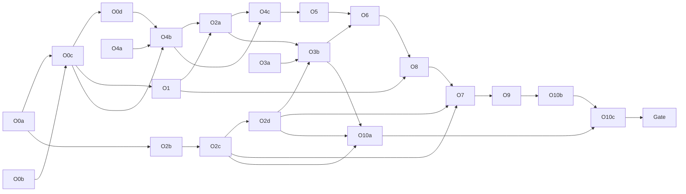

# Documents Overview Redesign Implementation Plan

> **For agentic workers:** REQUIRED SUB-SKILL: Use superpowers:subagent-driven-development (recommended) or superpowers:executing-plans to implement this plan task-by-task. Steps use checkbox (`- [ ]`) syntax for tracking.

**Goal:** Implement [2026-10-21-documents-overview-redesign-design.md](../specs/2026-10-21-documents-overview-redesign-design.md): the lead's Documents table gets three stage columns (Review, Annotation, Final) with server-derived cells, "Waiting on", one action button per row, row-level selection, tabs with counts, search, a facet popover with chips, a server-side NEW signal with a navigation counter, a final-result side panel with an agreement indicator, and explicit handling of text changes after annotation started (move, finish-then-carry, carry, handover, source-change review).

**Architecture:** Migration `0019_documents_overview` adds `work_plan_rows.decided`, `documents_visits`, `text_change_resolutions`, `draft_snapshots` and a second, draft-based source for `round_inputs`. Two pure modules carry the rules: `domain/stage_cells.py` (cells from `StageFacts`, which extend `StepFacts`) and `domain/agreement.py` (V9 matching). `domain/next_steps.py` gains `decide_plan` (V10) and the text-change rules 3a, 3b, 6a. The read model (`application/document_row_page.py` + new `document_row_stages.py`, `document_row_facets.py`) derives cells, tabs and facet counts in one pass, so table, facets, tabs, Progress links and the navigation counter share one derivation. A new `application/text_changes.py` (`TextChangeService`) does preview, move-to-version, resolutions and carry under the exclusive project lock, reusing a transaction-scoped core extracted from `WorkRoundService.create`; the V8 auto-carry runs as an in-transaction hook of the submit path. The frontend rebuilds `DocumentsTable` on an extended `ui/DataTable` (checkbox column, label group rows, server-driven sort), adds `ui/StageCell`, `ui/Tabs`, `ui/Popover`, `ui/FilterChip`, `ui/MenuButton`, a `side` variant of `ui/Dialog`, and new `documents/` components for tabs/filters, the final panel and the text-change dialogs.

**Tech Stack:** Python 3.12, FastAPI, SQLAlchemy 2, Alembic, PostgreSQL (pytest via Docker testcontainers or `ONTOTATOR_TEST_PG_URL`, pytest-xdist); React 18, TypeScript, Vitest + Testing Library, Playwright + axe-core; `openapi-typescript` for `generated.ts`. No new dependencies.

**Binding inputs:** the spec above (decisions V1 to V10, choices VD1 to VD22, Copy table binding, "Acceptance walkthrough"); the "Scenario table" of this plan (scenarios 1–16, copied from the mockups); mockups (reference only; the spec wins; gitignored, so they exist only in the main checkout, never in a worktree) in `.superpowers/mockups/overview-editor-guidelines/` (`documents-table-structure.html`, `documents-scenarios.html`, `documents-text-change.html`, `documents-filters.html`, `final-result.html`); [lead spec](../specs/2026-10-20-lead-workflow-design.md) (D1 to D26); [follow-up spec](../specs/2026-10-20-lead-followups-design.md) (F1 to F7, FD10 to FD12); `DESIGN.md`; `PRODUCT.md`.

**Open questions of the spec, decided by orchestrator 2026-10-21, open to veto:** (1) no full-text search (VD11); (2) handover refused when the person already works on the row, also with "Annotations per text = 1" (VD13, the spec default); (3) 30-minute visit gap kept (VD6); (4) tab counts ignore facets and search (spec gap 1; the user was informed and raised no objection). No WP waits for a confirmation; a later veto changes only the affected WP block (O0c for 1 and 4, O2b for 2, O1 for 3).

---

## Global rules (every WP; a subagent reads only this section and its WP block)

Worktree: `C:/Users/jan-p/Development/ontocurator/.worktrees/documents-overview` (Git Bash: `/c/Users/jan-p/Development/ontocurator/.worktrees/documents-overview`), branch `feat/documents-overview`, created from `main` **after `feat/lead-followups` is merged** (orchestrator check: `git merge-base --is-ancestor feat/lead-followups main && echo merged`). Create it from the main checkout with `git worktree add .worktrees/documents-overview -b feat/documents-overview main`, then `uv sync` and `npm --prefix frontend ci` in the worktree. Every command runs from the worktree root: `cd /c/Users/jan-p/Development/ontocurator/.worktrees/documents-overview && …`. All line references below were verified on `feat/lead-followups` at `90d7c70`; after the merge a WP re-checks every reference it uses with `grep -n` and reports drift in its hand-back instead of guessing.

1. **Subagents never commit, push, `git reset`, `git checkout -- <file>`, `git stash` or `git clean`.** They edit on top of the working tree. The orchestrator commits each WP after its done check (and review, where flagged) with the WP's commit message, staging only the WP's owned files (`git add <files>`, never `git add -A`). No AI attribution lines anywhere (no `Co-Authored-By`, no "Generated with").
2. **Exclusive file ownership.** A WP writes only the files in its **Owns** list (test files included). If it needs another file, it stops and reports. Two WPs never own the same file at the same time; shared files follow "Shared-file chains". Frontend WPs never edit `frontend/tests/documents/fixtures.ts` (only contracts writers add defaults there); they put builders into their own `frontend/tests/documents/<name>Fixtures.ts`.
3. **Prerequisite checks first.** Run the WP's prerequisite commands; if one fails, stop and report. Never re-implement a missing prerequisite.
4. **Shell.** Git Bash. `rg` is not installed; use `grep -rnE`.
5. **Machine limits (16 GB RAM).** At most **two test-heavy agents at once on the machine** (across all worktrees and plans). Heavy = backend pytest that touches PostgreSQL, a full Vitest run, Playwright, any `scripts/check.sh` run except `--quick` on frontend-only changes. Light = pure-Python pytest files without a database (`tests/test_stage_cells_domain.py`, `tests/test_agreement_domain.py`), single Vitest files, `npm --prefix frontend run typecheck`, ruff/mypy, generator scripts; at most three light agents at once. Lane **L+** = light, but its one wider Vitest run waits until the orchestrator confirms a free heavy slot. **One Playwright run per machine at a time.**
6. **Verification rule (user-approved).** WP agents run **only affected checks** through the fast path of `docs/operations/local-checks.md` (branch `chore/test-speed`): `bash scripts/check.sh --quick` (static checks plus affected tests against `main`), or with explicit paths `bash scripts/check.sh --quick <file> …`. If `--quick` is not on `main` yet, use the fallbacks: one backend file `uv run pytest tests/<file>.py -q`; several `uv run pytest -n 4 tests/<a>.py tests/<b>.py -q`; one Vitest file `npm --prefix frontend test -- --maxWorkers=4 --minWorkers=1 tests/<path>`; `npm --prefix frontend run typecheck`; `uv run ruff check . && uv run ruff format --check . && uv run mypy src`; after a regeneration `bash scripts/check.sh --only static`. **The full gate (`bash scripts/check.sh`) runs once, after the last WP, alone on the machine** ("Final gate"). No WP runs the full backend, full Vitest or full Playwright suite.
7. **Playwright.** This worktree always uses `HPO_E2E_PORT=18768` (`phase0-implementation` 18765, `editor-axes-scroll` 18766, `project-guidelines` 18767): `HPO_E2E_PORT=18768 npm --prefix frontend run test:e2e -- <spec>` (rebuilds `frontend/dist`).
8. **Isolated browser scenarios.** Every new or changed Playwright test builds its own fresh project through a test-only route (`/__test_overview__`, or the existing `/__test_documents__`, `/__test_lead_workflow__`, `/__test_review_flow__`, …). No test of this plan reads or writes the shared `browser-fixture` project or a project another test uses, so the suite can run with `--workers=3`. Evidence (screenshots, measurements) only under `build/documents-overview/evidence/` in the worktree (resolved as `resolve(test.info().config.rootDir, "../../build/documents-overview/evidence")`); no Playwright scratch files in the main checkout.
9. **Static gate during parallel work.** `scripts/check.sh --only static` (and `--quick`) checks the whole tree, so it may fail on a sibling WP's in-progress files or on a pending regeneration. A WP fixes only failures in its own Owns and reports the others with file names; the orchestrator reruns it later.
10. **Contracts.** `contracts/openapi.json`, `frontend/src/api/generated.ts` and `contracts/admin-error-codes.json` are never hand-edited. Regenerate with `uv run python scripts/export_openapi.py && npm --prefix frontend run api:generate` and `uv run python scripts/export_admin_error_codes.py`. **One contracts writer at a time, in the order O0c → O0d → O1 → O2a → O2b → O2c → O2d → O3b** (the orchestrator hands over a "contracts token"); a writer also adds its `frontend/src/api/client.ts` functions and the new defaults in `frontend/tests/documents/fixtures.ts`, so the tree typechecks after each writer.
11. **API changes are additive.** New response fields get defaults (`= None`, `= False`, `Field(default_factory=…)`). Request fields that change from one value to a list (`language`, `origin`) keep accepting one value (FastAPI repeatable query). `document-rows/case-ids` stays for one release beside the new `document-rows/keys`.
12. **Migration numbering (VD20).** This plan creates `src/ontotator/storage/migrations/versions/0019_documents_overview.py` with `revision = "0019"`, `down_revision = "0018"` (the guidelines plan's `0018_project_guidelines`). Rule: **whichever branch merges to `main` first keeps its number; the branch merging second renumbers before its merge**: rename its file to the next free number, set `revision`/`down_revision` to follow the head on `main`, update every test that upgrades to or pins a revision (`grep -rnE '"001[7-9]"|"0020"' tests/`; `tests/test_schema.py` compares with `head_revision()` and needs no edit), rerun its migration test files and `tests/test_schema.py`. If this branch merges before the guidelines branch, it renames to `0018_documents_overview.py` with `down_revision = "0017"` and the guidelines branch becomes `0019`. Never renumber a migration that is already on `main`.
13. **DocumentsPage token.** `frontend/src/admin/DocumentsPage.tsx` and `frontend/tests/documentsPage.test.tsx` have one writer at a time, in the order **O0c (compile only) → O4b → O4c → O5 → O6 → O8 → O7 → O9**. Frontend WPs build their components and component tests first (no token needed) and do the page wiring as their last implementation step, after the orchestrator hands them the token.
14. **English** for all files and UI copy; copy verbatim from the spec's "Copy" table. Stage symbols (`— ? ○ ◐ ● ⚠ ⏸ ✕ ✓`) are text glyphs required by the spec, rendered `aria-hidden` next to the status word; all other icons only from `frontend/src/ui/icons.tsx`. Status never by colour alone. Unavailable actions use `aria-disabled` + `aria-describedby` reason (existing `Button`), never native `disabled`. `DESIGN.md` tokens only; no new tokens.
15. **TDD.** Write the listed failing tests first, run them red, implement, run green.
16. **Reviews.** Only the flagged WPs (L or backend-critical) get one read-only review by the Claude `superpowers:code-reviewer` agent, then one fix agent at effort medium. After the final gate, one review of the whole plan's diff by the same agent. No Codex, no `agy`.
17. **Hand-back** (final message): changed/created/deleted files (subset of Owns), commands with exit status and one-line result, done checklist item by item, skipped parts and deviations, line-reference drift found, open risks, the commit message.

## Work packages

The spec's O0, O2, O3, O4 and O10 are split so each fits one agent session; IDs keep the spec prefix. Lanes: H heavy, L light, L+ light with one wider Vitest run, PW Playwright (heavy).

| WP   | Content                                                                                                                                                                                                                                                                                                                     | Size | Lane | Branch                  | Depends on                    | Review                              |
| ---- | --------------------------------------------------------------------------------------------------------------------------------------------------------------------------------------------------------------------------------------------------------------------------------------------------------------------------- | ---- | ---- | ----------------------- | ----------------------------- | ----------------------------------- |
| O0a  | Migration `0019` (all tables and columns of the spec), ORM, `decided` writes in `work_plan_store`, backfill, migration tests                                                                                                                                                                                                | M    | H    | feat/documents-overview | lead-followups merged         | yes (backend-critical)              |
| O0b  | Pure `domain/stage_cells.py` (scenarios 1–16, property test), `decide_plan` rule in `domain/next_steps.py`                                                                                                                                                                                                                  | M    | L    | feat/documents-overview | —                             | yes (backend-critical)              |
| O0c  | Read model: `StageFacts` building, `stages`, `version_marker`, `owner.people`, `plan_row.decided`, tabs (Done, All, not decided), facets and counts, repeatable filters, sort desc, search label form; contracts writer 1; contract tests (FD11 stays green)                                                                | L    | H    | feat/documents-overview | O0a, O0b                      | yes (backend-critical)              |
| O0d  | Row-level `rows` on bulk plan, selection summary, batch preview/commit (VD21); `POST document-rows/keys`; contracts writer 2                                                                                                                                                                                                | M    | H    | feat/documents-overview | O0c                           | yes (backend-critical, bulk writes) |
| O1   | `documents_visits` service, `POST documents/visit`, `GET documents/summary`, `others_activity_at`, `new`; contracts writer 3                                                                                                                                                                                                | S    | H    | feat/documents-overview | O0c                           | — (plan review)                     |
| O2a  | Text-change read side: facts for old-version work, resolutions and unfiltered source obligations; rules 3a, 3b, 6a, changed 8/9; text-change cell states; `SOURCE_UPDATE_UNREVIEWED` as issue; "moved to v2" data; labels; contracts writer 4                                                                               | L    | H    | feat/documents-overview | O0c, O1 (files), O4b (labels) | yes (backend-critical)              |
| O2b  | Text-change write side: `TextChangeService` (preview, move-to-version with draft snapshot, resolution, carry author/other/dismiss), `WorkRoundService` core extraction, round kinds `text_change`/`handover`, `CARRY_ROUND_KINDS` in the six behaviour gates, draft-source adapter, error codes, routes; contracts writer 5 | L    | H    | feat/documents-overview | O0a                           | yes (backend-critical)              |
| O2c  | V8 finish-then-carry hook in the submit transaction (exclusive lock flag, savepoint); source-change review flag on single and batch assign; contracts writer 6                                                                                                                                                              | M    | H    | feat/documents-overview | O2b                           | yes (backend-critical)              |
| O2d  | Draft-sourced round inputs in every reader: `RoundInputView.source_submission_id` optional (contract change), round reads, visibility, remaining carry-kind checks, final export and human inputs, frontend input readers; contracts writer 6b                                                                              | M    | H    | feat/documents-overview | O2c                           | yes (backend-critical, export)      |
| O3a  | Pure `domain/agreement.py` (V9) with unit tests                                                                                                                                                                                                                                                                             | S    | L    | feat/documents-overview | —                             | — (plan review, focus V9)           |
| O3b  | `GET …/final-panel`, agreement in the Final cell of shown `choose` rows, changed-passage count; contracts writer 7                                                                                                                                                                                                          | M    | H    | feat/documents-overview | O3a, O2a (files), O2d (token) | yes (backend-critical)              |
| O4a  | Design-system components: `DataTable` checkbox column, label group rows, row edge, server-driven sort; `StageCell`, `Tabs`, `Popover`, `FilterChip`, `MenuButton`, `Dialog` variant `side`                                                                                                                                  | M    | L    | feat/documents-overview | —                             | —                                   |
| O4b  | Table: 8 columns, group label rows, row checkboxes and text-level selection (VD4), stage-cell copy, Waiting on, Action + "+n" menu, plan popover, NEW + edge, muted not-in-plan rows, collapse rules removed                                                                                                                | L    | L+   | feat/documents-overview | O0c, O0d, O4a                 | yes (L)                             |
| O4c  | Slim expansion (History, Plan, Text versions with "moved to v2", details), inline Resolve panel with the F1 correction panel (F5 focus), removal of stage blocks / issues / submissions from the expansion                                                                                                                  | M    | L+   | feat/documents-overview | O4b                           | —                                   |
| O5   | Tabs, search, filter popover, chips, header sort, route fields, legacy parameters as chips; `DecisionBar` replaced                                                                                                                                                                                                          | M    | L+   | feat/documents-overview | O4b, O4c (token)              | —                                   |
| O6   | Final-result side panel: accept, compare, agreement, consolidate, review changes, advance                                                                                                                                                                                                                                   | M    | L+   | feat/documents-overview | O3b, O5 (token)               | —                                   |
| O7   | "Handle text change…" and "Carry to v2…" dialogs, "Assign review…" for a changed source, editor marker "Check after text change"                                                                                                                                                                                            | M    | L+   | feat/documents-overview | O2c, O2d, O8 (token)          | —                                   |
| O8   | Navigation counter "Documents (n)", visit call, landing and nav link to Needs your decision, `documents-changed` event                                                                                                                                                                                                      | S    | L+   | feat/documents-overview | O1, O6 (token)                | —                                   |
| O9   | Narrow cards, accessibility pass, `DESIGN.md`                                                                                                                                                                                                                                                                               | M    | L+   | feat/documents-overview | O7 (token)                    | —                                   |
| O10a | Browser scenario builders `tests/browser_overview_scenarios.py` (scenarios 1–16, `WALKTHROUGH`, act route), fixture test, `overviewHelpers.ts`                                                                                                                                                                              | M    | H    | feat/documents-overview | O2c, O2d, O3b                 | —                                   |
| O10b | Existing browser specs moved to the new UI (documents-table, documents-decisions, documents-a11y, lead-workflow, lead-workflow-a11y, final-workflow, problem-reports-lead, admin, variant-admin, compare, review-flow, translation-review, reanchor, variants)                                                              | L    | PW   | feat/documents-overview | O9                            | — (test-only; plan review)          |
| O10c | New browser specs: acceptance walkthrough with click totals, scenarios 1–16 with evidence, keyboard-only, 390/320 px, forced colours, Progress click-through                                                                                                                                                                | M    | PW   | feat/documents-overview | O10a, O9                      | — (plan review)                     |

Count: 20 WPs (S: O1, O3a, O8; M: O0a, O0b, O0d, O2c, O2d, O3b, O4a, O4c, O5, O6, O7, O9, O10a, O10c; L: O0c, O2a, O2b, O4b, O10b). Deviations from the spec's WP table: O1 and O3a are reviewed inside the plan review (small, read-mostly), O10b is L but test-only (plan review); O2d is new because draft-sourced round inputs reach the exports (spec gap, see "Spec gaps"); the design-system components move from O9 to O4a because O4b to O7 need them; DESIGN.md stays in O9.

## Shared-file chains (one writer at a time, in this order)

| File(s)                                                                                                                                                                                      | Writers in order                                                                                                                                                                                                                                                                                               |
| -------------------------------------------------------------------------------------------------------------------------------------------------------------------------------------------- | -------------------------------------------------------------------------------------------------------------------------------------------------------------------------------------------------------------------------------------------------------------------------------------------------------------- |
| `contracts/openapi.json`, `frontend/src/api/generated.ts`, `frontend/src/api/client.ts`, `frontend/tests/documents/fixtures.ts` (defaults only)                                              | O0c → O0d → O1 → O2a → O2b → O2c → O2d → O3b                                                                                                                                                                                                                                                                   |
| `src/ontotator/domain/admin_error_codes.py`, `contracts/admin-error-codes.json`, `frontend/src/admin/errors.ts`, `src/ontotator/api/app.py`                                              | O2b only (all new codes, also those O2c raises)                                                                                                                                                                                                                                                                |
| `src/ontotator/storage/migrations/versions/0019_documents_overview.py`, `storage/plan_tables.py`, `storage/workflow_tables.py`, new `storage/overview_tables.py`                           | O0a only                                                                                                                                                                                                                                                                                                       |
| `src/ontotator/storage/work_plan_store.py`                                                                                                                                                 | O0a only                                                                                                                                                                                                                                                                                                       |
| `src/ontotator/domain/next_steps.py`, `tests/test_next_steps_domain.py`                                                                                                                    | O0b → O2a                                                                                                                                                                                                                                                                                                      |
| `src/ontotator/domain/stage_cells.py`, `tests/test_stage_cells_domain.py`                                                                                                                  | O0b → O2a (only the text-change scenario expectations if a fact name changes)                                                                                                                                                                                                                                  |
| `src/ontotator/domain/document_rows.py`                                                                                                                                                    | O0c only                                                                                                                                                                                                                                                                                                       |
| `src/ontotator/application/document_row_page.py`, `application/document_rows.py`, `api/document_row_routes.py`, `application/document_row_stages.py`                                       | O0c → O1 → O2a → O3b                                                                                                                                                                                                                                                                                           |
| `src/ontotator/application/progress.py`, `tests/test_progress_links.py`                                                                                                                    | O0c only (FD11 links are built here, `progress.py:25-102`)                                                                                                                                                                                                                                                     |
| `src/ontotator/application/document_row_facets.py`                                                                                                                                         | O0c only                                                                                                                                                                                                                                                                                                       |
| `src/ontotator/api/assignment_batch_routes.py`, `src/ontotator/assignments/batch.py`                                                                                                     | O0d → O2c                                                                                                                                                                                                                                                                                                      |
| `src/ontotator/api/work_plan_routes.py`                                                                                                                                                    | O0c (`PlanFlagsView.decided` only) → O0d                                                                                                                                                                                                                                                                       |
| `src/ontotator/application/work_plans.py`                                                                                                                                                  | O0d only                                                                                                                                                                                                                                                                                                       |
| `src/ontotator/application/work_rounds.py`, `src/ontotator/domain/submission_labels.py`                                                                                                  | O2b only                                                                                                                                                                                                                                                                                                       |
| `src/ontotator/domain/work_rounds.py`, `src/ontotator/application/round_reads.py`                                                                                                        | O2b (`CARRY_ROUND_KINDS`, `round_reads.py:152`, `:194`) → O2d (`RoundInputView`, draft-source reads)                                                                                                                                                                                                           |
| `src/ontotator/storage/repository.py`                                                                                                                                                      | O0a (mypy fallout of the nullable column, `:505` only) → O2b (`:362` input snapshots of draft-sourced rounds, carry-kind check `:2874`) → O2c (`run_mutation` flag and hook, `_before_workspace_locks`) → O2d (`:505` reads both sources)                                                                      |
| `src/ontotator/application/submissions.py`                                                                                                                                                 | O2b (`:427` carry-kind check only) → O2c                                                                                                                                                                                                                                                                       |
| `src/ontotator/api/assignment_routes.py`, `src/ontotator/assignments/service.py`, `src/ontotator/assignments/eligibility.py`                                                           | O2c only                                                                                                                                                                                                                                                                                                       |
| `frontend/src/ui/DataTable.tsx`, `frontend/src/ui/Dialog.tsx`, `frontend/src/ui/index.ts`, new `ui/StageCell.tsx`, `ui/Tabs.tsx`, `ui/Popover.tsx`, `ui/FilterChip.tsx`, `ui/MenuButton.tsx` | O4a only                                                                                                                                                                                                                                                                                                       |
| `frontend/src/admin/DocumentsPage.tsx`, `frontend/tests/documentsPage.test.tsx`                                                                                                              | O0c → O4b → O4c → O5 → O6 → O8 → O7 → O9 (Global rule 13)                                                                                                                                                                                                                                                      |
| `frontend/src/documents/DocumentsTable.tsx`, `documents/RowCells.tsx`, `frontend/src/styles/screens/documents-table.css`                                                                     | O4b → O4c → O9                                                                                                                                                                                                                                                                                                 |
| `frontend/src/documents/nextStepLabels.ts`, `frontend/tests/documents/nextStepLabels.test.ts`                                                                                                | O0c (labels for `decide_plan`, `plan`) → O4b → O2a (labels for the text-change steps, actions, badge) → O4c → O9; the `Record<StepCode, …>`, `Record<RowAction, …>`, `Record<StepBadge, …>` maps (`:15`, `:34`, `:45`) are exhaustive, so each contracts writer that adds a code adds its label in the same WP |
| `frontend/src/editor/carried/checkState.ts`, `frontend/src/tasks/RoundInputEvidenceDialog.tsx`, `frontend/src/tasks/MergeInputs.tsx`                                                         | O2d only (optional `source_submission_id`)                                                                                                                                                                                                                                                                     |
| `frontend/src/documents/DocumentCards.tsx`, `frontend/src/styles/screens/documents-cards.css`                                                                                                | O4b (props only) → O9                                                                                                                                                                                                                                                                                          |
| `frontend/src/documents/ExpandedRow.tsx`, `documents/StageBlocks.tsx`, `documents/ResolveTranslation.tsx`, `documents/LeadCorrectionPanel.tsx`, `documents/TextVersions.tsx`                 | O4c only                                                                                                                                                                                                                                                                                                       |
| `frontend/src/app/router.ts`, `frontend/tests/router.test.ts`                                                                                                                                | O5 only                                                                                                                                                                                                                                                                                                        |
| `frontend/src/app/Shell.tsx`, `frontend/src/App.tsx`, `frontend/tests/shell.test.tsx`, `frontend/tests/landing.test.tsx`                                                                     | O8 only                                                                                                                                                                                                                                                                                                        |
| `frontend/src/app/CaseScreen.tsx`, `frontend/src/editor/carried/CarriedSection.tsx`                                                                                                          | O7 only                                                                                                                                                                                                                                                                                                        |
| `frontend/src/admin/AssignWorkDialog.tsx`                                                                                                                                                    | O7 only                                                                                                                                                                                                                                                                                                        |
| `tests/browser_server.py`                                                                                                                                                                    | O10a (one import and one registration line)                                                                                                                                                                                                                                                                    |
| `DESIGN.md`                                                                                                                                                                                  | O9 only                                                                                                                                                                                                                                                                                                        |

### Cross-plan files and resolution rules

Both other plans of 2026-10-21 start from `main` after `feat/lead-followups`. Files this plan shares with them:

| File                                                                                                                            | Other plan and WP                                                                                                         | Resolution rule                                                                                                                                                                                                                                                                                                                                                                                                                                                                            |
| ------------------------------------------------------------------------------------------------------------------------------- | ------------------------------------------------------------------------------------------------------------------------- | ------------------------------------------------------------------------------------------------------------------------------------------------------------------------------------------------------------------------------------------------------------------------------------------------------------------------------------------------------------------------------------------------------------------------------------------------------------------------------------------ |
| `frontend/src/documents/SubmissionsTable.tsx`, `frontend/tests/documents/submissionsTable.test.tsx`                             | Guidelines G5 (label "Guidelines v2" per submission)                                                                      | This plan does **not** edit `SubmissionsTable.tsx` (still used by `variants/SubmissionHistory.tsx`); O4c only removes its use from `ExpandedRow.tsx`. The final panel (O6) has its own submission rows. Branch merging second: if guidelines are on `main` first, O6's panel rows gain `submissionGuidelineLabel(...)` (one line per row) and a panel test asserts it; if this plan is first, the guidelines branch adds the label to `documents/FinalPanel.tsx` as its plan already says. |
| `frontend/tests/documents/fixtures.ts`                                                                                          | Guidelines G1a (defaults), G5                                                                                             | Both only add defaults/builders; keep both sides, rerun every `frontend/tests/documents/*.test.tsx` via `bash scripts/check.sh --quick frontend/tests/documents/fixtures.ts`.                                                                                                                                                                                                                                                                                                              |
| `RowSubmissionView` in `src/ontotator/api/document_row_routes.py`; `src/ontotator/application/document_row_submissions.py`  | Guidelines G1a (`guideline_version`, `guideline_withdrawn`)                                                               | O3b's `FinalPanelSubmissionView` **extends** `RowSubmissionView` and reuses `_submissions`, so G1a's fields flow into the panel without edits; resolve the textual conflict keeping both field sets, regenerate contracts.                                                                                                                                                                                                                                                                 |
| `frontend/src/app/router.ts`, `frontend/tests/router.test.ts`, `frontend/src/App.tsx`                                           | Guidelines G5 (route `projectGuidelines`)                                                                                 | Additive on both sides (G5: one route; O5: query fields; O8: landing). Keep both; rerun `tests/router.test.ts`, `tests/landing.test.tsx`.                                                                                                                                                                                                                                                                                                                                                  |
| `DESIGN.md`                                                                                                                     | Guidelines G4 (Drawer row, toolbar entry); editor-axes X1 (`Values block` row), S3 (translation review layout, Shortcuts) | Separate rows/sections; keep all. O9 adds its rows under "Components" and replaces "Grouped expandable table" (`DESIGN.md:269-279`) only.                                                                                                                                                                                                                                                                                                                                                  |
| `src/ontotator/storage/repository.py` (`run_mutation` Submission branch `:3126-3150`)                                         | Guidelines G0a, G1a (stamp in `run_mutation`), G1b                                                                        | Both add lines in the Submission branch: keep G1a's `guideline_version=` argument on `_insert_submission` **and** O2c's `after_submit` call after it (stamp first, then the hook, same transaction). Rerun `tests/test_guideline_stamps.py` (if present) and `tests/test_text_change_auto_carry.py`.                                                                                                                                                                                       |
| `src/ontotator/exchange/jobs.py`, `src/ontotator/exchange/final_export_guide.py`                                            | Guidelines G1b (`guideline_ref` per result, `INDEX_COLUMNS`)                                                              | O2d changes only the carry-kind checks (`jobs.py:326`, `final_export_guide.py:46`) and the draft-source branch at `jobs.py:195`; keep both; rerun the export tests of both plans.                                                                                                                                                                                                                                                                                                          |
| `src/ontotator/api/app.py`, `domain/admin_error_codes.py`, `contracts/admin-error-codes.json`, `frontend/src/admin/errors.ts` | Guidelines G0b                                                                                                            | Additive (routers, codes, status map entries); keep both, regenerate the catalog.                                                                                                                                                                                                                                                                                                                                                                                                          |
| `frontend/src/app/CaseScreen.tsx`                                                                                               | Guidelines G4 (prop `guidelineNotice`, one render line)                                                                   | O7 edits only the carry-kind conditions (`:283`, `:2625`, `:2634`); keep both.                                                                                                                                                                                                                                                                                                                                                                                                             |
| `frontend/src/ui/index.ts`, `frontend/src/ui/icons.tsx`                                                                         | Guidelines G2, G4                                                                                                         | One export line per component; keep all.                                                                                                                                                                                                                                                                                                                                                                                                                                                   |
| `frontend/src/styles/components.css`                                                                                            | Editor-axes X1 (removes the `.axis-*` rules `:69-115`, `:429-445`)                                                        | O4a only appends new component blocks at the end of the file and never edits existing rules; X1 only deletes `.axis-*` rules. Keep both sides; rerun `frontend/tests/annotationPanelStyles.test.ts` and the O4a `frontend/tests/ui/*` tests.                                                                                                                                                                                                                                               |
| `tests/browser_server.py`                                                                                                       | Guidelines G6a, editor-axes X0                                                                                            | One import and one registration line each; keep all.                                                                                                                                                                                                                                                                                                                                                                                                                                       |
| `contracts/openapi.json`, `frontend/src/api/generated.ts`                                                                       | all                                                                                                                       | Never hand-merge: take `main`'s version, then regenerate (Global rule 10).                                                                                                                                                                                                                                                                                                                                                                                                                 |
| Migrations                                                                                                                      | Guidelines G0a (`0018`)                                                                                                   | Global rule 12.                                                                                                                                                                                                                                                                                                                                                                                                                                                                            |

General rule for the branch merging second: rebase onto `main`, resolve conflicts keeping both sides, regenerate contracts, run `bash scripts/check.sh --quick` and then the full gate once.

## Dependency graph



## Wave schedule

A wave's WPs may run at the same time (disjoint owned files, ≤ 2 heavy on the machine, ≤ 3 light, ≤ 1 Playwright). A WP starts as soon as its prerequisites are done and its files and tokens are free.

| Wave | Heavy lane (≤ 2)   | Light lane (≤ 3)    | Notes                                                                                                                                               |
| ---- | ------------------ | ------------------- | --------------------------------------------------------------------------------------------------------------------------------------------------- |
| 0    | —                  | —                   | Orchestrator: `feat/lead-followups` on `main`; worktree; migration head check (`ls …/versions \| tail -2`). Open questions are decided (see top).   |
| 1    | O0a                | O0b, O3a, O4a       | Pure domain and UI components have no prerequisite.                                                                                                 |
| 2    | O0c                | O4a (cont.)         | Contracts writer 1.                                                                                                                                 |
| 3    | O0d, O1            | O4b (L+)            | Contracts token O0d → O1; O4b starts after O0d's regeneration (needs `rows`).                                                                       |
| 4    | O2a, O2b           | O4c (L+)            | Disjoint files; contracts token O2a → O2b; `nextStepLabels.ts` O4b → O2a → O4c; O4c builds its components first and wires after O2a's regeneration. |
| 5    | O2c                | O5 (L+)             | O2c is writer 6.                                                                                                                                    |
| 6    | O2d, O3b           | O6 (L+, components) | Contracts token O2d (writer 6b) → O3b (writer 7); O6 builds against O3b's types after O3b's regeneration; wiring after the token.                   |
| 7    | O10a               | O8 (L+), O7 (L+)    | Token order O6 → O8 → O7; O7's dialogs are built while O8 wires.                                                                                    |
| 8    | —                  | O9 (L+)             | Last page writer.                                                                                                                                   |
| 9    | O10b (PW)          | —                   | Playwright alone.                                                                                                                                   |
| 10   | O10c (PW)          | —                   | Playwright alone.                                                                                                                                   |
| 11   | Final gate (alone) | —                   | Then the plan review.                                                                                                                               |

## Dispatching a WP to a subagent

The orchestrator sends one WP per subagent with: the worktree path; the instruction to read **only** "Global rules", "Shared contracts" (the parts the WP block names) and the WP block, plus the spec sections and code locations the block lists; the sibling WPs of the wave and their Owns; the lane; whether it holds the contracts token or the DocumentsPage token; the hand-back format of rule 17. Implementation agents run at the default effort; fix agents after a review at effort medium.

**Done check (orchestrator):** compare the reported files with Owns (`git status --short`), rerun the WP's light verification if unclear, tick the done checklist. Then review (flagged WPs only), one fix agent if needed, commit with the WP's message, release files and tokens.

---

## Shared contracts

These names are fixed for all WPs. A WP that produces one implements it exactly; a WP that consumes one relies on it.

### Storage (O0a): migration `0019_documents_overview`

New module `src/ontotator/storage/overview_tables.py`, imported at the end of `storage/tables.py` next to `final_tables`, `plan_tables`, `workflow_tables` (`tables.py:914-916`).

| Object                                                | Definition                                                                                                                                                                                                                                                                                                                                                                                                                                                                                                                                                                                                                                                                                                                                                                                                                                                                                                                                                                                                                                                                                                                                                                                                                                 |
| ----------------------------------------------------- | ------------------------------------------------------------------------------------------------------------------------------------------------------------------------------------------------------------------------------------------------------------------------------------------------------------------------------------------------------------------------------------------------------------------------------------------------------------------------------------------------------------------------------------------------------------------------------------------------------------------------------------------------------------------------------------------------------------------------------------------------------------------------------------------------------------------------------------------------------------------------------------------------------------------------------------------------------------------------------------------------------------------------------------------------------------------------------------------------------------------------------------------------------------------------------------------------------------------------------------------ |
| `work_plan_rows.decided`                              | `boolean NOT NULL`; added with `server_default=true`, backfilled `UPDATE … SET decided = false WHERE review = false AND annotate = false AND updated_by IS NULL AND project_id IN (SELECT id FROM projects WHERE import_plan = 'nothing')`, then the server default is dropped (every writer states the value). ORM `WorkPlanFlagsRow.decided: Mapped[bool]` (`plan_tables.py:44-63`).                                                                                                                                                                                                                                                                                                                                                                                                                                                                                                                                                                                                                                                                                                                                                                                                                                                     |
| `documents_visits` (`DocumentsVisitRow`)              | `user_id` (FK users), `project_id` (FK projects), PK of both; `baseline_at`, `last_seen_at` (timestamptz NOT NULL). Grants `SELECT, INSERT, UPDATE`.                                                                                                                                                                                                                                                                                                                                                                                                                                                                                                                                                                                                                                                                                                                                                                                                                                                                                                                                                                                                                                                                                       |
| `text_change_resolutions` (`TextChangeResolutionRow`) | `id` (bigint identity PK), `project_id` (FK projects), `case_id`, `language`, `from_document_id`, `to_document_id` (composite FKs to `documents(project_id, document_id)`), `assignment_id` (nullable FK assignments), `submission_id` (nullable; composite FK to `submissions(project_id, submission_id)`), `resolution` (CHECK in `moved`, `finish_then_carry`, `withdrawn`, `carried`, `handed_over`, `dismissed`; no `kept_final`: "Keep final on v1" is the existing keep request and writes no resolution, YAGNI), `round_id` (nullable; composite FK to `work_rounds(project_id, round_id)`), `decided_by` (nullable FK users; NULL = system carry, V8), `decided_at` (`server_default=func.now()`). CHECK `num_nonnulls(assignment_id, submission_id) >= 1`. Unique `(project_id, assignment_id)` and `(project_id, submission_id, to_document_id)`. **Append-only** (`forbid_history_change` triggers, `GRANT SELECT, INSERT`); the automatic `carried` row after a `finish_then_carry` (V8, O2c) is a second row with `assignment_id` **NULL**, `submission_id` = the new submission, `round_id` = the carry round and `decided_by` NULL, because `(project_id, assignment_id)` is already taken by the `finish_then_carry` row. |
| `draft_snapshots` (`DraftSnapshotRow`)                | `id` (bigint identity PK), `project_id` (FK projects), `assignment_id` (FK assignments), `document_id` (composite FK documents), `workspace_key` (text), `draft_revision` (bigint), `payload` (jsonb, model `DraftSnapshotPayload` below), `created_at` (`server_default=func.now()`). Append-only.                                                                                                                                                                                                                                                                                                                                                                                                                                                                                                                                                                                                                                                                                                                                                                                                                                                                                                                                        |
| `round_inputs`                                        | `source_submission_id` becomes nullable; new `source_draft_snapshot_id bigint` FK `draft_snapshots.id`; CHECK `ck_round_inputs_one_source`: `num_nonnulls(source_submission_id, source_draft_snapshot_id) = 1`. ORM `RoundInputRow` (`workflow_tables.py:92-109`) follows.                                                                                                                                                                                                                                                                                                                                                                                                                                                                                                                                                                                                                                                                                                                                                                                                                                                                                                                                                                 |
| `work_rounds.kind`                                    | No database constraint exists (verified in `0011_work_rounds.py`); the new kinds are a domain change (O2b).                                                                                                                                                                                                                                                                                                                                                                                                                                                                                                                                                                                                                                                                                                                                                                                                                                                                                                                                                                                                                                                                                                                                |

`draft_snapshots.payload` (O0a stores it as opaque jsonb; O2b owns the model in `domain/work_rounds.py`):

```python
class DraftSnapshotPayload(BaseModel):  # extra="forbid"
    format_version: Literal["ontotator-draft-snapshot/v1"] = (
        "ontotator-draft-snapshot/v1"
    )
    origin_key: (
        WorkspaceKey  # the old assignment's workspace key (document_id = from version)
    )
    scope: TaskScope  # build_scope(profile, origin_key.mode) at snapshot time
    document_version: int  # version of origin_key.document_id
    text_sha256: str  # of that version's text
    snapshots: list[
        AnnotationSnapshot
    ]  # Draft.annotations, each with its evidence (encode_snapshot / decode_snapshot)
```

Downgrade: refuses with a clear `RuntimeError` when any `round_inputs.source_draft_snapshot_id` is set (data would be lost), otherwise drops the new tables and columns and makes `source_submission_id` NOT NULL again.

`storage/work_plan_store.py`: `ensure_rows` (`:413-458`) writes `decided = not (import_plan == "nothing")` for inserted rows (it reads the project's `import_plan` once); `write_rows` (`:353-411`) writes `decided = True` in the insert and the `on_conflict_do_update` set. New reader `decided_rows(conn, project_id) -> dict[RowKey, bool]`.

### Pure stage cells (O0b): `src/ontotator/domain/stage_cells.py`

```python
Tone = Literal[
    "none", "undecided", "waiting", "todo", "running", "decision", "rejected", "done"
]
ReviewState = Literal[
    "source",
    "not_planned",
    "undecided",
    "unassigned",
    "check_failed",
    "in_progress",
    "re_review",
    "paused",
    "rejected",
    "query",
    "not_accepted",
    "source_changed",
    "accepted",
]
AnnotationState = Literal[
    "not_planned",
    "undecided",
    "after_review",
    "blocked",
    "unassigned",
    "partly_assigned",
    "in_progress",
    "paused",
    "in_review",
    "consolidating",
    "old_text_open",
    "old_text_submitted",
    "finishing_on_old",
    "submitted",
]
FinalState = Literal[
    "none",
    "after_annotation",
    "after_review",
    "choose",
    "confirm",
    "old_text",
    "may_be_outdated",
    "final",
]
CellNote = Literal[
    "machine_translation",
    "review_only",
    "translation_rejected",
    "translation_queried",
    "translation_not_accepted",
    "unchanged",
    "with_corrections",
    "in_package",
    "outside",
    "review_off",
    "text_change_waiting",
    "may_change",
    "not_exported",
    "carried_on_submit",
    "v2_not_annotated",
]


@dataclass(frozen=True)
class OldItem:
    user_id: int
    from_version: int
    assignment_id: int | None = None
    submission_id: str | None = None


@dataclass(frozen=True)
class StageFacts:
    step: StepFacts
    decided: bool = True
    review_people: tuple[int, ...] = ()  # open translation review(s)
    review_reason: Literal["correction", "new_review", "source_changed"] | None = None
    review_decided_by: int | None = None  # latest decision on the newest version
    review_decided_at: datetime | None = None
    accepted_how: Literal["unchanged", "corrected", "package", "external"] | None = None
    accepted_from_version: int | None = None  # "v1 → v2" when corrected
    newest_version: int = 1
    newest_origin: str | None = None  # VariantOrigin of the target
    annotators_open: tuple[int, ...] = ()  # on the target(s), not held
    annotators_submitted: tuple[int, ...] = ()  # on the target(s)
    round_ordinal: int | None = None  # the one open round, if exactly one
    findings: int | None = None  # finding_count when exactly one submission
    annotation_reviewers: tuple[int, ...] = ()
    consolidators: tuple[int, ...] = ()
    paused_by: int | None = None  # reporter of the open report
    paused_excerpt: str | None = None  # ≤ 60 characters
    paused_task: Literal["annotate", "translation_review"] | None = None
    old_open: tuple[OldItem, ...] = ()  # rule 3a items (O2a fills)
    old_submitted: tuple[OldItem, ...] = ()  # rule 3b items (O2a fills)
    finishing: tuple[OldItem, ...] = ()  # finish_then_carry items (O2a fills)
    source_changed_from: int | None = (
        None  # source version of an unreviewed source change (O2a fills)
    )
    correction_waiting: bool = False  # correction ready_for_review, rule on (edge case)
    final_causes: tuple[str, ...] = ()  # unacknowledged cause codes
    final_kind: Literal["round", "consolidation"] | None = None
    final_author: int | None = None
    final_round_ordinal: int | None = None
    final_version: int | None = None
    final_on_newest: bool = True
    submissions: int = 0  # eligible submissions (Final "n submissions"): on the target version only, without
    # sources whose text-change resolution is carried, moved or handed_over (spec VD16)
    parallel_roots: bool = False


@dataclass(frozen=True)
class CellDetail:
    people: tuple[int, ...] = ()
    assigned: int | None = None
    target: int | None = None
    submitted: int | None = None
    total: int | None = None
    version: int | None = None
    from_version: int | None = None
    at: datetime | None = None
    findings: int | None = None
    excerpt: str | None = None
    reason: str | None = None
    note: CellNote | None = None
    matching: int | None = None  # Final "4 of 6 match" (O3b fills for shown rows)
    compared: int | None = None


@dataclass(frozen=True)
class StageCell:
    state: str  # ReviewState | AnnotationState | FinalState
    tone: Tone
    detail: CellDetail


@dataclass(frozen=True)
class StageCells:
    review: StageCell
    annotation: StageCell
    final: StageCell


STEP_CELL: Mapping[StepCode, Literal["review", "annotation", "final"] | None]


def stage_cells(facts: StageFacts, steps: Sequence[Step]) -> StageCells: ...
```

The state tables are the spec's "Stage cells" (Review, Annotation, Final), with three additions the spec implies: Review `source` (tone `none`, "— source"); Review `paused` (tone `decision`) when the held task is a translation review (the spec's Annotation table has `paused` only; spec gap); `STEP_CELL` maps `decide_report`/`resume_task` to the cell of the held task. Tones per the spec: `check_failed` and `source_changed` use the decision colour but their step is kind `assign` (D4, VD14); the frontend takes colour from `tone` and never from the step kind.

### Scenario table (scenarios 1–16)

Copied from the mockups `documents-scenarios.html` (1–11) and `documents-text-change.html` (12–16), because `.superpowers/` is gitignored and absent in every worktree; the spec's deviations are already applied (scenario 1 via VD3, scenario 6 Final via VD19, scenario 9 "+1 more step" via VD18). O0b (`test_stage_cells_domain.py`), O10a (`browser_overview_scenarios.py`) and O10c use this table, never the mockups. Cells read `state` (tone) · line 1 · line 2. People: Ana Weber, Tom Reis, Luc Martin; "per text" = Annotations per text.

| #   | Case · row                                    | Facts                                                                                                                                            | Review                                                                                             | Annotation                                                                               | Final                                                                     | Waiting on          | Action                                                      |
| --- | --------------------------------------------- | ------------------------------------------------------------------------------------------------------------------------------------------------ | -------------------------------------------------------------------------------------------------- | ---------------------------------------------------------------------------------------- | ------------------------------------------------------------------------- | ------------------- | ----------------------------------------------------------- |
| 1   | case-101 · de (translation)                   | Project `import_plan = "nothing"`; plan row system-written, flags off (`decided = false`)                                                        | `undecided` (undecided) · ? not decided                                                            | `undecided` (undecided) · ? not decided                                                  | `none` (none) · —                                                         | You                 | Plan…                                                       |
| 1   | case-101 · en (source)                        | Plan row written by the lead, Annotate off (`decided = true`)                                                                                    | `source` (none) · — source                                                                         | `not_planned` (none) · — not planned                                                     | `none` · —                                                                | —                   | Plan… (quiet text button, VD2)                              |
| 2   | case-102 · de                                 | Review on; automatic check failed; no reviewer                                                                                                   | `check_failed` (decision) · ⚠ Check failed · unassigned                                            | `after_review` (waiting) · ○ after review                                                | `none` · —                                                                | You                 | Assign review…                                              |
| 3   | case-103 · de                                 | Translation review open, Ana                                                                                                                     | `in_progress` (running) · ◐ In progress · Ana Weber                                                | `after_review` (waiting) · ○ after review                                                | `none` · —                                                                | Ana Weber           | —                                                           |
| 4   | case-104 · de                                 | Ana rejected the translation at 10:40 (after the lead's baseline)                                                                                | `rejected` (rejected) · ✕ Rejected · Ana Weber · 10:40                                             | `blocked` (waiting) · ○ blocked · translation rejected                                   | `none` · —                                                                | You                 | Resolve… (edge, NEW)                                        |
| 4   | case-104 · fr                                 | Luc queried the translation at 10:51                                                                                                             | `query` (decision) · ? Query · Luc Martin · 10:51                                                  | `blocked` (waiting) · ○ blocked · queried                                                | `none` · —                                                                | You                 | Resolve… (edge, NEW)                                        |
| 5   | case-105 · de                                 | Correction v2 accepted by Ana; per text 2; no annotate assignment                                                                                | `accepted` (done) · ✓ Accepted · with corrections · v1 → v2 · Ana Weber                            | `unassigned` (todo) · ○ 0 of 2 assigned                                                  | `none` · —                                                                | You                 | Assign annotation…                                          |
| 6   | case-106 · de                                 | Accepted; per text 2; Ana submitted, Tom open                                                                                                    | `accepted` (done) · ✓ Accepted · unchanged                                                         | `in_progress` (running) · ◐ 1 of 2 submitted · waiting: Tom Reis                         | `after_annotation` (waiting) · ○ after annotation (VD19)                  | Tom Reis            | —                                                           |
| 7a  | case-107 · de                                 | Project with per text 1; accepted; Ana submitted (3 findings), no final                                                                          | `accepted` (done) · ✓ Accepted · unchanged                                                         | `submitted` (done) · ✓ submitted · Ana Weber · 3 findings                                | `choose` (decision) · ● Your choice · 1 submission                        | You                 | Accept result… (edge, NEW)                                  |
| 7b  | case-107 · en (source)                        | Project with per text 2 ("Annotations per text" is a project setting, so O10a builds 7a and 7b as two projects); Ana and Tom submitted, no final | `source` (none) · — source                                                                         | `submitted` (done) · ✓ 2 of 2 submitted · Ana Weber, Tom Reis                            | `choose` (decision) · ● Your choice · 2 submissions                       | You                 | Compare results… (edge, NEW)                                |
| 8   | case-108 · de                                 | Accepted; two submissions; annotation review (adjudication) open, Luc                                                                            | `accepted` (done) · ✓ Accepted · unchanged                                                         | `in_review` (running) · ◐ In review · 2 submitted · review: Luc Martin                   | `after_review` (waiting) · ○ after review                                 | Luc Martin          | —                                                           |
| 9   | case-109 · de                                 | Accepted; Tom's annotate task held by his open problem report "Satz 3 unvollständig…"                                                            | `accepted` (done) · ✓ Accepted · unchanged                                                         | `paused` (decision) · ⏸ Paused · Tom Reis: “Satz 3 unvollständig…”                       | `none` · —                                                                | You                 | Decide on report… ("+n" only with a second lead step, VD18) |
| 10  | case-110 · de                                 | Review on, Annotate off; accepted unchanged                                                                                                      | `accepted` (done) · ✓ Accepted · unchanged                                                         | `not_planned` (none) · — not planned · Review only                                       | `none` · —                                                                | —                   | —                                                           |
| 11  | case-111 · de                                 | Accepted; per text 2; both submitted; final chosen: Round 1 · Ana                                                                                | `accepted` (done) · ✓ Accepted · unchanged                                                         | `submitted` (done) · ✓ 2 of 2 submitted · Ana Weber, Tom Reis                            | `final` (done) · ✓ Final · Round 1 · Ana Weber                            | —                   | —                                                           |
| 11  | case-111 · fr                                 | Accepted; per text 1; final is a consolidation by Luc                                                                                            | `accepted` (done) · ✓ Accepted · unchanged                                                         | `submitted` (done) · ✓ submitted                                                         | `final` (done) · ✓ Final · Consolidation · Luc Martin                     | —                   | —                                                           |
| 11  | case-111 · en (source)                        | Annotate off                                                                                                                                     | `source` (none) · — source                                                                         | `not_planned` (none) · — not planned                                                     | `none` · —                                                                | —                   | —                                                           |
| 12  | case-112 · de, marker "v2 corrected"          | Tom's annotate assignment open on v1; then a re-review by Ana accepted a correction → v2 (annotatable)                                           | `accepted` (done) · ✓ Accepted · with corrections · v1 → v2 · Ana Weber                            | `old_text_open` (decision) · ⚠ In progress on old text · Tom Reis works on v1            | `none` · —                                                                | You                 | Handle text change… (edge, NEW)                             |
| 13  | case-113 · de, marker "v2 corrected"          | Ana submitted on v1, no final; then correction v2 accepted                                                                                       | `accepted` (done) · ✓ Accepted · with corrections · v1 → v2 · Ana Weber                            | `old_text_submitted` (decision) · ⚠ Submitted on v1 · Ana Weber · v2 not annotated       | `after_annotation` (waiting) · ○ after annotation                         | You                 | Carry to v2… (edge, NEW)                                    |
| 14  | case-114 · de, marker "v2 corrected"          | Final chosen on v1 (Round 1 · Ana); then correction v2 accepted (`SELECTED_TEXT_CORRECTED`)                                                      | `accepted` (done) · ✓ Accepted · with corrections · v1 → v2 · Ana Weber                            | `submitted` (done) · ✓ submitted · detail `version: 1` (no 3b: a final exists)           | `old_text` (decision) · ⚠ Final is on old text · Round 1 · Ana Weber · v1 | You                 | Review changes… (edge, NEW)                                 |
| 15  | case-115 · en (source), marker "v2 corrected" | Source corrected → en v2                                                                                                                         | `source` (none) · — source                                                                         | `not_planned` (none) · — not planned                                                     | `none` · —                                                                | —                   | —                                                           |
| 15  | case-115 · de                                 | Review on; de v1 accepted before the source change; unresolved `SOURCE_UPDATE_UNREVIEWED`; Tom submitted on de v1; final chosen                  | `source_changed` (decision colour, step kind `assign`) · ⚠ Source changed · translation from en v1 | `submitted` (done) · ✓ submitted · detail `version: 1`                                   | `may_be_outdated` (waiting) · ⚠ may be outdated · source changed          | You                 | Assign review… (no edge, To assign, VD14)                   |
| 16  | case-116 · de                                 | Accepted de v1; D25/D26 re-review open by Ana with reason "Dosis prüfen"; Tom's annotation open on v1                                            | `re_review` (running) · ◐ Re-review in progress · Ana Weber · reason: “Dosis prüfen”               | `in_progress` (running) · ◐ In progress · Tom Reis · v1 · may change (note `may_change`) | `none` · —                                                                | Ana Weber, Tom Reis | —                                                           |

### Next step additions

O0b, `domain/next_steps.py`: `OldItem` (above) is defined here and imported by `stage_cells.py` (`stage_cells` imports `next_steps`, not the reverse); `StepCode` gains `decide_plan`; `RowAction` gains `plan`; `StepFacts` gains `decided: bool = True`. `derive_steps` returns `[Step("decide_plan", "decision", <stage>, "plan", ("your_decision",))]` **before** the `in_plan` check when `not in_plan(facts) and not facts.decided` (V10, VD3); stage `"annotation"` for sources, `"translation_review"` for translations. `segment_of` maps it to `decision`.

O2a, same file: `StepCode` gains `handle_text_change`, `carry_text_change`, `review_source_change`; `RowAction` gains `handle_text_change`, `carry_text_change`, `assign_source_review`; `Badge` gains `source_changed`; `StepFacts` gains `old_open: tuple[OldItem, ...] = ()`, `old_submitted: tuple[OldItem, ...] = ()`, `finishing: tuple[OldItem, ...] = ()` (the same tuples O2a puts into `StageFacts`), `pending_old_people: int = 0`, `source_changed: bool = False`; `final_exists_for_3b: bool` is **not** added (3b uses `has_final`). Rules exactly as the spec's table "New and changed next-step rules": 3a and 3b after rule 3, before 4; 6a after 6, kind `assign`, badge `source_changed`; rule 8 (`next_steps.py:251`) compares `annotation_assignments + pending_old_people < per_text`, where `pending_old_people` = distinct people with a 3a, 3b or `finish_then_carry` item who hold no annotate assignment on that target (computed by the caller as the minimum over targets, as `annotation_assignments` is, VD22); `pending_old_people` is read **only** by rule 8, so rule 5, `_final_ready` (`:137-139`), `row_stage` (`:142`) and the `assigned`/`target` counts of rule 8 stay on `annotation_assignments`; 9 counts `finishing` as in progress. **One step per old work item:** `derive_steps` returns one `handle_text_change` step per 3a item and one `carry_text_change` step per 3b item (people in the order of `OldItem`), so the "+n" menu lists one dialog per person; `Step` gains `assignment_id: int | None = None` and `submission_id: str | None = None`, and `NextStepView` (`document_row_routes.py:205-219`, which has `assignment_id` already) gains `submission_id: str | None = None`.

### Read model (O0c, O1, O2a, O3b)

`application/document_row_stages.py` (O0c): `stage_facts(ctx, key, *, live, targets, active, step_facts, final, row) -> StageFacts` and `cell_view(cell: StageCell, people: Callable[[int], dict]) -> dict` (maps `people` ids to `PersonRefView` dicts through `_Context.person`). `application/document_row_facets.py` (O0c): `facet_values(row: Mapping) -> dict[FacetGroup, tuple[str, ...]]`, `facet_counts(ctx, rows, matches_without: Callable[[FacetGroup], Callable[[row], bool]]) -> dict[FacetGroup, dict[str, int]]` with `FacetGroup = Literal["language", "review_state", "annotation_state", "final_state", "origin", "plan", "waiting_on"]`; counts of a group exclude that group's own selection (the usual facet rule) and include tab, search and every other group.

API additions in `api/document_row_routes.py` (all with defaults):

- `StageCellDetailView {people: list[PersonRefView] = [], assigned, target, submitted, total, version, from_version: int | None = None, at: datetime | None = None, findings: int | None = None, excerpt: str | None = None, reason: str | None = None, note: CellNote | None = None, matching: int | None = None, compared: int | None = None}`
- `StageCellView {state: str, tone: Tone, detail: StageCellDetailView}`; `RowStagesView {review: StageCellView, annotation: StageCellView, final: StageCellView}`
- `VersionMarkerView {kind: Literal["corrected", "version", "parallel"], version: int}`
- `DocumentRowView` (`:221-249`) gains `stages: RowStagesView | None = None`, `version_marker: VersionMarkerView | None = None` (O0c), `new: bool = False`, `others_activity_at: datetime | None = None` (O1).
- O2a: `WorkItemView` (`document_row_routes.py:86-99`) gains `moved_to_version: int | None = None` (version of `to_document_id` of a `moved` resolution row for that assignment; Text versions renders "moved to v2" from it, O4c), and `NextStepView` gains `submission_id` (see "Next step additions").
- `StepOwnerView` (`:174-177`) gains `people: list[PersonRefView] = []` (VD8: every person of the first step; for kind `in_progress` the people of every in-progress step of the row).
- `PlanFlagsView` (`api/work_plan_routes.py:20-24`) gains `decided: bool = True`.
- `DecisionBarView` (`:266-286`) gains `done: int = 0`, `all: int = 0`, `not_decided: int = 0`, `facets: dict[str, dict[str, int]] = {}`; `needs_decision` includes undecided rows (V10); `in_plan` stays.
- `Segment` (`application/document_rows.py:64`) gains `done`; no segment = **All** = every row, in plan or not (change; `_in_active_segment` at `document_row_page.py:822-834`).
- `RowQuery` (`document_rows.py:84-129`) and `_filters` (`document_row_routes.py:381-422`): `language`, `origin` become repeatable; new repeatable `review_state`, `annotation_state`, `final_state`, `waiting_on` ("me" or a pseudonym); `PlanFilter` (`:65`) gains `not_decided` (`not_in_plan` keeps meaning "flags off", so it includes undecided rows); `Sort` (`:66`) gains `-case`, `-activity`; `q` also accepts the text label form via `domain/document_rows.py` `split_text_label(q) -> tuple[str, str] | None` ("case-104 de", "case-104 · de" → case prefix + exact language; VD11).
- O1: `POST /api/v1/projects/{key}/documents/visit` → `DocumentsVisitView {baseline_at: datetime}`; `GET /api/v1/projects/{key}/documents/summary` → `DocumentsSummaryView {needs_decision: int}` (`new_decisions` dropped: no consumer) (both in `document_row_routes.py`, lead only).
- O3b: `GET /api/v1/projects/{key}/document-rows/{case_id:path}/{language}/final-panel` → `FinalPanelView {submissions: list[FinalPanelSubmissionView], agreement: AgreementView | None, label_rule: Literal["accept", "compare"], accept_submission_id: str | None, causes: list[RowItemView], changed_passages: int | None}`; `FinalPanelSubmissionView(RowSubmissionView) {eligible: bool, only_here: int | None, comparable: bool}`; `AgreementView {compared_version: int, total: int, matching: int, context_differences: int}`.

### Row-level bulk (O0d)

`RowRefView {case_id, language}` exists (`api/work_plan_routes.py:27-29`). `BulkPlanRequest` (`work_plan_routes.py:104-112`), `BatchAssignRequest` (`assignment_batch_routes.py:70-102`) and `SelectionSummaryRequest` (`:168-171`): `case_ids: list[str] = Field(default_factory=list, max_length=2000)` plus `rows: list[RowRefView] = Field(default_factory=list, max_length=20000)`; a validator requires exactly one of them to be non-empty and at most 2000 distinct cases in `rows` (`CASE_IDS_TOO_MANY` otherwise). With `rows`, only those texts are affected and skip reasons name texts (`skipped_rows: list[RowRefView]` beside the existing counts). `POST /api/v1/projects/{key}/document-rows/keys` (in `assignment_batch_routes.py`, next to `selection-summary`) body `{filters: DocumentRowFilters, case_ids: list[str] = []}` → `DocumentRowKeys {keys: list[RowRefView], cases: int, total: int, truncated: bool}` in list order; with `case_ids` it returns every text of those cases that matches the filters (Select by case IDs, VD4).

### Text changes (O2b, O2c)

`src/ontotator/application/text_changes.py`:

```python
class TextChangeService:
    def __init__(self, db: Database, repo: Repository) -> None: ...
    def preview(
        self,
        access: Access,
        actor: Actor,
        key: str,
        *,
        assignment_id: int | None,
        submission_id: str | None,
        target_document_id: str,
    ) -> TextChangePreview: ...
    def move_to_version(
        self,
        access: Access,
        actor: Actor,
        assignment_id: int,
        *,
        target_document_id: str,
        expected_workflow_revision: int,
        request_id: str,
    ) -> MoveResult: ...
    def resolve(
        self,
        access: Access,
        actor: Actor,
        assignment_id: int,
        *,
        resolution: Literal["finish_then_carry", "withdrawn"],
        target_document_id: str,
    ) -> None: ...
    def carry(
        self,
        access: Access,
        actor: Actor,
        key: str,
        submission_id: str,
        *,
        target_document_id: str,
        mode: Literal["author", "other", "dismiss"],
        username: str | None,
        confirm_language: bool,
        request_id: str,
    ) -> CarryResult: ...


def auto_carry_on_submit(
    conn: Connection,
    repo: Repository,
    *,
    project_id: int,
    project_key: str,
    assignment_id: int,
    submission: Submission,
) -> None: ...  # O2c, V8; runs inside conn.begin_nested()
```

`WorkRoundService` (`application/work_rounds.py:80`) gets

```python
def create_in(
    self,
    conn: Connection,
    *,
    project: str,
    pid: int,
    actor: Actor,
    assignment: Mapping[str, Any],
    kind: RoundKind,
    sources: list[str],
    draft_sources: list[int],
    reason: str | None,
    expected_workflow_revision: int,
    lead: bool,
    owner: str,
) -> WorkRoundView: ...
```

It holds the body of `create` from the revision check (`:261`, `WORKFLOW_REVISION_CONFLICT`) up to and including `result = self.repo.get_work_round(project, rid)` (`:578`), moved verbatim except the owner query (`:267-269`), which `create` runs before the call (`rid` is generated inside as today; `owner` is the assignee's pseudonym; `lead` is `can(fresh, Action.MANAGE_ASSIGNMENTS, project)`). The caller holds the exclusive project lock. **`create_in` writes neither the `WorkflowCommandReceiptRow` nor the `round.create` audit** (`:580-605`): `create` keeps locks, authorization, the receipt lookup, then calls `create_in`, then inserts the receipt and writes `round.create` exactly as today; `TextChangeService` writes its own receipt (its own `request_id` hash) and its `text_change.*` audit, and the V8 hook writes only `text_change.auto_carry`. `RoundKind` (`domain/work_rounds.py:21`) gains `text_change`, `handover`; `CARRY_ROUND_KINDS = frozenset({"carry_forward", "text_change", "handover"})`. Submission kind of a round of any carry kind stays `"carry_forward"` (`domain/submission_labels.py:41-42`), so labels and export formats do not change (plan decision).

**`CARRY_ROUND_KINDS` adoption, split by need.** O2b adopts it at the six behaviour gates a `text_change` or `handover` round passes through in O2b's own tests: `application/submissions.py:427` (input resolutions checked on submit), `application/work_rounds.py:676` (`RoundInputResolutionService._carry_inputs`), `storage/repository.py:2874` (seeds of a new draft), `domain/submission_labels.py:41` (submission kind), `application/round_reads.py:152` and `:194` (source facts of a round view). O2d adopts it at the remaining read and export sites (`final_causes.py:265`, `submission_history_routes.py:69`, `exchange/jobs.py:326`, `exchange/final_export_guide.py:46`).

**Draft-source adapter (O2b).** `create_in` turns each source into one `RoundSource` before the loop at `:321`: for a submission as today; for a draft snapshot id, `RoundSource(snapshots=payload.snapshots, version=payload.document_version, origin_key=payload.origin_key, scope=payload.scope, source_submission_id=None, source_draft_snapshot_id=id)` from `DraftSnapshotPayload`. The existing checks run on the adapter (scope `:337` against `payload.scope`, exact correction ancestor `:373-399` from `origin_key.document_id`, `text_map`/`reanchor_annotation` `:405-472`). The input id is `canonical_hash({"round": rid, "draft_snapshot": id, "ref": original.version, "id": annotation_id})` (submission sources keep their hash, so existing ids are unchanged). `_input_payload` (`:50-75`) takes `source_submission_id: str | None` and `source_draft_snapshot_id: int | None` and stores both keys. A `text_change` round has `input_submission_ids = []`; therefore `Repository.workspace_input_snapshots` (`repository.py:362`) must return the carried inputs when `round_view.kind in CARRY_ROUND_KINDS` (not only when `input_submission_ids` is non-empty), otherwise the moved draft would start empty.

Routes `src/ontotator/api/text_change_routes.py` (`router = APIRouter(prefix="/api/v1", tags=["text-changes"])`): `POST /projects/{key}/text-changes/preview`, `POST /assignments/{id}/move-to-version`, `POST /assignments/{id}/text-change-resolution`, `POST /projects/{key}/submissions/{submission_id:path}/carry`, bodies and responses as the spec's "Operations" 1 to 4. Error codes (O2b, all new): `TEXT_CHANGE_NOT_APPLICABLE` 422 (`details.reason` as the spec), `TEXT_CHANGE_CHANGED` 409, `HANDOVER_NOT_INDEPENDENT` 422, `SOURCE_REVIEW_NOT_NEEDED` 422.

O2c: `AssignRequest` (`api/assignment_routes.py:150-160`) and `BatchAssignRequest` gain `review_reason: Literal["source_changed"] | None = None` (the lead's dialog uses the batch endpoint, `admin/AssignWorkDialog.tsx:94`; the spec names only `POST /assignments`, plan decision). `Repository.run_mutation` (`storage/repository.py:2996`) gains `exclusive_project: bool = False` and `after_submit: Callable[[Connection, Submission], None] | None = None`. Today it takes the project lock **shared**, twice: in `_before_workspace_locks` (`:2644-2664`, when a principal is set) and at `:3018-3026`. With `exclusive_project=True` the **first** acquisition is `pg_advisory_xact_lock` (exclusive) — `_before_workspace_locks(conn, key, exclusive=True)` and the later call become exclusive too (an exclusive lock already held makes the shared one a no-op); upgrading a shared lock to exclusive inside the same transaction would deadlock against another shared holder waiting for the same upgrade, so it is never done. `after_submit` is called inside the transaction right after `_insert_submission` (`:3143`). `SubmissionService.submit` (`application/submissions.py:195-215`) reads, **before** the transaction (one `select` on `text_change_resolutions`), whether the assignment has a `finish_then_carry` row; only then it passes `exclusive_project=True` and an `after_submit` closure over `auto_carry_on_submit`; every other submit keeps the shared lock. The hook re-reads the resolution under the lock (a resolution recorded after the pre-check is not carried; the row falls back to rule 3b, never an error). The hook runs inside `with conn.begin_nested():` (SAVEPOINT); on any `Exception` the savepoint is rolled back, the error is logged with the assignment id, and the submission commits (catching `DomainError` after a failed SQL statement without a savepoint would leave the transaction aborted). Actor: the new assignment has `created_by` NULL; the carry round is created through `create_in` with `actor = Actor(user_id=None, label="system:text_change")`, `lead=True`, `owner` = the author; the resolution row has `decided_by` NULL (see Storage); the audit `text_change.auto_carry` uses the same system actor with `details = {"from_assignment_id", "submission_id", "round_id", "finish_then_carry_decided_by"}`.

### Frontend components (O4a)

- `ui/DataTable.tsx`: new props `rowSelection?: RowSelection<T>` (`{ selected(row): boolean; onSelect(row, mode: GroupSelectMode): void; label(row): string }`) rendering a first `td` checkbox cell per row; `groupSelection` then renders its checkbox in a separate first `td` of the group row and the header in `th scope="rowgroup" colSpan={columns.length}` left-aligned (`groupLayout: "label"`); `groupSelection.state?(key): "all" | "some" | "none"` sets `indeterminate`; `rowEdge?(row): "decision" | null` class `data-table-row--decision`; `sort?: { column: string; direction: "asc" | "desc" }` + `onSort?(column)` for server-driven sort (`aria-sort`, header button) without client reordering; `selectionHeader?: ReactNode` for the visually hidden "Select" header. Existing callers (no new props) render exactly as today.
- `ui/StageCell.tsx`: `StageCell({ symbol, word, detail, tone, muted })` two lines, `aria-hidden` symbol, tone classes `stage-cell--{tone}`; forced colours keep symbols.
- `ui/Tabs.tsx`: `Tabs({ label, tabs: {id, label, count, href, emphasised?}[], active, panelId, onSelect })` link-driven tablist with manual activation (Enter/Space), arrows/Home/End, count pill (`emphasised` = filled `warning`).
- `ui/Popover.tsx`: `Popover({ open, anchorRef, label, onClose, width = 360, children, footer })` non-modal `role="dialog"`, focus first focusable, Escape returns focus; below 700 px a full-height sheet (`Dialog` with class `ui-popover-sheet`).
- `ui/FilterChip.tsx`: `FilterChip({ label, onRemove })` button "Remove filter {label}".
- `ui/MenuButton.tsx`: `MenuButton({ label, items: {id, label, onSelect}[], buttonLabel })` menu button pattern.
- `ui/Dialog.tsx` (`size?: "sm" | "md" | "lg"` at `:13`): new `variant?: "center" | "side"`; `side` = right panel 480 px, full height, backdrop, background `inert`, 150 ms slide (none under reduced motion), full-screen sheet below 700 px.

### Frontend documents modules

- O4b: `documents/stageLabels.ts`: `stageText(stage: "review" | "annotation" | "final", cell: StageCellView, row: DocumentRowView): { symbol: string; word: string; detail: string }` (copy from the spec's Copy table and stage tables); `waitingOnText(row): { text: string; title: string }` (VD8); `versionMarkerText(row): string | null`. `documents/useTextSelection.ts`: `useTextSelection(): TextSelection` with keys `"{case}:{language}"`, range over rows in list order, `MAX_SELECTION_CASES = 2000` (replaces `useCaseSelection.ts`). `documents/RowActions.tsx`: `RowActionCell({ row, onAction })` (first lead-owned step button + `MenuButton` "+{n}", VD18) and `PlanPopover({ row, groupRevision, saves })` wrapping `PlanChips`.
- O5: `documents/DocumentsTabs.tsx`, `documents/FilterPopover.tsx`, `documents/filterModel.ts` (`FACET_GROUPS`, `chipsOf(query)`, route ↔ facet mapping incl. legacy `step`/`stage`/`paused`/`status`/`translation_status`/`final`/`owner` as chips).
- O6: `documents/FinalPanel.tsx` (`FinalPanel({ projectKey, rowKey, page, onClose, onDecided, onNavigate })`), `documents/useFinalPanel.ts`.
- O7: `documents/HandleTextChangeDialog.tsx`, `documents/CarryDialog.tsx`.
- O8: `documents/useDocumentsSummary.ts`, `documents/documentsEvents.ts` (`DOCUMENTS_CHANGED = "documents-changed"`, `notifyDocumentsChanged()`).

---

## WP blocks

### O0a: Migration 0019, ORM, `decided` writes

- **Goal:** the schema of the spec exists with its guards; plan rows record whether a lead decided them.
- **Spec:** VD3, VD6, VD20, "Backend and API" (migration bullet of O0, "Data (migration `0019`)" of O2), I1.
- **Owns:** `src/ontotator/storage/migrations/versions/0019_documents_overview.py` (create), `src/ontotator/storage/overview_tables.py` (create: `DocumentsVisitRow`, `TextChangeResolutionRow`, `DraftSnapshotRow`), `src/ontotator/storage/tables.py` (import line after `:916`; `APPEND_ONLY_TABLES` at `:38` gains `text_change_resolutions`, `draft_snapshots`), `src/ontotator/storage/plan_tables.py` (`decided`), `src/ontotator/storage/workflow_tables.py` (`RoundInputRow`), `src/ontotator/storage/work_plan_store.py` (`ensure_rows`, `write_rows`, new `decided_rows`), `src/ontotator/storage/repository.py` (only `:505` if mypy needs `str | None`), tests `tests/test_overview_migration.py` (create), `tests/test_work_plan_decided.py` (create).
- **Size / lane / review:** M / heavy / yes.
- **Code to read:** `migrations/versions/0016_work_plans.py:240-265` (append-only grants and triggers), `0001_initial.py:300-340` (`forbid_history_change`), `0017_lead_corrections.py` (header), `0011_work_rounds.py:40-140` (`round_inputs`), `storage/work_plan_store.py:353-458`, `tests/test_work_plan_migration.py:1-60, 160-175` (pattern with `unmigrated_database_url`, `upgrade(url, rev)`), `tests/test_schema.py:20-90`.
- **Prerequisites:** `git log main --oneline -1 -- src/ontotator/storage/migrations/versions/0017_lead_corrections.py` prints a commit; `ls src/ontotator/storage/migrations/versions/ | grep -E '^00[0-9]{2}_' | tail -2` (if `0018_project_guidelines.py` is **not** there, use `revision = "0018"`, `down_revision = "0017"` and file `0018_documents_overview.py` per Global rule 12, and report it; if something else holds `0019`, stop).

- [ ] **Step 1: Failing tests, heavy** (`tests/test_overview_migration.py`): `test_upgrade_creates_tables_and_columns` (`information_schema`: the three tables, `work_plan_rows.decided` NOT NULL without default, `round_inputs.source_draft_snapshot_id`, nullable `source_submission_id`), `test_decided_backfill` (before upgrade: projects with `import_plan` `nothing` and `review_and_annotate_translations`; rows off/NULL `updated_by`, off/lead `updated_by`, on/NULL → only the first under `nothing` is `false`), `test_round_inputs_need_exactly_one_source` (both NULL and both set → `IntegrityError`), `test_resolutions_and_snapshots_are_append_only` (UPDATE/DELETE → "append-only"; app role DELETE → permission denied), `test_resolution_needs_assignment_or_submission`, `test_resolution_uniques` (two rows for one assignment → `IntegrityError`; same submission and target twice → `IntegrityError`), `test_downgrade_refuses_with_draft_inputs` and `test_downgrade_reverses_without_them`. `tests/test_work_plan_decided.py`: `test_import_under_nothing_writes_undecided`, `test_import_with_default_plan_writes_decided`, `test_lead_write_marks_decided` (`write_rows` with an actor on an undecided row → `true`), `test_decided_rows_reader`.
- [ ] **Step 2:** `uv run pytest -n 4 tests/test_overview_migration.py tests/test_work_plan_decided.py -q` → FAIL.
- [ ] **Step 3: Implement** the migration (naming convention `pk_…`/`fk_…`/`ck_…` as `0016`), ORM exactly as "Shared contracts › Storage", the store writes and reader.
- [ ] **Step 4:** Step 2 → PASS; `bash scripts/check.sh --quick` (fallback: `uv run pytest -n 4 tests/test_schema.py tests/test_work_plan_migration.py tests/test_import_work_plan.py tests/test_work_rounds.py -q` and `uv run ruff check . && uv run ruff format --check . && uv run mypy src`).
- **Done:** schema equals ORM (`tests/test_schema.py` green); backfill matches the spec formula; append-only guards; no reader change beyond `:505`.
- **Commit:** `feat(documents): migration 0019 for stage cells, visits and text changes`

### O0b: Pure stage cells and the `decide_plan` rule

- **Goal:** one pure derivation gives every stage cell of scenarios 1–16 and undecided rows get their decision step.
- **Spec:** V1, V3 (edge), V10, VD3, VD14, VD19, VD22 (cell part), "Stage cells" (all three tables), "Waiting on" (people order), "States and edge cases › Edge cases", "Testing › Unit" (stage cells, `decide_plan`).
- **Owns:** `src/ontotator/domain/stage_cells.py` (create), `src/ontotator/domain/next_steps.py` (`OldItem`; `StepCode` at `:33-50`, `RowAction` at `:54-63`, `StepFacts` at `:83-107`, `derive_steps` at `:167-300`, `segment_of` docstring `:303-306`), tests `tests/test_stage_cells_domain.py` (create), `tests/test_next_steps_domain.py`.
- **Size / lane / review:** M / light / yes.
- **Code to read:** `domain/next_steps.py` (whole, 306 lines), `application/document_row_page.py:535-737` (`_row_steps`: how `StepFacts` is built, today's details), `domain/document_rows.py:1-120` (`Version`, `AssignmentFact`), "Shared contracts › Scenario table" (scenario numbering and expected cells).
- **Prerequisites:** `grep -c "decide_plan" src/ontotator/domain/next_steps.py` prints `0`.

- [ ] **Step 1: Failing tests** (`tests/test_stage_cells_domain.py`, no database): a helper `facts(**overrides) -> StageFacts` with a default in-plan translation row; `@pytest.mark.parametrize` over every row of "Shared contracts › Scenario table" (one case per table row: id, `StageFacts`, steps from `derive_steps`, expected `(review.state, review.tone, annotation.state, annotation.tone, final.state, final.tone)` and the notable `detail` fields, e.g. scenario 6 Final `after_annotation`); plus `test_source_rows_show_source_in_review`, `test_not_in_plan_rows_without_final_are_none` (decided, flags off, no final → Review `not_planned`/`source`, Annotation `not_planned`, Final `none`, all tone `none`), `test_not_in_plan_row_with_final_shows_final_not_exported` (spec edge case "Not in plan with a final": Final `final`, tone `done`, `detail.note == "not_exported"`; the frontend mutes the whole row because `in_plan` is false, O4b), `test_undecided_rows_show_undecided_in_review_and_annotation`, `test_check_failed_and_source_changed_use_decision_tone_with_assign_steps`, `test_final_cell_before_decision` (VD19: no submission → `none`; one submission → `after_annotation`; open annotation review or consolidation → `after_review`), `test_parallel_roots_summarise`, `test_correction_waiting_for_review_is_not_a_text_change`, `test_paused_translation_review_shows_in_review_cell`, `test_d15_d24_d25_d26_rows` (one case each), and the property test `test_every_lead_step_has_exactly_one_actionable_cell` (`hypothesis` is not a dependency: enumerate a product of boolean/int fact values, ≥ 500 combinations, via `itertools.product`; for each derived step of kind `decision` or `assign`, the one cell named by `STEP_CELL[step.code]` has tone `decision`, `todo` or `undecided`; several steps with the same code (one 3a/3b step per old work item, O2a) may name the same cell). `tests/test_next_steps_domain.py`: `test_undecided_row_gets_decide_plan_only`, `test_decided_not_in_plan_row_has_no_step`, `test_decide_plan_segment_is_decision`.
- [ ] **Step 2:** `uv run pytest tests/test_stage_cells_domain.py tests/test_next_steps_domain.py -q` → FAIL.
- [ ] **Step 3: Implement** exactly as "Shared contracts › Pure stage cells" and "Next step additions" (O0b part). The text-change fields (`old_open`, `old_submitted`, `finishing`, `source_changed_from`) are already handled by `stage_cells` here (Annotation `old_text_open`, `old_text_submitted`, `finishing_on_old`; Review `source_changed`; Final `old_text`, `may_be_outdated`), so O2a only fills facts and adds rules.
- [ ] **Step 4:** Step 2 → PASS; `uv run ruff check src/ontotator/domain tests/test_stage_cells_domain.py && uv run mypy src`.
- **Done:** every row of the Scenario table and the edge cases asserted; property test green; module imports nothing from `application` or `storage`.
- **Commit:** `feat(documents): pure stage cells and the decide-plan step`

### O0c: Read model, tabs, facets, filters (contracts writer 1)

- **Goal:** the rows endpoint returns stage cells, version markers, Waiting-on people, the decided flag, tab counts and facet counts from one derivation; the new filters work; FD11 stays green.
- **Spec:** V1, V2, V4, V10, VD1, VD3, VD7 (server side: no segment = All), VD8, VD9, VD10, VD11, "Tabs, search and filters", "Backend and API › Stage cells, tabs, facets (WP O0)", "Testing › Contract" (all items except text changes, visits, panel).
- **Owns:** `src/ontotator/application/document_row_stages.py` (create), `src/ontotator/application/document_row_facets.py` (create), `src/ontotator/application/document_row_page.py` (`_build_row` adds `stages`, `version_marker`; `_owner` `:487-505` adds `people`; `_row_steps` `:535-737` passes `decided`; `_version_matches` `:740-753`; `_PLAN_OPTIONS` `:756-762` and `_plan_matches`; `_row_level_matches` `:778-804`; `_in_active_segment` `:822-834`; `_matches_decision` `:837-853`; `_case_order` `:872-904`; `build_page` `:1027-1124`), `src/ontotator/application/document_rows.py` (`Segment`, `PlanFilter`, `Sort` at `:64-66`; `RowQuery` `:84-129`; `RowFacts` gains `decided: dict[RowKey, bool]`; `load_facts` `:531-604` reads `work_plan_store.decided_rows`), `src/ontotator/domain/document_rows.py` (`split_text_label`, `segment_counts` gains `done`/`all`/`not_decided`), `src/ontotator/api/document_row_routes.py` (views and `_filters` per "Shared contracts › Read model"), `src/ontotator/api/work_plan_routes.py` (`PlanFlagsView.decided` only; O0d edits the same file later), contracts, `frontend/src/api/client.ts` (types `StageCellView`, `RowStagesView`, `VersionMarkerView`; `DocumentRowsRequest` repeatable fields), `frontend/tests/documents/fixtures.ts` (defaults: `stages` with `none` cells, `version_marker: null`, `owner.people: []`, `plan_row.decided: true`, bar `done/all/not_decided: 0`, `facets: {}`), `frontend/src/admin/DocumentsPage.tsx` (compile-only edits in `rowsQuery` `:116-140` for repeatable `language`/`origin`), `frontend/src/documents/nextStepLabels.ts` and `frontend/tests/documents/nextStepLabels.test.ts` (only the entries for step `decide_plan` ("Decide the plan") and action `plan` ("Plan…") in the exhaustive `STEP_LABELS` `:15` and `ACTION_LABELS` `:34`, so the tree typechecks after the regeneration), `src/ontotator/application/progress.py` (FD11 links `LINKS` `:25-75`, `_card` `:86-103`, lede `segment_counts` `:174-195`), tests `tests/test_document_rows_stages.py` (create), `tests/test_document_rows_facets.py` (create), `tests/test_document_rows_tabs.py` (create), expectation edits in `tests/test_document_rows_api.py`, `tests/test_document_rows_page.py`, `tests/test_document_rows_next_step.py`, `tests/test_document_rows_filters_multi.py`, `tests/test_progress_links.py`, `tests/test_progress_stages.py` (expectations of the lede only, Step 5).
- **Size / lane / review:** L / heavy / yes.
- **Code to read:** `application/document_row_page.py` (whole), `application/document_rows.py:1-206, 531-631`, `api/document_row_routes.py` (whole), `domain/document_rows.py:1-120, 260-300`, `tests/document_rows_support.py`, `tests/test_progress_links.py:1-100` (`test_every_count_equals_its_documents_link`), `application/progress.py` (whole: `LINKS`, `_card`, `progress_view`).
- **Prerequisites:** `grep -n "def stage_cells" src/ontotator/domain/stage_cells.py`; `grep -n "def decided_rows" src/ontotator/storage/work_plan_store.py`.

- [ ] **Step 1: Failing tests, heavy** (`tests/test_document_rows_stages.py`, built with `document_rows_support` helpers): `test_rows_carry_three_stage_cells` (in-plan translation: Review `unassigned` with note `machine_translation`), `test_owner_lists_people_up_to_all` (three annotators → `owner.people` has three, `count == 3`), `test_in_progress_owner_joins_every_in_progress_step` (re-review + annotation open → both people), `test_version_marker` (correction → `corrected`/2; other newer version → `version`; parallel roots → `parallel`; v1 only → `null`), `test_undecided_row_counts_as_decision_not_assign` (V10: `bar.needs_decision` +1, `bar.to_assign` unchanged, `bar.not_decided` 1, `next_step.code == "decide_plan"`), `test_decided_flag_on_plan_row`. `tests/test_document_rows_tabs.py`: `test_tab_counts_equal_row_step_kinds` (decision/assign/progress/done counts equal the rows' first-step kinds; undecided in decision), `test_all_counts_every_row` (`bar.all` = rows incl. not in plan), `test_segment_done_lists_done_rows_only`, `test_no_segment_lists_every_row_and_shown_counts_them`, `test_shown_equals_rows_listed_for_each_tab`. `tests/test_document_rows_facets.py`: `test_facet_counts_exclude_own_group` (language `de` checked: language counts ignore it, review counts respect it), `test_each_facet_filter_equals_shown` (for every facet value: `bar.shown` with that value added equals the facet count shown before; FD11 pattern), `test_repeatable_language_and_origin_or_within_and_across`, `test_plan_not_decided_subset_of_not_in_plan`, `test_waiting_on_me_and_pseudonym`, `test_sort_descending_case_and_activity`, `test_search_text_label_forms` ("case-104 de", "case-104 · de", unknown language → no match, plain prefix unchanged), `test_unknown_facet_value_is_422`.
- [ ] **Step 2:** `uv run pytest -n 4 tests/test_document_rows_stages.py tests/test_document_rows_tabs.py tests/test_document_rows_facets.py -q` → FAIL.
- [ ] **Step 3: Implement.** `document_row_stages.stage_facts` builds `StageFacts` from the same locals `_row_steps` uses (`targets`, `live`, `annotations`, `open_reviews`, `final`, reports, acceptances, latest decisions); `_build_row` stores `stages` (via `cell_view`) and `version_marker`. `StageFacts.submissions` counts eligible submissions on the target version only (spec VD16; O2a adds the resolution exclusion). Facets: `facet_values` reads `row["stages"]`, `row["language"]`, version origins, `_PLAN_OPTIONS` and `ctx.owners`; `build_page` computes for each `FacetGroup` the rows matching tab + search + all other groups (one extra predicate pass per group, in memory) and counts values; `bar["facets"]`. Tabs: `segment_counts` returns `needs_decision` (incl. `decide_plan`), `to_assign`, `in_progress`, `done` (in-plan rows whose first step kind is `done`), `all` (every row), `not_decided`. **Tab counts ignore filters and search, as today's bar (spec gap 1, decided by orchestrator 2026-10-21, open to veto); facet counts respect tab and search.** `_in_active_segment`: no segment → every row (in plan or not); `segment="decision"` also takes `decide_plan` rows.
- [ ] **Step 4:** Step 2 → PASS; then the existing suites: `uv run pytest -n 4 tests/test_document_rows_api.py tests/test_document_rows_page.py tests/test_document_rows_next_step.py tests/test_document_rows_filters_multi.py tests/test_document_rows_domain.py tests/test_progress_links.py tests/test_progress_stages.py tests/test_assignment_batch.py -q`; adapt only expectations that the spec changes (columns of `bar`, All semantics) and list each changed assertion in the hand-back.
- [ ] **Step 5: FD11 check.** Progress links are built server-side in `application/progress.py` (`LINKS`, each count = `row_matches` with its link; the frontend only renders `links`). `tests/test_progress_links.py::test_every_count_equals_its_documents_link` must stay green. Every stage link today carries `plan` (`REVIEW_ON`/`ANNOTATE_ON`), so no-segment = All does not change them; if a link (or the lede's `needs_decision`, which now includes undecided rows, V10) changes its count, fix it in `progress.py` (e.g. add `plan`) and add a test case; `ProgressPage.tsx` stays unchanged (its lede links `segment=decision`/`assign` keep working).
- [ ] **Step 6: Contracts** (token 1): regenerate; `client.ts` types; fixtures defaults; `DocumentsPage.tsx` compile-only edits. `npm --prefix frontend run typecheck`; `bash scripts/check.sh --only static`.
- **Done:** one derivation for table, tabs and facets; FD11 contract green with the Done count; undecided rows only in Needs your decision; typecheck green.
- **Commit:** `feat(documents): stage cells, tabs and facet counts in the rows read model`

### O0d: Row-level bulk endpoints and row keys (contracts writer 2)

- **Goal:** plan, selection summary and batch assignment act on single texts; the client can fetch every matching text key (VD4, VD21).
- **Spec:** VD4, VD21, "Backend and API" bulk bullet; "Testing › Contract" (row-level bulk endpoints affect only the given rows).
- **Owns:** `src/ontotator/api/work_plan_routes.py` (`BulkPlanRequest` `:104-112`, preview `:219`, bulk `:226`, result `skipped_rows`), `src/ontotator/application/work_plans.py` (bulk preview/commit accept row keys), `src/ontotator/api/assignment_batch_routes.py` (`DocumentRowFilters` `:32-67`: `language`, `origin` become `X | list[X] | None` and the new repeatable `review_state`, `annotation_state`, `final_state`, `waiting_on` plus `plan` value `not_decided` are added exactly as O0c's `_filters`, so batch and selection summary see every facet; `BatchAssignRequest` `:70-102`, `SelectionSummaryRequest` `:168-171`, new `/document-rows/keys` route after `:232`), `src/ontotator/assignments/batch.py` (`BatchSpec` `:78` gains `rows: tuple[RowKey, ...] = ()`), `src/ontotator/application/document_row_keys.py` (create: `row_keys(context, query, case_ids) -> (keys, cases, total, truncated)` on top of `row_context`/`row_matches`), contracts, `frontend/src/api/client.ts` (`documentRowKeys`, `rows` in `bulkPlan`, `selectionSummary`, batch calls), `frontend/tests/documents/fixtures.ts` (defaults), tests `tests/test_row_level_bulk.py` (create), `tests/test_document_row_keys.py` (create), expectation edits in `tests/test_assignment_batch.py`, `tests/test_work_plans_api.py`, `tests/test_work_plans_service.py`.
- **Size / lane / review:** M / heavy / yes.
- **Code to read:** `api/work_plan_routes.py` (whole), `application/work_plans.py:1-120` and the bulk functions (`grep -n "def bulk" src/ontotator/application/work_plans.py`), `api/assignment_batch_routes.py` (whole), `assignments/batch.py:60-140, 380-440`, `application/document_row_page.py:920-1025` (`RowContext`, `row_matches`).
- **Prerequisites:** `grep -n "facets" src/ontotator/api/document_row_routes.py | head -1` (O0c committed); contracts token.

- [ ] **Step 1: Failing tests, heavy** (`tests/test_row_level_bulk.py`): `test_bulk_plan_rows_change_only_those_texts` (case with en, de, fr; rows `[de]` → only de flags change; revision bumps once per case), `test_bulk_plan_requires_exactly_one_of_case_ids_and_rows` (both / neither → 422), `test_rows_over_2000_cases_refused` (`CASE_IDS_TOO_MANY`), `test_selection_summary_with_rows_counts_texts`, `test_batch_preview_and_commit_with_rows_target_only_those_texts` (fr not targeted although its case is selected), `test_skip_reasons_name_texts` (`skipped_rows`), `test_case_ids_path_unchanged`. `tests/test_document_row_keys.py`: `test_keys_follow_filters_and_list_order`, `test_keys_for_case_ids_return_every_matching_text`, `test_keys_truncate_at_2000_cases`, `test_case_ids_endpoint_still_answers`; in `tests/test_row_level_bulk.py` also `test_document_row_filters_match_rows_query_parameters` (parity: the field names and accepted values of `DocumentRowFilters` equal the query parameters of `document_row_routes._filters`, read from both signatures, except `page`/`retain`; and one facet filter per group gives the same `not_shown` in the batch preview as `bar.shown` on the rows endpoint).
- [ ] **Step 2:** `uv run pytest -n 4 tests/test_row_level_bulk.py tests/test_document_row_keys.py -q` → FAIL; implement; → PASS.
- [ ] **Step 3:** `uv run pytest -n 4 tests/test_assignment_batch.py tests/test_import_plan.py tests/test_document_rows_api.py -q`.
- [ ] **Step 4: Contracts** (token 2); `npm --prefix frontend run typecheck`; `bash scripts/check.sh --only static`.
- **Done:** row-level paths affect only the given texts; case-level paths unchanged; keys endpoint in list order.
- **Commit:** `feat(documents): row-level bulk plan, summary and batch assignment`

### O1: Visits, NEW and documents summary (contracts writer 3)

- **Goal:** the server knows each lead's visit baseline, marks rows NEW and serves the navigation count.
- **Spec:** V3, VD6, V10 (counter), "New-item signal" (all), "Testing › Unit" (visit baseline, NEW excludes own events).
- **Owns:** `src/ontotator/application/documents_visits.py` (create: `record_visit(conn, user_id, project_id, now) -> datetime` as one `INSERT … ON CONFLICT (user_id, project_id) DO UPDATE SET baseline_at = CASE WHEN EXCLUDED.last_seen_at - documents_visits.last_seen_at >= GAP THEN documents_visits.last_seen_at ELSE documents_visits.baseline_at END, last_seen_at = EXCLUDED.last_seen_at RETURNING baseline_at` (first visit inserts `baseline_at = last_seen_at = now`; no read-then-write race), `baseline(conn, user_id, project_id) -> datetime | None`, `GAP = timedelta(minutes=30)`), `src/ontotator/application/document_rows.py` (`RowFacts.others_activity: dict[RowKey, datetime]`, `RowFacts.baseline_at`; `load_others_activity(conn, pid, viewer_user_id)` next to `load_last_activity` `:206-278`; `DocumentRowsService.visit`, `.summary`), `src/ontotator/application/document_row_page.py` (`new`, `others_activity_at` on rows), `src/ontotator/api/document_row_routes.py` (two endpoints, row fields), contracts, `client.ts` (`recordDocumentsVisit`, `documentsSummary`), fixtures defaults (`new: false`, `others_activity_at: null`), tests `tests/test_documents_visits.py` (create), `tests/test_documents_new.py` (create).
- **Size / lane / review:** S / heavy / — (plan review).
- **Code to read:** `application/document_rows.py:206-278` (event sources of last activity), `storage/tables.py` (`AssignmentRow` `created_by` at `:813`, `SubmissionRow`, `TranslationReviewRow`, `AuditEventRow`), `storage/workflow_tables.py` (`ProblemReportRow`, `TaskHoldRow`), `application/document_rows.py:607-631` (service pattern with `authorize_final_results`).
- **Prerequisites:** `grep -n "class DocumentsVisitRow" src/ontotator/storage/overview_tables.py`; contracts token after O0d.

- [ ] **Step 1: Failing tests, heavy** (`tests/test_documents_visits.py`): `test_first_visit_sets_both_and_nothing_is_new`, `test_return_within_30_minutes_keeps_baseline`, `test_return_after_30_minutes_moves_baseline_to_last_seen` (freeze time via the service's `now` parameter), `test_visit_is_lead_only` (annotator → 403 `NOT_ALLOWED`), `test_summary_counts_needs_decision_incl_undecided` (V10), `test_record_visit_is_one_upsert` (two concurrent first visits → one row, no `IntegrityError`). `tests/test_documents_new.py`: `test_new_needs_lead_owned_step_and_newer_activity`, `test_own_events_never_make_new` (the lead's own assignment, plan write, final selection), `test_other_leads_assignment_makes_new`, `test_submission_review_report_hold_import_correction_make_new` (parametrized), `test_new_stays_until_state_changes` (acting on the row without changing its step keeps NEW within the visit), `test_in_progress_rows_are_never_new`.
- [ ] **Step 2:** `uv run pytest -n 4 tests/test_documents_visits.py tests/test_documents_new.py -q` → FAIL; implement; → PASS.
- [ ] **Step 3:** `uv run pytest -n 4 tests/test_document_rows_api.py tests/test_document_rows_page.py -q`; contracts (token 3); `npm --prefix frontend run typecheck`; `bash scripts/check.sh --only static`.
- **Done:** baseline rules as the spec; NEW never from own events; summary equals `bar.needs_decision`.
- **Commit:** `feat(documents): last-visit baseline, NEW rows and the documents summary`

### O2a: Text-change read side (contracts writer 4)

- **Goal:** old-version work, resolutions and source changes become steps and cells; the row never asks "Assign annotation" while old work waits (VD22).
- **Spec:** V5, V8 (display), VD14, VD22, "Text changes after annotation › Facts", "Row display", "Backend and API › Text changes" (rules table, invariants I2, I7), "States and edge cases" (parallel roots, correction rejected, not yet acceptable, v1 → v3, discarded root), "Testing › Unit" (rules 3a/3b/6a, 8/9 precedence).
- **Owns:** `src/ontotator/domain/next_steps.py` (O2a part of "Next step additions"), `src/ontotator/domain/stage_cells.py` (only if a fact needs a rename; report it), `tests/test_next_steps_domain.py`, `src/ontotator/application/document_rows.py` (facts: `resolutions: dict[...]` from `text_change_resolutions`; `source_obligations: frozenset[str]` (document ids) from `repo.workflow_causes_in(conn, key, pid)` **unfiltered**, because `final_causes.py:244-249` keeps `SOURCE_UPDATE_UNREVIEWED` only for chains with a final or active work), `src/ontotator/application/document_row_page.py` (`_row_steps` `:535-737`: old-version items per target, `pending_old_people` per target per VD22 (`annotation_assignments` `:612` unchanged), `StepFacts` construction `:588-622`, one step per old work item with its `assignment_id`/`submission_id`/`document_id`; `WorkItemView.moved_to_version` from the `moved` resolution rows; issue `SOURCE_UPDATE_UNREVIEWED` with category `translation` for rows with Review applicable), `src/ontotator/application/document_row_stages.py` (fill `old_open`, `old_submitted`, `finishing`, `source_changed_from`, `correction_waiting`; `submissions` (O0c: submissions on the target version) additionally drops sources whose resolution is `carried`, `moved` or `handed_over`, spec VD16), `src/ontotator/api/document_row_routes.py` (step codes/actions/badges are Literal re-exports; `NextStepView` badges list at `:209-211` gains `source_changed`, `NextStepView.submission_id`, `WorkItemView.moved_to_version`), contracts, `client.ts` (types only), fixtures defaults, `frontend/src/documents/nextStepLabels.ts` and `frontend/tests/documents/nextStepLabels.test.ts` (chain O0c → O4b → O2a → O4c → O9; only the new entries of the exhaustive maps: steps "Handle text change", "Carry to v2", "Review source change"; actions "Handle text change…", "Carry to v2…", "Assign review…" (Copy › Actions); badge "Source changed"), tests `tests/test_text_change_steps.py` (create).
- **Size / lane / review:** L / heavy / yes.
- **Code to read:** `domain/next_steps.py`, `application/document_row_page.py:535-737`, `application/final_causes.py:37-46, 230-262, 360-420`, `domain/work_rounds.py:152-236` (`derive_source_obligations`), `application/translation_workflow.py:224-300`, `application/work_rounds.py:364-399` (exact correction ancestor rule), `storage/repository.py` (`grep -n "def workflow_causes_in"`).
- **Prerequisites:** `grep -n "others_activity_at" src/ontotator/api/document_row_routes.py` (O1 committed); `grep -n "class TextChangeResolutionRow" src/ontotator/storage/overview_tables.py`; O4b committed (`grep -n "waitingOnText" frontend/src/documents/stageLabels.ts`, it holds `nextStepLabels.ts` before O2a).

- [ ] **Step 1: Failing tests** — light in `tests/test_next_steps_domain.py`: `test_rule_3a_open_old_version_work`, `test_rule_3a_skipped_when_held_or_finish_then_carry`, `test_rule_3b_submitted_on_old_version_without_target_assignment`, `test_rule_3b_needs_no_final_and_no_resolution`, `test_rule_6a_source_change_is_assign_with_badge`, `test_precedence_3_3a_3b_4`, `test_rule_8_counts_pending_old_people` (per text 2: one moved, one carried → no `assign_annotation`), `test_pending_old_people_only_affects_rule_8` (same facts: rule 5, `_final_ready` and `row_stage` give the same results as with `pending_old_people = 0`), `test_rule_9_finishing_is_in_progress`, `test_one_step_per_old_work_item` (two 3a items → two `handle_text_change` steps with their `assignment_id`s, in `OldItem` order). Heavy in `tests/test_text_change_steps.py` (real data via `document_rows_support` and the correction helpers of `tests/test_final_causes.py`): `test_open_v1_annotation_after_correction_shows_handle_text_change` (Annotation `old_text_open`, step `handle_text_change`, `assignment_id` set, no `assign_annotation`), `test_submitted_v1_shows_carry_text_change` (`submission_id` set), `test_moved_work_item_reads_moved_to_version`, `test_old_open_and_old_submitted_on_one_row` (scenario 14 order), `test_correction_rejected_is_no_text_change`, `test_correction_not_yet_acceptable_has_no_step_and_note`, `test_v1_to_v3_targets_v3`, `test_discarded_root_work_is_ignored`, `test_source_change_gives_review_source_change_on_translations` (scenario 15; Final `may_be_outdated` when a final exists), `test_source_change_issue_only_with_review_applicable`, `test_resolution_rows_suppress_steps` (`moved`, `carried`, `dismissed`).
- [ ] **Step 2:** `uv run pytest tests/test_next_steps_domain.py -q` and `uv run pytest -n 4 tests/test_text_change_steps.py -q` → FAIL; implement; → PASS.
- [ ] **Step 3:** `uv run pytest -n 4 tests/test_document_rows_next_step.py tests/test_document_rows_stages.py tests/test_document_rows_tabs.py tests/test_final_causes.py tests/test_progress_links.py -q`.
- [ ] **Step 4: Contracts** (token 4); `npm --prefix frontend run typecheck`; `bash scripts/check.sh --only static`.
- **Done:** rules and precedence as the spec's table; VD22 holds; every new step has a cell in decision/todo tone (the O0b property test still green); `npm --prefix frontend run typecheck` green with the new labels.
- **Commit:** `feat(documents): text-change and source-change steps in the read model`

### O2b: Text-change operations (contracts writer 5)

- **Goal:** the lead can preview, move, let finish, withdraw, carry and hand over work across a text change, all-or-nothing and idempotent.
- **Spec:** V5, V8 (resolution record), VD12, VD13, "Text changes after annotation" (dialog semantics), "Backend and API › Text changes" (Data, Operations 1 to 4, Invariants I1 to I8, Error codes); decided open question 2 (handover refused also with per text 1).
- **Owns:** `src/ontotator/application/text_changes.py` (create; `TextChangeService` without `auto_carry_on_submit`, which O2c adds), `src/ontotator/api/text_change_routes.py` (create), `src/ontotator/application/work_rounds.py` (extract `create_in` from `create` `:193-606` exactly as "Shared contracts › Text changes" (receipt and `round.create` audit stay in `create`); the draft-source adapter and `_input_payload` `:50-75`; kinds `text_change` (inputs from one draft snapshot, the move) and `handover` (lead-only, one source submission of another author, independence check I3); `carry_forward` keeps its private-to-author check `:364-399`; `CARRY_ROUND_KINDS` at `:676`), `src/ontotator/domain/work_rounds.py` (`RoundKind` `:21`, `CARRY_ROUND_KINDS`, `DraftSnapshotPayload`), the other five `CARRY_ROUND_KINDS` gates (`src/ontotator/application/submissions.py:427`, `src/ontotator/storage/repository.py:2874`, `src/ontotator/domain/submission_labels.py:41`, `src/ontotator/application/round_reads.py:152`, `:194`), `src/ontotator/storage/repository.py:362` (`workspace_input_snapshots` for carry kinds), `src/ontotator/api/app.py` (router include after `work_round_router` `:449`; status map `:397-432`), `src/ontotator/domain/admin_error_codes.py`, `contracts/admin-error-codes.json`, `frontend/src/admin/errors.ts` (messages: copy "The text or the task changed. Reloaded." for `TEXT_CHANGE_CHANGED`, the handover sentence for `HANDOVER_NOT_INDEPENDENT`), contracts, `client.ts` (`previewTextChange`, `moveToVersion`, `resolveTextChange`, `carrySubmission`), fixtures defaults, tests `tests/test_text_change_service.py` (create), `tests/test_text_change_api.py` (create), `tests/test_work_round_core.py` (create).
- **Size / lane / review:** L / heavy / yes.
- **Code to read:** `application/work_rounds.py:80-606` (whole `create` incl. receipts, `text_map`/`reanchor_annotation` at `:405-472`, `validate_round_input_resolutions` `:607-621`), `assignments/service.py:304-480` (`check_assignable`, `_create`, `assign`, `_assign_locked`), `projects/assignments.py` (`revoke_assignments`), `application/workflow_guards.py` (`require_task_writable`, `TASK_HELD`), `storage/tables.py` (`DraftRow`), `api/work_round_routes.py` (request/receipt pattern), `tests/test_work_rounds.py` (fixtures).
- **Prerequisites:** `grep -n "class DraftSnapshotRow" src/ontotator/storage/overview_tables.py`; contracts token after O2a.

- [ ] **Step 1: Failing tests, heavy** (`tests/test_work_round_core.py`): `test_create_behaves_as_before_for_every_kind` (ordinary, clean restart, consolidation, carry-forward through `create`: same views and receipts as before the extraction). `tests/test_text_change_service.py`: `test_preview_counts_placed_unplaced_and_changed_passages_without_writing`, `test_move_snapshots_draft_creates_target_round_and_revokes_old` (draft snapshot row whose payload validates as `DraftSnapshotPayload`; the new draft of the target round is seeded with the carried inputs (`workspace_input_snapshots`, `repository.py:362`); input ids follow the draft-snapshot hash; new assignment for the same person on v2; round kind `text_change` with every input requiring resolution; old assignment revoked with reason `moved_to_version` in the audit details; resolution `moved`; old draft still readable by its author), `test_move_unplaced_inputs_need_resolution_before_submit` (`ROUND_INPUTS_INCOMPLETE` through `submissions.py:427`; resolving through `RoundInputResolutionService` works for kind `text_change`), `test_carry_round_submissions_have_kind_carry_forward` (`text_change` and `handover`), `test_create_in_writes_no_receipt_or_audit` (receipt and `round.create` only from `create`; `text_change.*` audit from the service), `test_move_refuses_held_task` (`TASK_HELD`), `test_move_refuses_stale_target` (`TEXT_CHANGE_CHANGED`), `test_move_not_ancestor_and_already_on_target` (`TEXT_CHANGE_NOT_APPLICABLE` reasons), `test_move_is_idempotent_and_conflicts_on_other_body` (`WORKFLOW_REQUEST_CONFLICT`), `test_resolution_withdrawn_revokes_and_keeps_draft`, `test_resolution_finish_then_carry_records_only`, `test_carry_author_creates_assignment_and_carry_forward_round`, `test_carry_author_reuses_open_assignment_without_round`, `test_carry_other_creates_handover_round`, `test_handover_refused_when_person_has_work_on_row` (`HANDOVER_NOT_INDEPENDENT`, also with per text 1), `test_carry_dismiss_records_only`, `test_carry_from_final_does_not_touch_the_final` (I6), `test_carry_refusals` (`not_submitted`, `not_latest_in_round`, `final_exists` for 3b, Annotate off → `NOT_IN_WORK_PLAN`), `test_all_or_nothing_on_failure` (forced failure after the snapshot → no rows written), `test_nothing_is_deleted` (I1: submissions, drafts, rounds, finals counts never drop). `tests/test_text_change_api.py`: `test_routes_are_lead_only`, `test_error_statuses`, `test_language_confirmation_for_carry_other`.
- [ ] **Step 2:** `uv run pytest -n 4 tests/test_work_round_core.py tests/test_text_change_service.py tests/test_text_change_api.py -q` → FAIL; implement; → PASS.
- [ ] **Step 3:** `uv run pytest -n 4 tests/test_work_rounds.py tests/test_work_round_identity.py tests/test_assignment_round_open_api.py tests/test_assignments.py tests/test_admin_error_codes.py -q`.
- [ ] **Step 4: Contracts** (token 5); `npm --prefix frontend run typecheck`; `bash scripts/check.sh --only static`.
- **Done:** operations 1 to 4 and invariants I1 to I8 tested; `create` unchanged for existing kinds; the six gates use `CARRY_ROUND_KINDS`. O2b's tests read draft-sourced inputs through the repository (inventory dicts, draft workspace), never through `RoundInputView` (`source_submission_id` stays required until O2d).
- **Commit:** `feat(documents): move, carry and hand over work across text changes`

### O2c: Finish-then-carry on submit, source-change review (contracts writer 6)

- **Goal:** "Let X finish on v1" carries automatically on X's submit (V8); the lead can assign a review of a translation whose source changed.
- **Spec:** V8, VD14, "Operations" 3 (submit part) and 5, "Assign review… for a changed source", I8.
- **Owns:** `src/ontotator/application/text_changes.py` (`auto_carry_on_submit`), `src/ontotator/storage/repository.py` (`run_mutation` `:2996` gains `exclusive_project` and `after_submit`; `_before_workspace_locks` `:2644` gains `exclusive`; the project lock `:3018-3026`; the call after `_insert_submission` at `:3143`), `src/ontotator/application/submissions.py` (`submit` `:195-215`: pre-check for a `finish_then_carry` row before the transaction, then `exclusive_project=True` and `after_submit`), `src/ontotator/api/assignment_routes.py` (`AssignRequest.review_reason` `:150-160`, pass-through at `:310`), `src/ontotator/assignments/service.py` (`assign` `:421-456`: `review_reason == "source_changed"` requires an unresolved obligation on the newest translation version, else `SOURCE_REVIEW_NOT_NEEDED`; then the D26 pattern turns Review on and `allow_accepted_translation_review=True`), `src/ontotator/api/assignment_batch_routes.py` and `src/ontotator/assignments/batch.py` (`review_reason` on the batch spec, same rule per target), contracts, `client.ts`, fixtures defaults, tests `tests/test_text_change_auto_carry.py` (create), `tests/test_source_change_review.py` (create).
- **Size / lane / review:** M / heavy / yes.
- **Code to read:** `storage/repository.py:2996-3165`, `application/submissions.py:180-260`, `application/work_plans.py` (`enable_review_for_accepted`), `assignments/eligibility.py:95-120`, `application/translation_workflow.py:224-300` (obligation resolution on accept), `assignments/batch.py:400-440`.
- **Prerequisites:** `grep -n "class TextChangeService" src/ontotator/application/text_changes.py`; `grep -n "def create_in" src/ontotator/application/work_rounds.py`; contracts token after O2b.

- [ ] **Step 1: Failing tests, heavy** (`tests/test_text_change_auto_carry.py`): `test_submit_on_v1_carries_to_newest_in_same_transaction` (resolution `carried` with `decided_by` NULL, audit `text_change.auto_carry`, new assignment and `carry_forward` round on v2), `test_auto_carry_skipped_when_target_not_annotatable` (submission succeeds; row shows `carry_text_change`), `test_auto_carry_skipped_when_person_left_project`, `test_auto_carry_to_v3_when_text_changed_twice`, `test_submission_never_fails_because_of_the_hook` (hook raises a `DomainError` and, in a second case, a failing SQL statement (forced `IntegrityError`) → savepoint rolled back, logged, submission committed, row falls back to 3b), `test_submit_takes_exclusive_lock_only_with_finish_then_carry` (other submits keep the shared lock: a concurrent shared holder does not block them), `test_hook_does_not_deadlock_with_concurrent_submit` (two submits of the same project, one with the flag, both finish), `test_auto_carry_actor` (assignment `created_by` NULL, round created by `system:text_change`, second resolution row `carried` with `assignment_id` NULL and `decided_by` NULL, audit `text_change.auto_carry` with `finish_then_carry_decided_by`). `tests/test_source_change_review.py`: `test_assign_review_with_source_changed_bypasses_already_accepted` (single and batch), `test_refused_without_obligation` (`SOURCE_REVIEW_NOT_NEEDED`), `test_turns_review_on_with_audit` (Review off before), `test_accepting_resolves_the_obligation_and_clears_6a`.
- [ ] **Step 2:** `uv run pytest -n 4 tests/test_text_change_auto_carry.py tests/test_source_change_review.py -q` → FAIL; implement; → PASS.
- [ ] **Step 3:** `uv run pytest -n 4 tests/test_assignment_submissions_api.py tests/test_assignment_batch.py tests/test_assignments.py tests/test_translation_review_task.py tests/test_final_source_reviews.py -q`.
- [ ] **Step 4: Contracts** (token 6); `npm --prefix frontend run typecheck`; `bash scripts/check.sh --only static`.
- **Done:** V8 holds and never blocks a submit; source-change review assignable only with an obligation.
- **Commit:** `feat(documents): carry on submit after a text change and source-change reviews`

### O2d: Draft-sourced round inputs everywhere

- **Goal:** rounds of kind `text_change` (inputs from a draft snapshot) and `handover` behave like carry-forward rounds in every reader, visibility rule and export, without changing an export format for existing data.
- **Spec:** I1, I3; "Data" (`round_inputs` source change); spec gap: exports and provenance of draft-sourced inputs (see "Spec gaps").
- **Contracts writer 6b** (token after O2c, before O3b): `RoundInputView.source_submission_id` becoming optional changes `contracts/openapi.json` and `generated.ts`, so the frontend readers of that field are updated in this WP.
- **Owns:** `src/ontotator/domain/work_rounds.py` (`RoundInputView` `:25-39`: `source_submission_id: str | None = None`, `source_draft_snapshot_id: int | None = None`; `NOT_ARCHIVED` unchanged), `src/ontotator/storage/repository.py` (`:505` reads both sources), `src/ontotator/application/round_reads.py` (`enrich_inputs` `:212-240`: source facts only for submission sources; a draft source gets `source_version` from the snapshot payload), `src/ontotator/application/final_causes.py` (`:265`), `src/ontotator/api/submission_history_routes.py` (`:69`), `src/ontotator/authz/visibility.py` (`:160`: draft-sourced inputs visible to the input owner and leads only), `src/ontotator/authz/workflow.py` (`:163`), `src/ontotator/exchange/final_export.py` (`:91-104`: a draft source exports `{"source_draft_snapshot_id": n}` instead of `source_submission_id`), `src/ontotator/exchange/human_inputs.py` (`:31` skips draft sources), `src/ontotator/exchange/jobs.py` (`:195`, `:326`), `src/ontotator/exchange/final_export_guide.py` (`:46`; one README sentence on draft-sourced inputs), `src/ontotator/packages/models.py` (`:230-236`), contracts, `frontend/src/api/client.ts` (types), `frontend/tests/documents/fixtures.ts` (defaults, if any), `frontend/src/editor/carried/checkState.ts` (`:23` `source_submission_id: string | null`), `frontend/src/tasks/RoundInputEvidenceDialog.tsx` (`:55`: "Draft before the text change" instead of a submission id when null), `frontend/src/tasks/MergeInputs.tsx` (`:23`: label without the id when null), tests `tests/test_draft_sourced_inputs.py` (create), the matching frontend tests of those three files (`grep -rln "checkState\|RoundInputEvidenceDialog\|MergeInputs" frontend/tests`), expectation edits in `tests/test_final_export.py`, `tests/test_final_export_guide.py` (only where they pin the README text).
- **Size / lane / review:** M / heavy / yes.
- **Code to read:** each cited line with 20 lines of context; `exchange/final_export.py:22-200`.
- **Prerequisites:** `grep -n "CARRY_ROUND_KINDS" src/ontotator/domain/work_rounds.py`; `grep -n "exclusive_project" src/ontotator/storage/repository.py` (O2c committed; O2d edits `repository.py` after O2c); contracts token after O2c.

- [ ] **Step 1: Failing tests, heavy** (`tests/test_draft_sourced_inputs.py`): `test_text_change_round_reads_like_carry_forward` (round views, carried inputs in the editor workspace), `test_handover_round_submission_kind_is_carry_forward`, `test_submission_history_of_text_change_round`, `test_visibility_of_draft_inputs` (owner and lead yes, another annotator no), `test_final_export_with_draft_sourced_final` (export succeeds; provenance carries `source_draft_snapshot_id`; existing exports byte-identical: compare a fixture export before/after), `test_human_inputs_skip_draft_sources`, `test_final_causes_treat_new_kinds_as_carry`, `test_round_input_view_of_draft_source` (`source_submission_id` null, `source_draft_snapshot_id` set, through the HTTP round-inputs endpoint).
- [ ] **Step 2:** `uv run pytest -n 4 tests/test_draft_sourced_inputs.py -q` → FAIL; implement; → PASS.
- [ ] **Step 3:** `uv run pytest -n 4 tests/test_final_export.py tests/test_final_export_archive.py tests/test_final_export_guide.py tests/test_final_human_export.py tests/test_exact_export_content.py tests/test_submission_history_api.py tests/test_work_rounds.py tests/test_final_causes.py -q`; `uv run mypy src`.
- [ ] **Step 4: Contracts** (token 6b): regenerate; update the three frontend readers and their tests; `npm --prefix frontend run typecheck`; `bash scripts/check.sh --only static`.
- **Done:** `grep -rn '"carry_forward"' src/ontotator` shows kind checks only in `domain/work_rounds.py`, `domain/submission_labels.py` (the submission kind literal) and the `create_in` kind branches (`work_rounds.py:304`, `:364`); exports of existing data unchanged; `npm --prefix frontend run typecheck` green after the regeneration.
- **Commit:** `feat(documents): draft-sourced round inputs in reads, visibility and exports`

### O3a: Agreement rule

- **Goal:** a pure, tested implementation of V9.
- **Spec:** V9, VD15, "Final-result panel › Agreement" (finding, match, context difference, pairing, clusters), "Testing › Unit" (agreement).
- **Owns:** `src/ontotator/domain/agreement.py` (create), `tests/test_agreement_domain.py` (create).
- **Size / lane / review:** S / light / — (plan review, focus V9).
- **Code to read:** `domain/annotations.py` (`grep -n "class \|axes\|modifiers\|document_level" src/ontotator/domain/annotations.py`), `application/document_row_submissions.py` (how `finding_count` selects editable layers).

```python
@dataclass(frozen=True)
class Finding:
    key: str  # annotation id
    layer_id: str
    term_id: str
    axes: Mapping[str, str]  # missing axis = default, filled by the caller
    modifiers: frozenset[str]
    spans: tuple[
        tuple[int, int], ...
    ]  # evidence segments; () = spanless (document_level or no mentions)
    order: int


@dataclass(frozen=True)
class Agreement:
    total: int
    matching: int
    context_differences: int
    only_here: Mapping[str, int]  # submission id -> count


def compare(
    findings: Mapping[str, Sequence[Finding]], order: Sequence[str]
) -> Agreement: ...
```

- [ ] **Step 1: Failing tests:** `test_overlap_of_one_character_matches`, `test_touching_spans_do_not_match` (`[0,5)` and `[5,9)`), `test_spanless_pairs_match_only_spanless`, `test_axis_difference_is_context_difference`, `test_missing_axis_equals_default`, `test_modifier_sets_compare_as_sets`, `test_one_to_one_exact_first_then_context_then_largest_overlap_then_order`, `test_n_counts_exact_context_and_unmatched`, `test_three_submissions_cluster_in_submission_order`, `test_only_here_per_submission`, `test_layers_and_terms_never_cross`.
- [ ] **Step 2:** `uv run pytest tests/test_agreement_domain.py -q` → FAIL; implement → PASS. **Matching (two submissions), deterministic:** per `(layer_id, term_id)` bucket, a lexicographic minimum-cost one-to-one assignment over candidate pairs (pairs that are exact matches or context differences; other pairs are not allowed). Pair cost is the tuple `(0 if exact else 1, 1 if context difference else 0, -overlap, order_a + order_b)` with `overlap` = shared characters (0 for spanless pairs), and an assignment is better when it has (1) more exact pairs, then (2) more context pairs, then (3) larger total overlap, then (4) smaller total order. Implement it as one min-cost assignment (pure-Python Hungarian algorithm, no new dependency) on an integer weight that encodes the tuple lexicographically (`W = exact·M³ + context·M² + overlap·M − order`, with `M` larger than any summed lower component), maximised; equal optima are broken by choosing, in `order` of A, the lowest `order` of B, so the result never depends on input order or hash order. Greedy is not maximum in general; `test_one_to_one_exact_first_then_context_then_largest_overlap_then_order` includes a case where greedy fails. Three or more submissions use the cluster rule of the spec unchanged.
- **Done:** every bullet of "Agreement" asserted; no imports from `application`/`storage`.
- **Commit:** `feat(documents): agreement rule for comparing submissions`

### O3b: Final-panel endpoint and agreement in the Final cell (contracts writer 7)

- **Goal:** one request gives the panel everything; the table's Final cell shows "k of n match" for shown rows.
- **Spec:** V6, V9, VD16, "Final-result panel" (data parts), "Backend and API › Agreement and panel data (WP O3)", "Review changes" ("{k} findings are in changed passages").
- **Owns:** `src/ontotator/application/document_row_panel.py` (create: `final_panel(conn, repo, facts, key, case_id, language) -> dict`, `findings_of(submission, profile) -> list[Finding]`), `src/ontotator/application/document_rows.py` (`DocumentRowsService.final_panel`; `page` fills `stages.final.detail.matching/compared` for shown rows in state `choose` with ≥ 2 comparable submissions, one `compare` per row, after paging), `src/ontotator/api/document_row_routes.py` (views and route next to `row_submissions` `:457-461`, shared project lock as `DocumentRowsService.submissions`, `document_rows.py:626-631`), contracts, `client.ts` (`finalPanel`), fixtures defaults, tests `tests/test_final_panel_api.py` (create).
- **Size / lane / review:** M / heavy / yes.
- **Code to read:** `application/document_row_submissions.py` (whole), `application/final_results.py:68-208` (eligibility, `OWN_RESULT_NOT_SELECTABLE`), `application/final_causes.py:360-420`, `application/work_rounds.py:405-472` (`text_map`, `reanchor_annotation` for the changed-passage count).
- **Prerequisites:** `grep -n "def compare" src/ontotator/domain/agreement.py`; `grep -n "handle_text_change" src/ontotator/domain/next_steps.py` (O2a committed); contracts token after O2d.

- [ ] **Step 1: Failing tests, heavy** (`tests/test_final_panel_api.py`): `test_one_submission_label_rule_accept`, `test_consolidation_of_all_others_is_accept` (VD16), `test_eligible_count_only_on_target_without_carried_moved_handed_over` (spec VD16: a v1 submission whose resolution is `carried` and a v2 consolidation of the two v2 submissions → `label_rule == "accept"`, Final cell "3 submissions"; the v1 submission is still listed with `eligible: true, comparable: false`), `test_several_is_compare_with_agreement`, `test_other_version_submissions_not_compared_but_eligible`, `test_own_result_not_selectable_flag` (adjudicator rule), `test_review_changes_causes_and_changed_passages` (final on v1, correction v2: count of findings whose evidence overlaps changed passages), `test_panel_is_lead_only_and_uses_shared_lock`, `test_rows_page_fills_match_for_shown_choose_rows_only` (a choose row on page 2 has `matching: null`).
- [ ] **Step 2:** `uv run pytest -n 4 tests/test_final_panel_api.py -q` → FAIL; implement; → PASS.
- [ ] **Step 3:** `uv run pytest -n 4 tests/test_document_rows_submissions.py tests/test_document_rows_api.py tests/test_final_results.py -q`; contracts (token 7); `npm --prefix frontend run typecheck`; `bash scripts/check.sh --only static`.
- **Done:** panel data and Final-cell agreement from the same `compare`; nothing stored.
- **Commit:** `feat(documents): final-result panel data and agreement`

### O4a: Design-system components

- **Goal:** the shared UI pieces exist, tested, without changing any existing screen.
- **Spec:** "Design system changes" (all bullets except DESIGN.md), "Accessibility" (tabs, popover, side panel, menu button, table semantics).
- **Owns:** `frontend/src/ui/DataTable.tsx`, `frontend/src/ui/Dialog.tsx`, `frontend/src/ui/index.ts`, `frontend/src/ui/StageCell.tsx`, `frontend/src/ui/Tabs.tsx`, `frontend/src/ui/Popover.tsx`, `frontend/src/ui/FilterChip.tsx`, `frontend/src/ui/MenuButton.tsx` (all create except the first three), `frontend/src/styles/components.css` (new component blocks only, appended), tests `frontend/tests/ui/dataTable.test.tsx` (create or extend), `frontend/tests/ui/stageCell.test.tsx`, `frontend/tests/ui/tabs.test.tsx`, `frontend/tests/ui/popover.test.tsx`, `frontend/tests/ui/filterChip.test.tsx`, `frontend/tests/ui/menuButton.test.tsx`, `frontend/tests/ui/dialogSide.test.tsx` (create).
- **Size / lane / review:** M / light / —.
- **Code to read:** `frontend/src/ui/DataTable.tsx` (whole, 105 lines: group header `:85-91`, sort header `:100-102`), `frontend/src/ui/Dialog.tsx` (whole), `frontend/src/ui/useMediaQuery.ts`, `frontend/src/styles/components.css` (existing `.ui-dialog`, `.status-pill`), `DESIGN.md:239-307`.
- **Prerequisites:** none.

- [ ] **Step 1: Failing tests:** DataTable: `it("renders a first checkbox cell per row with rowSelection")`, `it("group row: checkbox td plus a left-aligned rowgroup th spanning the other columns")`, `it("group checkbox is indeterminate for state some")`, `it("Shift+ArrowDown moves and selects over rows in order")`, `it("server-driven sort sets aria-sort and calls onSort without reordering")`, `it("rowEdge decision adds the class")`, `it("existing callers render as before")` (snapshot of a plain grouped table). StageCell: `it("symbol is aria-hidden and the word carries the meaning")`, `it("tone classes per tone")`. Tabs: `it("arrows move focus, Enter activates, Home/End")`, `it("accessible name 'Needs your decision, 3'")`, `it("emphasised count pill")`. Popover: `it("non-modal dialog, focuses first checkbox, Tab cycles, Escape returns focus")`, `it("sheet below 700 px")`. FilterChip: `it("button named Remove filter Language: de")`. MenuButton: `it("aria-haspopup, arrow keys, Escape")`. Dialog side: `it("side variant: aria-modal, inert background, heading focus, Escape returns focus")`, `it("no slide under reduced motion")`.
- [ ] **Step 2:** run each file → FAIL; implement; → PASS (`npm --prefix frontend test -- --maxWorkers=4 --minWorkers=1 tests/ui/`).
- [ ] **Step 3:** `npm --prefix frontend run typecheck`; `bash scripts/check.sh --quick` (frontend part).
- **Done:** components as "Shared contracts › Frontend components (O4a)"; existing DataTable users unchanged.
- **Commit:** `feat(ui): stage cell, tabs, popover, chips, menu button, side dialog and row selection`

### O4b: Documents table with stage columns and text selection

- **Goal:** the table of variant A: 8 columns, group label rows, row checkboxes, stage cells, Waiting on, one action, NEW and decision edge, muted not-in-plan rows.
- **Spec:** V1, V2, V3 (edge, NEW badge), VD1, VD2, VD4, VD5, VD8, VD10 (header sort UI), VD18, "Table" (Layout, Columns, Stage cells, Waiting on), "Copy" (Columns, Group row, Text cell, Stage words, Second lines, Actions), "Accessibility" (table semantics, keyboard, plan popover and "+n" menu).
- **Owns:** `frontend/src/documents/DocumentsTable.tsx` (rewrite: drop `COLLAPSE_GROUPS_ABOVE`/`initialExpandedGroups` `:27-39`, not-in-plan lines `:49-56, 111-116, 137-143`; columns `:106-133`), `frontend/src/documents/RowCells.tsx` (`RowHeaderCell` `:294` with version marker, NEW, visually hidden "Needs your decision"; remove `NextStepCell` `:319-338`, `OwnerCell` `:340`, `ActionCell` `:347`, `notInPlanToggleLabel` `:97`), `frontend/src/documents/nextStepLabels.ts` (chain O0c → O4b → O2a; renames "Choose final…" per V6/VD16 at render time; the labels of `decide_plan`/`plan` (O0c) and of the text-change codes (O2a) come from those WPs; `ownerLabel` `:135-144` replaced by `waitingOnText`; `moreStepsLabel` `:147` removed), `frontend/src/documents/stageLabels.ts` (create), `frontend/src/documents/useTextSelection.ts` (create), `frontend/src/documents/useCaseSelection.ts` (delete when no importer remains), `frontend/src/documents/RowActions.tsx` (create), `frontend/src/documents/SelectionBar.tsx` (texts: "3 texts in 2 cases selected"; sends `rows`), `frontend/src/documents/SelectByIdsDialog.tsx` (uses `documentRowKeys`), `frontend/src/documents/DocumentCards.tsx` (props only, to compile with the new selection; O9 redesigns), `frontend/src/styles/screens/documents-table.css` (edge moves from `.documents-group--issue > th` `:20`, `:91` to rows; group row 28 px `surface-sunken`; indent 20 px + rule), `frontend/src/admin/DocumentsPage.tsx` (token: remove group-expansion state `:367-390`, not-in-plan state `:391-392`, `SKELETON_HEADERS` `:90` → 8 columns, `useCaseSelection` `:603` → `useTextSelection`, shortcut hints `:689-690` "row", action dispatch `:725-741` for `plan` (the text-change actions do not exist in `RowAction` before O2a's regeneration; O4c adds their interim dispatch)), tests `frontend/tests/documents/documentsTable.test.tsx`, `frontend/tests/documents/stageLabels.test.ts` (create), `frontend/tests/documents/useTextSelection.test.tsx` (create; `useCaseSelection.test.tsx` deleted with its module), `frontend/tests/documents/rowActions.test.tsx` (create), `frontend/tests/documents/nextStepLabels.test.ts`, `frontend/tests/documents/selectionBar.test.tsx`, `frontend/tests/documents/selectByIdsDialog.test.tsx`, `frontend/tests/documents/documentCards.test.tsx` (compile/selection only), `frontend/tests/documents/tableFixtures.ts` (create), `frontend/tests/documentsPage.test.tsx` (token).
- **Size / lane / review:** L / L+ / yes.
- **Code to read:** `frontend/src/admin/DocumentsPage.tsx` (whole, 1054 lines), `frontend/src/documents/DocumentsTable.tsx`, `RowCells.tsx`, `nextStepLabels.ts`, `PlanChips.tsx:300-390`, `SelectionBar.tsx`, `useCaseSelection.ts`, `visitState.ts`, the mockups `documents-table-structure.html` (variant A) and `documents-scenarios.html`.
- **Prerequisites:** `grep -n "RowStagesView" frontend/src/api/generated.ts | head -1`; `grep -n "documentRowKeys" frontend/src/api/client.ts`; `grep -n "export function StageCell" frontend/src/ui/StageCell.tsx`; DocumentsPage token for the last step.

- [ ] **Step 1: Failing tests:** `stageLabels.test.ts`: one `it` per state of the three spec tables (word, symbol, second line from `detail`, e.g. `annotation in_progress` with `submitted 1, total 2, people [Tom]` → "◐ 1 of 2 submitted" / "waiting: Tom Reis"), `it("Final choose with matching shows '2 submissions · 4 of 6 match'")`, `it("Waiting on lists two names then +n and full list in title")` (VD8), `it("version marker v2 corrected / v2 / 2 translations")`. `documentsTable.test.tsx`: `it("has 8 columns with hidden Select and Action headers")`, `it("group row is a label: case checkbox td, rowgroup th, no disclosure")`, `it("rows: th scope=row named 'case-107 · de', 20 px indent class")`, `it("group checkbox is mixed when one of two texts is selected")`, `it("decision rows get the edge class and hidden text Needs your decision")`, `it("NEW badge with accessible text New since your last visit")`, `it("not-in-plan rows are muted rows, never collapsed")`, `it("Text and Last activity headers sort via onSort with aria-sort")`, `it("disclosure ▸ at the end of Last activity named 'Show history, case-107 · de'")`. `rowActions.test.tsx`: `it("one button for the first lead-owned step and a +n menu for the others")` (VD18), `it("Plan… is a secondary button on undecided rows and a quiet text button on not-in-plan rows; none on in-plan rows")` (VD2), `it("plan popover saves on chip click with Undo toast")`, `it("Accept result… for label_rule accept, Compare results… otherwise")` (from `stages.final.state` and submissions count). `useTextSelection.test.tsx`: `it("selects texts, range over rows in list order, case toggle selects all texts")`, `it("caps at 2000 cases")`. `selectionBar.test.tsx`: `it("counts texts in cases")`, `it("sends rows to selection-summary and bulk plan")`. `documentsPage.test.tsx` (token): `it("renders the new table with stage columns")`, `it("Space toggles the focused row checkbox")`.
- [ ] **Step 2:** run → FAIL; implement components, then (token) the page wiring; run → PASS.
- [ ] **Step 3: Verify:** owned test files; `npm --prefix frontend run typecheck`; the one wider run `npm --prefix frontend test -- --maxWorkers=4 --minWorkers=1 tests/documents tests/documentsPage.test.tsx` (L+, after the orchestrator's go).
- **Done:** every column, cell and action copy of the spec present; no collapse logic left (`grep -n "initialExpandedGroups\|not in plan · " frontend/src` empty).
- **Commit:** `feat(documents): stage columns, text selection and one action per row`

### O4c: Slim expansion and inline Resolve panel

- **Goal:** the expansion only holds history, plan chips, versions and details; the F1 correction panel moves into the inline Resolve panel.
- **Spec:** V1 (expansion), "Expansion (▸)", "Relation to feat/lead-followups" (F1/F5 bullet), Changes 10 and 13.
- **Owns:** `frontend/src/documents/ExpandedRow.tsx` (rewrite as the history region: remove `StageBlocks` `:237-239`, Issues `:241`, Submissions `:245-260`; keep Text versions, problem reports, technical details from "More" `:263+`; add History lines and the Plan line with `PlanChips`), `frontend/src/documents/StageBlocks.tsx` (delete when no importer), `frontend/src/documents/ResolveTranslation.tsx` (hosts `LeadCorrectionPanel`; F5 focus on the inline panel heading), `frontend/src/documents/LeadCorrectionPanel.tsx` (props only), `frontend/src/documents/historyLines.ts` (create: "Review: Ana Weber (ann-0003) · Accepted unchanged · 20 Oct 22:09" etc.), `frontend/src/documents/DocumentsTable.tsx`, `RowCells.tsx` (only if the region id wiring needs it), `frontend/src/admin/DocumentsPage.tsx` (token: `ExpandedRowLoader` `:977-1032`, `renderRowNotice` for Resolve; interim dispatch of `handle_text_change`/`carry_text_change`/`assign_source_review` (after O2a's regeneration): open the expansion's Text versions, logged in the hand-back as interim behaviour that O7 replaces), `frontend/src/documents/TextVersions.tsx` ("moved to v2" on a revoked work item with `moved_to_version`, spec "Acceptance walkthrough › Checks along the way"), `frontend/src/documents/nextStepLabels.ts` (chain O2a → O4c → O9; only if the history lines reuse labels), tests `frontend/tests/documents/expandedRow.test.tsx`, `frontend/tests/documents/expandedRowReports.test.tsx`, `frontend/tests/documents/resolveTranslation.test.tsx`, `frontend/tests/documents/leadCorrectionPanel.test.tsx`, `frontend/tests/documents/historyLines.test.ts` (create), `frontend/tests/documents/stageBlocks.test.tsx` (delete with its module), `frontend/tests/documentsPage.test.tsx` (token).
- **Size / lane / review:** M / L+ / —.
- **Code to read:** `ExpandedRow.tsx` (whole), `StageBlocks.tsx` (translation slot and F1 wiring), `ResolveTranslation.tsx`, `LeadCorrectionPanel.tsx`, `TextVersions.tsx`, `DocumentsPage.tsx:779-800, 977-1032`.
- **Prerequisites:** O4b committed (`grep -n "useTextSelection" frontend/src/admin/DocumentsPage.tsx`); O2a committed (`grep -n "moved_to_version" frontend/src/api/generated.ts`).

- [ ] **Step 1: Failing tests:** `historyLines.test.ts`: one line per stage as the spec examples; `expandedRow.test.tsx`: `it("is one region 'History, case-107 · de'")`, `it("shows History, Plan chips, Text versions (n), Assign annotation review…, Start consolidation…, Problem reports (n), Technical details")`, `it("has no stage blocks, issues list or submissions table")`, `it("Text versions shows a revoked work item with moved_to_version as moved to v2")`; `resolveTranslation.test.tsx`: `it("Resolve… renders inline under the row with the lead-correction option")`, `it("focus goes to the inline panel heading (F5)")`.
- [ ] **Step 2:** run → FAIL; implement; (token) wire; run → PASS.
- [ ] **Step 3: Verify:** owned test files; `npm --prefix frontend run typecheck`.
- **Done:** no required action only in the expansion (V1); F1 and F5 keep working.
- **Commit:** `feat(documents): slim history expansion and inline resolve panel`

### O5: Tabs, search, filter popover, chips, sort

- **Goal:** variant A filters: tabs with counts, one search field, one facet popover, removable chips, header sort, every old filter mapped (VD9).
- **Spec:** V4, VD7 (no segment = All), VD9, VD10, VD11, "Tabs, search and filters" (all), "Copy" (Tabs, Tool row, Popover), "Accessibility" (tabs, filter popover, chips), "States and edge cases" (loading, empty, tab empty, filter empty, error).
- **Owns:** `frontend/src/documents/DocumentsTabs.tsx`, `frontend/src/documents/FilterPopover.tsx`, `frontend/src/documents/filterModel.ts` (all create), `frontend/src/documents/DecisionBar.tsx` (delete; its "Updated · Refresh" and "Export final results…" move into `DocumentsTabs`), `frontend/src/app/router.ts` (`ProjectDocumentsQuery` `:9-38` and `DOCUMENT_FIELDS` `:43-46` gain `review_state`, `annotation_state`, `final_state`, `waiting_on`, `panel`; comma-joined repeatables as FD10), `frontend/tests/router.test.ts`, `frontend/src/admin/DocumentsPage.tsx` (token: replace the filter selects and "More filters" `:834-940` and `<DecisionBar>` `:877`; `ID_FILTER_DELAY_MS` stays), tests `frontend/tests/documents/documentsTabs.test.tsx`, `frontend/tests/documents/filterPopover.test.tsx`, `frontend/tests/documents/filterModel.test.ts` (create), `frontend/tests/documents/decisionBar.test.tsx` (delete), `frontend/tests/documentsPage.test.tsx` (token).
- **Size / lane / review:** M / L+ / —.
- **Code to read:** `DecisionBar.tsx` (whole), `DocumentsPage.tsx:93-150, 300-330, 834-940`, `router.ts:1-80`, the mockup `documents-filters.html` (variant A).
- **Prerequisites:** O4c committed; DocumentsPage token.

- [ ] **Step 1: Failing tests:** `filterModel.test.ts`: `it("maps every old filter per VD9")` (table-driven over the spec's mapping table), `it("legacy step, stage, paused, status, translation_status, final, owner become chips with labels")`, `it("Clear all keeps tab and order")`, `it("tab change keeps facets and search, drops page, open, select")`. `documentsTabs.test.tsx`: `it("Needs your decision (3) · To assign (2) · In progress (4) · Done (5) · All (14)")`, `it("no segment shows All")`, `it("tab empty states with Show all texts")`, `it("Updated 10:42 · Refresh and Export final results… when finals > 0")`. `filterPopover.test.tsx`: `it("four fieldsets with counts, muted zero facets stay checkable when checked")`, `it("checking updates the route at once and keeps the popover open")`, `it("live region '14 texts match'")`, `it("footer Order radio and Clear all")`, `it("sheet with Show {n} texts below 700 px")`. `router.test.ts`: `it("parses and builds the new repeatable fields and panel")`. `documentsPage.test.tsx` (token): `it("search debounces 300 ms, also on Enter and blur, clear button")`, `it("chip removal moves focus to the next chip or the search field")`, `it("{k} of {n} counts the active tab")`.
- [ ] **Step 2:** run → FAIL; implement; (token) wire; run → PASS.
- [ ] **Step 3: Verify:** owned test files; `npm --prefix frontend run typecheck`.
- **Done:** no `<Select>` filter left on the page; every FD11 Progress link renders (chips for parameters without facet).
- **Commit:** `feat(documents): tabs, search, facet popover and filter chips`

### O6: Final-result side panel

- **Goal:** "Accept result…" / "Compare results…" / "Review changes…" open one side panel that decides and advances.
- **Spec:** V6, V9 (display), VD16, VD17, "Final-result panel" (Opening, Content choose/compare/review changes, After a decision), "Copy › Panel", "Accessibility › Side panel", "States and edge cases" (panel column).
- **Owns:** `frontend/src/documents/FinalPanel.tsx`, `frontend/src/documents/useFinalPanel.ts`, `frontend/src/documents/finalPanelText.ts` (all create; reuse `selectRequest`, `keepRequest`, `selectionPayload`, `failureOf`, `successMessage`, `barChanges` from `FinalConfirm.tsx` and `causeLines`, `OWN_RESULT_REASON` from `SelectionNotice.tsx` without editing them), `frontend/src/documents/FinalConfirm.tsx`, `frontend/src/documents/SelectionNotice.tsx` (delete the components only if no importer remains; helper functions stay), `frontend/src/admin/DocumentsPage.tsx` (token: actions `choose_final`/`review_changes` `:727` open the panel; `panel` route parameter; remove the expansion-based confirm flow (`pendingSuccess` at `:472`, `openConfirm` at `:486`)), tests `frontend/tests/documents/finalPanel.test.tsx` (create), `frontend/tests/documents/panelFixtures.ts` (create), `frontend/tests/documents/finalConfirm.test.tsx` (helpers only), `frontend/tests/documentsPage.test.tsx` (token).
- **Size / lane / review:** M / L+ / —.
- **Code to read:** `FinalConfirm.tsx`, `SelectionNotice.tsx`, `DocumentsPage.tsx:157-200, 470-520, 700-770`, `frontend/src/variants/ConsolidationLauncher.tsx`, the mockup `final-result.html` (variant A).
- **Prerequisites:** `grep -n "finalPanel" frontend/src/api/client.ts`; O5 committed; DocumentsPage token.

- [ ] **Step 1: Failing tests** (`finalPanel.test.tsx`): `it("accept: Accept Ana Weber’s annotation as final? with Round line and Accept as final")`, `it("consolidation of all others: Accept the consolidation by … plus Compare all 3…")`, `it("compare: summary, Agreement: 4 of 6 findings match · 1 differs in context only, How is this counted?")`, `it("table Submission · Findings · Only here; other version shows on v1 · not compared and stays selectable")`, `it("own result: Use as final aria-disabled with OWN_RESULT_REASON")`, `it("Consolidate… opens the launcher in the panel; after start the panel closes")`, `it("review changes: Keep final on v1 primary only when the text change is the only cause; Carry to v2…; Use the newer result")`, `it("after a decision shows the next choose/confirm row, success line, focus on the new heading, live announcement")` (VD17), `it("none left: No more final results to decide. and Next decision link")`, `it("RevisionConflict shows This final result changed. Review again.")`, `it("Escape returns focus to the row action, or the row header when the row left")`, `it("panel route parameter reopens the panel")`.
- [ ] **Step 2:** run → FAIL; implement; (token) wire; run → PASS.
- [ ] **Step 3: Verify:** owned test files; `npm --prefix frontend run typecheck`.
- **Done:** two-click accept and compare flows; the expansion no longer decides finals.
- **Commit:** `feat(documents): final-result side panel with agreement`

### O8: Navigation counter, visit call, landing

- **Goal:** "Documents (n)" in the navigation, the visit baseline recorded on mount, and Needs your decision as the landing tab when n > 0.
- **Spec:** V3, V10, VD6 (client part), VD7, "Navigation counter".
- **Owns:** `frontend/src/documents/useDocumentsSummary.ts`, `frontend/src/documents/documentsEvents.ts` (create), `frontend/src/app/Shell.tsx` (link `:98` with count and accessible name "Documents, 3 need your decision"; `segment=decision` when n > 0; hook modelled on `useOpenTaskCount` `:48-69` plus a 60 s interval and the `documents-changed` event), `frontend/src/App.tsx` (landing `:167-173`: fetch the summary before the redirect; `segment: "decision"` when > 0), `frontend/src/admin/DocumentsPage.tsx` (token: `recordDocumentsVisit` once on mount, not on refetch, tab or filter change; `notifyDocumentsChanged()` after every own action that refreshes the page), tests `frontend/tests/shell.test.tsx`, `frontend/tests/landing.test.tsx`, `frontend/tests/documents/useDocumentsSummary.test.tsx` (create), `frontend/tests/documentsPage.test.tsx` (token).
- **Size / lane / review:** S / L+ / —.
- **Code to read:** `Shell.tsx` (whole), `App.tsx:40-60, 160-180`, `frontend/tests/shell.test.tsx`, `frontend/tests/landing.test.tsx`.
- **Prerequisites:** `grep -n "documentsSummary" frontend/src/api/client.ts`; O6 committed; DocumentsPage token.

- [ ] **Step 1: Failing tests:** `shell.test.tsx`: `it("shows Documents (3) for leads with accessible name Documents, 3 need your decision")`, `it("links segment=decision when n > 0, plain Documents otherwise")`, `it("reloads on focus, every 60 s and on documents-changed")`, `it("non-leads see no count")`. `landing.test.tsx`: `it("lands on Needs your decision when the count is > 0")`, `it("lands on All otherwise")`. `documentsPage.test.tsx` (token): `it("records the visit once on mount, not on tab or filter change")`, `it("fires documents-changed after an own action")`.
- [ ] **Step 2:** run → FAIL; implement; (token) wire; run → PASS.
- [ ] **Step 3: Verify:** owned test files; `npm --prefix frontend run typecheck`.
- **Done:** counter equals `bar.needs_decision`; visit recorded once per mount.
- **Commit:** `feat(documents): navigation counter, visit baseline and decision landing`

### O7: Text-change dialogs and source-change assign entry

- **Goal:** the lead handles every text-change step in two activations; annotators see carried findings marked "Check after text change".
- **Spec:** V5, V8, VD12, VD13, "Handle text change…", "Carry to v2…", "Review changes… with a final on old text", "Assign review… for a changed source", "Copy › Text change", "Copy › Editor", "Accessibility › Dialogs", "States and edge cases" (text-change dialogs column).
- **Owns:** `frontend/src/documents/HandleTextChangeDialog.tsx`, `frontend/src/documents/CarryDialog.tsx`, `frontend/src/documents/textChangeText.ts` (create), `frontend/src/admin/AssignWorkDialog.tsx` (`review_reason: "source_changed"` when opened from `assign_source_review`, `:94`), `frontend/src/app/CaseScreen.tsx` (`:283` carried inputs for every carry kind; `:2625`, `:2634` titles: `text_change` → "Check after text change" badge, `handover` as carry-forward), `frontend/src/editor/carried/CarriedSection.tsx` (`:39` origin line: "Check after text change" for `text_change` inputs), `frontend/src/admin/DocumentsPage.tsx` (token: actions `handle_text_change`, `carry_text_change`, `assign_source_review` replace O4b's interim behaviour; "+n" menu lists one dialog per person in order; panel's "Carry to v2…" opens `CarryDialog` with the final's submission), tests `frontend/tests/documents/handleTextChangeDialog.test.tsx`, `frontend/tests/documents/carryDialog.test.tsx` (create), `frontend/tests/documents/textChangeFixtures.ts` (create), `frontend/tests/carried/carriedTextChange.test.tsx` (create), `frontend/tests/documentsPage.test.tsx` (token).
- **Size / lane / review:** M / L+ / —.
- **Code to read:** `AssignWorkDialog.tsx` (whole), `CaseScreen.tsx:270-300, 2600-2650`, `editor/carried/CarriedSection.tsx:1-80`, the mockup `documents-text-change.html`.
- **Prerequisites:** `grep -n "moveToVersion\|carrySubmission" frontend/src/api/client.ts`; `grep -n "CARRY_ROUND_KINDS" src/ontotator/domain/work_rounds.py`; O8 committed; DocumentsPage token.

- [ ] **Step 1: Failing tests:** `handleTextChangeDialog.test.tsx`: `it("title Handle text change · case-112 · de and the three options with Move to v2 preselected")`, `it("shows Checking… then {k} of {m} findings could not be placed from the preview")`, `it("Apply calls move-to-version, text-change-resolution finish_then_carry or withdrawn")`, `it("held task shows the paused sentence, a Decide on report… link and no primary")`, `it("TEXT_CHANGE_CHANGED shows The text or the task changed. Reloaded. and keeps the choice")`, `it("radio descriptions linked by aria-describedby; Apply uses aria-disabled while busy")`. `carryDialog.test.tsx`: `it("author preselected with the carried sentence")`, `it("Someone else… lists members, people with own work muted with already annotating this text")`, `it("Annotate v2 from scratch records dismiss and opens the assign dialog")`, `it("success toast {person} continues on v2 with {n} carried findings.")`, `it("HANDOVER_NOT_INDEPENDENT message")`. Carried marker: `it("text_change inputs read Check after text change")`.
- [ ] **Step 2:** run → FAIL; implement; (token) wire; run → PASS.
- [ ] **Step 3: Verify:** owned test files plus `tests/caseScreen.test.tsx`, `tests/assignmentApp.test.tsx`; `npm --prefix frontend run typecheck`.
- **Done:** every text-change copy line of the spec present; pronouns neutral ("them").
- **Commit:** `feat(documents): text-change dialogs and source-change reviews`

### O9: Narrow cards, accessibility pass, DESIGN.md

- **Goal:** the redesign works at 390 and 320 px and meets WCAG 2.2 AA; DESIGN.md describes the new vocabulary.
- **Spec:** "Narrow (≤ 700 px)", "Accessibility" (all), "Design system changes" (DESIGN.md bullet), "States and edge cases › Narrow".
- **Owns:** `frontend/src/documents/DocumentCards.tsx` (rewrite per "Narrow"), `frontend/src/styles/screens/documents-cards.css`, `frontend/src/styles/screens/documents-table.css` (forced colours: decision edge `CanvasText`, symbols kept), `frontend/src/documents/DocumentsTable.tsx`, `RowCells.tsx` (a11y fixes only), `frontend/src/admin/DocumentsPage.tsx` (token: a11y fixes only), `DESIGN.md` (replace "Grouped expandable table" `:269-279` by "Documents table with stage columns" incl. the tone table and the rule "a button only where the lead must act"; component rows for StageCell, Tabs, Popover, FilterChip, MenuButton, Dialog `side`; forced-colours line `:304`), tests `frontend/tests/documents/documentCards.test.tsx`, `frontend/tests/documents/a11y.test.tsx` (create: jsdom axe-free checks of names/roles), `frontend/tests/documentsPage.test.tsx` (token).
- **Size / lane / review:** M / L+ / —.
- **Code to read:** `DocumentCards.tsx`, `documents-cards.css`, `DESIGN.md:239-307`.
- **Prerequisites:** O7 committed; DocumentsPage token.

- [ ] **Step 1: Failing tests:** `documentCards.test.tsx`: `it("one case card with checkbox and header, one article per text with three labelled stage lines")`, `it("Waiting on line, full-width action ≥ 32 px with +n, Open and History")`, `it("decision edge is the article's left border; not-in-plan articles muted")`. `a11y.test.tsx`: `it("caption Documents, one tbody per case, group th colspan 7")`, `it("row checkbox names and mixed group checkbox")`, `it("tabs, popover, panel, dialogs expose their roles and names")`.
- [ ] **Step 2:** run → FAIL; implement; (token) wire; run → PASS.
- [ ] **Step 3: Verify:** owned test files; `npm --prefix frontend run typecheck`; the one wider run `npm --prefix frontend test -- --maxWorkers=4 --minWorkers=1 tests/documents tests/documentsPage.test.tsx tests/ui` (L+).
- **Done:** narrow layout per spec; DESIGN.md updated without touching rows of the other plans.
- **Commit:** `feat(documents): narrow cards, accessibility and design notes`

### O10a: Browser scenario builders and act route

- **Goal:** isolated projects for scenarios 1–16 and the walkthrough, plus a test-only route that performs the other people's steps so browser tests click only as the lead.
- **Spec:** "Testing › Browser", "Acceptance walkthrough" (setup and people).
- **Owns:** `tests/browser_overview_scenarios.py` (create), `tests/test_browser_overview_fixture.py` (create), `tests/browser_server.py` (one import and one `register_overview_scenario_route(app)` line after `register_review_flow_scenario_route(app)` at `:1302`), `frontend/browser/overviewHelpers.ts` (create).
- **Size / lane / review:** M / heavy / —.
- **Code to read:** `tests/browser_lead_workflow_scenarios.py:40-280` (`Scenario`, `lead_project`, `person`, `case_units`, `import_units`, `plan`, `batch_assign`, `accept_review`, `result`), `tests/browser_review_flow_scenarios.py` (route registration with `app.router.routes.insert(0, …)`), `tests/browser_documents_scenarios.py:560-600`, `frontend/browser/documentsHelpers.ts`, `frontend/browser/reviewFlowHelpers.ts` (login helper).
- **Prerequisites:** `grep -n "def auto_carry_on_submit" src/ontotator/application/text_changes.py`; `grep -n "final-panel" src/ontotator/api/document_row_routes.py`.

Routes: `POST /__test_overview__?scenario=<name>` builds project `ovw-{scenario}-{uuid8}` with people Mia Kühn (`lead`), Ana Weber (`ana`, reviewer with qualification), Tom Reis (`tom`), Luc Martin (`luc`) (own `PEOPLE` map; `person()` pattern of `browser_lead_workflow_scenarios.py:88-108`) and returns `{project, users, display_names, rows, assignments}`. `POST /__test_overview_act__` body `{project, actor, action, case_id, language, preset?}` performs one non-lead step through the real services: `accept_review` (unchanged), `correct_translation` (accepted with corrections → v2), `submit_annotation` (fixed findings from `preset`: `"tom_v1"`, `"tom_v2"`, `"luc_v2"`, chosen so the walkthrough shows "5 of 7 findings match", Only here 1 / 1), `resolve_carried_and_submit`, `submit_consolidation`, `report_problem`, `age_visit` (moves the lead's `documents_visits.last_seen_at` back by 31 minutes).

| Scenario      | Data                                                                                                                                                                                                                               |
| ------------- | ---------------------------------------------------------------------------------------------------------------------------------------------------------------------------------------------------------------------------------- |
| `S1` … `S16`  | One project per scenario (`S7a`, `S7b` separately) with the facts and expected cells of "Shared contracts › Scenario table" (the mockups are not in the worktree)                                                                  |
| `WALKTHROUGH` | "Annotations per text = 2", rule on, import plan "Review and annotate all translations", case `case-201` en source + de machine translation, not yet imported (the lead imports in the browser; the route returns the bundle path) |

- [ ] **Step 1:** `tests/test_browser_overview_fixture.py`: `test_each_scenario_builds_and_shows_its_cells` (parametrized S1–S16 incl. S7a/S7b: build, then read the rows endpoint as the lead and assert the Scenario table's states, tones, Waiting on and action), `test_walkthrough_builds_unimported`, `test_act_route_steps_reach_walkthrough_states` (run steps 2–12 through the act route and the lead services, asserting "5 of 7" at step 9) → FAIL; builders; → PASS (`uv run pytest -n 2 tests/test_browser_overview_fixture.py -q`).
- [ ] **Step 2:** `overviewHelpers.ts`: `overviewScenario(page, name)`, `overviewAct(page, body)` (120 s timeouts), login reuse from `reviewFlowHelpers.ts`; `LeadClicks` counter (`count(locator)` wraps `click()` and increments) for the click totals.
- [ ] **Step 3: Verify:** Step 1; `uv run ruff check . && uv run ruff format --check .`; `npm --prefix frontend run typecheck`.
- **Commit:** `test(browser): documents overview scenarios and act route`

### O10b: Existing browser specs on the new UI

- **Goal:** every existing Playwright spec that touches Documents passes against the redesign, still on isolated projects.
- **Spec:** "Changes to approved decisions" 1 to 13 (what the old specs asserted and what replaces it).
- **Owns:** `frontend/browser/documents-table.spec.ts`, `documents-decisions.spec.ts`, `documents-a11y.spec.ts`, `lead-workflow.spec.ts`, `lead-workflow-a11y.spec.ts`, `final-workflow.spec.ts`, `problem-reports-lead.spec.ts`, `admin.spec.ts`, `variant-admin.spec.ts`, `compare.spec.ts`, `review-flow.spec.ts`, `translation-review.spec.ts`, `reanchor.spec.ts`, `variants.spec.ts` (Documents interactions only), `frontend/browser/documentsHelpers.ts`, `frontend/browser/leadWorkflowHelpers.ts`.
- **Size / lane / review:** L / PW / — (test-only; plan review).
- **Code to read:** each spec's Documents steps (`grep -nE "Choose final|Next step|More filters|not in plan|Owner|Use as final|segment=|getByLabel\\(\"(Language|Plan|Next step|Sort|Status|Final result)\"" frontend/browser/*.spec.ts`).
- **Prerequisites:** O9 committed; no other Playwright run on the machine.

Mapping rules: "Choose final…" → "Accept result…"/"Compare results…" + panel; "Next step"/"Owner" text → stage cell words and "Waiting on"; filter selects → popover checkboxes or route parameters; "More filters" → popover; case checkbox → group checkbox or row checkbox; "en not in plan · show" → muted rows under All; expanded Submissions → panel. A test that asserted a removed behaviour is rewritten to the replacing behaviour, never deleted without a replacement; the hand-back lists each rewrite with old and new assertion.

- [ ] **Step 1:** run each owned spec singly, e.g. `HPO_E2E_PORT=18768 npm --prefix frontend run test:e2e -- documents-table.spec.ts`; fix selectors and flows; repeat until green. Product bugs: stop, report with the failing step and a screenshot under `build/documents-overview/evidence/`.
- [ ] **Step 2:** once green singly, run the owned set together with `--workers=3` (machine otherwise idle) to prove isolation.
- **Done:** all owned specs green with three workers; no spec uses `browser-fixture` for Documents.
- **Commit:** `test(browser): existing Documents specs on the stage-column table`

### O10c: Acceptance walkthrough and scenario verification

- **Goal:** the whole process to a final result runs in the browser with the spec's click totals; every scenario is screenshotted; keyboard-only, narrow and forced-colour runs pass.
- **Spec:** V7, "Acceptance walkthrough" (all 13 steps and "Checks along the way"), "Testing › Browser (Playwright)".
- **Owns:** `frontend/browser/documents-overview.spec.ts`, `frontend/browser/documents-walkthrough.spec.ts`, `frontend/browser/documents-overview-a11y.spec.ts` (all create).
- **Size / lane / review:** M / PW / — (plan review).
- **Code to read:** `frontend/browser/overviewHelpers.ts`, `frontend/browser/problem-reports-a11y.spec.ts` (axe, forced colours, widths), the spec's "Acceptance walkthrough".
- **Prerequisites:** `grep -n "__test_overview__" tests/browser_server.py tests/browser_overview_scenarios.py`; O10b committed; no other Playwright run on the machine.

- [ ] **Step 1: Walkthrough** (`documents-walkthrough.spec.ts`, one serial test on `WALKTHROUGH` at 1280 px): perform steps 1–13 of the spec's table; lead actions only through `LeadClicks`, other people through `overviewAct`; after each step assert the row's cells and Waiting on exactly as the table, the running click total (1, 4, 4, 9, 9, 13, 15, 17, 17, 21, 21, 23), the tab count and that the navigation counter equals Needs your decision; reload Documents after a > 30-minute simulated gap where the table expects NEW (steps 3, 6, 9, 11; the act route can shift the visit baseline with `action: "age_visit"`); assert "Checks along the way" (Text versions shows Luc's v1 assignment revoked "moved to v2"; Tom's v1 submission still listed; no "Assign annotation" while old work waits). Evidence `walkthrough-{step}.png`.
- [ ] **Step 2: Scenarios** (`documents-overview.spec.ts`): one test per scenario S1–S16 incl. S7a/S7b (own project each): open Documents, assert the three cells (line 1 and line 2), Waiting on and Action of the scenario's rows as the Scenario table, screenshot `scenario-{n}.png`; plus `Progress → Documents click-through with equal counts` (each Progress count equals the Documents "{k} of {n}").
- [ ] **Step 3: Accessibility** (`documents-overview-a11y.spec.ts`, each on its own project): `keyboard-only: tabs, filter popover, row checkbox range, panel accept, Handle text change… dialog`, `390 px and 320 px reflow without horizontal scrolling (cards, sheets)`, `forced colours keep symbols and the decision edge`, `axe has no violations on table, popover, panel and dialogs`.
- [ ] **Step 4: Run** `HPO_E2E_PORT=18768 npm --prefix frontend run test:e2e -- documents-walkthrough.spec.ts documents-overview.spec.ts documents-overview-a11y.spec.ts` → PASS; then once with `--workers=3` when the machine is otherwise idle.
- **Done:** every row and check of the walkthrough asserted; evidence complete.
- **Commit:** `test(browser): documents overview acceptance walkthrough and scenarios`

## Final gate (wave 11, alone on the machine)

```bash
cd /c/Users/jan-p/Development/ontocurator/.worktrees/documents-overview
HPO_E2E_PORT=18768 CHECK_VITEST_WORKERS=4 bash scripts/check.sh
```

Expected last line: `All local checks passed.` On the first failure: one fix agent (effort medium), then rerun that phase with `--only <phase>` and finally the full command once more.

- [ ] `git status --short` shows only files of this plan's WPs (all committed WP by WP).
- [ ] Migration number: `git fetch && git ls-tree --name-only origin/main src/ontotator/storage/migrations/versions/ | tail -2`; renumber per Global rule 12 if needed.
- [ ] Plan review: one `superpowers:code-reviewer` agent over `git diff main...feat/documents-overview` against the spec, with this **mandatory checklist**: one derivation for table, tabs, facets, summary and Progress (no second rule set in the frontend); every lead-owned step has an actionable cell (property test present); V8 hook never fails a submit and runs in the submit transaction; text-change operations all-or-nothing, idempotent, nothing deleted (I1–I8); `handover` independence (I3); draft-sourced inputs never visible to other annotators; exports of existing data unchanged; agreement rule exactly V9 (O3a); visits lead-only and NEW excludes own events (O1); no required action reachable only through the expansion (V1); copy verbatim, no codes or usernames in visible copy; `aria-disabled` instead of `disabled`. One fix agent for verified findings; rerun the affected phases.
- [ ] Manual-test protocol (below) run once by the user or the orchestrator; findings recorded in the hand-back.

## Manual-test protocol (acceptance walkthrough by hand)

Purpose: the user plays V7 once in a real browser before the merge. Run on the worktree after the final gate.

1. Build and start: `npm --prefix frontend run build`, then `HPO_E2E_PORT=18768 .venv/Scripts/python.exe tests/browser_server.py` (Git Bash; the server listens on `http://127.0.0.1:18768/`).
2. Create the project: `curl -s -X POST "http://127.0.0.1:18768/__test_overview__?scenario=WALKTHROUGH"`; note `project`, the four usernames and the bundle path. Password for all: `browser test passphrase` (`TEST_PASSWORD`, `tests/browser_server.py:78`).
3. Play the table below in two browser windows (lead in one, the other person in a private window; or use `__test_overview_act__` for the other people's steps). Count only the lead's clicks.

| #   | Who      | Do                                                                                                     | Expect (row case-201 · de)                                                                                                                                                                                    | Lead clicks (total) |
| --- | -------- | ------------------------------------------------------------------------------------------------------ | ------------------------------------------------------------------------------------------------------------------------------------------------------------------------------------------------------------- | ------------------- |
| 1   | Mia      | Upload texts… → import the bundle                                                                      | Group "case-201 · en source + 1 translation"; Review "○ Unassigned · v1 machine translation"; Annotation "○ after review"; Final "—"; Waiting on You; "Assign review…"; en muted                              | 1                   |
| 2   | Mia      | Assign review… → Ana → Assign                                                                          | Review "◐ In progress · Ana Weber"; Waiting on Ana Weber; To assign 0                                                                                                                                         | 4                   |
| 3   | Ana      | Open the review task, accept unchanged                                                                 | After Mia's next visit (> 30 min, or `age_visit`): NEW; Review "✓ Accepted · unchanged"; Annotation "○ 0 of 2 assigned"; To assign (1)                                                                        | 4                   |
| 4   | Mia      | Assign annotation… → Split evenly → Tom, Luc → Assign                                                  | "◐ 0 of 2 submitted · waiting: Tom Reis, Luc Martin"                                                                                                                                                          | 9                   |
| 5   | Tom      | Annotate and submit                                                                                    | "◐ 1 of 2 submitted · waiting: Luc Martin"; Final "○ after annotation"                                                                                                                                        | 9                   |
| 6   | Mia, Ana | Mia: ▸ › Text versions › request a correction; Ana corrects and accepts with corrections               | "de v2 corrected NEW"; Review "✓ Accepted · with corrections · v1 → v2 · Ana Weber"; Annotation "⚠ In progress on old text · Luc Martin works on v1"; edge; "Handle text change…" + "+1"; nav "Documents (1)" | 13                  |
| 7   | Mia      | Handle text change… → Move to v2 (preselected) → Apply                                                 | Annotation "⚠ Submitted on v1 · Tom Reis · v2 not annotated"; Luc's task shows carried findings "Check after text change"                                                                                     | 15                  |
| 8   | Mia      | Carry to v2… → Tom (author) → Assign                                                                   | "◐ 0 of 2 submitted · waiting: Tom Reis, Luc Martin"; decision count 0                                                                                                                                        | 17                  |
| 9   | Tom, Luc | Check carried findings and submit on v2                                                                | "✓ 2 of 2 submitted"; Final "● Your choice · 2 submissions · 5 of 7 match"; edge; NEW; "Compare results…"                                                                                                     | 17                  |
| 10  | Mia      | Compare results… → panel: agreement 5 of 7, Only here 1 / 1 → Consolidate… → Ana → Start consolidation | Annotation "◐ Consolidating · Ana Weber"; Final "○ after review"; panel closed                                                                                                                                | 21                  |
| 11  | Ana      | Submit the consolidation                                                                               | Final "● Your choice · 3 submissions" (Tom's v1 submission is not counted: not on the target version, resolution `carried`; VD16); "Accept result…"                                                           | 21                  |
| 12  | Mia      | Accept result… → Accept as final                                                                       | Final "✓ Final · Consolidation · Ana Weber"; "Resolved"; panel "No more final results to decide."; Done (1)                                                                                                   | 23                  |
| 13  | Mia      | Export                                                                                                 | Preflight: 1 final, no omission for de; en not in plan                                                                                                                                                        | —                   |

4. Along the way check: Text versions lists Luc's v1 assignment as revoked "moved to v2"; Tom's v1 submission is still a submission; "Assign annotation" never appears while old-version work waits; the navigation counter equals the Needs your decision tab at every step.
5. Repeat steps 6–8 with the browser at 390 px and once keyboard-only (Tab, arrows, Enter, Space, Escape).
6. Record deviations (step, expected, seen, screenshot path under `build/documents-overview/evidence/manual/`).

## Spec gaps and plan decisions

| #   | Gap                                                                                                            | Plan decision                                                                                                                                                                                         |
| --- | -------------------------------------------------------------------------------------------------------------- | ----------------------------------------------------------------------------------------------------------------------------------------------------------------------------------------------------- |
| 1   | Tab counts: with or without the active facets and search?                                                      | Without (as today's bar, D21); facet counts respect tab and search; "{k} of {n}" k under filters (O0c). Decided by orchestrator 2026-10-21, open to veto (user informed, no objection).               |
| 2   | Round inputs from a draft snapshot reach exports, human inputs and visibility; the spec only changes the table | O2d: export provenance gets `source_draft_snapshot_id`, human inputs skip draft sources, visibility owner + leads.                                                                                    |
| 3   | Submission kind of `text_change`/`handover` rounds                                                             | Stays `carry_forward` (labels and exports unchanged).                                                                                                                                                 |
| 4   | Source-change review: spec names `POST /assignments`; the lead's dialog uses `assignments/batch`               | `review_reason` on both (O2c).                                                                                                                                                                        |
| 5   | Method and body of `document-rows/keys`; how "Select by case IDs…" gets texts                                  | `POST` with `filters` and optional `case_ids` (O0d).                                                                                                                                                  |
| 6   | Final line 2 "4 of 6 match" needs agreement per row                                                            | Computed only for shown rows in state `choose` after paging (O3b).                                                                                                                                    |
| 7   | Paused translation review: the Review table has no `paused` state                                              | Review `paused` (tone decision), same copy as Annotation (O0b).                                                                                                                                       |
| 8   | Review cell of source rows ("— source") is not a listed state                                                  | State `source`, tone `none` (O0b).                                                                                                                                                                    |
| 9   | `plan=not_in_plan` vs `not_decided`                                                                            | `not_in_plan` keeps "flags off" (FD11 links), `not_decided` is a subset (O0c).                                                                                                                        |
| 10  | No-segment = All changes `bar.shown` for Progress links without plan/step/stage                                | Links are built in `application/progress.py` and all carry `plan` today; FD11 test decides, a failing link is fixed in `progress.py` (O0c).                                                           |
| 11  | Which submissions count for "n submissions" and VD16 after a text change?                                      | Only submissions on the target version, without sources whose resolution is `carried`, `moved` or `handed_over` (spec VD16 updated; O0c, O2a, O3b). Decided by orchestrator 2026-10-21, open to veto. |
| 12  | Resolution `kept_final` has no writer ("Keep final on v1" is the existing keep request)                        | Dropped from the CHECK and the spec (YAGNI).                                                                                                                                                          |
| 13  | `documents/summary.new_decisions` has no consumer                                                              | Dropped (spec updated); the summary returns `needs_decision` only.                                                                                                                                    |

## Self-review against the spec

| Spec item                                                  | WP(s)                                                                  |
| ---------------------------------------------------------- | ---------------------------------------------------------------------- |
| V1 table structure, expansion                              | O0b, O0c (cells), O4a, O4b, O4c                                        |
| V2 Waiting on                                              | O0c (`owner.people`), O4b                                              |
| V3 edge, NEW, counter                                      | O1, O4b, O8                                                            |
| V4 tabs, search, facets, chips, sort                       | O0c, O5                                                                |
| V5 text changes                                            | O0a, O2a, O2b, O2c, O2d, O7                                            |
| V6 final panel                                             | O3b, O6                                                                |
| V7 acceptance walkthrough                                  | O10a, O10c, "Manual-test protocol"                                     |
| V8 finish then carry                                       | O2b (resolution), O2c (hook), O7 (dialog)                              |
| V9 agreement                                               | O3a, O3b, O6                                                           |
| V10 undecided in Needs your decision and counter           | O0b, O0c, O1, O8                                                       |
| VD1 not-in-plan rows                                       | O0c (All), O4b                                                         |
| VD2 plan editing                                           | O4b (popover, action), O4c (expansion line)                            |
| VD3 undecided, VD20 migration                              | O0a, O0b, O0c; Global rule 12                                          |
| VD4 selection unit, VD21 row-level bulk                    | O0d, O4b                                                               |
| VD5 group rows                                             | O4a, O4b                                                               |
| VD6 last visit                                             | O0a, O1, O8                                                            |
| VD7 default tab                                            | O0c, O5, O8                                                            |
| VD8 several people                                         | O0c, O4b                                                               |
| VD9 filter mapping, VD10 sorting, VD11 search              | O0c, O5 (VD10 headers in O4b)                                          |
| VD12/VD13 finish-then-carry, handover                      | O2b, O2c, O7                                                           |
| VD14 source changed                                        | O0b, O2a, O2c, O7                                                      |
| VD15/VD16/VD17 agreement, accept vs compare, panel advance | O3a, O3b, O6                                                           |
| VD18 several lead actions                                  | O4b, O7                                                                |
| VD19 Final cell before the decision                        | O0b                                                                    |
| VD22 multi-annotator and old text                          | O2a                                                                    |
| "Relation to feat/lead-followups" (FD10–FD12, F1, F4, F5)  | O0c (FD10, FD11), O5 (FD12 export link), O4c (F1, F5), O0c (F4 people) |
| "States and edge cases"                                    | O0b, O2a (backend), O4b, O5, O6, O7, O9 (UI)                           |
| "Narrow"                                                   | O4a (sheets), O9                                                       |
| "Copy"                                                     | O4b, O4c, O5, O6, O7, O8 (each owns its rows)                          |
| "Accessibility"                                            | O4a, O9, O10c                                                          |
| "Changes to approved decisions" 1–13                       | O4b (1–6), O5 (7, 8), O6 (9), O4c (10, 13), O0b/O2a (11), O1 (12)      |
| "Design system changes"                                    | O4a, O9 (DESIGN.md)                                                    |
| "Testing" Unit / Contract / Component / Browser            | O0a–O3b / O0c, O0d, O2b, O3b / O4a–O9 / O10a–O10c                      |
