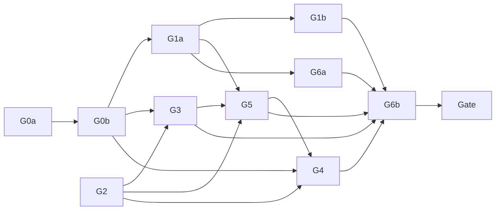

# Project Guidelines Implementation Plan

> **For agentic workers:** REQUIRED SUB-SKILL: Use superpowers:subagent-driven-development (recommended) or superpowers:executing-plans to implement this plan task-by-task. Steps use checkbox (`- [ ]`) syntax for tracking.

**Goal:** Give every project one versioned guideline document inside Ontocurator, as specified in [2026-10-21-project-guidelines-design.md](../specs/2026-10-21-project-guidelines-design.md): the lead uploads `.md`/`.txt` versions and can withdraw one, annotators and reviewers read the version in force from every task in a non-modal drawer and get a one-time update notice, every submission and translation review records the version in force at submit, and exports carry that version per result.

**Architecture:** Migration `0018_project_guidelines` adds `guideline_versions`, `guideline_contents`, `guideline_withdrawals`, `guideline_reads` and the nullable stamp columns `submissions.guideline_version` and `translation_reviews.guideline_version`, and drops `projects.guideline_url`/`guideline_version`. A pure module `domain/guidelines.py` holds validation, the current-version rule, the notice rule and the `guideline_ref` format; `application/guidelines.py` (`GuidelineService`) does upload, withdraw, reads and listings under the project advisory lock and is exposed by `api/guideline_routes.py`. The submit paths read `current_guideline_version(conn, project_id)` inside their own transaction; the T1, final and translation-review exports turn the stamps into per-result references. The frontend adds a lazily loaded Markdown renderer (`react-markdown` 9 + `remark-gfm`), a `ui/Drawer`, Settings › Guidelines, `tasks/TaskGuidelines` in both task screens, a read-only guidelines route and submission labels.

**Tech Stack:** Python 3.12, FastAPI, SQLAlchemy 2, Alembic, PostgreSQL (pytest via Docker testcontainers or `ONTOCURATOR_TEST_PG_URL`, pytest-xdist); React 18, TypeScript, Vitest + Testing Library, Playwright + axe-core; `openapi-typescript` for `generated.ts`; new: `react-markdown@^9`, `remark-gfm@^4`.

**Binding inputs:** the spec above (G1 to G27, copy table binding); `PRODUCT.md`; `DESIGN.md`; [problem reports spec](../specs/2026-10-19-problem-reports-design.md) (toolbar entry pattern); [lead follow-ups spec](../specs/2026-10-20-lead-followups-design.md) (migration `0017`, lead correction is an ordinary translation review row). No mockups.

---

## Global rules (every WP; a subagent reads only this section and its WP block)

Worktree: `C:/Users/jan-p/Development/ontocurator/.worktrees/project-guidelines` (Git Bash: `/c/Users/jan-p/Development/ontocurator/.worktrees/project-guidelines`), branch `feat/project-guidelines`, created from `main` **after `feat/lead-followups` is merged** (`git worktree add .worktrees/project-guidelines -b feat/project-guidelines main`). Every command runs from the worktree root: `cd /c/Users/jan-p/Development/ontocurator/.worktrees/project-guidelines && …`. All line references below were verified on `feat/lead-followups` (`48a52a6`, contains `main`); after the merge a WP re-checks every reference it uses with `grep -n` and reports drift in its hand-back instead of guessing.

1. **Subagents never commit, push, `git reset`, `git checkout -- <file>`, `git stash` or `git clean`.** They edit on top of the working tree. The orchestrator commits each WP after its done check (and review, where flagged) with the WP's commit message, staging only the WP's owned files (`git add <files>`, never `git add -A`). No AI attribution lines anywhere (no `Co-Authored-By`, no "Generated with").
2. **Exclusive file ownership.** A WP writes only the files in its **Owns** list (test files included). If it needs another file, it stops and reports. Two WPs never own the same file at the same time; shared files follow "Shared-file chains".
3. **Prerequisite checks first.** Run the WP's prerequisite commands; if one fails, stop and report. Never re-implement a missing prerequisite.
4. **Shell.** Git Bash. `rg` is not installed; use `grep -rnE`.
5. **Machine limits (16 GB RAM).** At most **two test-heavy agents at once**. Heavy = backend pytest that touches PostgreSQL, a full Vitest run, Playwright, a `scripts/check.sh` stage. Light = pure-Python pytest files without a database (`tests/test_guidelines_domain.py`), single Vitest files, `npm --prefix frontend run typecheck`, ruff/mypy, generator scripts; at most three light agents at once. Lane **L+** = light, but a full Vitest run (only if the WP block asks for one) waits until the orchestrator confirms a free heavy slot.
6. **Verification rule (user-approved).** A WP runs **only the checks affected by its change**, through the affected-tests fast path described in `docs/operations/local-checks.md` (added on branch `chore/test-speed`; if that section is not there yet, use the concrete fallbacks below). Fallbacks: one backend file `uv run pytest tests/<file>.py -q`; several backend files `uv run pytest -n 4 tests/<a>.py tests/<b>.py -q`; one Vitest file `npm --prefix frontend test -- --maxWorkers=4 --minWorkers=1 tests/<path>`; `npm --prefix frontend run typecheck`; `uv run ruff check . && uv run ruff format --check . && uv run mypy src`; after a contracts regeneration `bash scripts/check.sh --only static`. **The full gate (`bash scripts/check.sh`) runs once, after the last WP, alone on the machine** (see "Final gate"). No WP runs the full backend, full Vitest or full Playwright suite.
7. **Playwright: one run at a time on the machine** (across all worktrees, also those of other plans), always `HPO_E2E_PORT=18767` in this worktree (other worktrees use other ports): `HPO_E2E_PORT=18767 npm --prefix frontend run test:e2e -- <spec>` (it rebuilds `frontend/dist`). Browser scenarios build **isolated projects** through a test-only route (`guide-{scenario}-{uuid8}`); no spec of this plan uses or changes the shared `browser-fixture` project, so the suite can later run with `CHECK_PLAYWRIGHT_WORKERS=3`. Screenshots and evidence only under `build/project-guidelines/evidence/` in the worktree.
8. **Static gate during parallel work.** `scripts/check.sh --only static` checks the whole tree (ruff, format, mypy, contract drift), so it may fail on a sibling WP's in-progress files or on a pending regeneration. A WP fixes only failures in its own Owns, reports the others with file names; the orchestrator reruns it later.
9. **Contracts.** `contracts/openapi.json`, `frontend/src/api/generated.ts` and `contracts/admin-error-codes.json` are never hand-edited. Regenerate with `uv run python scripts/export_openapi.py && npm --prefix frontend run api:generate` and `uv run python scripts/export_admin_error_codes.py`; drift checks are part of `bash scripts/check.sh --only static`. One contracts writer at a time, in the order G0b → G1a.
10. **API changes are additive, with one deliberate removal.** New response fields get defaults (`= None`, `= False`, `Field(default_factory=…)`). The only removals are `ProjectSettingsChange.guideline_url`/`guideline_version` (and so `ProjectSettings`) and the error code `GUIDELINE_INCOMPLETE`: the backend side is removed in G0a, the catalog entry and every frontend user (settings form, `errors.ts`, fixtures, tests) in G0b in the same step as the regeneration, so the tree typechecks after G0b.
11. **Migration numbering.** This plan creates `src/ontocurator/storage/migrations/versions/0018_project_guidelines.py` with `revision = "0018"`, `down_revision = "0017"`. The documents-overview spec ([VD20](../specs/2026-10-21-documents-overview-redesign-design.md), lines 58, 107, 459, 480) now plans **`0019_documents_overview`** (`down_revision = "0018"`) with the same renumber rule. Rule: **whichever branch merges to `main` first keeps its number in that order; the branch merging second renumbers before its merge**: rename its file to the next free number, set `revision`/`down_revision` to follow the head on `main`, update every test that upgrades to or pins a revision (`grep -rnE '"001[6-9]"' tests/`; `tests/test_schema.py` compares with `head_revision()` and needs no edit), rerun its migration test files and `tests/test_schema.py`. Never renumber a migration that is already on `main`.
12. **English** for all files and UI copy; icons only from `frontend/src/ui/icons.tsx` (no Unicode glyph icons). Status never by colour alone. Unavailable actions use `aria-disabled` + `aria-describedby` reason (existing `Button`), not native `disabled`. Copy comes verbatim from the spec's "Copy" table.
13. **TDD.** Write the listed failing tests first, run them red, implement, run green.
14. **Reviews.** Only the flagged WPs (G0a, G0b, G1a, G1b: backend-critical) get one read-only review by the Claude `superpowers:code-reviewer` agent, then one fix agent at effort medium. After the final gate, one review of the whole plan's diff by the same agent. No Codex, no other reviewer.
15. **Hand-back** (final message): changed/created/deleted files (subset of Owns), commands with exit status and one-line result, done checklist item by item, skipped parts and deviations, line-reference drift found, open risks, the commit message.

## Work packages

The spec's G0 and G1 are split so that each fits one agent session; IDs keep the spec prefix.

| WP  | Content                                                                                                                                                                                                                                     | Size | Lane | Branch             | Depends on            | Review                                        |
| --- | ------------------------------------------------------------------------------------------------------------------------------------------------------------------------------------------------------------------------------------------- | ---- | ---- | ------------------ | --------------------- | --------------------------------------------- |
| G0a | Migration `0018`, ORM `storage/guideline_tables.py` + stamp columns, pure `domain/guidelines.py`, backend removal of `guideline_url`/`guideline_version`/`validate_guideline`, migration and domain tests                                   | L    | H    | project-guidelines | lead-followups merged | yes (backend-critical)                        |
| G0b | `GuidelineService`, `api/guideline_routes.py`, `AssignmentView.guideline`/`guideline_notice`, error codes and statuses, contracts (writer 1), `client.ts` functions, frontend removal of the old settings fields and `GUIDELINE_INCOMPLETE` | L    | H    | project-guidelines | G0a                   | yes (backend-critical)                        |
| G1a | Version stamp in every submit path, `guideline_version`/`guideline_withdrawn` on submission and review views, contracts (writer 2)                                                                                                          | M    | H    | project-guidelines | G0b                   | yes (backend-critical)                        |
| G1b | Exports: `guideline_refs` per result in T1 exports and frozen snapshots, `index.csv`, README, translation-review export fields (references only, no texts)                                                                                  | L    | H    | project-guidelines | G1a                   | yes (backend-critical, export format)         |
| G2  | `ui/GuidelineDocument` (lazy `react-markdown` + `remark-gfm`, element rules, `.txt`), dependency addition, security component tests                                                                                                         | S    | L    | project-guidelines | —                     | — (sanitization checklist in the plan review) |
| G3  | Settings › Guidelines: current version, not-seen names, file choice with preview, publish, withdraw dialog, conflicts, versions table, reading view, empty and no-version-in-force states                                                   | M    | L+   | project-guidelines | G0b, G2               | —                                             |
| G5  | Route `#/projects/{key}/guidelines[/v{n}]` with `GuidelinesPage`, "My tasks" link, submission labels in Documents and submission history                                                                                                    | S    | L+   | project-guidelines | G1a, G2, G3           | —                                             |
| G4  | `ui/Drawer`, `IconBook`, `tasks/TaskGuidelines` (button, badge, drawer, notice, reads, focus refresh, withdrawal) mounted in `TaskEditor` for both task screens                                                                             | M    | L+   | project-guidelines | G0b, G2, G5           | —                                             |
| G6a | Browser scenario builders `tests/browser_guideline_scenarios.py` + route + fixture test + `guidelineHelpers.ts`                                                                                                                             | S    | H    | project-guidelines | G1a                   | —                                             |
| G6b | Browser specs `guidelines.spec.ts`, `guidelines-a11y.spec.ts`                                                                                                                                                                               | M    | PW   | project-guidelines | G6a, G1b, G3, G4, G5  | — (plan review)                               |

Deviation from the spec's WP table: the spec flags G2 for its own review (sanitization). Per the user-approved review rule this review is folded into the plan review after the final gate, with the mandatory sanitization checklist in "Final gate". G4 runs after G5 because the drawer's "All versions" link needs G5's route.

## Shared-file chains (one writer at a time, in this order)

| File(s)                                                                                                                                                                   | Writers in order                                                                                                                             |
| ------------------------------------------------------------------------------------------------------------------------------------------------------------------------- | -------------------------------------------------------------------------------------------------------------------------------------------- |
| `contracts/openapi.json`, `frontend/src/api/generated.ts`, `frontend/src/api/client.ts`                                                                                   | G0b → G1a                                                                                                                                    |
| `src/ontocurator/domain/admin_error_codes.py`, `contracts/admin-error-codes.json`, `frontend/src/admin/errors.ts`, `src/ontocurator/api/app.py`                           | G0b only                                                                                                                                     |
| `src/ontocurator/storage/tables.py`, `src/ontocurator/storage/guideline_tables.py`                                                                                        | G0a only                                                                                                                                     |
| `src/ontocurator/storage/repository.py`                                                                                                                                   | G0a (`_t1_export_content` select and constructor) → G1a (`run_mutation`, `_insert_submission`) → G1b (`ProjectExport`, `_t1_export_content`) |
| `src/ontocurator/domain/guidelines.py`, `tests/test_guidelines_domain.py`                                                                                                 | G0a → G1b (`guideline_ref` is already there; G1b only adds tests if needed)                                                                  |
| `src/ontocurator/storage/guidelines.py`                                                                                                                                   | G0a (`current_guideline_version`, `guideline_facts`)                                                                                         |
| `src/ontocurator/application/guidelines.py`                                                                                                                               | G0b only                                                                                                                                     |
| `src/ontocurator/application/translation_reviews.py`                                                                                                                      | G1a only                                                                                                                                     |
| `src/ontocurator/projects/service.py`, `tests/test_project_settings_validation.py`, `tests/test_assignments_schema.py`                                                    | G0a only                                                                                                                                     |
| `tests/test_projects_api.py`                                                                                                                                              | G0a (settings test; deletes the url@version export test)                                                                                     |
| `frontend/src/admin/ProjectSettingsPage.tsx`, `frontend/tests/projectSettings.test.tsx`, `frontend/tests/projectFixtures.ts`                                              | G0b (removal) → G3                                                                                                                           |
| `frontend/package.json`, `frontend/package-lock.json`                                                                                                                     | G2 only                                                                                                                                      |
| `frontend/src/ui/index.ts`, `frontend/src/ui/icons.tsx`                                                                                                                   | G2 (`GuidelineDocument` export) → G4 (`Drawer`, `IconBook`)                                                                                  |
| `frontend/src/app/router.ts`, `frontend/tests/router.test.ts`, `frontend/src/App.tsx`                                                                                     | G5 only                                                                                                                                      |
| `frontend/src/tasks/TaskEditor.tsx`, `frontend/src/app/CaseScreen.tsx`, `frontend/src/translation/TranslationReviewScreen.tsx`, `frontend/src/problems/useTaskReports.ts` | G4 only                                                                                                                                      |
| `frontend/tests/documents/fixtures.ts`                                                                                                                                    | G1a (defaults only) → G5                                                                                                                     |
| `tests/browser_server.py`                                                                                                                                                 | G6a (one import and one registration line)                                                                                                   |
| `DESIGN.md`                                                                                                                                                               | G4 only                                                                                                                                      |

**Cross-plan files.** The editor-axes plan ([2026-10-21-editor-axes-and-coupled-scroll.md](2026-10-21-editor-axes-and-coupled-scroll.md)) also edits `frontend/src/translation/TranslationReviewScreen.tsx`, `frontend/src/ui/shortcuts.ts` (S3, `matches()` only; this plan does not edit it) and `DESIGN.md`. The documents-overview work ([spec](../specs/2026-10-21-documents-overview-redesign-design.md)) edits `frontend/src/app/router.ts`, `frontend/src/App.tsx`, migrations, and moves the Submissions table out of `frontend/src/documents/ExpandedRow.tsx` into a new final panel built on `RowSubmissionView` (spec lines 236, 519-520). Files this plan owns that the overview work also touches: `frontend/src/documents/SubmissionsTable.tsx`, `frontend/tests/documents/submissionsTable.test.tsx`, `frontend/tests/documents/fixtures.ts` (G5; G1a defaults), `src/ontocurator/api/document_row_routes.py` (`RowSubmissionView`) and `src/ontocurator/application/document_row_submissions.py` (G1a). G4 and G5 keep their edits minimal (one prop, one render line, one route, one label); the branch merging second resolves the textual conflicts, reruns the affected tests and, if the overview's final panel is on `main` first, adds the `submissionGuidelineLabel` line to that panel's submission rows (if guidelines merge first, the overview branch carries the label over from `SubmissionsTable.tsx`).

## Dependency graph



## Wave schedule

A wave's WPs may run at the same time (disjoint owned files, ≤ 2 heavy, ≤ 3 light, ≤ 1 Playwright). A WP starts as soon as its prerequisites are done and its files are free.

| Wave | Heavy lane (≤ 2)   | Light lane (≤ 3) | Notes                                                                                                                                   |
| ---- | ------------------ | ---------------- | --------------------------------------------------------------------------------------------------------------------------------------- |
| 0    | —                  | —                | Orchestrator: confirm `feat/lead-followups` is on `main`, create the worktree, run the migration check of G0a's prerequisites.          |
| 1    | G0a                | G2               | G2 has no prerequisite (pure component + dependency).                                                                                   |
| 2    | G0b                | —                | Contracts writer 1.                                                                                                                     |
| 3    | G1a                | G3 (L+)          | Contracts writer 2 after G0b is committed.                                                                                              |
| 4    | G1b, G6a           | G5 (L+)          | G6a needs stamps (G1a) for its fixture assertions; G1b and G6a own disjoint files; G5 starts after G3 is committed (`GuidelineReader`). |
| 5    | —                  | G4 (L+)          | After G5 (router) and G3 (`ui/index.ts` is G2 → G4 only, no conflict).                                                                  |
| 6    | G6b (PW)           | —                | Playwright alone.                                                                                                                       |
| 7    | Final gate (alone) | —                | Then the plan review.                                                                                                                   |

Count: 10 WPs (G0a, G0b, G1a, G1b, G2, G3, G4, G5, G6a, G6b), each exactly once.

## Dispatching a WP to a subagent

The orchestrator sends one WP per subagent with: the worktree path; the instruction to read **only** "Global rules", "Shared contracts" (the parts the WP block names) and the WP block, plus the spec sections and code locations the block lists; the sibling WPs of the wave and their Owns; the lane; the hand-back format of rule 15. Implementation agents run at the default effort; fix agents after a review at effort medium.

**Done check (orchestrator):** compare the reported files with Owns (`git status --short`), rerun the WP's light verification if unclear, tick the done checklist. Then review (flagged WPs only), one fix agent if needed, commit with the WP's message, release the files.

---

## Shared contracts

These names are fixed for all WPs. A WP that produces one implements it exactly; a WP that consumes one relies on it.

### Storage (G0a)

`src/ontocurator/storage/guideline_tables.py` (imported at the end of `storage/tables.py` like `final_tables`, `plan_tables`, `workflow_tables` at `tables.py:914-916`):

| ORM class                | Table                   | Columns (spec "Data model and migration")                                                                                                                                                                                                                       |
| ------------------------ | ----------------------- | --------------------------------------------------------------------------------------------------------------------------------------------------------------------------------------------------------------------------------------------------------------- |
| `GuidelineVersionRow`    | `guideline_versions`    | `project_id` (PK, FK projects), `version` (PK, check `version >= 1`), `kind` (check in `markdown`, `text`), `body_sha256`, `size_bytes` (check `size_bytes <= 262144`), `created_by` (FK users), `created_by_label`, `created_at` (`server_default=func.now()`) |
| `GuidelineContentRow`    | `guideline_contents`    | `project_id`, `version` (PK, FK → `guideline_versions`), `filename`, `body`, `change_note` (nullable, check `char_length(change_note) <= 280`)                                                                                                                  |
| `GuidelineWithdrawalRow` | `guideline_withdrawals` | `project_id`, `version` (PK, FK), `reason` (nullable, check `<= 280`), `withdrawn_by` (FK users), `withdrawn_by_label`, `withdrawn_at` (`server_default=func.now()`)                                                                                            |
| `GuidelineReadRow`       | `guideline_reads`       | `project_id`, `version` (FK), `user_id` (FK users) (PK of the three), `notified_at`, `opened_at` (both nullable timestamptz)                                                                                                                                    |

`SubmissionRow.guideline_version: Mapped[int | None]` and `TranslationReviewRow.guideline_version: Mapped[int | None]`, each with a composite `ForeignKeyConstraint(["project_id", "guideline_version"], ["ontocurator.guideline_versions.project_id", "ontocurator.guideline_versions.version"])`. `APPEND_ONLY_TABLES` (`tables.py:38-59`) gains `"guideline_versions"` and `"guideline_withdrawals"`. `ProjectRow.guideline_url`/`guideline_version` (`tables.py:103-104`) are removed.

### Pure domain (G0a): `src/ontocurator/domain/guidelines.py`

```python
GuidelineKind = Literal["markdown", "text"]
MAX_GUIDELINE_BYTES = 262_144
MAX_NOTE_CHARS = 280
NOTICE_LIMIT = 5


def kind_for_filename(filename: str) -> GuidelineKind:
    ...
    # .md/.markdown -> "markdown", .txt -> "text" (case-insensitive); else DomainError("GUIDELINE_FILE_TYPE")


def decode_body(data: bytes) -> str:
    ...
    # > MAX_GUIDELINE_BYTES + 3 raw, or encoded body after BOM removal > MAX_GUIDELINE_BYTES -> GUIDELINE_TOO_LARGE;
    # invalid UTF-8 or a NUL byte -> GUIDELINE_ENCODING; empty or whitespace-only -> GUIDELINE_EMPTY; drops one leading BOM


def validate_note(
    value: str | None, *, field: Literal["change_note", "reason"]
) -> str | None:
    ...
    # strips; "" -> None; > 280 chars or contains "\n"/"\r" -> DomainError("GUIDELINE_NOTE_INVALID", {"field": field})


def body_sha256(body: str) -> str: ...
def guideline_ref(project_key: str, version: int, sha256: str) -> str:
    ...
    # f"urn:ontocurator:{project_key}:guidelines:v{version}#sha256={sha256}"


@dataclass(frozen=True)
class VersionFact:
    version: int
    created_at: datetime
    change_note: str | None
    withdrawn: bool


def current_version(versions: Sequence[VersionFact]) -> int | None:
    ...
    # highest version if not withdrawn, else None (G25)


@dataclass(frozen=True)
class Notice:
    from_version: int | None  # S, None for first exposure
    to_version: int  # L
    changes: tuple[
        VersionFact, ...
    ]  # versions in (S, L], newest first, at most NOTICE_LIMIT
    more: int


def compute_notice(versions: Sequence[VersionFact], seen: int | None) -> Notice | None:
    ...
    # None when no current version or seen >= current
```

### Storage readers (G0a): `src/ontocurator/storage/guidelines.py`

`storage/repository.py` must not import `application/guidelines.py` (the storage layer never imports `application`; `application` modules import `storage.repository`, so that import would be circular). The readers used by repository code therefore live in storage:

```python
def current_guideline_version(
    conn: Connection, project_id: int
) -> int | None: ...  # used by G1a in submit transactions
def guideline_facts(conn: Connection, project_id: int) -> dict[int, GuidelineFact]:
    ...
    # version -> (kind, sha256, withdrawn); used by G1a views and G1b exports
```

`GuidelineFact` = `(kind, sha256, withdrawn: bool)` is defined here (a frozen dataclass).

### Service (G0b): `src/ontocurator/application/guidelines.py`

```python
def guideline_briefs(
    conn: Connection, project_ids: Iterable[int]
) -> dict[int, GuidelineBrief]:
    ...
    # current version per project, one query for all ids; used by api/assignment_routes._views


def guideline_notice(
    conn: Connection, *, project_id: int, user_id: int
) -> Notice | None:
    ...
    # only called for the owner's editable rows; used by _views


class GuidelineService:
    def __init__(self, db: Database) -> None: ...
    def listing(self, access: Access, key: str) -> GuidelineListingRecord: ...
    def document(
        self, access: Access, key: str, version: int
    ) -> GuidelineDocumentRecord: ...
    def upload(
        self,
        actor: Actor,
        key: str,
        *,
        filename: str,
        data: bytes,
        change_note: str | None,
        expected_latest_version: int | None,
    ) -> GuidelineSummaryRecord: ...
    def withdraw(
        self,
        actor: Actor,
        key: str,
        version: int,
        *,
        reason: str | None,
        expected_latest_version: int,
    ) -> GuidelineSummaryRecord: ...
    def record_read(
        self,
        access: Access,
        key: str,
        version: int,
        event: Literal["notified", "opened"],
    ) -> None: ...
```

`GuidelineBrief` = `(version, kind, created_at)`. The service re-exports nothing from `storage/guidelines.py`; callers import the readers from storage.

Locks: upload and withdraw take `pg_advisory_xact_lock_shared(_lock_id("members", key))` then `pg_advisory_xact_lock(_lock_id("project", key))` as `ProjectService.update_settings` (`projects/service.py:313-314`), then `require_project_management(conn, actor, key, pid, Action.MANAGE_PROJECT_SETTINGS)`. Audit through `record_audit` (`auth/audit.py:42`): `guideline.upload` (`target_type="guideline"`, `target_id=f"{key}:v{n}"`, details `version`, `kind`, `size_bytes`, `sha256`, `previous_version`), `guideline.withdraw` (details `version`, `reason`, `was_current`).

### API (G0b, G1a): `src/ontocurator/api/guideline_routes.py`, `router = APIRouter(prefix="/api/v1/projects", tags=["guidelines"])`

The spec writes `/api/projects/...`; the real prefix is `/api/v1/projects` (`api/project_routes.py:41`).

| Endpoint                                                    | Body / response                                                                                                                   |
| ----------------------------------------------------------- | --------------------------------------------------------------------------------------------------------------------------------- |
| `GET /api/v1/projects/{key}/guidelines`                     | `GuidelineListing`                                                                                                                |
| `GET /api/v1/projects/{key}/guidelines/{version}`           | `GuidelineDocument`; headers `ETag: "<sha256>"` or `"withdrawn"`, `Cache-Control: private, no-cache`; `If-None-Match` match → 304 |
| `POST /api/v1/projects/{key}/guidelines`                    | multipart `file: UploadFile`, `change_note: str = Form("")`, `expected_latest_version: str = Form("")` → 201 `GuidelineSummary`   |
| `POST /api/v1/projects/{key}/guidelines/{version}/withdraw` | `GuidelineWithdrawRequest {reason: str \| None, expected_latest_version: int}` → 200 `GuidelineSummary`                           |
| `POST /api/v1/projects/{key}/guidelines/{version}/reads`    | `GuidelineReadRequest {event: Literal["notified","opened"]}` → 204                                                                |

Pydantic views (all `extra="forbid"` on requests):

- `GuidelineWithdrawalView {at: datetime, by: PersonRefView, reason: str | None}`
- `GuidelineReachView {notified: int, opened: int, members: int}`
- `GuidelineNotSeenView {person: PersonRefView, notified: bool}`
- `GuidelineSummary {version: int, kind: Literal["markdown","text"], filename: str | None, size_bytes: int, sha256: str, change_note: str | None, created_at: datetime, created_by: PersonRefView, withdrawn: GuidelineWithdrawalView | None = None, reach: GuidelineReachView | None = None, not_seen: list[GuidelineNotSeenView] | None = None}` (`reach` for leads/admins on non-withdrawn versions; `not_seen` for leads/admins on the current version only)
- `GuidelineListing {current: GuidelineSummary | None, latest_version: int | None, versions: list[GuidelineSummary], my_latest_seen: int | None}`
- `GuidelineDocument(GuidelineSummary) {body: str | None}`
- On `AssignmentView` (`api/assignment_routes.py:53-75`): `guideline: AssignmentGuidelineView | None = None` (`{version, kind, created_at}`), `guideline_notice: GuidelineNoticeView | None = None` (`{from_version: int | None, to_version: int, changes: list[GuidelineNoticeChangeView{version, change_note, created_at, withdrawn: bool}], more: int}`).
- G1a: `guideline_version: int | None = None` and `guideline_withdrawn: bool = False` on `SubmissionHistorySummary` (`api/submission_history_routes.py:36-42`, so also inside `SubmissionHistoryDetail.summary`), `RowSubmissionView` (`api/document_row_routes.py:304-319`), and `TranslationReviewRecord` (`application/translation_reviews.py:50-71`, returned by `api/translation_review_routes.py:63`, `:72`).

Error codes (G0b; `domain/admin_error_codes.py`, `api/app.py` status map at `app.py:389-430`): `GUIDELINE_FILE_TYPE` 422, `GUIDELINE_TOO_LARGE` 413, `GUIDELINE_ENCODING` 422, `GUIDELINE_EMPTY` 422, `GUIDELINE_UNCHANGED` 409 (details `{"version": n}`), `GUIDELINE_NOTE_INVALID` 422 (details `{"field": "change_note" | "reason"}`), `GUIDELINE_VERSION_CONFLICT` 409, `GUIDELINE_ALREADY_WITHDRAWN` 409 (details `{"version": n}`), `GUIDELINE_NOT_FOUND` 404 (add to `NOT_FOUND_CODES`, `app.py:69`). `GUIDELINE_INCOMPLETE` is removed.

### Frontend client (G0b): `frontend/src/api/client.ts`

```ts
export type GuidelineSummary = components["schemas"]["GuidelineSummary"];
export type GuidelineListing = components["schemas"]["GuidelineListing"];
export type GuidelineDocument = components["schemas"]["GuidelineDocument"];
export type GuidelineNotice = components["schemas"]["GuidelineNoticeView"];
listGuidelines(key: string): Promise<GuidelineListing>
getGuideline(key: string, version: number): Promise<GuidelineDocument>
publishGuideline(key: string, input: { file: File; changeNote: string; expectedLatestVersion: number | null }): Promise<GuidelineSummary>   // FormData, like the upload at client.ts:454
withdrawGuideline(key: string, version: number, body: { reason: string | null; expected_latest_version: number }): Promise<GuidelineSummary>
recordGuidelineRead(key: string, version: number, event: "notified" | "opened"): Promise<void>
```

### Frontend components

- G2: `frontend/src/ui/GuidelineDocument.tsx`: `export function GuidelineDocument(props: { kind: "markdown" | "text"; body: string; headingOffset?: number /* default 1 */ }): JSX.Element` (lazy `React.lazy(() => import("./MarkdownBody"))` inside `Suspense` with "Loading guidelines…"); `frontend/src/ui/MarkdownBody.tsx` default export `MarkdownBody({ body, headingOffset })`. Exported from `ui/index.ts` (`GuidelineDocument` only).
- G4: `frontend/src/ui/Drawer.tsx`: `export function Drawer(props: { open: boolean; title: string; headingId?: string; onClose: () => void; returnFocusRef: RefObject<HTMLElement>; footer?: ReactNode; children: ReactNode }): JSX.Element | null` — ≥ 1100 px non-modal `<aside aria-labelledby>`; 700–1099 px `Dialog size="lg"`; < 700 px full-height sheet (`Dialog` with class `ui-drawer-sheet`). `IconBook` in `ui/icons.tsx`.
- G4: `frontend/src/tasks/TaskGuidelines.tsx`: `export function TaskGuidelines(props: { assignment: AssignmentView; readOnly: boolean; children: (parts: { button: ReactNode; notice: ReactNode; drawer: ReactNode }) => ReactNode }): JSX.Element`. `readOnly` is the task's real read-only state as `TaskEditor` knows it, not `status !== "submitted"`: annotation `workspace.read_only || assignment.held` (`workspace.read_only` already covers submitted tasks and read-only rounds and is what `TaskEditor` passes to `CaseScreen` at `TaskEditor.tsx:160`); translation review `assignment.status === "submitted" || assignment.held`. The notice is shown and `notified` recorded only when `readOnly` is false. New props `guidelineNotice?: ReactNode` on `CaseScreen` and `TranslationReviewScreen`, and `guidelineActions?: ReactNode` on `TranslationReviewScreen`, rendered unconditionally in `div.translation-review-tools` before `reportActions` (`reportActions` is hidden in lead-correction mode, `{!leadCorrection && props.reportActions}` at `TranslationReviewScreen.tsx:405`, so the guidelines button must not ride on it). `CaseScreen` renders `taskActions` unconditionally (`CaseScreen.tsx:2676`), so the button goes there.
- G5: `frontend/src/guidelines/submissionLabel.ts`: `export function submissionGuidelineLabel(version: number | null | undefined, withdrawn: boolean, current: number | null): string` ("Guidelines v2", "Guidelines v2 (current: v3)", "Guidelines v2 (withdrawn)", "Guidelines: not recorded"). Route `{ name: "projectGuidelines"; key: string; version?: number }`, hashes `#/projects/{key}/guidelines` and `#/projects/{key}/guidelines/v{n}`. `frontend/src/guidelines/GuidelinesPage.tsx`: `GuidelinesPage({ projectKey, version, canManage, onNavigate })`.
- G3: `frontend/src/admin/GuidelinesSection.tsx`: `GuidelinesSection({ projectKey }: { projectKey: string })`; `frontend/src/guidelines/fileChecks.ts`: `checkGuidelineFile(file: File): string | null` (same messages as the server codes); `frontend/src/guidelines/GuidelineReader.tsx`: `GuidelineReader({ projectKey, version, currentVersion })` (heading, meta line, older-version banner, withdrawn text, `GuidelineDocument`) reused by G4's drawer and G5's page.

---

## WP blocks

### G0a: Migration 0018, storage rows, pure guideline domain, removal of the old fields

- **Goal:** the schema of the spec exists, guarded like the other append-only tables; the pure rules (validation, current version, notice, reference) are tested; the old URL/version fields are gone from backend code.
- **Spec:** "Data model and migration", G10, G11, G13, G16 to G20, G25, "Backend › Notice computation", "Backend › Removed", "Testing › Migration" and the domain parts of "Testing › Unit (backend)".
- **Owns:** `src/ontocurator/storage/migrations/versions/0018_project_guidelines.py` (create), `src/ontocurator/storage/guideline_tables.py` (create), `src/ontocurator/storage/tables.py` (`APPEND_ONLY_TABLES`, `ProjectRow` columns, `SubmissionRow`/`TranslationReviewRow` stamp columns, the import line), `src/ontocurator/domain/guidelines.py` (create), `src/ontocurator/storage/guidelines.py` (create: `GuidelineFact`, `current_guideline_version`, `guideline_facts` as "Storage readers"), `src/ontocurator/projects/service.py` (remove `guideline_url`/`guideline_version` at `:59-60`, `validate_guideline` at `:162-175` and its call at `:319`), `src/ontocurator/storage/repository.py` (`_t1_export_content` only: drop `ProjectRow.guideline_url`/`guideline_version` from the select at `:1451-1455` and the `guideline_ref=` argument at `:1577-1579`; `ProjectExport.guideline_ref` stays `None` until G1b), tests `tests/test_guideline_migration.py` (create), `tests/test_guidelines_domain.py` (create), `tests/test_guideline_storage.py` (create), expectation edits in `tests/test_assignments_schema.py` (`:151` raw SQL lists `guideline_url, guideline_version`), `tests/test_projects_api.py` (settings PATCH at `:74-80` drops the two fields; delete `test_the_export_carries_the_guideline_reference` at `:209-234`, replaced by G1b), `tests/test_project_settings_validation.py` (delete `test_guidelines_require_a_complete_http_reference` at `:90-95` with its parametrize at `:80-89`).
- **Size / lane / review:** L / heavy / yes.
- **Code to read:** `migrations/versions/0001_initial.py:300-340` (`forbid_history_change`, triggers, grants), `0016_work_plans.py:240-265` (append-only and mutable grant pattern, sequences), `0003_projects_edit_log.py:105-125` (nullable column on an append-only table plus FK), `0017_lead_corrections.py` (header, `down_revision`), `0005_admin.py:45-60` (the two dropped columns, for the downgrade), `storage/tables.py:30-60, 95-110, 390-420, 826-866, 910-916`, `tests/test_work_plan_migration.py:1-60, 160-175` (migration test pattern with `unmigrated_database_url`, `upgrade(url, rev)`), `tests/test_schema.py:20-90` (mapped-tables equality and the parametrized append-only checks).
- **Prerequisites:** `git log main --oneline -1 -- src/ontocurator/storage/migrations/versions/0017_lead_corrections.py` prints a commit (lead follow-ups merged); `ls src/ontocurator/storage/migrations/versions/ | grep -E '^00[0-9]{2}_' | tail -3` ends with `0017_lead_corrections.py` (if a `0018_*` exists, apply Global rule 11 and stop for the orchestrator's decision); `grep -n "guideline_url" src/ontocurator/storage/tables.py`.

- [ ] **Step 1: Failing tests, light** (`tests/test_guidelines_domain.py`): `test_kind_by_extension` (parametrized `.md`, `.MD`, `.markdown` → markdown, `.txt` → text, `.pdf`/`.html`/no extension → `GUIDELINE_FILE_TYPE`), `test_decode_drops_bom_and_keeps_crlf`, `test_size_boundary` (262 144 bytes ok, 262 145 → `GUIDELINE_TOO_LARGE`; 262 144 + BOM ok), `test_invalid_utf8_and_nul_are_encoding_errors`, `test_empty_and_whitespace_only_are_empty`, `test_note_rules` (280 ok, 281 and a newline → `GUIDELINE_NOTE_INVALID` with `field`; `""` → `None`), `test_guideline_ref_format`, `test_current_version_ignores_nothing_but_the_highest` (highest withdrawn → `None`; older withdrawn → highest), `test_notice_none_first_exposure_skipped_versions_withdrawn_and_more` (seen `None` → `from_version=None`; seen 1, current 3 → changes 3, 2 newest first; withdrawn v2 listed with `withdrawn=True`; 8 versions unseen → 5 changes, `more == 3`; seen == current → `None`; no current → `None`).
- [ ] **Step 2: Failing tests, heavy** (`tests/test_guideline_migration.py`, pattern of `tests/test_work_plan_migration.py`): `test_upgrade_creates_tables_and_stamp_columns_and_drops_old_fields` (from `0017` to `0018`, `information_schema`), `test_downgrade_readds_old_columns_empty_and_drops_tables`, `test_append_only_guideline_tables_refuse_update_and_delete` (owner engine: `UPDATE`/`DELETE` on `guideline_versions`, `guideline_withdrawals` → "append-only"), `test_app_role_may_delete_contents_but_not_versions` (app role: `DELETE FROM guideline_contents` allowed, `DELETE FROM guideline_versions` → permission denied), `test_reads_are_updatable_by_the_app_role`, `test_stamp_columns_accept_inserts_on_append_only_tables` (insert a `submissions` and a `translation_reviews` row with `guideline_version` referencing an existing version; a missing version → FK violation), `test_checks` (`version 0`, `kind 'html'`, `size_bytes 262145`, 281-character change note → `IntegrityError`). `tests/test_guideline_storage.py`: `test_current_version_reader` (none, highest, highest withdrawn → `None`), `test_facts_reader` (kind, sha256, withdrawn per version), `test_storage_does_not_import_application` (source scan of `storage/guidelines.py` and `storage/repository.py`: no `ontocurator.application` import).
- [ ] **Step 3:** `uv run pytest tests/test_guidelines_domain.py -q` and `uv run pytest -n 4 tests/test_guideline_migration.py tests/test_guideline_storage.py -q` → FAIL.
- [ ] **Step 4: Implement.** Migration: four `op.create_table` calls with the naming convention (`pk_…`, `fk_…`, `ck_…` as in `0016`), `GRANT SELECT, INSERT` + `forbid_history_change` triggers (`_append_only`, `_no_truncate`) on `guideline_versions` and `guideline_withdrawals`, `GRANT SELECT, INSERT, DELETE` on `guideline_contents`, `GRANT SELECT, INSERT, UPDATE` on `guideline_reads`; `op.add_column("submissions", sa.Column("guideline_version", sa.Integer(), nullable=True), schema=SCHEMA)` plus `op.create_foreign_key(...)` (same for `translation_reviews`); `op.drop_column("projects", "guideline_url")`, `…"guideline_version"`. Downgrade in reverse; docstring states that uploaded texts are lost. ORM, domain and storage readers exactly as "Shared contracts". Remove the old fields from `projects/service.py` (`ProjectSettingsChange` keeps `extra="forbid"`, so a PATCH with `guideline_url` is now 422) and from `_t1_export_content`.
- [ ] **Step 5:** Step 3 → PASS; affected checks (rule 6): `uv run pytest -n 4 tests/test_guideline_storage.py tests/test_schema.py tests/test_assignments_schema.py tests/test_projects_api.py tests/test_project_settings_validation.py tests/test_t1_export.py tests/test_t1_mapping.py -q`; `uv run ruff check . && uv run ruff format --check . && uv run mypy src`.
- **Done:** schema equals ORM (`test_schema.py` green incl. the new append-only tables); domain rules as the spec; no backend reference to `guideline_url`/`validate_guideline` left (`grep -rn "guideline_url\|validate_guideline" src` empty outside migrations); OpenAPI drift is expected until G0b.
- **Commit:** `feat(guidelines): schema, migration 0018 and pure guideline rules`

### G0b: Guideline service, endpoints, assignment fields, error codes, contracts, old-field removal in the frontend

- **Goal:** leads upload and withdraw versions, everyone reads them, reads are recorded, a task's metadata carries the version in force and the notice; the frontend compiles without the old settings fields.
- **Spec:** "Backend" (Upload, Withdraw, Notice computation), "API", "Permissions and audit", G9, G10, G15 to G17, G23 to G25, G27, "Testing › Contract/API" (all items except stamps and exports).
- **Owns:** `src/ontocurator/application/guidelines.py` (create), `src/ontocurator/api/guideline_routes.py` (create), `src/ontocurator/api/app.py` (router import and `include_router` next to `project_router` at `:473`; status map; `NOT_FOUND_CODES`), `src/ontocurator/api/assignment_routes.py` (`AssignmentView` fields, `_views` at `:188-245`), `src/ontocurator/domain/admin_error_codes.py` (add nine codes, remove `GUIDELINE_INCOMPLETE` at `:47`), `contracts/admin-error-codes.json`, `contracts/openapi.json`, `frontend/src/api/generated.ts`, `frontend/src/api/client.ts` (types and five functions; `ProjectSettingsPatch` follows the regenerated schema), `frontend/src/admin/errors.ts` (messages of the new codes as the spec's "New error codes", `GUIDELINE_UNCHANGED`/`GUIDELINE_ALREADY_WITHDRAWN` with `v{n}` from details, `GUIDELINE_NOTE_INVALID` by `field`; remove `:92`), `frontend/src/admin/ProjectSettingsPage.tsx` (remove the old Guideline form: `:52`, `:58`, `:93`, `:107`, `:120`, `:153`, `:192-197`; section label "Guidelines" at `:41`/`:46`; the section renders only `<h2>Guidelines</h2>` until G3), `frontend/tests/projectFixtures.ts` (`:11` drop the two fields), `frontend/tests/projectAdminClient.test.ts` (`:13`, `:24` use `{ name: … }`), `frontend/tests/projectSettings.test.tsx` (`:83`, `:95` label "Guidelines"; the unsaved-changes tests at `:158-230` switch from "Guideline URL" to the General section's name field), `frontend/tests/errors.test.ts` (expectations only), tests `tests/test_guidelines_service.py` (create), `tests/test_guidelines_api.py` (create), `tests/test_guideline_assignment_view.py` (create), `frontend/tests/guidelinesClient.test.ts` (create).
- **Size / lane / review:** L / heavy / yes.
- **Code to read:** `projects/service.py:300-370` (locks, `require_project_management`, audit), `authz/project_authority.py:14-40`, `authz/policy.py:30-45, 72-120, 132` (`Action`, `can`), `application/people.py:11-35` (`person_refs`), `api/person_views.py`, `storage/tables.py:599-616` (`ProjectMembershipRow`, roles `lead`/`annotator`/`adjudicator`), `api/assignment_routes.py:45-77, 188-252, 368-377`, `api/ontology_routes.py:92-125` (multipart `UploadFile`, bounded chunked read in `_upload_files`), `api/app.py:60-90, 389-430, 436-480`, `frontend/src/api/client.ts:330-340, 450-470, 520-530, 570-590`, `tests/test_projects_api.py:60-90` (`logged_in`, `create_project`).
- **Prerequisites:** `grep -n "class GuidelineVersionRow" src/ontocurator/storage/guideline_tables.py`; `grep -n "def compute_notice" src/ontocurator/domain/guidelines.py`; `grep -n "def guideline_facts" src/ontocurator/storage/guidelines.py`.

- [ ] **Step 1: Failing tests, heavy** (`tests/test_guidelines_service.py`): `test_upload_numbers_versions_and_records_uploader_read` (v1, v2; uploader's read row has both timestamps), `test_upload_refuses_each_invalid_file` (parametrized per code, via the service), `test_unchanged_body_is_refused_against_the_current_version_only` (same bytes as v2 → `GUIDELINE_UNCHANGED` `{"version": 2}`; same bytes as v1 while v2 is current → allowed, becomes v3), `test_expected_latest_version_conflict` (stale number → `GUIDELINE_VERSION_CONFLICT`, nothing written), `test_concurrent_uploads_serialize` (two threads with the same expectation: one v(n+1), one conflict), `test_withdraw_deletes_contents_and_writes_withdrawal` (invariant: contents row ⇔ no withdrawal row, checked over all versions), `test_withdraw_refusals` (unknown → `GUIDELINE_NOT_FOUND`, twice → `GUIDELINE_ALREADY_WITHDRAWN`, reason with newline → `GUIDELINE_NOTE_INVALID` `field=reason`, stale expectation → conflict), `test_current_version_after_withdrawals` (withdraw current → `None`; withdraw older → unchanged), `test_numbering_continues_after_withdrawn_latest` (v4 withdrawn → next upload is v5), `test_reads_upsert_keeps_first_timestamp`, `test_reads_ignored_for_withdrawn_versions`, `test_notice_for_task_owner` (none, first exposure, skipped versions, withdrawn in the list, more than 5, uploader gets none; read-only filtering is the caller's job, see Step 4), `test_not_seen_lists_task_members_without_opened` (annotator and adjudicator members only, sorted by display name, `notified` flag; lead-only member excluded), `test_reach_counts`, `test_audit_details_have_no_filename_or_note` (`guideline.upload`, `guideline.withdraw` with `was_current`), `test_system_admin_without_membership_can_upload_and_gets_no_notice`.
- [ ] **Step 2: Failing tests, heavy** (`tests/test_guidelines_api.py`): `test_permissions` (annotator upload/withdraw → 403 `NOT_ALLOWED` as other management routes; non-member read → 404; lead sees `reach`/`not_seen`, annotator gets `null` for both), `test_multipart_upload_returns_201_summary`, `test_withdrawn_document_has_no_body_and_withdrawn_etag`, `test_etag_and_cache_control` (`Cache-Control: private, no-cache`; `If-None-Match` with the current ETag → 304; after withdrawal the old ETag → 200 with `body: null`), `test_reads_endpoint_returns_204_and_is_idempotent`, `test_error_statuses` (each new code → its status), `test_settings_refuse_guideline_url` (PATCH with `guideline_url` → 422), `test_oversized_multipart_upload_is_refused_without_reading_it_all` (a 1 MiB file → 413 `GUIDELINE_TOO_LARGE`; nothing written; the route read at most `262144 + 4` bytes, asserted with a counting `UploadFile.read` wrapper or a stream that fails beyond that). `tests/test_guideline_assignment_view.py`: `test_assignment_view_carries_current_version`, `test_notice_only_on_editable_tasks_of_the_owner` (submitted task → `guideline_notice` `null`; `guideline` still set; rows of other users in lead list views never carry a notice), `test_no_version_in_force_gives_nulls`, `test_list_and_batch_views_query_guidelines_once_per_project` (list endpoints at `assignment_routes.py:268`, `:372` and the batch create at `assignment_batch_routes.py:229` with several rows in one project: `guideline_briefs` called once per `_views` call, `guideline_notice` never called without `owner_id`; spy via `monkeypatch`).
- [ ] **Step 3:** `uv run pytest -n 4 tests/test_guidelines_service.py tests/test_guidelines_api.py tests/test_guideline_assignment_view.py -q` → FAIL.
- [ ] **Step 4: Implement** service, routes and `_views` exactly as "Shared contracts". `_views` is also used by the list and batch endpoints (`assignment_routes.py:268`, `:372`, `:295`, `:315`; `assignment_batch_routes.py:229`), so no per-row query: inside the existing transaction call `guideline_briefs(conn, {row.project_id for row in assignments})` once, and `guideline_notice` only for rows in `owned` (the `owner_id`'s own rows) whose `status != "submitted"`, once per distinct project. The server filter is coarse on purpose: holds and read-only rounds are known only to the client, which shows and records the notice only on editable tasks (G4 `readOnly`); a notice not recorded stays offered. Upload route: read the `UploadFile` in bounded chunks as `_upload_files` in `api/ontology_routes.py:92-125` (`while chunk := await file.read(min(65536, limit - total + 1))` with `limit = MAX_GUIDELINE_BYTES + 3`), and fail with `GUIDELINE_TOO_LARGE` as soon as more than `262144 + 3` bytes arrived, i.e. after at most `262144 + 4` bytes were read; never call `await file.read()` without a size. `expected_latest_version` form value `""` means `None`; a non-integer value is a request validation error through the existing `RequestValidationError` handler (`api/app.py:296`), not a conflict.
- [ ] **Step 5:** Step 3 → PASS; `uv run pytest -n 4 tests/test_assignments.py tests/test_admin_error_codes.py tests/test_projects_api.py -q`.
- [ ] **Step 6: Contracts** (writer 1): regenerate OpenAPI, TS, error codes (rule 9); `client.ts` functions; frontend removal edits listed in Owns; `frontend/tests/guidelinesClient.test.ts`: `it("lists, reads, withdraws and records reads")`, `it("publishes as multipart with an empty expected version for the first upload")`.
- [ ] **Step 7: Verify:** `bash scripts/check.sh --only static`; `npm --prefix frontend test -- --maxWorkers=4 --minWorkers=1 tests/guidelinesClient.test.ts tests/projectSettings.test.tsx tests/projectAdminClient.test.ts tests/errors.test.ts`; `npm --prefix frontend run typecheck`.
- **Done:** all endpoints and the assignment fields as the spec; `grep -rn "guideline_url\|GUIDELINE_INCOMPLETE" src frontend/src frontend/tests tests contracts` empty (outside migrations); typecheck green.
- **Commit:** `feat(guidelines): versioned guideline service, endpoints and task metadata`

### G1a: Version stamp at submit and on result views

- **Goal:** every submission and translation review records the version in force when its submit commits; result views expose it.
- **Spec:** G7, G15, G19, "Backend › Stamp at submit", "API › Additions to existing views", "Edge cases" (draft under v2 submitted under v3, rounds, lead correction, imported), stamp items of "Testing › Contract/API".
- **Owns:** `src/ontocurator/storage/repository.py` (`_insert_submission` at `:2173-2197` gains `guideline_version: int | None = None`; the `Submission` branch of `run_mutation` at `:3128-3150` reads `current_guideline_version(conn, project_id)` (imported from `storage/guidelines.py`) and passes it; imported path `:812-813` unchanged = NULL), `src/ontocurator/application/translation_reviews.py` (`TranslationReviewRecord` at `:50-71` gains `guideline_version: int | None = None`, `guideline_withdrawn: bool = False`; `submit` at `:395` adds `guideline_version=current_guideline_version(conn, pid)` to `values` before the insert at `:484-488`; record reads fill `guideline_withdrawn` from `guideline_facts`), `src/ontocurator/api/submission_history_routes.py` (`SubmissionHistorySummary` at `:36-42`, built at `:117-126`), `src/ontocurator/application/document_row_submissions.py` (`_submissions` at `:140-169` selects `SubmissionRow.guideline_version`), `src/ontocurator/api/document_row_routes.py` (`RowSubmissionView` at `:304-319` only), `tests/test_guideline_stamps.py` (create), `contracts/openapi.json`, `frontend/src/api/generated.ts`, `frontend/src/api/client.ts` (types only), `frontend/tests/documents/fixtures.ts` (defaults only).
- **Size / lane / review:** M / heavy / yes.
- **Code to read:** `storage/repository.py:2996-3010, 3095-3165` (`run_mutation`, every local submit: independent, assisted, review, consolidation and carry-forward rounds go through it), `application/submissions.py:195-230`, `application/translation_reviews.py:395-520` (also used by the lead correction, `assignments.lead_correction`), `tests/test_work_rounds.py` and `tests/test_lead_correction.py` (fixtures for rounds and lead correction), `tests/test_submission_history_api.py`, `tests/test_translation_review_task.py`.
- **Prerequisites:** `grep -n "def current_guideline_version" src/ontocurator/storage/guidelines.py`; `grep -n "GuidelineListing" frontend/src/api/generated.ts | head -1` (G0b contracts committed).

- [ ] **Step 1: Failing tests, heavy** (`tests/test_guideline_stamps.py`): `test_each_submit_path_stamps_the_current_version` (parametrized: independent, assisted, review, consolidation round, carry-forward round), `test_translation_review_and_lead_correction_stamp`, `test_no_version_in_force_stamps_null` (none published; current withdrawn), `test_imported_submissions_stay_null`, `test_draft_started_under_v2_submitted_under_v3_records_v3`, `test_stamp_survives_withdrawal_and_views_mark_it` (history summary, `RowSubmissionView`, translation review record: `guideline_version == 2`, `guideline_withdrawn is True`), `test_stamp_is_not_part_of_the_payload` (`Submission` payload and `submission_id` unchanged; `extra="forbid"` model still validates the stored payload).
- [ ] **Step 2:** `uv run pytest tests/test_guideline_stamps.py -q` → FAIL; implement; → PASS.
- [ ] **Step 3:** `uv run pytest -n 4 tests/test_submission_history_api.py tests/test_translation_review_task.py tests/test_translation_review_service.py tests/test_lead_correction.py tests/test_work_rounds.py tests/test_document_rows_api.py -q`.
- [ ] **Step 4: Contracts** (writer 2): regenerate; fixture defaults (`guideline_version: null`, `guideline_withdrawn: false`).
- [ ] **Step 5: Verify:** `bash scripts/check.sh --only static`; `npm --prefix frontend run typecheck`.
- **Done:** all seven submit paths stamp; imports NULL; views additive.
- **Commit:** `feat(guidelines): record the guideline version on every submission`

### G1b: Exports carry the version per result

- **Goal:** T1 exports, frozen final snapshots, the final archive and the translation-review export reference the version each result was made under. Exports carry references only, never guideline texts (spec G20).
- **Spec:** "Export" (all bullets), G20, G26, export items of "Testing › Contract/API".
- **Owns:** `src/ontocurator/storage/repository.py` (`ProjectExport` at `:310-327`: replace `guideline_ref` by `guideline_refs: dict[str, str] = field(default_factory=dict)` and `guideline_versions: dict[str, int] = field(default_factory=dict)`, both keyed by `submission_id`; fill them in `_t1_export_content` at `:1438-1580` from `SubmissionRow.guideline_version` and `guideline_facts`), `src/ontocurator/exchange/jobs.py` (`:319` `guideline_ref=content.guideline_refs.get(submission.submission_id)`), `src/ontocurator/exchange/final_content.py` (`freeze_content` `:102`, `thaw_content` `:130`: store and read `guideline_refs` and `guideline_versions`; no compatibility path, G18), `src/ontocurator/exchange/final_export_guide.py` (`INDEX_COLUMNS` `:15-32` gains the last column `guideline_version`; one paragraph on `guideline_ref` under "How to read it", stating that the guideline texts are not in the archive), `src/ontocurator/exchange/review_export.py` (row at `:119-160` gains `guideline_version`, `guideline_ref`, `guideline_withdrawn`; format string unchanged), tests `tests/test_guideline_exports.py` (create), expectation edits in `tests/test_final_export_guide.py`, `tests/test_final_export_archive.py`, `tests/test_review_export_serialization.py` (key list at `:100-127`), `tests/test_exact_export_content.py`, `tests/test_t1_export.py` (only where they pin columns, keys or the old field).
- **Size / lane / review:** L / heavy / yes.
- **Code to read:** `exchange/jobs.py:280-340`, `exchange/t1.py:548-565, 755-770` (`submission_to_unit(..., guideline_ref=)` needs no change), `exchange/final_content.py` (whole), `exchange/final_export.py:22-200`, `exchange/final_export_guide.py:15-160, 180-315`, `exchange/review_export.py:55-200`.
- **Prerequisites:** `grep -n "guideline_version" src/ontocurator/storage/repository.py | head -1`; `grep -n "def guideline_facts" src/ontocurator/storage/guidelines.py`.

- [ ] **Step 1: Failing tests, heavy** (`tests/test_guideline_exports.py`): `test_t1_annotation_sets_carry_their_own_reference` (submissions under v1 and v2 → two different `guideline_ref`, format `urn:ontocurator:{key}:guidelines:v{n}#sha256=…`), `test_unstamped_submission_has_no_reference`, `test_withdrawn_version_keeps_its_reference`, `test_frozen_snapshot_keeps_references`, `test_final_archive_carries_references_only` (results under v1 and v2: no `guidelines/` entry, no guideline body text in any archive file, no `guidelines` key in `receipt.json`), `test_index_csv_last_column_guideline_version` (empty when not recorded), `test_readme_mentions_guidelines`, `test_translation_review_export_rows_carry_guideline_fields` (format stays `ontocurator-translation-review/v1`).
- [ ] **Step 2:** `uv run pytest tests/test_guideline_exports.py -q` → FAIL; implement; → PASS.
- [ ] **Step 3:** `uv run pytest -n 4 tests/test_final_export.py tests/test_final_export_archive.py tests/test_final_export_guide.py tests/test_final_human_export.py tests/test_exact_export_content.py tests/test_t1_export.py tests/test_t1_mapping.py tests/test_review_export.py tests/test_review_export_serialization.py tests/test_progress_export_api.py -q`.
- [ ] **Step 4: Verify:** `uv run ruff check . && uv run ruff format --check . && uv run mypy src`; `uv run python scripts/export_openapi.py --check` (no API change expected).
- **Done:** no project-wide `guideline_ref` left (`grep -rn "content.guideline_ref\b" src` empty); no guideline text in any export (`grep -rn "guideline_contents" src/ontocurator/exchange` empty).
- **Commit:** `feat(guidelines): exports reference the guideline version of each result`

### G2: Safe guideline renderer

- **Goal:** Markdown guidelines render as React elements without HTML injection, remote images or unsafe links; `.txt` renders preformatted.
- **Spec:** G4, G12 and its rationale (element rules), "Edge cases" (very long Markdown, HTML/scripts/`javascript:`/images, CRLF), renderer items of "Testing › Component".
- **Owns:** `frontend/package.json`, `frontend/package-lock.json` (add `react-markdown@^9`, `remark-gfm@^4`; one `npm --prefix frontend install react-markdown@^9 remark-gfm@^4`), `frontend/src/ui/GuidelineDocument.tsx` (create), `frontend/src/ui/MarkdownBody.tsx` (create), `frontend/src/ui/guidelineDocument.css` (create, imported by `GuidelineDocument.tsx`), `frontend/src/ui/index.ts` (one export), `frontend/tests/ui/guidelineDocument.test.tsx` (create).
- **Size / lane / review:** S / light / — (sanitization checklist in the plan review).
- **Code to read:** `frontend/src/ui/index.ts`, `frontend/src/tasks/TaskProblemActions.tsx:1-10` (component-local CSS import pattern), `DESIGN.md` (reading serif, body size), `frontend/vite.config.ts` (chunking).
- **Prerequisites:** `grep -c "react-markdown" frontend/package.json` prints `0`.

- [ ] **Step 1: Failing tests** (`guidelineDocument.test.tsx`; `await screen.findBy…` because of the lazy chunk): `it("renders raw HTML as text and never creates a script element")`, `it("drops javascript:, vbscript: and data: links")`, `it("renders a link whose href the urlTransform emptied as text, never as <a href>")` (`defaultUrlTransform` returns `""` for unsafe URLs, so the `a` override receives `href=""`; an empty or missing `href` renders the link text in a `span`, no `a` element, so it never points at the current page), `it("opens http, https and mailto links in a new tab with noopener noreferrer")`, `it("renders relative links and #anchors as text with the target shown")` (this includes GFM footnote references and back-references, whose `href` is `#user-content-fn-…`: they render as text, an accepted limitation), `it("renders images as the link Image: {alt} and never loads them")` (no `img` element), `it("shifts headings by one level")` (`#` → `h3`), `it("renders GFM tables inside a horizontally scrollable container")`, `it("renders .txt in pre with pre-wrap and keeps CRLF lines")`, `it("never uses dangerouslySetInnerHTML")` (source scan of `ui/MarkdownBody.tsx` and `ui/GuidelineDocument.tsx`).
- [ ] **Step 2:** run → FAIL; implement (`ReactMarkdown` with `remarkPlugins={[remarkGfm]}`, no `rehype-raw`, `skipHtml` off so HTML shows as text per default, `components` overrides for `a`, `img`, `h1`–`h6`, `table`; `urlTransform` default plus the allow-list; the `a` override treats an empty `href` from `defaultUrlTransform` as unsafe and renders text); run → PASS.
- [ ] **Step 3: Verify:** `npm --prefix frontend test -- --maxWorkers=4 --minWorkers=1 tests/ui/guidelineDocument.test.tsx`; `npm --prefix frontend run typecheck`; `npm --prefix frontend run build` once and confirm a separate chunk containing `react-markdown` in `frontend/dist/assets` (report its gzip size).
- **Done:** all element rules covered; renderer only in its own lazy chunk.
- **Commit:** `feat(ui): lazy, sanitized guideline renderer`

### G3: Settings › Guidelines

- **Goal:** the lead publishes, reads and withdraws versions and sees who has not yet seen the current one.
- **Spec:** "UI: lead (Settings › Guidelines)" 1 to 5, success and conflict lines, G14, G21, G23 to G25, "Copy" rows for Settings, Withdraw, Withdrawn version, No version in force, Older version banner; Settings items of "Testing › Component".
- **Owns:** `frontend/src/admin/GuidelinesSection.tsx` (create), `frontend/src/guidelines/fileChecks.ts` (create), `frontend/src/guidelines/GuidelineReader.tsx` (create), `frontend/src/guidelines/guidelines.css` (create), `frontend/src/admin/ProjectSettingsPage.tsx` (render `<GuidelinesSection projectKey=… />` in the `guideline` section), tests `frontend/tests/guidelinesSettings.test.tsx` (create), `frontend/tests/guidelineReader.test.tsx` (create), `frontend/tests/projectSettings.test.tsx`, `frontend/tests/projectFixtures.ts` (guideline fixtures `guidelineListing(…)`).
- **Size / lane / review:** M / L+ / —.
- **Code to read:** `frontend/src/admin/ProjectSettingsPage.tsx:35-60, 180-240`, `frontend/src/admin/MembersSection.tsx` (section with its own loads), `frontend/src/ui/Dialog.tsx`, `ui/InlineMessage.tsx`, `ui/DataTable.tsx`, `ui/TextInput.tsx`, `frontend/src/app/identity.ts` (`personLabel`), `frontend/src/admin/errors.ts`.
- **Prerequisites:** `grep -n "publishGuideline" frontend/src/api/client.ts`; `grep -n "export function GuidelineDocument" frontend/src/ui/GuidelineDocument.tsx`.

- [ ] **Step 1: Failing tests** (`guidelinesSettings.test.tsx`): `it("shows the empty state with the upload")`, `it("previews the chosen file with size and Will be published as v4")`, `it("checks type, size and emptiness on file choice with the server messages")`, `it("publishes with the change note and focuses the success message")`, `it("keeps file and note on a version conflict and reloads the list")`, `it("lists versions newest first with Seen by and Read")`, `it("shows not-seen names with notified and and n more as a disclosure after 10")`, `it("withdraw dialog for the current version adds the no-guideline sentence")`, `it("withdraw dialog for an older version has no such sentence")`, `it("withdraw keeps the reason on conflict and focuses v4 withdrawn. on success")`, `it("withdrawn rows show — and the Withdrawn {date} by {person}: {reason} note without Read or Withdraw")`, `it("shows No guideline is in force when the current version is withdrawn")`. `guidelineReader.test.tsx`: `it("shows the older-version banner")`, `it("shows v3 was withdrawn by the project lead. for a withdrawn version")`, `it("renders the meta line Published {date} · {change note}")`. `projectSettings.test.tsx`: `it("section Guidelines renders GuidelinesSection")`.
- [ ] **Step 2:** run → FAIL; implement; run → PASS.
- [ ] **Step 3: Verify:** owned test files (rule 6); `npm --prefix frontend run typecheck`.
- **Done:** every Settings copy line of the spec present; client checks share the server messages.
- **Commit:** `feat(settings): publish, read and withdraw project guidelines`

### G5: Guidelines route, My tasks link, submission labels

- **Goal:** members read all versions on a page of their own; results show the version they were made under.
- **Spec:** "UI: annotators and reviewers" › Read-only route, Submitted results; "Copy" › Submission label.
- **Owns:** `frontend/src/app/router.ts` (route `projectGuidelines` in the `Route` union at `:76-88`, parsing next to the project routes at `:143-150`, hash building), `frontend/tests/router.test.ts`, `frontend/src/App.tsx` (one `case "projectGuidelines"` next to `:236`), `frontend/src/guidelines/GuidelinesPage.tsx` (create), `frontend/src/guidelines/submissionLabel.ts` (create), `frontend/src/tasks/MyTasks.tsx` (link line), `frontend/src/documents/SubmissionsTable.tsx`, `frontend/src/variants/SubmissionHistory.tsx`, tests `frontend/tests/guidelinesPage.test.tsx` (create), `frontend/tests/submissionGuidelineLabel.test.ts` (create), `frontend/tests/myTasks.test.tsx`, `frontend/tests/documents/submissionsTable.test.tsx`, `frontend/tests/submissionHistory.test.tsx`, `frontend/tests/documents/fixtures.ts`.
- **Size / lane / review:** S / L+ / —.
- **Code to read:** `frontend/src/app/router.ts:60-200`, `frontend/src/App.tsx:200-250`, `frontend/src/tasks/MyTasks.tsx:60-130`, `frontend/src/documents/SubmissionsTable.tsx`, `frontend/src/documents/ExpandedRow.tsx:80-90, 250-260`, `frontend/src/variants/SubmissionHistory.tsx`.
- **Prerequisites:** `grep -n "guideline_withdrawn" frontend/src/api/generated.ts | head -1` (G1a); `grep -n "export function GuidelineReader" frontend/src/guidelines/GuidelineReader.tsx` (G3; if G3 is not done yet, G5 waits).

My tasks has no project groups (a flat `DataTable` with a project filter, `MyTasks.tsx:68-126`; spec gap): show one quiet link "Project guidelines v3" per distinct project of the listed tasks that has a version in force, in a line above the table, ordered as the project filter options; one `listGuidelines` call per distinct project on load.

- [ ] **Step 1: Failing tests.** `router.test.ts`: `it("parses and builds #/projects/{key}/guidelines and /guidelines/v{n}")`, `it("v0 and non-numeric versions are notFound")`. `guidelinesPage.test.tsx`: `it("shows the current version and the list without Seen by for non-leads")`, `it("lists withdrawn versions as v4 · Withdrawn 21 Oct without text")`, `it("opens a chosen version with the older-version banner")`. `submissionGuidelineLabel.test.ts`: four label cases. `submissionsTable.test.tsx` / `submissionHistory.test.tsx`: `it("shows Guidelines v2 (current: v3)")`, `it("shows Guidelines: not recorded")`. `myTasks.test.tsx`: `it("links Project guidelines v3 once per project with a version in force")`.
- [ ] **Step 2:** run → FAIL; implement; run → PASS.
- [ ] **Step 3: Verify:** owned test files; `npm --prefix frontend run typecheck`.
- **Done:** route, page, link and labels as the spec.
- **Commit:** `feat(guidelines): guidelines page, My tasks link and submission labels`

### G4: Guidelines in every task: button, drawer, notice

- **Goal:** annotators and reviewers open the version in force next to their work and learn once about a new version.
- **Spec:** G5, G6, G17, G22, G27, "UI: annotators and reviewers" › Button, Drawer, Notice, Refresh; "Copy" › Task button, Notice; task items of "Testing › Component".
- **Owns:** `frontend/src/ui/Drawer.tsx` (create), `frontend/src/ui/drawer.css` (create, imported by `Drawer.tsx`), `frontend/src/ui/icons.tsx` (`IconBook`), `frontend/src/ui/index.ts` (`Drawer` export), `frontend/src/tasks/TaskGuidelines.tsx` (create), `frontend/src/tasks/TaskEditor.tsx` (wrap both screens: translation review at `:40-43`, annotation at `:148-160`; annotation: button in `taskActions` before `TaskProblemActions`; translation review: button through the new `guidelineActions` prop, not inside `reportActions`; drawer as sibling; `readOnly` per "Frontend components"), `frontend/src/app/CaseScreen.tsx` (prop `guidelineNotice` in the props at `:161-207`, rendered right after the "Submitted…" line at `:2704`), `frontend/src/translation/TranslationReviewScreen.tsx` (props `guidelineNotice` and `guidelineActions` at `:21-29`; `guidelineNotice` rendered after the paused message at `:386`, above `.translation-review-bar` (`:388`); `guidelineActions` rendered unconditionally in `div.translation-review-tools` right before `{!leadCorrection && props.reportActions}` at `:405`), `frontend/src/problems/useTaskReports.ts` (`assignmentChanged` at `:7-11` also compares `guideline` and `guideline_notice`, so the existing window-focus reload of the task metadata refreshes the button and the notice), `DESIGN.md` (Drawer component row; "Guidelines" toolbar entry), tests `frontend/tests/ui/drawer.test.tsx` (create), `frontend/tests/taskGuidelines.test.tsx` (create), `frontend/tests/translationTaskApp.test.tsx` and `frontend/tests/caseScreen.test.tsx` (assertion-only edits if a toolbar order assertion changes).
- **Size / lane / review:** M / L+ / —.
- **Code to read:** `frontend/src/tasks/TaskEditor.tsx` (whole, 177 lines), `frontend/src/tasks/TaskProblemActions.tsx:1-60`, `frontend/src/problems/useTaskReports.ts`, `frontend/src/ui/Dialog.tsx`, `frontend/src/ui/useMediaQuery.ts`, `frontend/src/ui/shortcuts.ts:45-65` (`dispatch` on a window `keydown` listener; only `aria-modal` and `[inert]` suppress shortcuts, so the non-modal drawer does not; read only, not owned), `frontend/src/app/CaseScreen.tsx:2595-2710`, `frontend/src/translation/TranslationReviewScreen.tsx:380-410`.
- **Prerequisites:** `grep -n "recordGuidelineRead" frontend/src/api/client.ts`; `grep -n "export function GuidelineReader" frontend/src/guidelines/GuidelineReader.tsx`; `grep -n "projectGuidelines" frontend/src/app/router.ts`.

Shortcuts inside the drawer: the global window `keydown` dispatch (`ui/shortcuts.ts:45-57`) would otherwise fire editor shortcuts (e.g. `D` confirms defaults) while the user reads in the non-modal drawer. The non-modal `Drawer` therefore stops propagation of every `keydown` that originates inside it except `Escape` (`onKeyDown` on the `aside`: `if (event.key !== "Escape") event.stopPropagation()`; React 18 delegates at the root, so the native event no longer reaches the window listener). `Escape` closes the drawer. `shortcuts.ts` stays untouched (it is owned by the editor-axes plan's S3). Outside the drawer all editor shortcuts work as before.

Notice rule in the client: the notice element shows `assignment.guideline_notice` and calls `recordGuidelineRead(key, to_version, "notified")` once when it first renders; it keeps the shown notice locally until the user closes it, even when a later metadata reload returns `guideline_notice: null` (the server no longer offers it after `notified`).

- [ ] **Step 1: Failing tests.** `drawer.test.tsx`: `it("is a non-modal aside from 1100 px and the editor stays operable")`, `it("is a modal dialog between 700 and 1099 px")`, `it("is a full-height sheet below 700 px")`, `it("focuses the heading on open, returns focus to the button on close, Escape closes")`, `it("D inside the drawer does nothing")` (register `useShortcut("d", spy)` as `CaseScreen` does; `keydown` `d` on an element inside the open non-modal drawer: spy not called; the same key outside the drawer calls it; `Escape` inside still closes). `taskGuidelines.test.tsx`: `it("button reads Guidelines v3 with accessible name Guidelines v3, open the project guidelines")`, `it("shows the New badge and , updated in the name when a newer version than my_latest_seen exists")`, `it("is absent without a version in force")`, `it("opening records opened and keeps the scroll position while the task stays open")`, `it("update notice lists change notes, v2: withdrawn and and 2 earlier changes")`, `it("first-exposure notice copy")`, `it("records notified once; Close only hides")`, `it("no notice on a submitted task, button stays")`, `it("no notice and nothing recorded on a held task or a read-only round, button stays")` (`readOnly` true from `assignment.held` or `workspace.read_only` while `status` is not `submitted`: no notice, `recordGuidelineRead` not called), `it("a focus reload with a new version updates the button and shows the notice in place")`, `it("a focus reload after withdrawal removes the button; an open drawer shows v3 was withdrawn by the project lead.")`, `it("is placed before Report problem in both task screens")`, `it("stays visible in lead-correction mode of the translation review")` (workspace with `lead_correction` set: "Report problem" absent, "Guidelines v3" present), `it("All versions opens #/projects/{key}/guidelines in a new tab")`.
- [ ] **Step 2:** run → FAIL; implement; run → PASS.
- [ ] **Step 3: Verify:** owned test files plus `tests/translationReview.test.tsx`, `tests/caseScreen.test.tsx`, `tests/translationTaskApp.test.tsx`, `tests/problems/reporterDialog.test.tsx` (rule 6); `npm --prefix frontend run typecheck`.
- **Done:** both task screens show the entry; notice never blocks saving or submitting; DESIGN.md updated.
- **Commit:** `feat(tasks): guidelines drawer and update notice in every task`

### G6a: Browser scenario builders

- **Goal:** isolated projects for every guideline browser flow, built through the real services.
- **Spec:** "Testing › Browser (Playwright)".
- **Owns:** `tests/browser_guideline_scenarios.py` (create), `tests/test_browser_guideline_fixture.py` (create), `tests/browser_server.py` (one import and one `register_guideline_scenario_route(app)` line after `register_review_flow_scenario_route(app)` at `:1302`), `frontend/browser/guidelineHelpers.ts` (create).
- **Size / lane / review:** S / heavy / —.
- **Code to read:** `tests/browser_review_flow_scenarios.py` (whole: `lead_project`, `import_units`, `plan`, `batch_assign`, `result`, route registration with `app.router.routes.insert(0, …)`), `tests/browser_lead_workflow_scenarios.py:1-60, 430-450`, `tests/test_browser_lead_workflow_fixture.py`, `frontend/browser/reviewFlowHelpers.ts` (`reviewFlowScenario`, login helper).
- **Prerequisites:** `grep -n "class GuidelineService" src/ontocurator/application/guidelines.py`; `grep -n "current_guideline_version" src/ontocurator/storage/repository.py`.

Route `POST /__test_guidelines__?scenario=<name>` returns the lead scenario identities (`project`, `users`, `display_names`) plus `assignments: {name: id}` and `files: {name: absolute path}` (guideline files written to a temp directory for `page.setInputFiles`). Projects `guide-{scenario}-{uuid8}` (pass the prefix through `lead_project` or build the key the same way).

| Scenario    | Data                                                                                                                                                                                                                                                                                                  |
| ----------- | ----------------------------------------------------------------------------------------------------------------------------------------------------------------------------------------------------------------------------------------------------------------------------------------------------- |
| `EMPTY`     | lead, annotator `ana`, reviewer `ben`; two native `en` texts assigned to `ana` for annotation, one `de` translation review assigned to `ben`; no guideline; files `v1.md` (headings, table, a raw `<script>`, a `javascript:` link, an image), `v2.md` (other text), `big.txt` (> 256 KiB), `bad.pdf` |
| `PUBLISHED` | as `EMPTY` plus v1 published by the lead (change note "First version"); `ana` has not seen it                                                                                                                                                                                                         |

- [ ] **Step 1:** `tests/test_browser_guideline_fixture.py`: `test_empty_builds`, `test_published_builds` (listing as the lead shows v1, `not_seen` contains Ana and Ben) → FAIL; builders; → PASS (`uv run pytest tests/test_browser_guideline_fixture.py -q`).
- [ ] **Step 2:** `guidelineHelpers.ts`: `guidelineScenario(page, name)` (POST, 120 s timeout) and reuse of the login helper from `reviewFlowHelpers.ts`; do not edit `helpers.ts`.
- [ ] **Step 3: Verify:** Step 1; `uv run ruff check . && uv run ruff format --check .`; `npm --prefix frontend run typecheck`.
- **Commit:** `test(browser): guideline fixture scenarios`

### G6b: Browser verification

- **Goal:** the full guideline flow works end to end, accessibly, at all widths.
- **Spec:** "Testing › Browser (Playwright)".
- **Owns:** `frontend/browser/guidelines.spec.ts` (create), `frontend/browser/guidelines-a11y.spec.ts` (create).
- **Size / lane / review:** M / PW / — (plan review).
- **Code to read:** `frontend/browser/review-flow.spec.ts`, `frontend/browser/problem-reports-a11y.spec.ts` (axe, forced colours, widths), `frontend/browser/guidelineHelpers.ts`.
- **Prerequisites:** `grep -n "__test_guidelines__" tests/browser_server.py tests/browser_guideline_scenarios.py`; `test -e frontend/src/tasks/TaskGuidelines.tsx`; `grep -n "projectGuidelines" frontend/src/App.tsx`.

Every test builds its own scenario project (no shared state between tests or files).

- [ ] **Step 1: Write tests** (`guidelines.spec.ts`): one serial test on `EMPTY`: lead publishes v1 (.md) with preview → Ana opens a task, sees "This project has guidelines (v1)", opens the drawer (script not executed, image not loaded: no `img` request), submits → lead sees Ana leave "Not yet seen by" → lead publishes v2 with "What changed?" → Ana's next task shows "Guidelines updated to v2" once, not on the following task → Ben's translation review shows "Guidelines v2" and his submit is labelled "Guidelines v2" in Documents → export: annotation sets reference v1 and v2, the final archive contains no `guidelines/` file → lead withdraws v2 → task button disappears, Documents shows "Guidelines v2 (withdrawn)". Plus `PUBLISHED: refused files show the server messages` (`big.txt`, `bad.pdf`), `PUBLISHED: My tasks link and the guidelines page`.
- [ ] **Step 2: Write tests** (`guidelines-a11y.spec.ts`, each on its own `PUBLISHED` project): `drawer at 1280 px is non-modal and the editor stays operable`, `900 px uses a dialog`, `390 px uses a sheet`, `320 px reflow without horizontal scrolling`, `keyboard-only path: Tab to Guidelines, Enter, Escape returns focus`, `axe has no violations on the drawer, Settings › Guidelines and the withdraw dialog`, `forced colours keep the New badge and the notice visible`.
- [ ] **Step 3: Run** `HPO_E2E_PORT=18767 npm --prefix frontend run test:e2e -- guidelines.spec.ts guidelines-a11y.spec.ts` → PASS (fix only owned spec files; report product bugs with the failing step and a screenshot path under `build/project-guidelines/evidence/`).
- **Done:** every bullet of "Testing › Browser" asserted; specs independent of each other (they pass with `--workers=3`: run once `HPO_E2E_PORT=18767 npm --prefix frontend run test:e2e -- --workers=3 guidelines.spec.ts guidelines-a11y.spec.ts` when the machine is otherwise idle).
- **Commit:** `test(browser): project guidelines end to end`

## Final gate (wave 7, alone on the machine)

```bash
cd /c/Users/jan-p/Development/ontocurator/.worktrees/project-guidelines
HPO_E2E_PORT=18767 CHECK_VITEST_WORKERS=4 bash scripts/check.sh
```

Expected last line: `All local checks passed.` On the first failure: one fix agent (effort medium), then rerun that phase with `--only <phase>` and finally the full command once more.

- [ ] `git status --short` shows only files of this plan's WPs (all committed WP by WP).
- [ ] Migration number still free: `git fetch && git ls-tree --name-only origin/main src/ontocurator/storage/migrations/versions/ | tail -2`; if `main` has gained an `0018_*` meanwhile, renumber per Global rule 11 before the merge.
- [ ] Plan review: one `superpowers:code-reviewer` agent over `git diff main...feat/project-guidelines` against the spec, with this **mandatory sanitization checklist** (replaces the spec's separate G2 review): no `dangerouslySetInnerHTML`, no `rehype-raw`, link allow-list `http`/`https`/`mailto` only, `rel="noopener noreferrer"`, no `img` element ever rendered, raw HTML shown as text, the renderer only in its lazy chunk; plus: withdrawn text never in audit details, no guideline text in any export (references only, G20), stamps read inside the submit transaction, `not_seen`/`reach` only for leads and admins. One fix agent for verified findings; rerun the affected phases.

## Self-review against the spec

| Spec section                                                        | WP(s)                                                                                                                                                                                                                       |
| ------------------------------------------------------------------- | --------------------------------------------------------------------------------------------------------------------------------------------------------------------------------------------------------------------------- |
| G1 to G3, G10, G11, G13 (data, limits)                              | G0a (schema, pure rules), G0b (service)                                                                                                                                                                                     |
| G4, G12 (renderer)                                                  | G2                                                                                                                                                                                                                          |
| G5, G6, G17, G22, G27 (task button, drawer, notice)                 | G4 (UI), G0b (`AssignmentView` fields, notice computation in G0a)                                                                                                                                                           |
| G7, G15, G19 (stamp)                                                | G1a                                                                                                                                                                                                                         |
| G8, G18 (old fields removed)                                        | G0a (backend), G0b (catalog and frontend)                                                                                                                                                                                   |
| G9, "Permissions and audit"                                         | G0b                                                                                                                                                                                                                         |
| G14 (preview)                                                       | G3                                                                                                                                                                                                                          |
| G16 (reads)                                                         | G0a (table), G0b (service, endpoint), G4 (calls)                                                                                                                                                                            |
| G20, G26, "Export"                                                  | G1b                                                                                                                                                                                                                         |
| G21 (no guidelines)                                                 | G0b (nulls), G3 (empty state), G4 (no button), G1b (no reference)                                                                                                                                                           |
| G23 (lead overview)                                                 | G0b (`reach`, `not_seen`), G3                                                                                                                                                                                               |
| G24 (single concurrent change)                                      | G0b, G3 (conflict handling)                                                                                                                                                                                                 |
| G25 (withdraw)                                                      | G0a (tables, current rule), G0b, G1b (references only), G3 (dialog), G4 (withdrawn text)                                                                                                                                    |
| "Data model and migration" incl. ordering                           | G0a, Global rule 11                                                                                                                                                                                                         |
| "UI: lead"                                                          | G3                                                                                                                                                                                                                          |
| "UI: annotators and reviewers" › Read-only route, Submitted results | G5                                                                                                                                                                                                                          |
| "Copy"                                                              | G3, G4, G5 (each owns its rows)                                                                                                                                                                                             |
| "Edge cases"                                                        | G1a (draft/rounds/imported/lead correction), G0b (skipped versions, member added later, admin without membership), G1b (withdrawn version keeps its reference), G2 (HTML, long tables, CRLF), G4 (drawer during withdrawal) |
| "Testing" › Unit, Migration, Contract/API                           | G0a, G0b, G1a, G1b                                                                                                                                                                                                          |
| "Testing" › Component                                               | G2, G3, G4, G5                                                                                                                                                                                                              |
| "Testing" › Browser                                                 | G6a, G6b                                                                                                                                                                                                                    |
